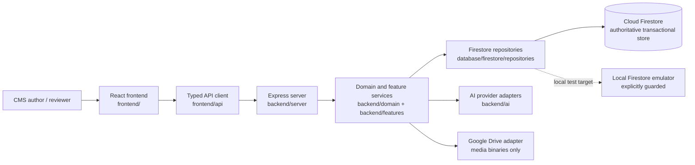
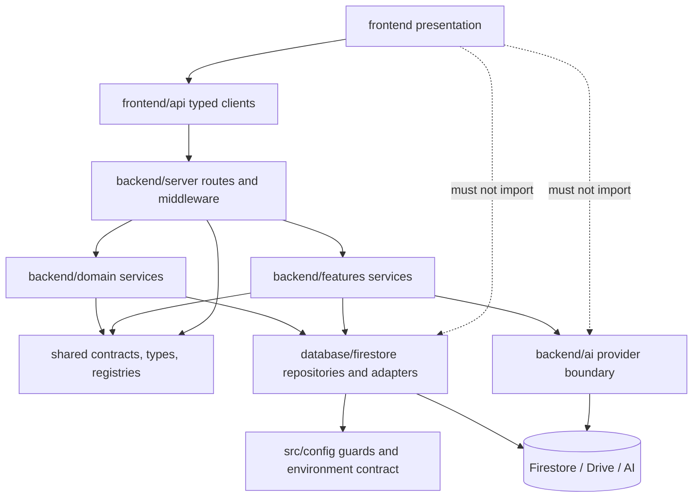
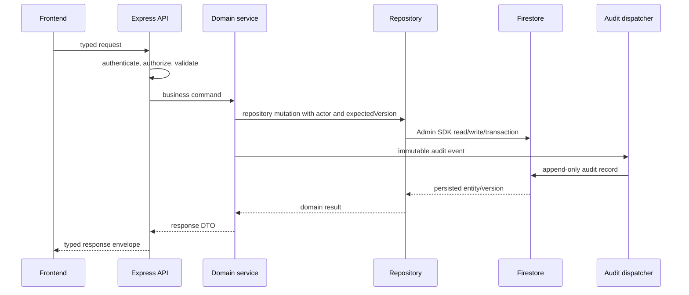
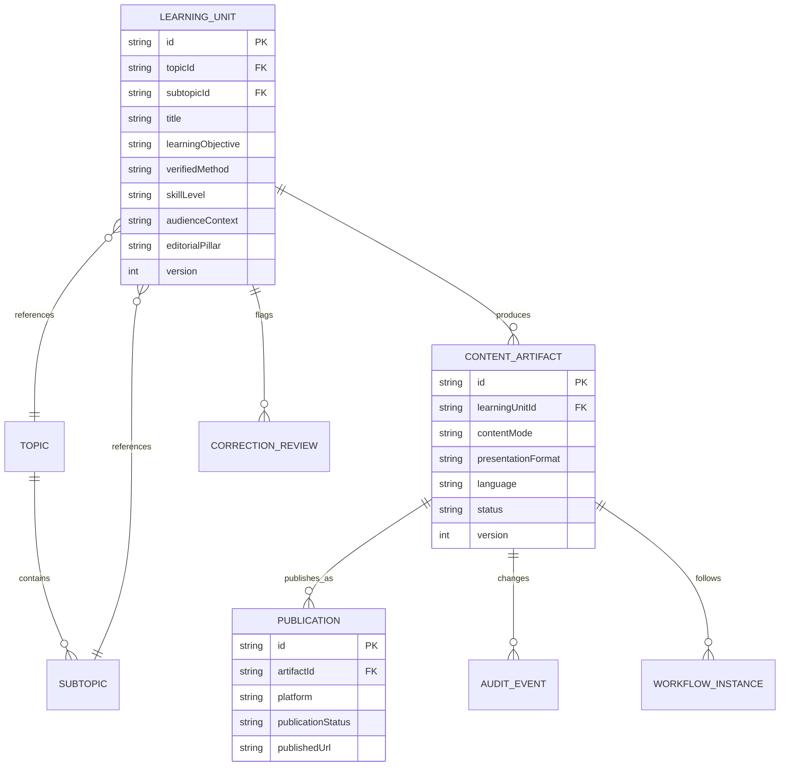
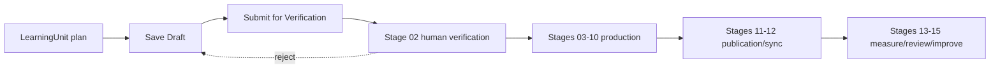

# BP-CMS Core Architecture Reconciliation

**Date:** 2026-10-24
**Status:** Authoritative brownfield audit and target architecture
**Scope:** Core requirements, architecture boundaries, remaining delivery plan
**Primary baseline:** [`docs/BP_CMS_CORE_REQUIREMENTS/bp_cms_core_requirements1.md`](../BP_CMS_CORE_REQUIREMENTS/bp_cms_core_requirements1.md)
**Supersedes as current planning authority:** [`CORE-ARCHITECTURE-PROPOSAL.md`](CORE-ARCHITECTURE-PROPOSAL.md)
**Related decisions:** [`DECISION-LOG.md`](DECISION-LOG.md), especially ADR-001 through ADR-015

This document records what the repository supports today, what remains partial or
missing, and the target architecture and dependency-ordered plan. It is based on
static repository inspection of the GitHub `main` baseline at `116476b` plus the
working-tree state noted in the task record. No production service, production
Firestore project, external content, or live AI provider was accessed.

## 1. Evidence policy

| Rating | Meaning |
| --- | --- |
| `VERIFIED` | Directly supported by current source, contracts, rules, or a reviewed test file. |
| `PARTIAL` | A working slice exists, but the requirement is incomplete, inconsistently applied, or not end-to-end. |
| `MISSING` | No current runtime implementation was found. |
| `CONFLICTING` | Current code, current documents, or tracked status disagree. |
| `UNVERIFIED` | The repository suggests support, but the required safe execution or deployment evidence was not available. |

The words “reported complete” refer only to existing tracking entries. They do
not replace independent verification of a command or a production acceptance gate.

## 2. Existing-state audit

### 2.1 System context

**Verified evidence:** `backend/server/server.ts` starts Express and Vite;
`frontend/api/api-client.ts` sends browser requests to `/api`; Firestore Admin
access is under `database/firestore/adapter/`; AI providers are under
`backend/ai/`; media services use the Google Drive adapter.

### 2.2 Module and dependency audit

| Area | Current responsibility and evidence | Rating |
| --- | --- | --- |
| Frontend | React pages and workspaces; browser communication is centralized through `frontend/api/api-client.ts` and feature API wrappers. | `VERIFIED` |
| API boundary | Express routes in `backend/server/routers/routes.ts` plus `script.routes.ts`; request validation, auth middleware, response handling, and service calls are present. | `PARTIAL` |
| Domain services | Workflow, question generation, taxonomy, production, publishing, analytics, and recovery services exist under `backend/`. | `VERIFIED` |
| Service boundary discipline | The large route module imports many services and repositories directly, so the intended route -> service -> repository separation is not consistently enforced. | `PARTIAL` |
| Shared contracts | `shared/` contains workflow, question, production-context, RBAC, core-requirement, and LearningUnit contracts without React or secret dependencies. | `VERIFIED` |
| Persistence | `BaseRepository`, `FirestoreRepository`, collection repositories, Admin SDK adapter, and Firestore rules exist. `learning_units` is registered and has a repository. | `VERIFIED` |
| Taxonomy | Topic and Subtopic are represented by dedicated repositories and selectors. No new runtime Category model is authorized. | `VERIFIED` |
| Workflow | `backend/domain/workflow/transition-matrix.ts`, `workflow.service.ts`, shared workflow constants, and `shared/lib/workflow-resolver.ts` implement the 15-stage backbone. Multiple mapping/resolution surfaces remain. | `PARTIAL` |
| Authorization | Auth middleware, role/capability checks, object authorization, GAR-02 checks, and Firestore backend-gateway rules exist. Route coverage still needs an endpoint-by-endpoint gate audit. | `PARTIAL` |
| Audit | Audit dispatchers, `audit_logs`/`audit_events` repositories, immutable Firestore rules, and audit routes exist. End-to-end immutability and override evidence is reported in historical tests, not re-run for this audit. | `PARTIAL` |
| Concurrency | Repository updates use expected versions and Firestore transactions; question draft and LearningUnit contracts expose OCC fields. | `VERIFIED` for implemented repositories; `PARTIAL` for system-wide coverage |
| AI | `backend/ai/orchestrator`, provider registry, adapters, validators, retries, health, and secret sanitization exist. AI remains advisory by policy. | `VERIFIED` |
| Environment | `src/config/env.contract.ts`, `src/config/datastore-guard.ts`, `scripts/start-local-dev.ts`, Dockerfile, and Vite/esbuild build scripts define local/deployed variants. | `VERIFIED` in code; deployment parity is `UNVERIFIED` |
| Testing | Unit, integration, architecture, regression, API, and E2E test trees plus datastore guards exist. No CI workflow was found. | `PARTIAL` |

### 2.3 Current data flow and persistence ownership

Cloud Firestore is the sole authoritative transactional datastore. Google Drive
is an external binary-media boundary and must not become a business-record source
of truth. The repository contract owns persistence mechanics; services own
business rules. Direct browser Firestore writes are denied by
`database/firestore/rules/firestore.rules`.

The current LearningUnit slice is real but incomplete: `shared/types/learning-unit.ts`
and `shared/contracts/learning-unit.contract.ts` define the contract, while
`database/firestore/repositories/learning-units.repository.ts` validates input,
creates `lnu_` IDs, checks ownership, performs OCC updates, and filters records.
It does not yet expose a planning API, a UI, or reverse queries for all linked
artifacts.

### 2.4 Security, workflow, and concurrency

- The canonical steps are Question Generation, Question Verification, Audience
  Script, Teleprompter & Filming, Raw Video, Editing Bay, Final QC, Thumbnail,
  Social Review, Publishing Setup, Published, Platform Sync, Analytics,
  Performance Review, and Intelligence Loop. Their constants are in
  `shared/constants/workflow.ts`.
- Save Draft and Submit for Verification are separate commands in
  `shared/contracts/question-generation/question-generation.contract.ts` and
  route handling in `backend/server/routers/routes.ts`. Saving must not advance
  the workflow.
- GAR-02 is enforced by request middleware and workflow resolution, with the
  documented System Administrator override requiring explicit confirmation and
  an audited justification. Employee self-approval remains prohibited.
- OCC is represented by `expectedVersion`, transaction-backed repository updates,
  and `ConcurrencyConflictError`. A complete endpoint matrix is still required
  for all workflow aggregates.
- The current source contains more than one workflow mapping/resolution surface.
  The target keeps one transition authority and treats compatibility mappers as
  adapters only; this is a consolidation task, not permission to weaken existing
  gates.

### 2.5 AI, configuration, and deployment

AI calls are server-side through `backend/ai/providers/` and the provider
orchestrator. `@google/genai` is not imported by the frontend. Provider adapters
track configuration, health, rate limits, retry behavior, and sanitized errors.
No AI result may approve content silently.

Local development is guarded by `src/config/datastore-guard.ts` and the launcher
in `scripts/start-local-dev.ts`, which require the loopback Firestore emulator and
synthetic project. `Dockerfile`, `vite.config.ts`, and `package.json` define a
single build that bundles the frontend and Express server. The actual Google AI
Studio publication, environment injection, and deployed smoke path were not
executed in this audit, so deployment parity remains `UNVERIFIED`.

## 3. Requirements traceability

The following stable references map sections 1-13 of the immediate core
requirements baseline. A requirement is not complete because a type, mock, or
unit test exists; completion requires the acceptance evidence in the matrix.

| Ref | Requirement and current evidence | Gap / impact | Target component | Plan task | Verification and acceptance | Status / dependency |
| --- | --- | --- | --- | --- | --- | --- |
| `REQ-01` | Telugu generation and exam taxonomy exist in `backend/ai/` and shared taxonomy. | Practical math, everyday decisions, and broader editorial prompts are not a dedicated planning contract. | LearningUnit planning and prompt templates | `S12-T05`, `S13-T02` | Create a percentage/discount fixture and verify objective, scenario, method, and Telugu output remain consistent. | `PARTIAL`; depends on planning API |
| `REQ-02` | Canonical modes and alias are present in `shared/constants/core-requirements.ts`; registry resolves `WORKED_EXAMPLES` and `EXPLAINED_QUESTIONS_VIDEO`. | Existing pages and historical docs still use the legacy name and old mode numbering; preferred sequence is not a cross-artifact rule. | Shared mode registry and sequence service | `S11-T03`, `S13-T01` | Alias round-trip, legacy read compatibility, and Intro -> Worked Examples -> Challenge linking tests pass without data rewrite. | `PARTIAL` / `CONFLICTING` terminology; depends on link model |
| `REQ-03` | Five formats are typed in `shared/constants/core-requirements.ts`. | Only video production is operational; format-specific artifact schemas/templates are missing. | Artifact contract and format template services | `S12-T03`, `S12-T04` | Each format validates independently while retaining the same LearningUnit ID and mode. | `PARTIAL`; depends on artifact contract |
| `REQ-04` | Editorial pillar enum and LearningUnit fields exist. | Five usefulness questions and editorial review evidence are not a required planning/checklist gate. | Planning contract and verification gate | `S11-T03`, `S12-T02` | Draft cannot be submitted without objective, beneficiary, outcome, teaching method, and verification evidence. | `PARTIAL`; depends on API validation |
| `REQ-05` | Seven audience contexts and four skill levels exist in shared constants and LearningUnit schema. | Studio selectors and practical filtering are not wired through a planning workflow. | Planning API/UI and query contract | `S11-T03`, `S11-T04` | Create, reopen, filter, and render each dimension through typed API calls. | `PARTIAL`; depends on planning API |
| `REQ-06` | LearningUnit types, Zod schemas, `learning_units` collection, and repository exist. | No planning API/UI or reverse artifact linkage; integration persistence gate is not independently verified here. | LearningUnit service, API, and link index/query | `S11-T03`, `S11-T05`, `S11-T06` | Emulator-only create/read/update/OCC test plus linked-artifact query and correction-review flag test. | `PARTIAL`; emulator gate `UNVERIFIED` |
| `REQ-07` | Topic/Subtopic, drafts, questions, videos, and analytics structures cover parts of four layers. | Learning design and publication-effort records are fragmented; no authoritative cross-layer aggregate view. | Layered contracts and read models | `S11-T05`, `S14-T02`, `S15-T01` | One fixture traces knowledge reference -> design -> artifact -> publication/feedback without duplicating authority. | `PARTIAL` |
| `REQ-08` | Preservation rules, alias, Firestore guard, workflow, and backend gateway are present. | Full regression evidence and endpoint-by-endpoint gate coverage are not re-established in this audit. | Existing foundation plus regression suite | `S11-T07`, `S16-T01` | Existing Sprint 9/10 and architecture suites pass in isolated mode; no production target is used. | `PARTIAL`; historical status reported, current run omitted |
| `REQ-09` | Technical 15-stage workflow exists; draft and verification commands are distinct. | The product's Discover -> Improve pipeline is not explicitly bridged to the CMS entry point and non-video formats. | LearningUnit planning bridge and workflow resolver | `S13-T01`, `S13-T03` | State transition matrix maps product pipeline to 15 stages and rejects invalid skips for each mode. | `PARTIAL` |
| `REQ-10` | Prior S11-S15 proposal exists; S11-T01/T02 are tracked as completed. | Prior task meanings are stale and omit explicit exit gates and human acceptance. | Authoritative sprint roadmap | `S11`-`S16` roadmap | Every sprint has measurable exit criteria, a safe test strategy, and a separate human acceptance gate. | `PARTIAL`; roadmap reconciliation required |
| `REQ-11` | Trust controls include human gates, GAR-02, audit, and free-tier guardrails. | Monetization is intentionally not implemented; business outcome evidence is not a core runtime contract yet. | Measurement and editorial governance | `S15-T03`, `S16-T03` | Preserve accuracy/trust gates; explicitly defer payment systems until evidence justifies them. | `PARTIAL` by design |
| `REQ-12` | Platform analytics types and dashboard surfaces exist. | Learning engagement accuracy, production time/cost, revision rate, and reuse are not fully persisted per artifact/platform. | Artifact metrics and analytics repositories | `S15-T01`, `S15-T02`, `S15-T03` | Isolated fixture records platform metrics and production effort separately and reports the three categories. | `PARTIAL` |
| `REQ-13` | Architecture policy preserves Topic -> Subtopic, Firestore authority, human review, and a single codebase. | The construction sequence is not yet the explicit release gate for all new features. | Architecture governance and release checklist | `S16-T01`, `S16-T03` | Architecture test and human gate reject Category, direct Firestore UI access, silent AI approval, and production test targets. | `PARTIAL` |

## 4. Target architecture

### 4.1 Principles and boundaries

1. Firestore is the only authoritative transactional datastore. Repositories own
   reads, writes, transactions, serialization, and collection names; services own
   policy and business rules.
2. The frontend uses typed API clients only. It does not import Firestore Admin,
   backend implementations, server secrets, or AI providers. Backend code does
   not import React presentation code. Shared code remains framework- and
   secret-free.
3. Taxonomy is exactly `Topic -> Subtopic`. `Category` is obsolete and must not
   appear in new runtime contracts, schemas, UI, or documentation.
4. The three content modes are educational purpose; the five presentation
   formats are delivery form. They are independent dimensions.
5. The verified LearningUnit is the educational foundation. Each publication is
   a separate artifact linked to one LearningUnit; a correction can identify
   affected artifacts without rewriting historical publications.
6. The backend owns authentication, authorization, workflow transitions, GAR-02,
   optimistic concurrency, validation gates, and immutable audit events.
7. AI is advisory. Human approval is required at verification and other defined
   quality gates.
8. Local and deployed execution share the same application code and domain
   behavior. Only adapters and explicitly validated environment configuration vary.

### 4.2 Component ownership

| Component | Owns | Must not own |
| --- | --- | --- |
| `frontend/` | Presentation, editor state, user interaction, typed API calls, audience-safe projections. | Firestore, Admin SDK, business authorization, provider secrets. |
| `backend/server/` | HTTP transport, authentication middleware, request validation, response/error envelopes. | Persistence mechanics or duplicated business rules. |
| `backend/domain/` and `backend/features/` | Domain commands, workflow policy, content planning, verification, publishing, analytics orchestration. | Browser rendering or direct external persistence details. |
| `database/firestore/` | Collection repositories, transactions, serialization, indexes/contracts, Firestore adapter. | UI policy, AI decisions, workflow authorization. |
| `shared/` | Framework-free types, schemas, constants, mode and workflow contracts. | Secrets, React, Admin SDK, provider calls. |
| `backend/ai/` | Provider abstraction, prompts, validation, provenance, retry/error normalization. | Approval decisions or direct browser access. |
| `src/config/` | Environment contract and fail-closed datastore safety checks. | Feature-specific business policy. |

### 4.3 Domain entities and relationships

`question_drafts`, `questions`, and `videos` remain compatible legacy artifact
collections. New artifact contracts should carry optional `learningUnitId` until
all creation paths use the planning flow. No migration or rewrite of existing
documents is authorized.

### 4.4 Canonical educational dimensions

| Dimension | Canonical values | Rule |
| --- | --- | --- |
| Content mode | `TOPIC_INTRODUCTION`, `WORKED_EXAMPLES`, `QUESTION_CHALLENGE_SHORT` | Preferred sequence is Intro -> Worked Examples -> Challenge, but each mode is optional when it adds no value. |
| Legacy alias | `EXPLAINED_QUESTIONS_VIDEO` | Read/write compatibility adapter for `WORKED_EXAMPLES`; never rewrite stored identifiers as part of normal development. |
| Presentation format | `TEXT`, `VIDEO`, `AUDIO`, `IMAGE`, `ANIMATION` | Independent of mode; do not auto-generate all formats. |
| Audience context | `CHILDREN`, `STUDENTS`, `COMPETITIVE_EXAM`, `WORKING_ADULTS`, `HOUSEHOLDS`, `BUSINESS_OPERATORS`, `OLDER_LEARNERS` | Selects context, examples, language, and pacing. |
| Skill level | `FOUNDATION`, `BEGINNER`, `INTERMEDIATE`, `ADVANCED` | Controls conceptual complexity; does not derive from age. |
| Editorial pillar | Pillars A-F in `shared/constants/core-requirements.ts` | Editorial classification, not an additional taxonomy tier. |

### 4.5 Workflow and mode applicability

| Stage group | `TOPIC_INTRODUCTION` | `WORKED_EXAMPLES` | `QUESTION_CHALLENGE_SHORT` |
| --- | --- | --- | --- |
| 01-02 plan/generate and verify | Concept and syllabus verification; no MCQ requirement. | Worked method, calculations, and reasoning completeness. | Four-option challenge, answer, explanation, and ambiguity checks. |
| 03-07 script through final QC | Format-specific script/visual quality; video stages only when format is video. | Solution narration and visual method consistency. | Short-form hook, reveal, explanation, and video QC when applicable. |
| 08-12 package, publish, sync | Applicable to the selected presentation format and platform. | Applicable to the selected presentation format and platform. | Applicable to the selected presentation format and platform. |
| 13-15 analytics and improvement | Track artifact/platform outcome and corrections. | Track reuse, learning engagement, and production effort. | Track participation, answer accuracy where supported, and follow-up demand. |

The resolver must express applicability rather than silently skipping a stage.
Non-video formats may produce scripts, narration, image instructions, or
animation briefs before a later rendering capability is justified.

### 4.6 API, validation, and error contract

The target request path is:

`frontend typed client -> Express route -> auth/capability -> Zod/request schema -> domain service -> repository transaction -> audit event -> typed response`.

LearningUnit planning commands must include actor identity, expected version for
updates, and an explicit operation (`SAVE_DRAFT` or `SUBMIT_FOR_VERIFICATION`).
Validation errors are client-correctable (`400`/`422`), authentication and
authorization failures are `401`/`403`, stale versions are `409`, missing records
are `404`, and unexpected failures are sanitized `500` responses with request IDs.

Internal reviewer notes, audit metadata, provider provenance, and operational
diagnostics must not be included in audience-facing projections.

### 4.7 Observability, security, and testing boundaries

- Every state mutation records actor, resource, old/new state, request ID,
  timestamp, reason, and expected/current version where applicable.
- Audit records are append-only. Administrative overrides require explicit
  confirmation and a substantive reason; there is no silent bypass.
- Tests use in-memory repositories or a verified loopback Firestore emulator with
  the synthetic project. Tests fail closed when the target cannot be established.
- AI, Drive, publishing, synchronization, analytics, and email integrations are
  mocked or sandboxed in code-level checks. No live AI or production mutation is
  part of this plan.
- The repository currently has no `.github/workflows/` CI workflow. CI is a
  later governance task, not an assumed capability of this reconciliation.

## 5. Reconciled status summary

| Status | Items |
| --- | --- |
| Completed by current code, subject to historical test evidence | Core mode constants/alias, five format constants, audience/skill/pillar constants, LearningUnit schema, `lnu_` ID helper, Firestore collection registration, LearningUnit repository, existing 15-stage/workflow/RBAC/audit foundations. |
| In progress / partial | LearningUnit planning API/UI, artifact links and reverse queries, required usefulness checklist, mode-sequence linkage, complete endpoint authorization matrix, non-video templates, artifact effort metrics. |
| Blocked or unverified | Emulator round-trip for the current S11-T02 integration test was not run; Google AI Studio publication parity was not executed; live human acceptance remains owner-controlled. |
| Not started | Dedicated calculation/reasoning gate for LearningUnits, multi-format artifact templates, connected learning sequence views, production-cost and learning-engagement persistence, final end-to-end acceptance gate. |

The working tree at audit time contains pre-existing modifications to
`package.json` and an untracked `tests/integration/core-requirements/` test.
Those files are intentionally outside this documentation change and must remain
with their owner.

## 6. Delivery authority

The dependency-ordered task plan is maintained separately in
[`docs/sprints/CORE-REQUIREMENTS-ROADMAP.md`](../sprints/CORE-REQUIREMENTS-ROADMAP.md).
Architecture records decisions and boundaries; the sprint roadmap records planned
work and acceptance criteria; project tracking records only what actually ran.

The single recommended next implementation task is `S11-T03`, Learning Unit
Planning API and service integration. It is next because the repository and
contracts exist, but no safe product entry point can create a LearningUnit or
connect it to the existing workflow without this service boundary.
