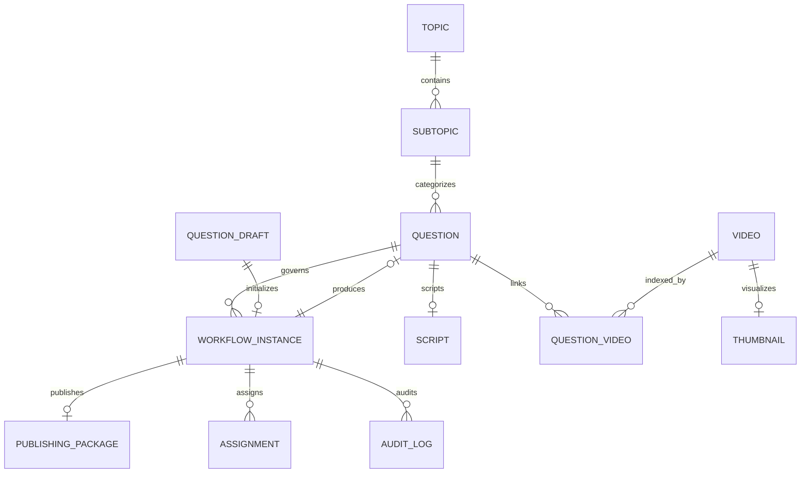

# Firestore Collection Contract & Entity Architecture

## 1. Executive Summary & Datastore Authority

The Burra Pariksha Content Management System (BP-CMS) enforces **Cloud Firestore** as its sole, authoritative, transactional datastore. All business domain entities, 15-stage Question Challenge Short lifecycle workflows, media metadata, publication packages, role assignments, and immutable audit logs reside natively within Firestore.

In accordance with architectural invariants defined in [AGENTS.md](../../AGENTS.md):
1. **Frontend-Backend Boundary**: Presentation components interact strictly with backend endpoints via typed API clients (`frontend/features/*`). No frontend component directly imports the Firebase Admin SDK, server secrets, or Firestore client adapters.
2. **Persistence Mechanics**: All transactional reads and writes are managed through repository classes inheriting from `BaseRepository<T>` (`database/firestore/repositories/base.repository.ts`), which wraps the singleton Google Cloud Firestore Admin SDK (`database/firestore/adapter/admin.ts`).
3. **Taxonomy Invariant**: The content hierarchy is strictly `Topic -> Subtopic`. Legacy `Category` constructs are completely removed from schemas, runtime code, and database collections.
4. **ID Standard**: All entity IDs are generated using collision-resistant UUIDv4 algorithms with standardized semantic prefixes (`shared/lib/id.service.ts`). Sequential sheet counters, spreadsheet-row IDs, and insecure `Math.random()` fallbacks are prohibited.
5. **Clean Database Baseline**: The owner's deliberate empty database state is preserved. Read and diagnostic operations treat empty collections as valid baseline states (`EMPTY`) rather than fatal system failures.

---

## 2. Authoritative 23-Collection Canonical Inventory

The system integrity audit and diagnostic service (`backend/features/recovery/services/data-integrity.service.ts`) formally monitors and validates **23 canonical Firestore collections**. Every collection maps directly to a typed repository, concrete domain model, and diagnostic verification rule.

### 2.1 Collection-Contract Matrix

| Logical Entity | Canonical Collection | Actual Runtime Collection | Primary Repository | Runtime Read Paths | Runtime Write Paths | Diagnostic Coverage | Status | Notes / Remediation |
| :--- | :--- | :--- | :--- | :--- | :--- | :--- | :--- | :--- |
| **User Account & Identity** | `users` | `users` | `usersRepository` (`users.repository.ts`) | Auth middleware, RBAC checks, assignment lookups, user directory | User onboarding, profile updates, status toggling | `checkUsersCollection()` | **PASS** | Authoritative user identity store. Stores `USR-<uuid>` or Firebase Auth UID. |
| **Curricular Topic** | `topics` | `topics` | `topicsRepository` (`topics.repository.ts`) | Studio topic selectors, taxonomy validation, dashboard filters | Admin taxonomy management, seed utilities | `checkTopicsCollection()` | **PASS** | Top-level taxonomy entity (`top_<uuid>`). |
| **Curricular Subtopic** | `subtopics` | `subtopics` | `subtopicsRepository` (`subtopics.repository.ts`) | Studio dependent dropdowns, question generation prompts | Admin taxonomy management, seed utilities | `checkSubtopicsCollection()` | **PASS** | Second-level taxonomy entity (`sub_<uuid>`) linking to `topic_id`. |
| **Verified Question** | `questions` | `questions` | `questionsRepository` (`questions.repository.ts`) | Studio verification stage, workbench queues, editorial reviews | Stage 02 reviewer approval, bulk import | `checkQuestionsCollection()` | **PASS** | Authoritative post-verification question entity (`qst_<uuid>`). |
| **Question-Video Association** | `question_videos` | `question_videos` | `questionVideosRepository` (`question-videos.repository.ts`) | Production workbench joins, video lineage tracking | Stage 05-07 video-question binding operations | `checkQuestionVideosCollection()` | **PASS** | Relational junction linking `question_id` to `video_id`. |
| **Video Production Asset** | `videos` | `videos` | `videosRepository` (`videos.repository.ts`) | Stage 05 raw video preview, Stage 06 editing bay, Stage 07 QC | Stage 05 take registration, Stage 06 cut finalization | `checkVideosCollection()` | **PASS** | Core video entity (`vid_<uuid>`) tracking raw and edited assets. |
| **Production Script** | `scripts` | `scripts` | `scriptsRepository` (`scripts.repository.ts`) | Stage 03 audience script review, Stage 04 teleprompter feed | Stage 03 script generation and editorial finalization | `checkScriptsCollection()` | **PASS** | Canonical script entity (`scr_<uuid>`) holding Telugu prompt script. |
| **Script Version Trail** | `script_versions` | `script_versions` | `scriptVersionsRepository` (`script-versions.repository.ts`) | Script editor version history drawer, diff comparison | Stage 03 auto-save, manual revisions | `checkScriptVersionsCollection()` | **PASS** | Immutable historical snapshots (`scv_<uuid>`) of script iterations. |
| **Video Thumbnail** | `thumbnails` | `thumbnails` | `thumbnailsRepository` (`thumbnails.repository.ts`) | Stage 08 thumbnail preview, publishing review | Stage 08 thumbnail creation, crop adjustments | `checkThumbnailsCollection()` | **PASS** | Canonical thumbnail record (`thb_<uuid>`) linking to image binaries. |
| **Thumbnail Version Trail** | `thumbnail_versions` | `thumbnail_versions` | `thumbnailVersionsRepository` (`thumbnail-versions.repository.ts`) | Thumbnail history, A/B candidate review | Stage 08 variant uploads and revisions | `checkThumbnailVersionsCollection()` | **PASS** | Immutable historical versions (`thv_<uuid>`) of thumbnail graphics. |
| **Pinned Community Comment** | `pinned_comments` | `pinned_comments` | `pinnedCommentsRepository` (`pinned-comments.repository.ts`) | Stage 09 social review, publishing packager | Stage 09 comment drafting and localization | `checkPinnedCommentsCollection()` | **PASS** | Contextual audience engagement comment (`pnc_<uuid>`). |
| **Comment Version Trail** | `pinned_comment_versions` | `pinned_comment_versions` | `pinnedCommentVersionsRepository` (`pinned-comment-versions.repository.ts`) | Comment revision history drawer | Stage 09 copy edits and approval revisions | `checkPinnedCommentVersionsCollection()` | **PASS** | Immutable historical versions (`pcv_<uuid>`) of pinned comments. |
| **15-Stage Workflow Instance** | `workflow_instances` | `workflow_instances` | `workflowInstancesRepository` (`workflow.repository.ts`) | Dashboard KPI pipeline, Studio stage coordinator, state gates | Stage 01-15 state transitions, handoffs, resets | `checkWorkflowInstancesCollection()` | **PASS** | State machine coordinator (`wfl_<uuid>`) tracking canonical 15 stages. |
| **Task / Role Assignment** | `assignments` | `assignments` | `assignmentsRepository` (`assignments.repository.ts`) | User task queue, reviewer dashboard, action-required queue | Stage handoff assignments, admin delegations | `checkAssignmentsCollection()` | **PASS** | Workflow role assignments (`asg_<uuid>`) enforcing GAR-02 boundaries. |
| **Publishing Package** | `publishing_packages` | `publishing_packages` | `publishingRepository` (`publishing.repository.ts`) | Stage 10 setup, Stage 11 publishing, Stage 12 sync | Stage 10 bundle assembly, dispatch updates | `checkPublishingPackagesCollection()` | **PASS** | Publication metadata, tags, and multi-channel payloads (`pub_<uuid>`). |
| **Immutable Audit Log** | `audit_logs` | `audit_logs` | `auditLogRepository` (`audit-log.repository.ts`) | Audit trail viewers, compliance inspection, security logs | Immutable domain event logging across all 15 stages | `checkAuditLogsCollection()` | **PASS** | Immutable ledger (`aud_<uuid>`) capturing actor, action, diffs, and timestamp. |
| **Content Master Record** | `content_masters` | `content_masters` | `contentMasterRepository` (`content-master.repository.ts`) | Stage 07 Final QC approval, master registry view | Stage 07 QC signoff, master cut consolidation | `checkContentMastersCollection()` | **PASS** | Authoritative consolidated content package (`mas_<uuid>`). |
| **Social Review & Feedback** | `social_reviews` | `social_reviews` | `socialReviewsRepository` (`social-reviews.repository.ts`) | Stage 09 social review gate, compliance review | Stage 09 approval / rejection notes | `checkSocialReviewsCollection()` | **PASS** | Social readiness evaluations (`srv_<uuid>`) verifying tone and policy. |
| **Automated Validation Gate** | `validations` | `validations` | `validationsRepository` (`validations.repository.ts`) | Quality gate engine, AI validation checker | Stage 01 AI sanity check, Stage 02 quality gates | `checkValidationsCollection()` | **PASS** | Automated validation outcomes (`val_<uuid>`) verifying pedagogical safety. |
| **Question Engine Config** | `question_config` | `question_config` | `questionConfigRepository` (`question-config.repository.ts`) | AI generation prompts, system constraints, quality thresholds | Admin engine tuning, model parameters | `checkQuestionConfigCollection()` | **PASS** | Operational configuration parameters (`qcf_<uuid>`) for question generation. |
| **Media Binary Asset Metadata**| `media_assets` | `media_assets` | `mediaAssetsRepository` (`media-assets.repository.ts`) | Video player components, thumbnail preview components | Binary upload metadata registration (Google Drive/GCS)| `checkMediaAssetsCollection()` | **PASS** | Metadata records (`med_<uuid>`) pointing to Google Drive/GCS media URIs. |
| **Content Plan** | `content_plans` | `content_plans` | `contentPlansRepository` (`content-plans.repository.ts`) | Editorial calendar, release scheduling | Editorial planning, release managers | `checkContentPlansCollection()` | **PASS** | High-level editorial calendar plans (`pln_<uuid>`). |
| **Content Generation Batch** | `content_batches` | `content_batches` | `contentBatchesRepository` (`content-batches.repository.ts`) | Batch generation monitors, multi-item creation tracking | Batch creation operations, bulk generation dispatch | `checkContentBatchesCollection()` | **PASS** | Batch generation runs (`bat_<uuid>`) grouping multiple question drafts. |

---

## 3. Supporting & Auxiliary Datastore Collections

Beyond the 23 core collections verified by the diagnostics suite, several auxiliary Firestore collections fulfill specialized operational, staging, and sub-stage persistence roles:

1. **`question_drafts`**
   - **Repository**: `questionDraftsRepository` (`database/firestore/repositories/question-drafts.repository.ts`)
   - **Domain Role**: Staging store for preliminary AI-generated or user-edited drafts (`dft_<uuid>`) during **Stage 01 (Question Generation)** before formal reviewer submission.
   - **Persistence Invariant**: Saving a draft persists strictly to `question_drafts` and updates the active `workflow_instances` record without advancing workflow state. When approved in Stage 02, the content is promoted to `questions` and the draft is marked finalized or archived.
2. **`question_history`**
   - **Repository**: `questionHistoryRepository` (`database/firestore/repositories/question-history.repository.ts`)
   - **Domain Role**: Append-only audit collection tracking editorial revisions, field diffs, and refinement steps applied to questions over time.
3. **`platform_adaptations` & `platform_adaptation_versions`**
   - **Repository**: `platformAdaptationsRepository` (`database/firestore/repositories/platform-adaptations.repository.ts`)
   - **Domain Role**: Stores platform-specific distribution variations (YouTube Shorts, Instagram Reels, Facebook Watch) including tailored aspect ratios, title character limits, and hashtags.
4. **`pinned_comment_packages`**
   - **Repository**: `pinnedCommentPackagesRepository` (`database/firestore/repositories/pinned-comment-packages.repository.ts`)
   - **Domain Role**: Bundles localized comments, engagement hooks, and promotional links for multi-platform distribution.
5. **`thumbnail_candidates` & `thumbnail_candidate_versions`**
   - **Repository**: `thumbnailCandidatesRepository` (`database/firestore/repositories/thumbnail-candidates.repository.ts`)
   - **Domain Role**: Staging store for AI-generated or designer-submitted thumbnail options evaluated during Stage 08 before selecting the canonical thumbnail.
6. **`refinement_candidates`**
   - **Repository**: `refinementCandidatesRepository` (`database/firestore/repositories/refinement-candidates.repository.ts`)
   - **Domain Role**: Stores alternative phrasing, distractor options, and explanations generated during Stage 01/02 for editorial consideration.
7. **`social_analytics`**
   - **Repository**: `socialAnalyticsRepository` (`database/firestore/repositories/social-analytics.repository.ts`)
   - **Domain Role**: Stores post-publishing metrics (views, retention, CTR, comments) consumed in Stage 13 (Analytics) and Stage 14 (Performance Review).
8. **`publishing_platforms`**
   - **Repository**: `publishingPlatformsRepository` (`database/firestore/repositories/publishing-platforms.repository.ts`)
   - **Domain Role**: Stores system configuration and credentials/endpoints for target distribution platforms.
9. **`workflow_history`**
   - **Repository**: Backed by `workflowInstancesRepository.addHistoryEntry()`
   - **Domain Role**: Fine-grained sub-collection tracking every individual state machine transition, timestamp, and executing actor.

---

## 4. Entity Identifier Standards & Cross-Collection Relationships

Every document in Firestore utilizes a collision-resistant UUIDv4 identifier generated via `shared/lib/id.service.ts`. Sequential IDs, spreadsheet row indices, and un-prefixed raw integers are forbidden.

### 4.1 Canonical Prefix Registry

| Entity | ID Pattern | Generating Function | Example |
| :--- | :--- | :--- | :--- |
| **Question** | `qst_[a-f0-9-]{36}` | `generateQuestionId()` | `qst_b798006c-859a-4fd8-b64d-dfb6b907fe23` |
| **Question Draft** | `dft_[a-f0-9-]{36}` | `generateQuestionDraftId()` | `dft_38cb091c-7cb0-466a-b28e-5b12da61bb08` |
| **Workflow Instance**| `wfl_[a-f0-9-]{36}` | `generateWorkflowId()` | `wfl_4f923c8e-32fa-4a25-9c94-55447101ad40` |
| **Topic** | `top_[a-f0-9-]{36}` | `generateTopicId()` | `top_d7a5b62b-684f-4d99-ba4f-8cfb1ca06f65` |
| **Subtopic** | `sub_[a-f0-9-]{36}` | `generateSubtopicId()` | `sub_47a4ba71-f925-4518-8f83-e18e815615d1` |
| **Script** | `scr_[a-f0-9-]{36}` | `generateScriptId()` | `scr_679da152-cbce-41ee-b883-fae4ef846386` |
| **Video Asset** | `vid_[a-f0-9-]{36}` | `generateVideoId()` | `vid_34efcb10-18f4-41d3-98b4-ef291122a014` |
| **Thumbnail** | `thb_[a-f0-9-]{36}` | `generateThumbnailId()` | `thb_532cf201-92b0-46ca-9081-346790a1bc23` |
| **Publishing Package**| `pub_[a-f0-9-]{36}` | `generatePublishingPackageId()` | `pub_11ad238b-90ac-4bdf-8701-deac9054ab12` |
| **Audit Log Entry** | `aud_[a-f0-9-]{36}` | `generateAuditLogId()` | `aud_893ef001-38ca-4dbb-a912-ef340911ca78` |
| **Task Assignment** | `asg_[a-f0-9-]{36}` | `generateAssignmentId()` | `asg_72cb098f-44aa-43d9-95cb-01993427ab33` |
| **Validation Gate** | `val_[a-f0-9-]{36}` | `generateValidationId()` | `val_098ab341-21cb-4eaf-8809-5432ef10928a` |

### 4.2 Entity Relational Integrity

Foreign-key references are strongly typed and validated before storage operations:

---

## 5. Legacy Alias Reconciliation & Discrepancy Resolution

Earlier sprint documentation, diagnostic spikes, and exploratory notes referenced alternative or legacy names. This audit definitively resolves the naming discrepancies:

1. **`audit_log` vs `audit_logs`**:
   - **Resolution**: `audit_logs` is the authoritative Firestore collection name. The TypeScript file is named `audit-log.repository.ts`, but its constructor passes `super('audit_logs')`. All queries and diagnostic sweeps target `audit_logs`.
2. **`content_master` vs `content_masters`**:
   - **Resolution**: `content_masters` is the authoritative Firestore collection name. The TypeScript entity model is `ContentMaster`, but the repository and Firestore collection use the plural `content_masters`.
3. **`publishing` vs `publishing_packages`**:
   - **Resolution**: `publishing_packages` is the authoritative Firestore collection name. The repository file is `publishing.repository.ts`, but its constructor binds to `publishing_packages`.
4. **`workflow_assignments` vs `assignments`**:
   - **Resolution**: `assignments` is the authoritative Firestore collection name.
5. **`analytics` vs `social_analytics`**:
   - **Resolution**: `social_analytics` is the authoritative collection for post-publishing social metrics.
6. **`video_production`, `teleprompter_scripts`, `video_takes`, `master_cuts`, `qc_reviews`**:
   - **Resolution**: These were exploratory spike names proposed during early planning. In the canonical architecture:
     - Teleprompter scripts are consolidated into `scripts` and `script_versions`.
     - Video takes and master cuts are consolidated into `videos` with `type: 'RAW_TAKE'` or `type: 'MASTER_CUT'`.
     - QC reviews are consolidated into `social_reviews` and `validations`.
     - There are zero active runtime operations or Firestore collections named `video_production` or `teleprompter_scripts`.

---

## 6. Diagnostic Discovery & Empty Collection Verification

The system diagnostics service (`backend/features/recovery/services/data-integrity.service.ts`) scans the 23 canonical collections using bounded queries (`limit(1)`) to verify collection availability, schema conformance, and referential integrity.

### 6.1 Clean Database Baseline Behavior
When a collection contains zero documents:
- The diagnostic engine flags the status as `'EMPTY'` rather than `'DEFECT'` or `'ERROR'`.
- The summary report classifies the collection under `unpopulated_collections` (e.g. `[EMPTY] questions: 0 documents (unpopulated baseline)`).
- Zero artificial documents are injected into the database.
- Zero cascading foreign-key violations are raised against legitimately empty collections.
- Diagnostics execute purely as read operations; no health check telemetry or diagnostic scan records are written back to Firestore.
