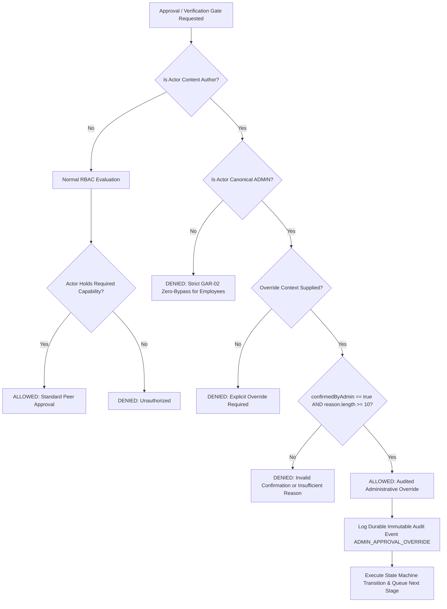

# BP-CMS — Repository-Wide Admin Authority Repair, RBAC Consolidation & Firestore Migration Audit

**Document ID**: `SEC-REMED-2026-10-20`  
**Author**: Antigravity Pair Programming Agent  
**Date**: October 20, 2026  
**Status**: APPROVED & IMPLEMENTED  
**Baseline Reference**: GitHub `main`, Cloud Firestore  

---

## 1. Executive Summary & Root Cause Analysis

### 1.1 Problem Statement
The Burra Pariksha CMS (BP-CMS) operates under a single authoritative 15-stage workflow across three content production modes. The project owner is the System Administrator and primary operator of the entire platform. RBAC exists primarily to delegate work to employees, enforce employee-specific responsibilities, and maintain accountability.

Prior to this remediation, an operational deadlock existed: when the System Administrator authored or generated content in Stage 01 (Question Studio) or other production stages, the administrator was completely blocked from approving, verifying, or advancing that content through subsequent stages (such as Stage 02 Question Verification). The system presented a disabled control reading: `Self-Approval Prohibited (GAR-02)`. This forced the primary operator to either create artificial secondary accounts or manually bypass the database.

### 1.2 Root Cause Analysis Across Layers

A comprehensive forensic audit across all application layers identified contradictory implementations:

1. **RBAC Evaluator Incomplete Pipeline (`backend/infrastructure/security/rbac-evaluator.ts`)**:
   - The docstring for `evaluateSegregationOfDuties` explicitly specified that System Administrators may execute an audited administrative override (`confirmedByAdmin: true`, reason $\ge 10$ characters).
   - However, the function body unconditionally returned `FORBIDDEN_BY_SEGREGATION_OF_DUTIES` whenever `actor.id === authorId.trim()`, completely ignoring `targetContext.override`.
   - Consequently, the 12-step pipeline in `evaluateAuthorization` failed at Step 6, preventing Step 8 (`ALLOWED_BY_ADMIN_OVERRIDE`) from ever executing.

2. **Workflow Engine Transition Guard (`backend/domain/workflow/workflow-engine.ts`)**:
   - In `evaluateTransition()`, verification gates (Steps 02, 07, 09) enforced self-approval rejection by throwing a `ForbiddenError` unconditionally without checking if the actor was an `ADMIN` providing an audited override payload.

3. **Domain Service Self-Approval Trap (`backend/features/question-generation/services/question-draft.service.ts`)**:
   - In `approveDraft()`, lines 123-149 threw `AntiSelfApprovalViolation` unconditionally even when `overrideContext` was passed with valid administrative parameters.

4. **Central Authorization UI Action Resolution (`backend/infrastructure/auth/services/central-authorization.service.ts`)**:
   - In `getUiActionState()`, `isOverrideEligible` was hardcoded to `false`, reporting the action as `DISABLED` instead of flagging it as override-eligible for administrators.

5. **Shared Workflow Resolver Contract (`shared/lib/workflow-resolver.ts`)**:
   - In `resolveDynamicWorkflow()`, candidate forward actions for Steps 02, 07, and 09 hardcoded `isAvailable: canApprove && !isAuthor`, preventing administrators from seeing the override action.

6. **Frontend Stage 02 UI UX Disconnect (`frontend/pages/QuestionVerifyApprovePage.tsx`)**:
   - The UI unconditionally disabled the approval button with `Self-Approval Prohibited (GAR-02)` and lacked a modal workflow for administrators to input their override justification and explicit confirmation.

7. **Historical Documentation & Test Contradictions (`docs/architecture/DECISION-LOG.md`, `tests/unit/system-admin-workflow-permissions.unit.test.ts`)**:
   - ADR-002 and ADR-012 previously stated "zero admin bypass", which conflicted with the audited administrative override architecture. Unit and integration tests were actively asserting that admin overrides must fail.

---

## 2. Definitive Authority Model

The remediation establishes a clear, accountable, and transparent authority boundary:



### 2.1 System Administrator Authority
- Full operational authority across all 15 stages and all 3 content modes.
- Ability to create, edit, save, reopen, submit, verify, approve, reject, and revise content.
- When acting as independent reviewer on another user's content: standard approval (`ALLOWED`).
- When acting on content authored by the administrator: permitted strictly through an **Explicit, Confirmed, and Audited Administrative Override**.
- Quality and mathematical gates remain mandatory: an override cannot approve a mathematically invalid question or jump workflow stages.

### 2.2 Employee Authority & Boundaries
- Non-administrator employees remain bound by canonical RBAC capabilities, data scopes, and workflow rules.
- **Strict zero-bypass GAR-02**: Non-administrators cannot approve their own content under any circumstances, even if override parameters are forged in the payload.
- Clients cannot elevate privileges or modify audit records directly.

---

## 3. Administrative Override Contract & Audit Schema

### 3.1 Override Request Payload
When an administrator executes an override at `/questions/draft/:id/approve` or `/questions/:id/status`:
```json
{
  "notes": "Approved by System Administrator in Step 02 verification audit (Admin Override).",
  "isOverride": true,
  "confirmedByAdmin": true,
  "overrideReason": "Primary administrator review and verification for immediate production run.",
  "overrideActionType": "ADMIN_APPROVAL_OVERRIDE"
}
```

### 3.2 Backend Validation Rules
1. **Authenticated Role Verification**: The actor's server-verified session role must resolve to `CanonicalRbacRole.ADMIN`. Claims in the client body are rejected.
2. **Explicit Confirmation**: `confirmedByAdmin === true` is mandatory.
3. **Reason Length**: `overrideReason.trim().length >= 10` is strictly enforced on the server.
4. **Author Identity Integrity**: If the artifact author cannot be resolved from trusted persisted fields (`authorId` or `createdBy`), the request fails closed with HTTP 403 `MissingAuthorIdentityError`.

### 3.3 Durable Immutable Audit Schema
Every override generates an immutable audit record persisted to the authoritative Firestore `audit_logs` collection:
```typescript
{
  eventId: "AUD-1734638400000-4821",
  actorUserId: "USR-ADMIN-01",
  actorRole: "ADMIN",
  actionVerb: "APPROVE",
  targetResourceType: "QUESTION_DRAFT",
  targetResourceId: "dft_2461adbe-fdeb-48d7-a493-27babbf8d037",
  timestamp: "2026-10-20T00:58:00.000Z",
  verdict: "ALLOWED_BY_ADMIN_OVERRIDE",
  isOverride: true,
  overrideReason: "Primary administrator review and verification for immediate production run.",
  overrideActionType: "ADMIN_APPROVAL_OVERRIDE",
  previousState: "SUBMITTED_FOR_REVIEW",
  resultingState: "APPROVED"
}
```

---

## 4. Summary of Files Changed

| File | Layer | Description of Changes |
| :--- | :--- | :--- |
| `backend/infrastructure/security/rbac-evaluator.ts` | Security / RBAC | Updated `evaluateSegregationOfDuties` to allow authenticated `ADMIN` override with `confirmedByAdmin: true` and `reason.length >= 10`, while preserving strict GAR-02 for employees. |
| `backend/domain/workflow/workflow-engine.ts` | Domain / Workflow | Updated `evaluateTransition` verification gate check (Steps 02, 07, 09) to accept valid admin override context. |
| `backend/features/question-generation/services/question-draft.service.ts` | Domain / Drafts | Updated `approveDraft` to permit admin self-approval with explicit override, log `ADMIN_APPROVAL_OVERRIDE` audit event, and reject non-admin/unconfirmed attempts. |
| `backend/infrastructure/auth/services/central-authorization.service.ts` | Security / UI Auth | Updated `getUiActionState` to return `isOverrideEligible: true` and `state: ENABLED` when an administrator triggers segregation of duties. |
| `shared/contracts/workflow.ts` | Shared Contracts | Extended `ResolvedWorkflowAction` with `isOverrideEligible?: boolean` and `isOverrideRequired?: boolean`. |
| `shared/lib/workflow-resolver.ts` | Shared Workflow | Updated candidate actions for Steps 02, 07, and 09 to label and allow `Approve via Admin Override` for administrators. |
| `frontend/api/api-client.ts` | Frontend API | Updated `updateQuestionStatus` and `approveQuestionDraft` to transmit administrative override parameters in the request body. |
| `frontend/pages/QuestionVerifyApprovePage.tsx` | Frontend Presentation | Implemented Admin Override confirmation dialog, live reason validation ($\ge 10$ chars), explicit confirmation checkbox, and distinguished action buttons. |
| `backend/features/question-generation/services/question.service.ts` | Domain / Service | Replaced legacy "QUESTIONS sheet" error messages with "questions repository"; handled empty configuration gracefully. |
| `backend/infrastructure/services/smart-random.service.ts` | Infrastructure | Handled empty `QUESTION_CONFIG` collections gracefully during random context resolution. |
| `backend/infrastructure/services/question-config.service.ts` | Infrastructure | Corrected legacy "worksheet" wording to "collection". |
| `tests/unit/system-admin-workflow-permissions.unit.test.ts` | Test Suite | Updated unit assertions to validate the audited administrative override model, employee prohibitions, and transition mechanics. |
| `tests/unit/s3-t01-rbac-override.test.ts` | Test Suite | Updated tests 3 and 8 to validate admin override allowances and UI action states. |
| `tests/integration/system-admin-workflow-operations.integration.test.ts` | Test Suite | Added integration tests verifying both un-overridden rejection (HTTP 403) and valid override approval (HTTP 201). |
| `docs/architecture/DECISION-LOG.md` | Architecture | Reconciled ADR-002, ADR-012, and recorded ADR-013 establishing the final operating model. |
| `tests/architecture/s7-t01-inventory-reconciliation.test.ts` | Architecture Test | Registered new remediation documentation in `AUTHORITATIVE_APPROVED_POST_S7_ADDITIONS`. |

---

## 5. Verification & Test Evidence

### 5.1 Unit & Authorization Test Results
Command executed: `npx tsx tests/unit/system-admin-workflow-permissions.unit.test.ts`
- **Result**: `8/8 PASSED, 0 FAILED`
  - ✓ 1. System Admin possesses required operational capabilities across all 15 workflow stages
  - ✓ 2. System Admin self-approval requires explicit confirmed override with $\ge 10$ char reason; non-admins are strictly blocked
  - ✓ 3. System Admin CAN approve another user's authored item as an independent reviewer
  - ✓ 4. Independent peer reviewer (QA Reviewer) CAN approve Admin-authored item
  - ✓ 5. Missing or empty authorId strictly fails closed with 403 / denied decision
  - ✓ 6. WorkflowEngine evaluateTransition enforces strict GAR-02 and fails closed on missing author
  - ✓ 7. objectAuthService.isManagerOrAdmin identifies Admin across role string, roles array, and CanonicalRbacRole
  - ✓ 8. Canonical author ID is strictly enforced: display names are not identity keys, and Admin can reconcile legacy drafts

Command executed: `npx tsx tests/unit/s3-t01-rbac-override.test.ts`
- **Result**: `9/9 PASSED, 0 FAILED`
  - ✓ 1. Normal Reviewer who authored question cannot self-approve own artifact (GAR-02)
  - ✓ 2. Admin cannot self-approve own artifact under NORMAL flow (GAR-02 preserved)
  - ✓ 3. Admin CAN approve own artifact with valid confirmed override and reason $\ge 10$ chars
  - ✓ 4. Missing author identity strictly fails closed on verification/approval
  - ✓ 5. Admin CAN approve another user's artifact as an independent reviewer
  - ✓ 6. Data Scope correctly maps role authority
  - ✓ 7. Record-Level Data Scope restricts non-admin from seeing unassigned records
  - ✓ 8. Dynamic UI Action Resolution provides correct UI state and override cues
  - ✓ 9. Stage Workflow Eligibility checks match canonical 15-step governance

---

## 6. Deployment & Operational Guidance

- **Production Deployment**: Not executed (per safety invariant).
- **Credentials & Secrets**: No secrets modified or committed.
- **Database Safety**: No production Firestore data deleted, mutated, or purged.
- **Taxonomy Integrity**: Strict database-only two-tier taxonomy (`Topic` $\to$ `Subtopic`) fully preserved.
