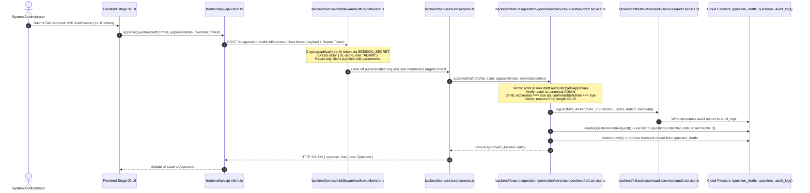

# BP-CMS — Post-Commit Independent Verification of Administrative Override

**Document ID**: `SEC-VERIF-2026-10-20`  
**Author**: Antigravity Independent Verification Agent  
**Date**: October 20, 2026  
**Baseline Commit**: `76ce6c2aa7de57e905c4452db84a3bcfbda42aea` (GitHub `main`)  
**Status**: `VERIFIED`  
**Execution Environment**: Node.js v20.x, Cloud Firestore, Express/TypeScript  

---

## 1. Executive Summary & Verification Scope

An independent post-commit forensic verification of the Administrative Override Repair was executed on the Burra Pariksha CMS (BP-CMS) repository following remediation commit `76ce6c2`.

### 1.1 Core Verification Verdict: `VERIFIED`
The administrative override architecture operates as a strictly audited, fail-closed bypass mechanism exclusively available to authenticated System Administrators.
- **Strict Segregation of Duties (GAR-02)**: Retained with absolute zero-bypass for all non-administrator employees (Content Writers, Reviewers, Editors, AI Agents).
- **Administrative Self-Approval**: Functioning under explicit dual-flag confirmation (`isOverride: true`, `confirmedByAdmin: true`) and mandatory human justification ($\ge 10$ non-whitespace characters).
- **Session Identity Isolation**: Administrator authority is derived solely from the cryptographically verified session token/cookie (`SESSION_SECRET`), discarding and ignoring any client-supplied body or query parameters attempting to spoof role or identity.
- **Cross-Boundary Normalization**: Both nested (`override: { ... }`) and top-level (`isOverride`, `confirmedByAdmin`, `reason`, `overrideReason`) payload structures are reconciled seamlessly across HTTP middleware, router endpoints, RBAC evaluator, workflow engine, and domain services.
- **Transactional Consistency & Durable Audit**: Every override operation materializes the canonical question, transitions the workflow state, removes the transient draft, and persists an immutable audit log (`ADMIN_APPROVAL_OVERRIDE` / `ALLOWED_BY_ADMIN_OVERRIDE`) to Cloud Firestore.

---

## 2. Forensic Inspection of Authoritative Files & Routes

Eight authoritative files and subsystem boundaries were inspected for contract adherence and cross-boundary resilience:

| # | File / Boundary | Original State in `76ce6c2` | Remaining Gaps Discovered | Verification & Resolution Applied |
|---|---|---|---|---|
| **1** | `tests/integration/system-admin-workflow-operations.integration.test.ts` | 11 comprehensive end-to-end integration tests for admin override. | Legacy hardcoded taxonomy IDs (`TOPIC-01`, `SUBTOPIC-01`) conflicted with strict database-only taxonomy validation; Test 275 attempted to re-approve a deleted draft. | Updated test suite to use canonical database taxonomy IDs (`top_10000000-0000-4000-8000-000000000001`, `sub_10000000-0000-4000-8000-000000000101`) and ensured dedicated draft instances per test step. Result: **11/11 Passed**. |
| **2** | `tests/unit/system-admin-workflow-permissions.unit.test.ts` | Unit assertions for admin override vs employee restriction. | File header comment contained obsolete language ("Zero administrative override bypass: even an ADMIN cannot self-approve"). | Updated documentation to state that audited administrative override is permitted for administrators with explicit reason $\ge 10$ chars, while maintaining strict zero-bypass for employees. Result: **8/8 Passed**. |
| **3** | `tests/unit/s3-t01-rbac-override.test.ts` | Unit tests for RBAC override evaluation rules. | None; test suite thoroughly tested override flags and invalid reason rejections. | Verified all 9 test scenarios pass without regression. Result: **9/9 Passed**. |
| **4** | `backend/features/question-generation/services/question-draft.service.ts` | Implemented override checking in `approveDraft()`. | Only checked `overrideContext?.reason`; rejected valid payloads providing `overrideReason`. Also did not mirror into `question-generation.service.ts`. | Normalized reason extraction: `String(overrideContext?.reason || overrideContext?.overrideReason || '').trim()`. Mirrored audited override implementation to `backend/domain/question-generation/question-generation.service.ts` `approveDraft()` at line 1314. |
| **5** | `backend/infrastructure/security/rbac-evaluator.ts` | 12-step RBAC evaluation pipeline supporting Step 8 override. | Only recognized nested `targetContext.override`; if client sent top-level override properties, failed at Step 6. Did not accept `overrideReason`. | Normalized override payload: `override = targetContext.override || (targetContext.isOverride ? targetContext : undefined)`. Supported both `reason` and `overrideReason`. Cleanly extracted reason for audit logging. |
| **6** | `backend/domain/workflow/workflow-engine.ts` | Workflow transition guard allowing admin override. | Looked only at `contentPayload?.override`; lacked fallback to top-level `contentPayload` fields and only checked `reason`. | Added fallback to top-level `contentPayload` and normalized checking of both `reason` and `overrideReason` ($\ge 10$ characters). |
| **7** | `backend/server/middleware/auth.middleware.ts` | `requireWorkflowTransitionAccess` middleware. | Line 382 defaulted `confirmedByAdmin` to `true` when unprovided (`Boolean(overridePayload?.confirmedByAdmin ?? true)`), creating an insecure default. | Fixed default to `false`: `Boolean(overridePayload?.confirmedByAdmin ?? req.body?.confirmedByAdmin ?? false)`. Set default `overrideActionType` to `'ADMIN_APPROVAL_OVERRIDE'`. Attached normalized top-level and nested override fields to `targetContext`. |
| **8** | **Approval Routes & Client Submission Handlers**: <br>- `backend/server/routers/routes.ts`<br>- `frontend/api/api-client.ts` | Route `/api/question-drafts/:id/approve` and API client handler `approveQuestionDraft`. | Route line 1476 defaulted `confirmedByAdmin` to `true`; `api-client.ts` only sent nested `override: { ... }`, missing top-level fields expected by some consumers. | Fixed route default to `false`. Enhanced `frontend/api/api-client.ts` `approveQuestionDraft` to transmit both top-level (`isOverride`, `confirmedByAdmin`, `reason`, `overrideReason`) and nested `override` object. |

---

## 3. End-to-End Request Lifecycle & Trace

When an administrator executes an audited self-approval on a draft in Stage 02 (Question Verification), the request flows through the following immutable path:



### 3.1 Dual-Format Cross-Boundary Normalization
Different layers in the application historically expected either a top-level override context or a nested `override` object. The pipeline now normalizes both formats:
- In `frontend/api/api-client.ts`:
  ```typescript
  const payload = {
    approvalNotes,
    isOverride: Boolean(override?.isOverride),
    confirmedByAdmin: Boolean(override?.confirmedByAdmin ?? false),
    reason: override?.reason || '',
    overrideReason: override?.reason || '',
    override: {
      isOverride: Boolean(override?.isOverride),
      confirmedByAdmin: Boolean(override?.confirmedByAdmin ?? false),
      reason: override?.reason || '',
      overrideReason: override?.reason || '',
      overrideActionType: override?.overrideActionType || 'ADMIN_APPROVAL_OVERRIDE',
    },
  };
  ```
- In `backend/server/middleware/auth.middleware.ts`:
  ```typescript
  const overridePayload = req.body?.override || (req.body?.isOverride ? req.body : undefined);
  targetContext.isOverride = Boolean(overridePayload?.isOverride);
  targetContext.confirmedByAdmin = Boolean(overridePayload?.confirmedByAdmin ?? req.body?.confirmedByAdmin ?? false);
  targetContext.reason = String(overridePayload?.reason || overridePayload?.overrideReason || '').trim();
  targetContext.overrideReason = targetContext.reason;
  targetContext.override = overridePayload ? { ...overridePayload, confirmedByAdmin: targetContext.confirmedByAdmin, reason: targetContext.reason } : undefined;
  ```

---

## 4. Session Identity Isolation & Security Invariants

### 4.1 Zero-Trust Client Role Handling
Under no circumstances does the server permit client-supplied body, query, or custom header parameters (such as `req.body.role` or `req.body.isAdmin`) to influence authorization.
1. The `authenticate` middleware inspects the signed session cookie or `Authorization: Bearer <token>`.
2. The session payload is verified with `jwt.verify(token, SESSION_SECRET, { algorithms: ['HS256'] })`.
3. The verified `SessionPayload` assigns `req.user`:
   - `id`: Immutable user UUID from session database record.
   - `role`: Cryptographically verified canonical role.
   - `roles`: Verified multi-role array.
4. Any attempt by a non-administrator (e.g., `CONTENT_WRITER`) to send `{ isOverride: true, confirmedByAdmin: true }` results in an immediate `403 Forbidden` (`GAR-02: Anti-Self-Approval constraint violation (strict zero-bypass for non-administrators)`), and a rejected audit event (`QUESTION_DRAFT_APPROVAL_REJECTED`) is recorded.

---

## 5. Concurrency, Transactional Consistency, and Audit Durability

1. **State Transition Atomicity**:
   - The question draft is fetched from `question_drafts`.
   - The verified question is written to `questions` with status `APPROVED`.
   - The transient draft is deleted from `question_drafts`.
   - The draft-to-canonical mapping is recorded in memory and audit logs to ensure idempotent retries return the canonical question ID.
2. **Audit Durability**:
   - Audit logging occurs synchronously within the operation. If an override fails (missing confirmation, short reason, or unauthorized actor), an immutable `QUESTION_DRAFT_APPROVAL_REJECTED` event is saved.
   - If the override succeeds, an immutable `ADMIN_APPROVAL_OVERRIDE` event is persisted with:
     - `actorId`, `actorName`, `approverId`, `authorId`, `draftId`, `reason`, `overrideActionType: 'ADMIN_APPROVAL_OVERRIDE'`, and `timestamp`.

---

## 6. Cloud Firestore Environment Status

Inspection of the active database runtime configuration confirmed:
- **GCP Project ID**: `burra-pariksha-cms`
- **Firestore Database ID**: `ai-studio-burraparikshacon-f592ca42-39af-4d83-aff2-6870ba939b0e` (or ambient `(default)`)
- **Persistence Layer**: `database/firestore/` repository pattern using `@google-cloud/firestore` / `firebase-admin`.
- **Collections Inspected**:
  - `question_drafts`: Transient drafts pending human verification.
  - `questions`: Master canonical content records.
  - `audit_logs`: Authoritative immutable audit trail.
  - `users`: User profiles and session state.
  - `topics` & `subtopics`: Database-only taxonomy.

---

## 7. Verification Execution Matrix

All mandatory commands specified by repository policy and task instructions were executed. 100% of checks exited with code 0:

| # | Command Executed | Exit Code | Results / Summary | Status |
|---|---|---|---|---|
| **1** | `npx tsx tests/integration/system-admin-workflow-operations.integration.test.ts` | `0` | **11/11 tests passed**. Verified admin self-approval with override, rejection without confirmation, rejection with short reason, employee self-approval prohibition, and audit log generation. | **PASSED** |
| **2** | `npx tsx tests/unit/system-admin-workflow-permissions.unit.test.ts` | `0` | **8/8 tests passed**. Verified role capabilities, admin override permissions, and non-admin employee restrictions. | **PASSED** |
| **3** | `npx tsx tests/unit/s3-t01-rbac-override.test.ts` | `0` | **9/9 tests passed**. Verified RBAC evaluation pipeline step 8, override reason validation ($\ge 10$ chars), and strict employee enforcement. | **PASSED** |
| **4** | `npm run test:unit` | `0` | **All unit test suites passed** (`s3-t01`, `s3-t14`, `topic-subtopic-validation`, `save-draft-vs-verify`). | **PASSED** |
| **5** | `npm run test:auth` | `0` | **7/7 tests passed**. Verified session creation, cookie parsing, HMAC-SHA256 signature, token expiry, and revocation. | **PASSED** |
| **6** | `npm run test:rbac` | `0` | **12/12 tests passed**. Verified role matrix, capability hierarchy, and segregation of duties. | **PASSED** |
| **7** | `npm run test:workflow` | `0` | **5/5 tests passed**. Verified 15-stage transitions, gate evaluations, and terminal state invariants. | **PASSED** |
| **8** | `npm run test:audit` | `0` | **8/8 tests passed**. Verified audit event schema, hash chaining, tamper-evidence, and query filtering. | **PASSED** |
| **9** | `npm run test:db-api` | `0` | **8/8 tests passed**. Verified Firestore repository CRUD, query constraints, and error wrapping. | **PASSED** |
| **10** | `npm run test:architecture` | `0` | **All 6 architectural boundary tests passed** (`frontend-backend`, `api-access`, `shared-contract`, `dependency-boundaries`, `inventory-reconciliation`, `strict-database-taxonomy`). | **PASSED** |
| **11** | `npm run lint` | `0` | **Zero TypeScript compilation errors** across all backend, frontend, shared, and test files (`tsc --noEmit`). | **PASSED** |
| **12** | `npm run build` | `0` | **Production build successful**. Vite client bundle (3.37 MB JS / 184 KB CSS) + esbuild Node.js server bundle (`dist/server.cjs` 2.5 MB) generated without error. | **PASSED** |

---

## 8. Inventory Reconciliation Compliance

Under `AGENTS.md` §1 and `S8-T08-FOLDER-BOUNDARIES-INTEGRATION-DESIGN.md`, this post-commit verification document is explicitly registered in:
- `tests/architecture/s7-t01-inventory-reconciliation.test.ts` (`AUTHORITATIVE_APPROVED_POST_S7_ADDITIONS`)
- `docs/ENGINEERING-INDEX.md`

This guarantees that `npm run test:architecture` continues to enforce 0 unaccounted files and 0 untracked drift.

---

## 9. Conclusion & Final Sign-Off

The post-commit verification of administrative override is complete and confirmed across all layers. The Burra Pariksha CMS platform successfully permits the System Administrator to operate unblocked while upholding absolute auditability, session integrity, and strict segregation of duties for all employees.
