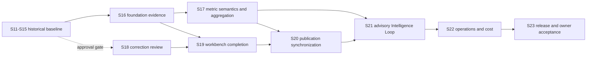

# BP-CMS Core Requirements Roadmap

**Date:** 2026-10-24
**Status:** Authoritative remaining-work roadmap; S16+ is the future planning baseline
**Source:** [`docs/BP_CMS_CORE_REQUIREMENTS/bp_cms_core_requirements1.md`](../BP_CMS_CORE_REQUIREMENTS/bp_cms_core_requirements1.md)
**Architecture authority:** [`docs/architecture/CORE-ARCHITECTURE-RECONCILIATION.md`](../architecture/CORE-ARCHITECTURE-RECONCILIATION.md)

This roadmap reconciles the historical S11-S15 work with the actual repository
and tracking history. Historical task identities remain unchanged. The future
implementation baseline begins at S16; S11-T03 through S15-T04 remain useful
historical scope/status references and are not reopened by this document.

## Roadmap rules

- Firestore remains the only transactional source of truth.
- No task may add Category, direct frontend Firestore access, silent AI approval,
  or a production-data test path.
- Save Draft and Submit for Verification are separate commands.
- Unit, mocked API, emulator integration, and human acceptance are separate gates.
- A task is `COMPLETED` only after its exact acceptance evidence exists. Existing
  tracking claims are labelled `REPORTED` until independently re-run.
- Files below are likely impact areas, not permission to change unrelated modules.

## Historical status and evidence boundary

| Task | Scope | Status | Evidence state |
| --- | --- | --- | --- |
| `S11-T01` | Core mode, format, audience, skill, pillar, and LearningUnit contracts | `REPORTED COMPLETED` | Tracking records `npm run lint` and `npm run test:s11-t01` passes; source and test files are present. Commands were not re-run in this documentation task. |
| `S11-T02` | `learning_units` Firestore repository, validation, RBAC, OCC, collection registration | `REPORTED COMPLETED` | Repository and rules are present; tracking records unit-test pass. Current emulator round-trip is `UNVERIFIED`; the integration test is a pre-existing untracked change and was not run. |
| Sprint 9/10 baseline | Existing workflow, production modes, authorization, audit, and compatibility behavior | `REPORTED / PARTIAL` | Historical sprint reports claim passes; this task did not re-run those suites or assert live UI behavior. |

The S11-S15 task tables below are retained as historical scope and acceptance
context. Their tracking entries are the record of actual work; this document
does not convert reported, partial, or blocked work into accepted behavior.

## Sprint 11 - Planning entry point and artifact linkage

**Goal:** Turn the existing LearningUnit contracts and repository into a safe,
creator-friendly planning path that can feed existing production workflows.

**Dependencies:** `S11-T01`, `S11-T02`; emulator target must be verified before
any integration test that writes data.

**Exit criteria:** A synthetic LearningUnit can be created, saved, reopened,
updated with OCC, and linked to an existing artifact through typed API calls;
legacy standalone artifacts remain valid; no production target is contacted.

| Task | Work and likely files | Acceptance and test strategy | Risks / blockers |
| --- | --- | --- | --- |
| `S11-T03` | Add LearningUnit domain service, request schemas, routes, and frontend API wrapper under `backend/features/planning/`, `backend/server/`, `frontend/api/`, and `shared/contracts/`. | Mocked API tests cover create, read, update, `SAVE_DRAFT`, `SUBMIT_FOR_VERIFICATION`, `400/403/404/409`, actor attribution, and audience-safe DTO projection. | Must not bypass repository actor checks or duplicate workflow rules. |
| `S11-T04` | Add lightweight planning workspace and audience/skill/pillar selectors under `frontend/features/` and `frontend/pages/`. | Component/API tests prove reload fidelity, independent audience and skill values, Topic -> Subtopic selection, and no direct Firestore/provider imports. | Keep the first form small; do not build a second editor or new taxonomy. |
| `S11-T05` | Add optional LearningUnit link handling to draft/question/video creation and read models. Reuse existing `learningUnitId` fields. | Mocked service tests prove linked and standalone artifacts both save; invalid IDs fail closed; audience projections exclude reviewer metadata. | Existing legacy documents may omit the link. No migration or backfill. |
| `S11-T06` | Add repository/service queries for all artifacts linked to a LearningUnit and correction-review flags. | Isolated repository tests return only matching `learningUnitId` records and identify affected artifacts after a unit version/correction. | Avoid full collection scans in production paths; define indexes/query limits first. |
| `S11-T07` | Reconcile datastore integration fixtures, test commands, and architecture/task documentation. | Run the unit suite once; run the emulator suite only after confirming loopback host, synthetic project, cleanup, and no external calls. Record exact PASS/BLOCKED result. | Existing untracked integration test is not part of this planning commit. |

## Sprint 12 - Verification gates and multi-format templates

**Goal:** Make the educational quality requirements explicit and provide reusable
format contracts without prematurely automating rendering.

**Dependencies:** `S11-T03` through `S11-T06`; reuse existing AI validator and
human workflow infrastructure.

**Exit criteria:** A LearningUnit and its artifact cannot reach verification
without the required usefulness and correctness evidence; TEXT, VIDEO, AUDIO,
IMAGE, and ANIMATION artifacts use one shared link model with format-specific
payloads.

| Task | Work and likely files | Acceptance and test strategy | Risks / blockers |
| --- | --- | --- | --- |
| `S12-T01` | Add deterministic calculation and reasoning verification helpers under `backend/ai/validators/` or a framework-free shared domain module. | Fixtures cover correct results, incorrect calculations, incomplete worked steps, ambiguity, and non-MCQ Topic Introduction content. | AI suggestions remain advisory; deterministic checks must not claim natural-language correctness. |
| `S12-T02` | Add the five usefulness questions, Telugu clarity checklist, cross-field consistency, duplicate/fact-risk checks to Stage 02 validation. | Contract tests prove blocking versus advisory findings and preserve GAR-02 human approval. | Do not leak internal notes into audience projections. |
| `S12-T03` | Define TEXT and IMAGE artifact schemas/templates for written explanations, tables, diagrams, and image instructions. | Contract tests validate format separation and LearningUnit linkage; structured TEXT stays in application content, while IMAGE binaries use the existing Google Drive/MediaAsset path and persist metadata only. | Reuse the existing Drive storage system; no renderer or new provider is introduced. |
| `S12-T04` | Define AUDIO and ANIMATION brief/narration contracts with timing, scene, pronunciation, and accessibility metadata. | Schema tests validate required fields and safe empty/optional behavior; provider calls are mocked. | Animation rendering is intentionally deferred. |
| `S12-T05` | Produce the first percentages/discounts synthetic vertical slice across all three modes and selected formats. | Mocked end-to-end service test proves Intro -> Worked Examples -> Challenge relationships, calculations, and approval gates. | This is synthetic planning/test content, not a publication or production write. |
| `S12-T06` | Add mode/format compatibility matrix and migration notes for `EXPLAINED_QUESTIONS_VIDEO`. | Alias tests prove reads, writes, route compatibility, and no identifier rewrite. | Existing historical docs still use legacy numbering; update only current authority docs. |

## Sprint 13 - Workflow integration and production ingestion

**Goal:** Integrate LearningUnit-linked artifacts into the existing 15-stage
workflow while preserving mode-specific validation and video behavior.

**Dependencies:** Sprint 12 verification and format contracts.

**Exit criteria:** Each mode resolves the same 15 stages with explicit
applicability; invalid skips, self-approval, stale versions, and Save Draft
workflow advancement are rejected in isolated API tests.

| Task | Work and likely files | Acceptance and test strategy | Risks / blockers |
| --- | --- | --- | --- |
| `S13-T01` | Consolidate transition authority around `backend/domain/workflow/transition-matrix.ts`; keep compatibility resolvers as adapters. | Architecture and workflow tests show one authoritative transition decision for all three modes. | Existing historical behavior must remain green; no broad rewrite without regression evidence. |
| `S13-T02` | Add mode-aware prompt/template inputs for practical math, everyday money, and decision scenarios. | Mock provider tests verify prompt provenance and advisory status; no live Gemini call. | Prompt output is not correctness proof. |
| `S13-T03` | Map product pipeline Discover -> Improve to LearningUnit planning and stages 01-15. | State-machine tests cover creation, revision, verification, publish, measure, and improve paths. | Product planning is not a reason to add a separate workflow engine. |
| `S13-T04` | Wire linked LearningUnit context into script, teleprompter, media, QC, and publication services. | Service contract tests prove context propagation and prevent internal metadata exposure. | Non-video artifacts must not be forced through video-only requirements. |
| `S13-T05` | Audit every mutation endpoint for authentication, capability, ownership, GAR-02, expectedVersion, and audit event coverage. | Isolated route matrix records PASS/FAIL for each endpoint; uncovered routes are fixed in the smallest module. | A route may be readable without being mutable; preserve intended public health/auth endpoints. |
| `S13-T06` | Add safe integration acceptance for one LearningUnit-linked video path using emulator and mocked Drive/AI. | Emulator-only persistence, workflow history, audit append, OCC conflict, and cleanup checks pass or are explicitly BLOCKED. | No live Drive, AI, publishing, or production Firestore calls. |

## Sprint 14 - Connected learning sequences and editorial planning

**Goal:** Make related learning content visible and plan reusable series without
creating a new taxonomy level or recommendation engine.

**Dependencies:** S11 linked-artifact queries and S13 workflow integration.

**Exit criteria:** A creator can see Intro, Worked Examples, Challenge, and
alternate-format artifacts for one LearningUnit and identify items needing review
after a correction.

| Task | Work and likely files | Acceptance and test strategy | Risks / blockers |
| --- | --- | --- | --- |
| `S14-T01` | Add related-artifact read model and sequence API. | Repository/API tests prove deterministic ordering, missing-mode tolerance, and pagination/limits. | Do not make the sequence mandatory for every topic. |
| `S14-T02` | Add lightweight editorial calendar/planning views using existing planning concepts. | Component/API tests prove filters by Topic, Subtopic, mode, format, audience, and status. | Calendar is an operational view, not a second source of truth. |
| `S14-T03` | Add correction propagation/review queue for linked artifacts. | Synthetic correction test creates review flags without mutating or deleting historical artifacts. | Preserve immutable audit and existing workflow ownership. |
| `S14-T04` | Add series-level human acceptance path across all three modes. | Mocked workflow test proves each artifact independently passes its own gate and the sequence does not bypass GAR-02. | Avoid approving a group through one author action. |

**Readiness dependency:** S14-T03 remains blocked pending explicit acceptance
of ADR-016. The required decision must define correction evidence, affected
artifact selection, flag lifecycle, authorized capabilities, OCC/idempotency,
immutable audit events, and audience-safe projections. S14-T04 is transitively
blocked because its human acceptance path must consume the approved correction
review semantics without creating a second workflow authority.

## Sprint 15 - Artifact performance, learning engagement, and production effort

**Goal:** Measure audience outcomes and production effort at artifact and
platform level, without treating views as proof of learning.

**Dependencies:** S14 artifact relationships; existing analytics repositories and
platform adapters.

**Exit criteria:** Synthetic analytics can report the three requirement
categories independently and compare format/mode/audience/series with explicit
sample-size and missing-data behavior.

| Task | Work and likely files | Acceptance and test strategy | Risks / blockers |
| --- | --- | --- | --- |
| `S15-T01` | Define artifact/platform performance and learning-engagement contracts. | Contract tests cover reach, retention, participation, answer accuracy where supported, and unavailable metrics. | Comments and likes remain signals, not learning proof. |
| `S15-T02` | Persist production time, cost, revisions, rejection rate, and reuse at artifact level. | Mocked repository tests prove independent records per artifact/platform and OCC behavior. | Do not introduce billing or paid services. |
| `S15-T03` | Add analytics aggregation and dashboard slices for the three categories. | Isolated fixtures verify filters by topic, mode, format, audience, and series with no production reads. | Avoid recursive collection scans and free-tier read amplification. |
| `S15-T04` | Add performance-review feedback into the Intelligence Loop as audited recommendations. | Service tests prove recommendations cannot directly publish, approve, or mutate content without an authorized command. | AI remains advisory and cost-bounded. |

## Verified S15 boundary

S15-T01 and S15-T02 are present at pushed commit
`fb8076a7e2044de208d5c34b8340ec54ddbbb09f`. S15-T01 defines shared
audience-performance and learning-engagement contracts with explicit unavailable
metrics. S15-T02 adds explicit artifact/platform production-effort records,
server-side actor attribution, audit calls, and OCC updates. S15-T02 does not
define or derive formulas for elapsed versus active time, currency/cost
semantics, revision/rejection derivation, or LearningUnit reuse. Those decisions
must precede aggregation and dashboard acceptance. The known TypeScript lint
blocker is the installed `googleapis` declaration error at
`containeranalysis/v1.d.ts(1450,48)`.

## Future roadmap status and rules

The following S16+ plan is a dependency-aware planning hypothesis derived from
the core requirements and the architecture audit. It does not change historical
S11–S15 identities or mark any task accepted. `READY` means the prerequisite
contract is approved and the task can be implemented; `GATED` means a named
decision or evidence gate must be satisfied first.

## Sprint 16 - Verified production foundation and workflow acceptance

**Goal:** Close the highest-risk evidence gaps in the existing LearningUnit and
15-stage production path without adding new domain concepts.

**Dependencies:** S11–S15 code remains the baseline; ADR-016 is not required
for tasks that do not implement correction behavior.

| Task | Status | Deliverables | Acceptance evidence / non-goals |
| --- | --- | --- | --- |
| `S16-T01` | READY | Protected API acceptance matrix for LearningUnit, artifact linking, Save Draft, Submit, workflow, and audience-safe projections | Mocked API tests cover 400/401/403/404/409, actor attribution, GAR-02, ownership, OCC, and no workflow advancement on save; no UI rewrite |
| `S16-T02` | READY | Emulator acceptance for linked LearningUnit -> artifact -> workflow history -> audit | Loopback-only emulator test with synthetic data, bounded cleanup, stale OCC conflict, and no provider calls |
| `S16-T03` | READY | Role-aware production workbench route/read-model verification over existing pages | Browser/component evidence for capability visibility and forbidden actions; no new role or route family |
| `S16-T04` | READY | Reconciled API error/idempotency behavior for existing publication/media adapters | Mocked retry and duplicate tests; no provider or production publication |

**Exit:** API and emulator evidence exists for the foundation path, and all
failures are classified rather than hidden. S17 can begin without correction
review approval.

### S16-T01 execution boundary

S16-T01 is limited to acceptance coverage over existing services and routes. It
must inventory the LearningUnit create/read/update commands, artifact-linking
paths, Save Draft, Submit for Verification, workflow transition/approval routes,
and audience-safe projections before adding tests. It may add only focused test
fixtures, route-test helpers, or contract clarifications needed to exercise
those existing boundaries; it must not add correction-review persistence,
metric aggregation, a new workflow stage, a new role, a new page family, or
production data.

The minimum acceptance matrix is:

1. unauthenticated requests fail with 401 and never receive an Admin fallback;
2. authenticated actors without capability or ownership fail with 403;
3. invalid, missing, and cross-unit references fail with 400/404 as applicable;
4. Save Draft preserves draft state and does not advance workflow or trigger
   verification;
5. Submit for Verification is a distinct command and enforces the existing
   validation gate;
6. valid transitions are delegated to `WorkflowEngine`/`transition-matrix.ts`;
7. ordinary authors cannot self-approve, while the approved audited System
   Administrator override remains explicit and reason-validated;
8. stale expected versions return the existing 409 conflict behavior;
9. responses omit reviewer, audit, provider, assignment, and OCC internals
   from audience-facing projections; and
10. mocked API tests pass without Firestore/provider writes, with emulator
    coverage deferred to S16-T02.

## Sprint 17 - Measurement semantics, aggregation, and operational analytics

**Goal:** Turn S15 contracts and explicit records into trustworthy comparisons.

**Dependencies:** S16 evidence; product-owner approval of metric definitions.

| Task | Status | Deliverables | Acceptance evidence / gates |
| --- | --- | --- | --- |
| `S17-T01` | COMPLETED | Approved metric dictionary plus server-owned provenance for production time, cost/currency, revisions, rejection, reuse, source, window, and sample rules | Owner approval recorded for both Product Owner and Architecture Owner; focused provenance tests, S15 regressions, lint, and build passed; deferred currency conversion and numeric sample threshold remain disabled |
| `S17-T02` | GATED | Bounded repository/service aggregation over artifact/platform snapshots and production effort | Fixture tests for topic, mode, format, audience, series, platform, time window, unavailable values, and small samples; no recursive scans |
| `S17-T03` | GATED | Protected analytics dashboard/read model using typed DTOs | API/component tests prove filters, deterministic ordering, role access, and no internal metadata leakage |
| `S17-T04` | GATED | Measurement provenance and audit/export contract | Tests prove source/capture window and unavailable reasons survive aggregation; no billing integration |

**Exit:** A reviewer can distinguish measured, unavailable, and insufficient
sample results, with source and window visible to authorized users.

## Sprint 18 - Correction review and related-artifact safety

**Goal:** Implement correction propagation only after the governing decision is
accepted.

**Dependencies:** ADR-016 accepted or the roadmap explicitly replanned;
S16 workflow/OCC evidence.

| Task | Status | Deliverables | Acceptance evidence / gates |
| --- | --- | --- | --- |
| `S18-T01` | GATED | Accepted correction evidence/version contract and capability matrix | ADR-016 acceptance records evidence authority, lifecycle, roles, reasons, and version semantics |
| `S18-T02` | GATED | Additive correction flag/review persistence using existing repositories and audit | Mocked repository tests cover ownership, GAR-02, reason validation, OCC, duplicate/stale requests, and immutable audit |
| `S18-T03` | GATED | Bounded affected-artifact query and internal review projection | Emulator/API tests prove exact LearningUnit/version binding, limits, deterministic order, and audience-safe omission |
| `S18-T04` | GATED | Revision re-entry through existing Stage 01 authority | Workflow tests prove no new stage, no silent approval, and Save Draft remains separate |

**Exit:** Correction behavior is either accepted and evidenced or explicitly
deferred; S19 must not depend on an unapproved lifecycle.

## Sprint 19 - Multi-format editorial and production workbench completion

**Goal:** Deliver a coherent work-oriented experience across the five formats.

**Dependencies:** S16 foundation evidence; S18 only for correction-aware queues.

| Task | Status | Deliverables | Acceptance evidence |
| --- | --- | --- | --- |
| `S19-T01` | READY | LearningUnit planning workspace completion using existing contracts | Component/API tests prove reload fidelity, independent audience/skill, Topic -> Subtopic, and safe errors |
| `S19-T02` | READY | Shared artifact editor/preview projections for TEXT, VIDEO, AUDIO, IMAGE, ANIMATION | Contract/component tests prove mode/format orthogonality and metadata-only binary handling |
| `S19-T03` | READY | Production workbench sequence, assignments, and stage actions | API/component tests prove capability and ownership gates, deterministic linked-artifact context, and internal metadata separation |
| `S19-T04` | READY | Human acceptance pack for one synthetic percentages/discounts vertical slice | Owner-run evidence only; no claim from unit tests or production data |

**Exit:** One synthetic lesson can be planned, produced, reviewed, and previewed
through the supported formats without a second editor or workflow.

## Sprint 20 - Publication and platform synchronization hardening

**Goal:** Make publication setup, provider synchronization, and failure recovery
safe and observable.

**Dependencies:** S16 API/idempotency evidence and S19 workbench contracts.

| Task | Status | Deliverables | Acceptance evidence |
| --- | --- | --- | --- |
| `S20-T01` | READY | Protected publication package and platform adaptation API acceptance | Mocked API tests for validation, ownership, OCC, GAR-02 where applicable, and safe projections |
| `S20-T02` | READY | Idempotent platform sync adapter boundary and retry state | Provider doubles prove duplicate prevention, bounded retry, explicit failure, and audit |
| `S20-T03` | READY | Publication status/read-model reconciliation | Fixture/emulator tests prove planned, scheduled, published, failed, and unavailable states without new workflow stages |
| `S20-T04` | READY | Human acceptance of a mocked publish/sync journey | Owner-controlled sandbox evidence; no live publishing |

**Exit:** Publication behavior is repeatable with no hidden external side effects.

## Sprint 21 - Intelligence Loop and feedback governance

**Goal:** Convert measured signals and review outcomes into audited advisory
recommendations without autonomous mutations.

**Dependencies:** S17 metric provenance and S20 publication status; AI remains
advisory.

| Task | Status | Deliverables | Acceptance evidence |
| --- | --- | --- | --- |
| `S21-T01` | READY | Feedback/recommendation contract with provenance and confidence explanation | Contract tests reject missing source/window and preserve unavailable data |
| `S21-T02` | READY | Recommendation service and protected internal projection | Service tests prove role access, audit append, and no audience metadata leakage |
| `S21-T03` | READY | Authorized command boundary for accepting/rejecting a recommendation | Tests prove recommendations cannot publish, approve, or mutate content directly |
| `S21-T04` | READY | Intelligence Loop synthetic regression | Mocked end-to-end test from metric/review evidence to advisory recommendation |

**Exit:** The Intelligence Loop is useful, traceable, and non-authoritative.

## Sprint 22 - Operational resilience, privacy, and cost controls

**Goal:** Close environment, observability, recovery, and free-tier safety gaps.

**Dependencies:** S16–S21 behavior and evidence; no production mutation.

| Task | Status | Deliverables | Acceptance evidence |
| --- | --- | --- | --- |
| `S22-T01` | READY | Structured audit/observability coverage for critical commands and provider failures | Unit/API tests prove sanitized payloads, correlation IDs, and immutable append behavior |
| `S22-T02` | READY | Datastore isolation and fail-closed environment probes | Local/emulator tests prove production project IDs and endpoints cannot be used accidentally |
| `S22-T03` | READY | Bounded query/index review for high-volume read models | Static/query fixture evidence; no recursive scans or speculative indexes |
| `S22-T04` | READY | Recovery and operational runbook validation | Isolated synthetic recovery evidence; no production export/import or destructive cleanup |

**Exit:** Operational claims have reproducible local evidence and explicit
cloud/human gaps.

## Sprint 23 - Release readiness and owner acceptance

**Goal:** Establish a truthful release gate over the complete core requirements.

**Dependencies:** S16–S22 exit criteria; owner-controlled live acceptance only.

| Task | Status | Deliverables | Acceptance evidence |
| --- | --- | --- | --- |
| `S23-T01` | READY | Requirements-to-test traceability and final architecture reconciliation | Static consistency checks; every requirement has an evidence classification |
| `S23-T02` | READY | Full safe regression, build, lint blocker report, and emulator suite | Commands run once in isolated targets; known `googleapis` blocker remains explicit |
| `S23-T03` | READY | Owner human-acceptance checklist for all supported modes and stages | Owner evidence required; agent must not claim live behavior |
| `S23-T04` | READY | Release decision record and deferred-work register | Explicit accepted, partial, blocked, and not-justified outcomes; no deployment |

**Exit:** The owner can distinguish code-level readiness from human/cloud
acceptance, and no roadmap item is marked complete without its evidence.

## Cross-sprint dependency view

The next roadmap task marked `READY` after the completed S16 foundation and
approved S17-T01 work is `S19-T01`: LearningUnit planning workspace completion.
The existing workspace implementation and S11-T04 tests already cover its
selectors, audience-safe preview, validation, Save Draft/Submit separation,
OCC conflict handling, permission errors, and Topic -> Subtopic cascade. Any
further S19-T01 work must therefore begin with a concrete remaining acceptance
gap rather than duplicate the existing implementation. It must not implement
correction review, metric aggregation, or a new frontend architecture.
