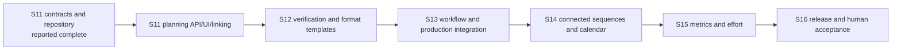

# BP-CMS Core Requirements Roadmap

**Date:** 2026-10-24
**Status:** Authoritative remaining-work roadmap
**Source:** [`docs/BP_CMS_CORE_REQUIREMENTS/bp_cms_core_requirements1.md`](../BP_CMS_CORE_REQUIREMENTS/bp_cms_core_requirements1.md)
**Architecture authority:** [`docs/architecture/CORE-ARCHITECTURE-RECONCILIATION.md`](../architecture/CORE-ARCHITECTURE-RECONCILIATION.md)

This roadmap reconciles the earlier S11-S15 proposal with the actual repository
and tracking history. The earlier proposal assigned mode alignment to `S11-T02`,
but the tracked implementation uses `S11-T01` for contracts and `S11-T02` for
LearningUnit persistence. This document preserves those identities and starts
remaining work at `S11-T03`.

## Roadmap rules

- Firestore remains the only transactional source of truth.
- No task may add Category, direct frontend Firestore access, silent AI approval,
  or a production-data test path.
- Save Draft and Submit for Verification are separate commands.
- Unit, mocked API, emulator integration, and human acceptance are separate gates.
- A task is `COMPLETED` only after its exact acceptance evidence exists. Existing
  tracking claims are labelled `REPORTED` until independently re-run.
- Files below are likely impact areas, not permission to change unrelated modules.

## Current status before this roadmap

| Task | Scope | Status | Evidence state |
| --- | --- | --- | --- |
| `S11-T01` | Core mode, format, audience, skill, pillar, and LearningUnit contracts | `REPORTED COMPLETED` | Tracking records `npm run lint` and `npm run test:s11-t01` passes; source and test files are present. Commands were not re-run in this documentation task. |
| `S11-T02` | `learning_units` Firestore repository, validation, RBAC, OCC, collection registration | `REPORTED COMPLETED` | Repository and rules are present; tracking records unit-test pass. Current emulator round-trip is `UNVERIFIED`; the integration test is a pre-existing untracked change and was not run. |
| Sprint 9/10 baseline | Existing workflow, production modes, authorization, audit, and compatibility behavior | `REPORTED / PARTIAL` | Historical sprint reports claim passes; this task did not re-run those suites or assert live UI behavior. |

## Sprint 11 - Planning entry point and artifact linkage

**Goal:** Turn the existing LearningUnit contracts and repository into a safe,
creator-friendly planning path that can feed existing production workflows.

**Dependencies:** `S11-T01`, `S11-T02`; emulator target must be verified before
any integration test that writes data.

**Exit criteria:** A synthetic LearningUnit can be created, saved, reopened,
updated with OCC, and linked to an existing artifact through typed API calls;
legacy standalone artifacts remain valid; no production target is contacted.

| Task | Work and likely files | Acceptance and test strategy | Risks / blockers |
| --- | --- | --- | --- |
| `S11-T03` | Add LearningUnit domain service, request schemas, routes, and frontend API wrapper under `backend/features/planning/`, `backend/server/`, `frontend/api/`, and `shared/contracts/`. | Mocked API tests cover create, read, update, `SAVE_DRAFT`, `SUBMIT_FOR_VERIFICATION`, `400/403/404/409`, actor attribution, and audience-safe DTO projection. | Must not bypass repository actor checks or duplicate workflow rules. |
| `S11-T04` | Add lightweight planning workspace and audience/skill/pillar selectors under `frontend/features/` and `frontend/pages/`. | Component/API tests prove reload fidelity, independent audience and skill values, Topic -> Subtopic selection, and no direct Firestore/provider imports. | Keep the first form small; do not build a second editor or new taxonomy. |
| `S11-T05` | Add optional LearningUnit link handling to draft/question/video creation and read models. Reuse existing `learningUnitId` fields. | Mocked service tests prove linked and standalone artifacts both save; invalid IDs fail closed; audience projections exclude reviewer metadata. | Existing legacy documents may omit the link. No migration or backfill. |
| `S11-T06` | Add repository/service queries for all artifacts linked to a LearningUnit and correction-review flags. | Isolated repository tests return only matching `learningUnitId` records and identify affected artifacts after a unit version/correction. | Avoid full collection scans in production paths; define indexes/query limits first. |
| `S11-T07` | Reconcile datastore integration fixtures, test commands, and architecture/task documentation. | Run the unit suite once; run the emulator suite only after confirming loopback host, synthetic project, cleanup, and no external calls. Record exact PASS/BLOCKED result. | Existing untracked integration test is not part of this planning commit. |

## Sprint 12 - Verification gates and multi-format templates

**Goal:** Make the educational quality requirements explicit and provide reusable
format contracts without prematurely automating rendering.

**Dependencies:** `S11-T03` through `S11-T06`; reuse existing AI validator and
human workflow infrastructure.

**Exit criteria:** A LearningUnit and its artifact cannot reach verification
without the required usefulness and correctness evidence; TEXT, VIDEO, AUDIO,
IMAGE, and ANIMATION artifacts use one shared link model with format-specific
payloads.

| Task | Work and likely files | Acceptance and test strategy | Risks / blockers |
| --- | --- | --- | --- |
| `S12-T01` | Add deterministic calculation and reasoning verification helpers under `backend/ai/validators/` or a framework-free shared domain module. | Fixtures cover correct results, incorrect calculations, incomplete worked steps, ambiguity, and non-MCQ Topic Introduction content. | AI suggestions remain advisory; deterministic checks must not claim natural-language correctness. |
| `S12-T02` | Add the five usefulness questions, Telugu clarity checklist, cross-field consistency, duplicate/fact-risk checks to Stage 02 validation. | Contract tests prove blocking versus advisory findings and preserve GAR-02 human approval. | Do not leak internal notes into audience projections. |
| `S12-T03` | Define TEXT and IMAGE artifact schemas/templates for written explanations, tables, diagrams, and image instructions. | Contract tests validate format separation and LearningUnit linkage; structured TEXT stays in application content, while IMAGE binaries use the existing Google Drive/MediaAsset path and persist metadata only. | Reuse the existing Drive storage system; no renderer or new provider is introduced. |
| `S12-T04` | Define AUDIO and ANIMATION brief/narration contracts with timing, scene, pronunciation, and accessibility metadata. | Schema tests validate required fields and safe empty/optional behavior; provider calls are mocked. | Animation rendering is intentionally deferred. |
| `S12-T05` | Produce the first percentages/discounts synthetic vertical slice across all three modes and selected formats. | Mocked end-to-end service test proves Intro -> Worked Examples -> Challenge relationships, calculations, and approval gates. | This is synthetic planning/test content, not a publication or production write. |
| `S12-T06` | Add mode/format compatibility matrix and migration notes for `EXPLAINED_QUESTIONS_VIDEO`. | Alias tests prove reads, writes, route compatibility, and no identifier rewrite. | Existing historical docs still use legacy numbering; update only current authority docs. |

## Sprint 13 - Workflow integration and production ingestion

**Goal:** Integrate LearningUnit-linked artifacts into the existing 15-stage
workflow while preserving mode-specific validation and video behavior.

**Dependencies:** Sprint 12 verification and format contracts.

**Exit criteria:** Each mode resolves the same 15 stages with explicit
applicability; invalid skips, self-approval, stale versions, and Save Draft
workflow advancement are rejected in isolated API tests.

| Task | Work and likely files | Acceptance and test strategy | Risks / blockers |
| --- | --- | --- | --- |
| `S13-T01` | Consolidate transition authority around `backend/domain/workflow/transition-matrix.ts`; keep compatibility resolvers as adapters. | Architecture and workflow tests show one authoritative transition decision for all three modes. | Existing historical behavior must remain green; no broad rewrite without regression evidence. |
| `S13-T02` | Add mode-aware prompt/template inputs for practical math, everyday money, and decision scenarios. | Mock provider tests verify prompt provenance and advisory status; no live Gemini call. | Prompt output is not correctness proof. |
| `S13-T03` | Map product pipeline Discover -> Improve to LearningUnit planning and stages 01-15. | State-machine tests cover creation, revision, verification, publish, measure, and improve paths. | Product planning is not a reason to add a separate workflow engine. |
| `S13-T04` | Wire linked LearningUnit context into script, teleprompter, media, QC, and publication services. | Service contract tests prove context propagation and prevent internal metadata exposure. | Non-video artifacts must not be forced through video-only requirements. |
| `S13-T05` | Audit every mutation endpoint for authentication, capability, ownership, GAR-02, expectedVersion, and audit event coverage. | Isolated route matrix records PASS/FAIL for each endpoint; uncovered routes are fixed in the smallest module. | A route may be readable without being mutable; preserve intended public health/auth endpoints. |
| `S13-T06` | Add safe integration acceptance for one LearningUnit-linked video path using emulator and mocked Drive/AI. | Emulator-only persistence, workflow history, audit append, OCC conflict, and cleanup checks pass or are explicitly BLOCKED. | No live Drive, AI, publishing, or production Firestore calls. |

## Sprint 14 - Connected learning sequences and editorial planning

**Goal:** Make related learning content visible and plan reusable series without
creating a new taxonomy level or recommendation engine.

**Dependencies:** S11 linked-artifact queries and S13 workflow integration.

**Exit criteria:** A creator can see Intro, Worked Examples, Challenge, and
alternate-format artifacts for one LearningUnit and identify items needing review
after a correction.

| Task | Work and likely files | Acceptance and test strategy | Risks / blockers |
| --- | --- | --- | --- |
| `S14-T01` | Add related-artifact read model and sequence API. | Repository/API tests prove deterministic ordering, missing-mode tolerance, and pagination/limits. | Do not make the sequence mandatory for every topic. |
| `S14-T02` | Add lightweight editorial calendar/planning views using existing planning concepts. | Component/API tests prove filters by Topic, Subtopic, mode, format, audience, and status. | Calendar is an operational view, not a second source of truth. |
| `S14-T03` | Add correction propagation/review queue for linked artifacts. | Synthetic correction test creates review flags without mutating or deleting historical artifacts. | Preserve immutable audit and existing workflow ownership. |
| `S14-T04` | Add series-level human acceptance path across all three modes. | Mocked workflow test proves each artifact independently passes its own gate and the sequence does not bypass GAR-02. | Avoid approving a group through one author action. |

## Sprint 15 - Artifact performance, learning engagement, and production effort

**Goal:** Measure audience outcomes and production effort at artifact and
platform level, without treating views as proof of learning.

**Dependencies:** S14 artifact relationships; existing analytics repositories and
platform adapters.

**Exit criteria:** Synthetic analytics can report the three requirement
categories independently and compare format/mode/audience/series with explicit
sample-size and missing-data behavior.

| Task | Work and likely files | Acceptance and test strategy | Risks / blockers |
| --- | --- | --- | --- |
| `S15-T01` | Define artifact/platform performance and learning-engagement contracts. | Contract tests cover reach, retention, participation, answer accuracy where supported, and unavailable metrics. | Comments and likes remain signals, not learning proof. |
| `S15-T02` | Persist production time, cost, revisions, rejection rate, and reuse at artifact level. | Mocked repository tests prove independent records per artifact/platform and OCC behavior. | Do not introduce billing or paid services. |
| `S15-T03` | Add analytics aggregation and dashboard slices for the three categories. | Isolated fixtures verify filters by topic, mode, format, audience, and series with no production reads. | Avoid recursive collection scans and free-tier read amplification. |
| `S15-T04` | Add performance-review feedback into the Intelligence Loop as audited recommendations. | Service tests prove recommendations cannot directly publish, approve, or mutate content without an authorized command. | AI remains advisory and cost-bounded. |

## Sprint 16 - Release, architecture, and human acceptance gates

**Goal:** Close the core-requirements roadmap with reproducible code-level
evidence and owner-controlled human acceptance.

**Dependencies:** S11 through S15; no task may deploy as a side effect.

**Exit criteria:** Documentation, architecture, security, workflow, persistence,
and isolated end-to-end gates are green; remaining gaps have explicit owners;
the owner receives a manual human-acceptance checklist for the live environment.

| Task | Work and likely files | Acceptance and test strategy | Risks / blockers |
| --- | --- | --- | --- |
| `S16-T01` | Run the architecture, contract, workflow, RBAC, taxonomy, and regression gates once in safe isolation. | Exact commands and PASS/FAIL/BLOCKED results are recorded; no production target is accepted. | Missing emulator or external dependency is a BLOCKED result, not a pass. |
| `S16-T02` | Validate production build and local/deployed configuration contract. | `npm run lint` and `npm run build` pass; deployment publication remains a separate owner-authorized check. | Do not claim Google AI Studio parity from a local build alone. |
| `S16-T03` | Execute isolated end-to-end synthetic LearningUnit journey and prepare human acceptance checklist. | Emulator/mock path proves all required invariants; checklist separately covers owner-run live UI and publication behavior. | IDE agent does not log into or mutate production. |
| `S16-T04` | Final architecture and roadmap closure review; update project tracking with evidence. | Only intended docs/code task files are staged; `git diff --check` passes; unresolved risks are listed. | Do not mark requirements complete without evidence. |

## Cross-sprint dependency view

The next implementation task is `S11-T03`. It creates the missing service/API
boundary needed to use the already-present LearningUnit contracts and repository,
while keeping persistence, authorization, and workflow decisions in their
authoritative backend layers.
