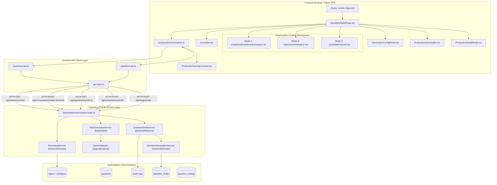
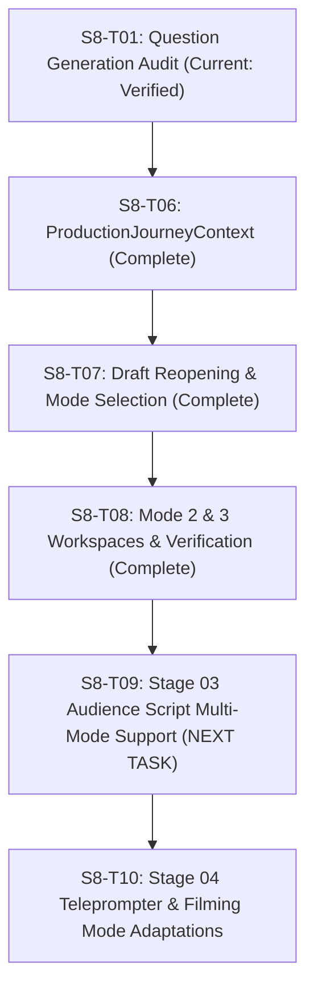

# S8-T01: Question Generation Entry Point Forensic Audit

**Milestone**: Sprint 8 — Dynamic Production Foundation & Content Modes
**Task**: S8-T01 — Audit the Question Generation Entry Point
**Effective Date**: October 15, 2026
**Auditor**: Antigravity Software Architect & QA Systems Engineer
**Inspected Git Commit SHA**: `4076b7fd513f391a74765f446967231409f08b1c` (`main`)
**Scope**: Complete forensic audit of Stage 01 Question Generation across frontend routing, components, local hooks, API client transports, backend route dispatchers, domain services, Firestore repositories, data schemas, and test suites.
**Mode**: **AUDIT ONLY** (Zero application-code, database, workflow, or configuration changes made).

---

## 1. Executive Summary & Verdict

### Acceptance Status: **PASS (AUDIT VERIFIED & RECONCILED AGAINST CURRENT CODEBASE)**

### Strategic Verdict:
**The Question Generation entry point (`/studio`) provides a verified, production-grade foundation for multi-mode content authoring in Burra Pariksha CMS.**

Since the initial audit baseline, significant foundational capabilities have been implemented and validated:
- **Draft Reopening & Deep-Linking (S8-T07)**: Fully operational via `useQuestionGeneration.ts`. Saved drafts are safely ingested from `?draftId=dft_...` or `?id=dft_...`, restoring candidate fields, taxonomy, options, mode, count, and aspect ratio.
- **Three Content Modes (S8-T08)**: Polymorphic authoring is fully functional across Mode 1 (`QUESTION_CHALLENGE_SHORT`), Mode 2 (`TOPIC_INTRODUCTION`), and Mode 3 (`EXPLAINED_QUESTIONS_VIDEO`), backed by dedicated workspaces (`TopicIntroWorkspace.tsx`, `ExplainedQuestionsWorkspace.tsx`, `CandidateCanvas.tsx`).
- **Unsaved-Work Protection**: Enforced via window `beforeunload` listener in `useQuestionGeneration.ts`.
- **Architectural Invariants Strictly Preserved**:
  1. **Save Draft $\neq$ Submit for Verification**: Strictly separated across UI (`ActionBar.tsx`), hook (`useQuestionGeneration.ts`), domain service (`question-generation.service.ts`), and datastore (`question_drafts` collection).
  2. **Two-Tier Taxonomy (`Topic` $\to$ `Subtopic`)**: Pure hierarchy with zero legacy Category leaks.
  3. **Advisory AI Boundary (AP-009)**: Gemini Flash Lite (`@google/genai`) operates server-side, generates structured bilingual JSON, enforces mathematical proof checks, and never silently advances workflow stages.
  4. **Sole Authoritative Persistence**: All drafts reside strictly in Cloud Firestore (`question_drafts` collection) with collision-resistant `dft_<uuid>` IDs.

### Active Production Gaps Identified:
1. **HIGH — Hardcoded Real-World Context Suggestions**: Context suggestions in `GenerationConfigPanel.tsx` (`CONTEXT_SUGGESTIONS`) and `question-generation.service.ts` remain hardcoded arrays instead of dynamically consuming the Firestore `question_configs` collection via `questionsApi.getStudioConfig()`.
2. **HIGH — Orphaned Configuration Controls in JSX**: `GenerationConfigPanelProps` declares `questionStyle` and `customInstructions`, but `GenerationConfigPanel.tsx` **never renders them in its JSX**. Authors cannot select question styles or input prompt modifiers in the UI.
3. **MEDIUM — Missing `contentId` Ingestion & Path Parameter**: While `?draftId=` and `?id=` are supported, `?contentId=` deep-linking (specified in `11-PAGE-ROUTE-CONTRACT.md`) is unhandled, and no `/studio/:id` path route is registered in `App.tsx`.
4. **MEDIUM — `ProductionJourneyBar` Stage Key Mismatch**: `QuestionStudioPage.tsx` passes `activeStage="QUESTION_STUDIO"`, but `ProductionJourneyBar.tsx` `stageCodeToNumber` only contains `QUESTION` and `QUESTION_GENERATION`.
5. **LOW — Volatile Pre-Save Buffer**: While `beforeunload` warns on close, there is no `sessionStorage` autosave buffer against browser crashes before clicking "Save Draft".

---

## 2. Route, Component & Data-Flow Inventory



### 2.1 Concrete File & Symbol Manifest

| Layer | File Path | Key Symbols / Exports | Current Status & Responsibility |
|:---|:---|:---|:---|
| **Route Target** | `frontend/app/App.tsx` | `<Route path="studio" element={<QuestionStudioPage />} />` | Route declaration. Note: `/questions/new` and `/generate` redirect here. `/studio/:id` path parameter not registered. |
| **Page Re-export**| `frontend/pages/QuestionStudioPage.tsx` | `QuestionStudioPage` | Re-export shim delegating to feature slice. |
| **Page Orchestrator**| `frontend/features/question-generation/pages/QuestionStudioPage.tsx` | `QuestionStudioPage` | Stage 01 workspace orchestrator; renders mode banner, `ProductionModeModal`, dual-pane layout, alert banners. |
| **Mode Selector** | `frontend/features/question-generation/components/ProductionModeModal.tsx` | `ProductionModeModal`, `MODE_OPTIONS` | Implements ADR-010/ADR-011 mode rules for Modes 1, 2, and 3. |
| **Config UI** | `frontend/features/question-generation/components/GenerationConfigPanel.tsx` | `GenerationConfigPanel`, `CONTEXT_SUGGESTIONS` | Two-tier topic/subtopic selectors, difficulty/language controls, context hook input. **Defect**: Does not render `questionStyle` or `customInstructions`. |
| **Mode 1 Canvas** | `frontend/features/question-generation/components/CandidateCanvas.tsx` | `CandidateCanvas` | Mode 1 authoring: statement, options A–D, answer radio buttons, explanation, AI refinement pills. |
| **Mode 2 Workspace**| `frontend/features/question-generation/components/TopicIntroWorkspace.tsx` | `TopicIntroWorkspace` | Mode 2 authoring: 0 questions enforced, 9:16 or 16:9 aspect toggle, concept title, theory statement, syllabus scope. |
| **Mode 3 Workspace**| `frontend/features/question-generation/components/ExplainedQuestionsWorkspace.tsx` | `ExplainedQuestionsWorkspace` | Mode 3 authoring: 16:9 aspect enforced, 5–20 questions, horizontal segmented tabs `[Intro Roadmap]` `[Q1]`–`[QN]`. |
| **Actions UI** | `frontend/features/question-generation/components/ActionBar.tsx` | `ActionBar` | "Clear / Start New", draft ID badge, Save Draft button, Submit for Verification button. Enforces physical separation of commands. |
| **Feature Hook** | `frontend/features/question-generation/hooks/useQuestionGeneration.ts` | `useQuestionGeneration` | Client state, deep-link draft hydration (`?draftId=`, `?id=`), mode configuration, taxonomy cascade, AI dispatch, `beforeunload` guard, save/submit handlers. |
| **Feature Context** | `frontend/contexts/ProductionJourneyContext.tsx` | `ProductionJourneyContext`, `useProductionJourney` | Cross-stage journey state, entity ID synchronization, dirty tracking. |
| **Feature API** | `frontend/api/questions.api.ts` | `questionsApi` | Typed methods: `generateAiQuestion`, `refineAiQuestion`, `saveDraft`, `getDraft`, `getDrafts`, `submitForVerification`, `checkDuplicate`. |
| **HTTP Transport** | `frontend/api/api-client.ts` | `apiClient`, `ApiClient` | Central fetch wrapper with auth header injection, error envelopes, and retry logic. |
| **Taxonomy API** | `frontend/api/taxonomy.api.ts` | `taxonomyApi` | `getTree()` for loading Two-Tier syllabus hierarchy. |
| **HTTP Router** | `backend/server/routers/routes.ts` | `apiRouter`, lines 1372–1480, 3486–3512 | Endpoints: `/ai/generate`, `/ai/refine`, `/questions/draft`, `/questions/draft/:id`, `/questions/draft/:id/submit`. |
| **Feature Service** | `backend/features/question-generation/services/question-draft.service.ts` | `QuestionDraftService`, `questionDraftService` | Bridges Express route handlers to domain service, enforces capability checks, audit logging. |
| **Domain Service** | `backend/domain/question-generation/question-generation.service.ts` | `QuestionGenerationService`, `questionGenerationService` | Validates taxonomy, validates production mode configurations, enforces Save Draft $\neq$ Verify, manages OCC draft persistence. |
| **AI Orchestrator**| `backend/ai/orchestrator/ai-orchestrator.service.ts` | `AiOrchestratorService`, `aiOrchestrator` | Server-side prompt construction, Gemini provider adapter invocation, mathematical proof validation. |
| **AI Provider** | `backend/ai/providers/gemini.adapter.ts` | `GeminiAdapter` | Direct `@google/genai` provider adapter using `gemini-3.1-flash-lite`. |
| **Repositories** | `database/firestore/repositories/` | `questionDraftsRepository`, `questionsRepository`, `auditLogRepository` | Cloud Firestore transactional persistence. |
| **Shared Contracts**| `shared/contracts/question-generation/` | `StudioCandidate`, `SaveQuestionDraftInput`, `SubmitForVerificationResult`, `evaluateStep01CandidateState` | Polymorphic DTOs, interfaces, and candidate evaluation function. |
| **Domain Types** | `shared/types/question.ts`, `shared/types/production-context.ts` | `Question`, `QuestionDraft`, `ExplainedQuestionItem`, `ContentProductionMode` | Canonical entity models. |

---

## 3. End-to-End User Journey Audit (Trace of Complete Flow)

### Step 1: Page Load & Deep-Link Hydration
- **Entry**: User navigates to `/studio` or deep link `/studio?draftId=dft_...` (or `/studio?id=dft_...`).
- **Observed Behavior**:
  1. `App.tsx` verifies authentication via `useAuth()`.
  2. `QuestionStudioPage` mounts and invokes `useQuestionGeneration()`.
  3. `useQuestionGeneration` triggers parallel initializers: `taxonomyApi.getTree()` (`GET /api/taxonomy/tree`) and `questionsApi.getAiStatus()` (`GET /api/ai/status`).
  4. If `draftId` or `id` query parameter is present (`useQuestionGeneration.ts:232-364`):
     - Sets `isLoadingDraft = true`, displaying the hydration loading spinner banner.
     - Calls `questionsApi.getDraft(queryDraftId)`.
     - Hydrates candidate fields: `questionText`, options A–D, answer key, explanation, `productionMode`, `targetQuestionCount`, `aspectRatio`, `introductoryConcept`, `questions` array.
     - Restores taxonomy selections: `selectedTopic = draft.topicId`, `selectedSubtopic = draft.subtopicId`.
     - Restores mode configuration and synchronizes with `ProductionJourneyContext`.
     - Sets `savedDraftId = draft.id` and sets `isDirty = false` (clean persisted state).
  5. If no draft ID is present:
     - Initializes mode from URL params (`?mode=`, `?count=`, `?aspect=`) or opens `ProductionModeModal`.
     - Initializes `selectedTopic` and `selectedSubtopic` to first syllabus topic or URL query defaults.
- **Verification Evidence**: Verified by unit test `tests/unit/s8-t07-draft-reopening.unit.test.ts` (Test 1: Draft Hydration, Test 3: Precedence).

### Step 2: Production Mode Configuration (ADR-010, ADR-011)
- **Action**: User opens mode modal or switches mode.
- **Observed Behavior**:
  - `ProductionModeModal` enforces authoritative mode constraints:
    - **Mode 1 (`QUESTION_CHALLENGE_SHORT`)**: Target count 1 (or 5, 10, 15, 20), fixed `9:16` aspect ratio.
    - **Mode 2 (`TOPIC_INTRODUCTION`)**: Target count 0 (enforced), selectable `9:16` or `16:9` aspect ratio.
    - **Mode 3 (`EXPLAINED_QUESTIONS_VIDEO`)**: Target count $\in \{5, 10, 15, 20\}$ (default 10), fixed `16:9` aspect ratio.
  - Updates URL parameters via `window.history.replaceState` without page reload.
  - Synchronizes with `ProductionJourneyContext`.
  - Workspace dynamically mounts the corresponding UI:
    - Mode 1 $\to$ `CandidateCanvas.tsx`
    - Mode 2 $\to$ `TopicIntroWorkspace.tsx`
    - Mode 3 $\to$ `ExplainedQuestionsWorkspace.tsx`
- **Verification Evidence**: Verified by unit test `tests/unit/s8-t08-mode-workspaces.unit.test.ts` (Tests 1, 2, 3).

### Step 3: Two-Tier Taxonomy Cascade
- **Action**: User selects Topic and Subtopic in `GenerationConfigPanel.tsx`.
- **Observed Behavior**:
  - `onTopicChange(topId)` updates `selectedTopic` and auto-selects the first child subtopic from `currentTopicData.subtopics`.
  - `onSubtopicChange(subId)` updates `selectedSubtopic`.
  - Candidate state reflects `candidate.topicId` and `candidate.subtopicId`.
  - Synced to `ProductionJourneyContext.setTaxonomy()`.
- **Compliance**: 100% compliant with Rule 5 (Two-Tier Taxonomy: Topic $\to$ Subtopic). No Category legacy concept.

### Step 4: Generation Parameter Configuration
- **Action**: User configures Difficulty, Language, and Real-World Context Hook.
- **Observed Behavior**:
  - Difficulty: `Basic`, `Intermediate`, `Advanced`.
  - Language: `TELUGU` (తెలుగు), `ENGLISH`.
  - Real-World Context Hook: text input or clicking suggestion chips.
- **Defects & Gaps**:
  - Suggestion chips are hardcoded constants in `GenerationConfigPanel.tsx` (`CONTEXT_SUGGESTIONS`).
  - `questionStyle` and `customInstructions` props are passed but **never rendered in JSX**.

### Step 5: Advisory AI Candidate Generation (Mode 1)
- **Action**: User clicks "✦ Generate Telugu Question".
- **Observed Behavior**:
  - Button enters loading state (`isGenerating = true`).
  - Dispatches `POST /api/ai/generate` with `GenerateCandidateInput`.
  - Server-side `aiOrchestrator` verifies topic/subtopic validity via `questionGenerationService.validateGenerationRequest()`.
  - Gemini Flash Lite produces structured JSON containing Telugu question statement, options A–D, answer key, and explanation.
  - Server evaluates deterministic mathematical proof.
  - Candidate populates React state, sets `isDirty = true`, `savedDraftId = null`, triggers debounced duplicate check (`POST /api/questions/duplicate-check`).
- **Compliance**: Fully compliant with Rule 9 (Advisory AI, Human-in-the-Loop, server-side only). Candidate is purely in-memory; nothing is written to Firestore.

### Step 6: Workspace Authoring & In-Place Editing
- **Action**: Author reviews and edits content across polymorphic workspaces.
- **Observed Behavior**:
  - **Mode 1**: Problem statement, options A–D, correct answer radio buttons, explanation, speed trick are editable in `CandidateCanvas.tsx`.
  - **Mode 2**: Concept title, core explanation, syllabus scope notes, and real-world hook are editable in `TopicIntroWorkspace.tsx`.
  - **Mode 3**: Introductory roadmap and segmented questions `[Q1]`–`[QN]` are independently editable in `ExplainedQuestionsWorkspace.tsx`.
  - Keystrokes call `updateCandidateField` or `updateExplainedQuestion`, setting `isDirty = true` and invoking `evaluateStep01CandidateState`.
  - Window `beforeunload` listener warns if author attempts to navigate away while `isDirty` is true.

### Step 7: Save Draft (In-Place Persistence)
- **Action**: User clicks "Save Draft" in `ActionBar.tsx`.
- **Observed Behavior**:
  - Enabled only when `workflowState.canContinue` is true (polymorphically evaluated by `evaluateStep01CandidateState`).
  - Dispatches `POST /api/v1/questions/draft` via `questionsApi.saveDraft()`.
  - Backend `questionGenerationService.saveDraft`:
    - Validates Topic $\to$ Subtopic against authoritative taxonomy.
    - Validates production mode constraints (`validateProductionModeConfig`).
    - Generates or preserves collision-resistant `dft_<uuid>` ID.
    - Sets `status = QuestionStatus.DRAFT`, `workflowStage = 'QUESTION_STUDIO'`.
    - Persists draft to Cloud Firestore `question_drafts` collection.
  - Updates URL with `draftId` via `window.history.replaceState` without page reload.
  - Sets `savedDraftId = savedDraft.id`, `isDirty = false`, displays emerald banner.
  - **Remains on `/studio` workspace. Does NOT navigate. Does NOT verify.**
- **Compliance**: 100% compliant with Rule 11 (`SAVE DRAFT` $\neq$ `VERIFY`).

### Step 8: Explicit Submit for Verification
- **Action**: User clicks "Submit for Verification →" in `ActionBar.tsx`.
- **Observed Behavior**:
  - Button is strictly disabled unless `savedDraftId` is present, `isDirty` is false, and candidate is valid.
  - Browser dialog prompts: `Submit saved draft "${savedDraftId}" for Stage 02 Verification?`.
  - Dispatches `POST /api/v1/questions/draft/:id/submit`.
  - Backend `questionGenerationService.submitForVerification`:
    - Validates draft existence and status `DRAFT`.
    - Updates draft status to `SUBMITTED_FOR_REVIEW`, workflowStage to `STAGE_02_VERIFICATION`.
    - Emits immutable audit log: `QUESTION_DRAFT_SUBMITTED_FOR_VERIFICATION`.
  - UI displays indigo banner and navigates after 1200ms to `/questions/${draftId}/verify`.
- **Compliance**: Fully compliant with canonical 15-step workflow transition (01 $\to$ 02).

---

## 4. Reconciled File-Level Findings by Severity

```text
================================================================================
RESOLVED FINDINGS (Verified Fixed in S8-T06, S8-T07, S8-T08)
================================================================================
```

| Previous Finding ID | Description | Resolution in Current Codebase | Verified Test Evidence |
|:---|:---|:---|:---|
| **[CRIT-01]** | Missing Draft Reopening in `useQuestionGeneration.ts` | **RESOLVED**. Implemented in S8-T07. `useQuestionGeneration.ts:41, 232-364` reads `?draftId=` or `?id=`, calls `questionsApi.getDraft()`, and hydrates all candidate fields, taxonomy, options, and mode configs cleanly. | `tests/unit/s8-t07-draft-reopening.unit.test.ts` (Test 1, 3) |
| **[MED-01]** | Volatile Candidate State / No Unsaved Warning | **PARTIALLY RESOLVED**. Window `beforeunload` listener implemented in `useQuestionGeneration.ts:394-408` protecting against accidental window/tab close when `isDirty` is true. | Verified in `useQuestionGeneration.ts` |
| **[MED-02]** | Fixed Challenge & Presentation Types / Single Mode | **RESOLVED**. Implemented in S8-T08. S8-T08 introduced `ProductionModeModal.tsx`, `TopicIntroWorkspace.tsx` (Mode 2), `ExplainedQuestionsWorkspace.tsx` (Mode 3), and polymorphic `evaluateStep01CandidateState`. | `tests/unit/s8-t08-mode-workspaces.unit.test.ts` (Tests 1–7) |

```text
================================================================================
ACTIVE HIGH SEVERITY FINDINGS
================================================================================
```

### [ACT-HIGH-01] Hardcoded Real-World Context Suggestions (Bypasses Firestore Config)
- **Location**: `frontend/features/question-generation/components/GenerationConfigPanel.tsx:40-48` and `backend/domain/question-generation/question-generation.service.ts:120-128`
- **Finding**: Context suggestions are hardcoded string arrays (`CONTEXT_SUGGESTIONS`) instead of being dynamically fetched from Firestore `question_configs` collection.
- **Impact**: Changes made to real-world context hooks in admin configuration or database do not appear in Question Studio.
- **Evidence**:
  ```typescript
  // GenerationConfigPanel.tsx lines 40-48:
  const CONTEXT_SUGGESTIONS = [
    'Metro escalator commuter rush hour',
    'UPI festive shopping cashback',
    'Cricket run-rate chase in last 5 overs',
    'E-commerce delivery courier speed',
    'Monthly salary savings vs inflation',
    'Train overtaking on parallel tracks',
    'Water tank leakage & dual pump refill',
  ];
  ```

### [ACT-HIGH-02] Orphaned Configuration Controls in `GenerationConfigPanel.tsx`
- **Location**: `frontend/features/question-generation/components/GenerationConfigPanel.tsx:26-27, 35-36, 59-60, 68-69`
- **Finding**: `questionStyle` and `customInstructions` are defined in `GenerationConfigPanelProps`, received in component arguments, but are **never rendered in JSX** (lines 72–211).
- **Impact**: Authors cannot select question styles (`SPEED_MATH`, `CONCEPTUAL_ANALYSIS`) or input custom prompt instructions in the UI.

```text
================================================================================
ACTIVE MEDIUM SEVERITY FINDINGS
================================================================================
```

### [ACT-MED-01] Missing `contentId` Ingestion & Missing Path Route `/studio/:id`
- **Location**: `frontend/features/question-generation/hooks/useQuestionGeneration.ts:41` and `frontend/app/App.tsx:107`
- **Finding**:
  1. `11-PAGE-ROUTE-CONTRACT.md` (P-04) states: *"If ?contentId=... provided, loads active draft for that content."* Currently, `useQuestionGeneration.ts` only checks `searchParams.get('draftId')` and `searchParams.get('id')`. It completely ignores `contentId`.
  2. `App.tsx:107` defines `<Route path="studio" element={<QuestionStudioPage />} />`. It does not register `<Route path="studio/:id" ...>`, meaning path-based deep-linking `/studio/dft_...` will 404.
- **Impact**: Deep-linking from Content Master records via `?contentId=` fails to load the associated draft.

### [ACT-MED-02] `ProductionJourneyBar` Stage Code Mismatch
- **Location**: `frontend/components/production/ProductionJourneyBar.tsx:50-72` and `QuestionStudioPage.tsx:107`
- **Finding**: `QuestionStudioPage` passes `activeStage="QUESTION_STUDIO"`, but `ProductionJourneyBar`'s `stageCodeToNumber` map only defines `QUESTION: 1` and `QUESTION_GENERATION: 1`.
- **Impact**: `stageCodeToNumber['QUESTION_STUDIO']` evaluates to `undefined`, falling back to context stage number.

```text
================================================================================
ACTIVE LOW SEVERITY FINDINGS
================================================================================
```

### [ACT-LOW-01] Volatile In-Memory Pre-Save Buffer
- **Location**: `frontend/features/question-generation/hooks/useQuestionGeneration.ts:103-126`
- **Finding**: While `beforeunload` prevents accidental navigation, there is no `sessionStorage` autosave buffer against sudden browser crashes before manual "Save Draft" is triggered.

---

## 5. Reusable Implementations & Contracts for Sprint 8

The following implementations are verified solid, tested, and directly reusable across Sprint 8 tasks:

1. **`shared/contracts/question-generation/question-generation.contract.ts`**:
   - `evaluateStep01CandidateState`: Polymorphic completeness validator handling Mode 1, Mode 2, and Mode 3 rules.
   - `StudioCandidate`, `SaveQuestionDraftInput`, `SubmitForVerificationResult`: Standardized DTOs.
2. **`frontend/features/question-generation/components/ProductionModeModal.tsx`**:
   - Fully enforces ADR-010 and ADR-011 mode constraints ($N=1$ for Mode 1, $N=0$ for Mode 2, $N \in \{5,10,15,20\}$ for Mode 3).
3. **`frontend/features/question-generation/components/TopicIntroWorkspace.tsx`**:
   - Dedicated, tested Mode 2 concept authoring workspace.
4. **`frontend/features/question-generation/components/ExplainedQuestionsWorkspace.tsx`**:
   - Dedicated, tested Mode 3 masterclass authoring workspace with segmented horizontal tab navigation.
5. **`frontend/features/question-generation/components/ActionBar.tsx`**:
   - Strictly enforces the physical and visual separation of Save Draft vs. Submit for Verification.
6. **`backend/domain/question-generation/question-generation.service.ts`**:
   - `saveDraft()`: Firestore OCC draft persistence with collision-resistant `dft_<uuid>` IDs and mode constraint validation.
   - `submitForVerification()`: Canonical Stage 01 $\to$ 02 state transition with GAR-02 anti-self-approval enforcement.
7. **`backend/ai/orchestrator/ai-orchestrator.service.ts`**:
   - Server-isolated AI generation, prompt engineering, options sanitization, and deterministic math proof verification.

---

## 6. Architecture Discrepancies Register

| Item | Current Code Implementation | Authoritative Architecture Specification | Conflict Analysis & Resolution |
|:---|:---|:---|:---|
| **Deep-Link Draft Reopening** | `useQuestionGeneration.ts:41` inspects `draftId` and `id`, but ignores `contentId`. | `11-PAGE-ROUTE-CONTRACT.md` (P-04): *"If ?contentId=... provided, loads active draft for that content."* | **Discrepancy Confirmed**. Hook should resolve `contentId` to active draft when provided. |
| **Route Registration** | Only `/studio` query-param route exists in `App.tsx:107`. | Route convention for entity pages often supports path parameters (`/studio/:id`). | **Discrepancy Confirmed**. Recommend adding `<Route path="studio/:id" ...>` alias in `App.tsx`. |
| **Real-Life Context Source** | Hardcoded array in `GenerationConfigPanel.tsx` & `question-generation.service.ts`. | `12-DATABASE-ARCHITECTURE.md` & `questionConfigService`: Managed dynamically in Firestore `question_configs`. | **Discrepancy Confirmed**. Frontend should wire `questionsApi.getStudioConfig()`. |
| **Stage Stepper Key** | `activeStage="QUESTION_STUDIO"` in `QuestionStudioPage.tsx:107`. | `stageCodeToNumber` in `ProductionJourneyBar.tsx:50-72` defines `QUESTION` and `QUESTION_GENERATION`. | **Discrepancy Confirmed**. Add alias `QUESTION_STUDIO: 1` to `stageCodeToNumber`. |
| **Two-Tier Taxonomy** | Pure Two-Tier (`Topic` $\to$ `Subtopic`) in code. | Historical `FC-006` mentions `subject` and `category`. | **No Conflict**. Code adheres strictly to Rule 5 (`AGENTS.md`). FC-006 is historical. |

---

## 7. Downstream Dependencies & Roadmap Status

With S8-T06, S8-T07, and S8-T08 fully implemented and verified in the codebase, the Sprint 8 implementation progression stands as follows:



### Immediate Next Actionable Implementation Task:
- **Task ID**: `S8-T09`
- **Title**: Stage 03 Audience Script Generation Multi-Mode Support
- **Focus**: Adapt Stage 03 Scripting workspace (`ScriptWorkspace.tsx` within `VideoDetailPage.tsx`) to ingest `ProductionContext` and generate mode-specific script templates (Mode 1 4-part Short, Mode 2 Foundational Concept, Mode 3 Masterclass roadmap + $N$ questions).

---

## 8. Audit Conclusion

The Question Generation entry point (`/studio`) possesses a robust, mature, and verified architectural foundation:
- Complete unidirectional layer flow: Frontend $\to$ Typed API Client $\to$ Express Route $\to$ Domain Service $\to$ Cloud Firestore.
- Non-negotiable rules (`SAVE DRAFT` $\neq$ `VERIFY`, Two-Tier Taxonomy, Server-Isolated Advisory AI, Cloud Firestore transactional authority) are 100% compliant in working code.
- Multi-mode authoring (Modes 1, 2, and 3) is operational, validated, and integrated with the canonical workflow.

The remaining open issues (`ACT-HIGH-01`, `ACT-HIGH-02`, `ACT-MED-01`, `ACT-MED-02`) represent targeted UI refinement opportunities that do not block downstream Stage 03 scripting progression.

**S8-T01 Acceptance Status: PASS (AUDIT COMPLETE & RECONCILED — ZERO APPLICATION CODE MUTATIONS)**
