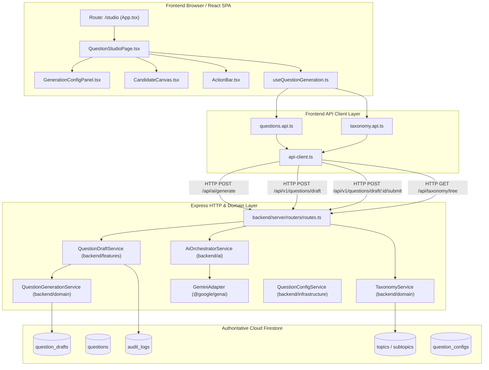
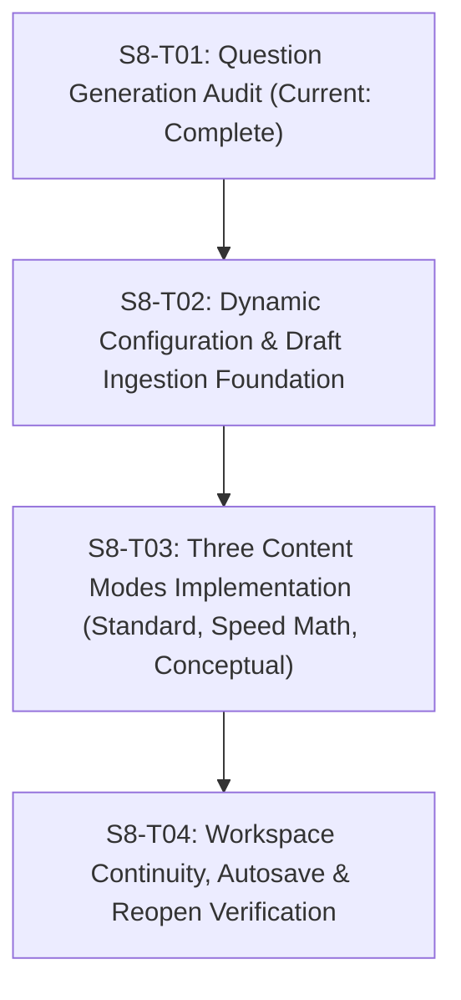

# S8-T01: Question Generation Entry Point Forensic Audit

**Milestone**: Sprint 8 — Dynamic Production Foundation & Content Modes  
**Task**: S8-T01 — Audit the Question Generation Entry Point  
**Effective Date**: October 14, 2026  
**Auditor**: Antigravity Software Architect & QA Systems Engineer  
**Inspected Git Commit SHA**: `17ca168fd2932e15e52e8da32db9f66bff0c3156` (`main`)  
**Scope**: Complete forensic audit of Stage 01 Question Generation across frontend routing, components, local hooks, API client transports, backend route dispatchers, domain services, Firestore repositories, data schemas, and test suites.  
**Mode**: **AUDIT ONLY** (Zero application-code, database, workflow, or configuration changes made).

---

## 1. Executive Summary & Verdict

### Acceptance Status: **PASS (AUDIT COMPLETE)**

### Strategic Verdict:
**The existing Question Generation entry point (`/studio`) CAN serve as the structural foundation for Sprint 8, BUT it is NOT yet production-ready for dynamic multi-mode authoring without targeted remediation in S8-T02 through S8-T04.**

- **Architectural Strengths (Verified Working)**:
  1. The **Save Draft $\neq$ Submit for Verification** invariant is strictly enforced across the UI, hook, domain service, and Firestore repository.
  2. The **Two-Tier Taxonomy (`Topic` $\to$ `Subtopic`)** cascade is strictly followed with zero Category legacy leaks.
  3. The **AI Provider Abstraction** (`@google/genai` via `aiOrchestrator`) is strictly server-isolated, operates advisory-only, enforces client option allowlisting/clamping, and produces deterministic math verification.
  4. The **Persistence Layer** is strictly bound to Cloud Firestore (`question_drafts` collection for transient drafts with canonical `dft_<uuid>` IDs; `questions` collection only upon Stage 02 approval).

- **Critical Production Blockers & Gaps (Identified for S8-T02–S8-T04)**:
  1. **CRITICAL — No Draft Reopening Support**: The Question Studio hook (`useQuestionGeneration.ts`) has **zero logic** to read `draftId`, `id`, or `contentId` from the URL or query parameters. Visiting `/studio?draftId=dft_...` or attempting to reopen a saved draft displays a blank workspace with default topic `TOP-QA-01`. While the backend (`GET /api/questions/draft/:id`) and API client (`questionsApi.getDraft`) exist, the frontend workspace cannot load or edit existing drafts.
  2. **HIGH — Hardcoded Real-World Context Suggestions**: Context suggestions in `GenerationConfigPanel.tsx` are hardcoded client-side arrays (`CONTEXT_SUGGESTIONS`), duplicated in `question-generation.service.ts`, completely ignoring the existing Firestore-backed `questionConfigService` (`question_configs` collection) and the `/api/questions/config` endpoint.
  3. **HIGH — Orphaned Configuration Controls in JSX**: `GenerationConfigPanelProps` declares `questionStyle` and `customInstructions`, but `GenerationConfigPanel.tsx` **never renders them in its JSX**. Users cannot select question styles or provide custom prompt instructions in the UI.
  4. **MEDIUM — Volatile In-Memory Workspace**: In-progress candidate generation and manual edits reside exclusively in volatile React state (`useState`). Any accidental browser refresh, route click, or timeout prior to clicking "Save Draft" results in catastrophic loss of generated content.
  5. **MEDIUM — Fixed Challenge & Presentation Types**: `challengeType` is fixed to `'ABCD'` and `presentationType` is fixed to `'Text'` in `useQuestionGeneration.ts`, with zero UI controls to toggle alternative formats (e.g. `TRUE_FALSE`, `YES_NO`, `IMAGE_BASED`) required by upcoming content modes.

---

## 2. Route, Component & Data-Flow Inventory



### 2.1 Concrete File & Symbol Manifest

| Layer | File Path | Key Symbols / Exports | Responsibility |
|:---|:---|:---|:---|
| **Route Target** | `frontend/pages/QuestionStudioPage.tsx` | `QuestionStudioPage`, `getStep01WorkflowState` | Re-export shim delegating to feature slice |
| **Page Component** | `frontend/features/question-generation/pages/QuestionStudioPage.tsx` | `QuestionStudioPage` | Main Stage 01 workspace orchestrator, layout grid, alert banners, navigation |
| **Config UI** | `frontend/features/question-generation/components/GenerationConfigPanel.tsx` | `GenerationConfigPanel`, `CONTEXT_SUGGESTIONS` | Topic/Subtopic selects, difficulty/language selects, context input, generate button |
| **Canvas UI** | `frontend/features/question-generation/components/CandidateCanvas.tsx` | `CandidateCanvas` | Problem statement editor, 4 options with answer key radios, explanation, math verification |
| **Actions UI** | `frontend/features/question-generation/components/ActionBar.tsx` | `ActionBar` | "Clear / Start New", validation callout, draft ID badge, Save Draft, Submit for Verification |
| **State Hook** | `frontend/features/question-generation/hooks/useQuestionGeneration.ts` | `useQuestionGeneration` | Client state, taxonomy cascade, AI generation dispatch, dirty tracking, save/submit handlers |
| **Feature API** | `frontend/api/questions.api.ts` | `questionsApi` | Typed client methods: `generateAiQuestion`, `refineAiQuestion`, `saveDraft`, `submitForVerification`, `getDraft` |
| **HTTP Transport** | `frontend/api/api-client.ts` | `apiClient`, `ApiClient` | Central fetch wrapper, auth headers, CSRF, error envelopes |
| **Taxonomy API** | `frontend/api/taxonomy.api.ts` | `taxonomyApi` | `getTree()` for loading Two-Tier syllabus hierarchy |
| **HTTP Router** | `backend/server/routers/routes.ts` | `apiRouter`, `sanitizeClientOrchestratorOptions` | Routes: `/ai/generate`, `/ai/refine`, `/v1/questions/draft`, `/v1/questions/draft/:id/submit`, `/questions/:id` |
| **Feature Service** | `backend/features/question-generation/services/question-draft.service.ts` | `QuestionDraftService`, `questionDraftService` | Bridges routes to domain, orchestrates Stage 02 materialization, enforces GAR-02 |
| **Domain Service** | `backend/domain/question-generation/question-generation.service.ts` | `QuestionGenerationService`, `questionGenerationService` | Validates taxonomy alignment, enforces Save Draft $\neq$ Verify, saves to `question_drafts`, transitions to Stage 02 |
| **AI Orchestrator**| `backend/ai/orchestrator/ai-orchestrator.service.ts` | `AiOrchestratorService`, `aiOrchestrator` | Server-side prompt construction, Gemini adapter invocation, mathematical verification |
| **AI Provider** | `backend/ai/providers/gemini.adapter.ts` | `GeminiAdapter` | Direct `@google/genai` provider adapter using `gemini-3.1-flash-lite` |
| **Repository** | `database/firestore/repositories/question-drafts.repository.ts` | `questionDraftsRepository` | Firestore persistence for collection `question_drafts` |
| **Repository** | `database/firestore/repositories/questions.repository.ts` | `questionsRepository` | Firestore persistence for collection `questions` (Stage 02 materialization only) |
| **Repository** | `database/firestore/repositories/audit-log.repository.ts` | `auditLogRepository` | Firestore persistence for collection `audit_logs` (`findByEntityId`, `create`) |
| **Shared Contract**| `shared/contracts/question-generation/question-generation.contract.ts` | `GenerateCandidateInput`, `StudioCandidate`, `SaveQuestionDraftInput`, `SubmitForVerificationResult`, `evaluateStep01CandidateState` | Isomorphic DTOs, interfaces, and pure evaluation function |
| **Entity Types** | `shared/types/question.ts` | `Question`, `QuestionDraft`, `QuestionCandidate` | Pure domain entity interfaces |

---

## 3. End-to-End User Journey Audit

### Step 1: Page Load & Session Initialization
- **Action**: User navigates to `/studio` (or is redirected from `/questions/new` or `/generate`).
- **Observed Behavior**:
  - `App.tsx` checks auth session via `useAuth()`. If unauthenticated, displays `LoginPage`.
  - `QuestionStudioPage` mounts.
  - `useQuestionGeneration` runs `useEffect` on mount, triggering parallel `taxonomyApi.getTree()` (`GET /api/taxonomy/tree`) and `questionsApi.getAiStatus()` (`GET /api/ai/status`).
  - Reads search parameters: `topicId`/`topic`, `subtopicId`/`subtopic`, `difficulty`, `language`/`lang`, `questionStyle`/`style`, `realWorldContext`/`context`.
  - If query params exist, initializes `selectedTopic` and `selectedSubtopic`. If not, selects the first topic and first subtopic from `taxonomyTree`.
  - Renders PageHeader, ProductionJourneyBar, and empty workspace.
- **Defects & Gaps**:
  - Does **NOT** inspect `draftId`, `id`, or `contentId` parameter.
  - Does **NOT** call `questionsApi.getStudioConfig()`, leaving creator-managed configs unread.

### Step 2: Topic & Subtopic Selection (Two-Tier Cascade)
- **Action**: User opens Topic dropdown in `GenerationConfigPanel` and selects a topic.
- **Observed Behavior**:
  - Fires `onTopicChange(topId)`.
  - Sets `selectedTopic = topId`, updates `candidate.topicId = topId`.
  - Finds topic in `taxonomyTree`. If subtopics exist, auto-selects `top.subtopics[0].id` and updates `selectedSubtopic` and `candidate.subtopicId`.
  - User selects specific Subtopic from Subtopic dropdown (`onSubtopicChange`), updating `selectedSubtopic` and `candidate.subtopicId`.
- **Compliance**: Fully compliant with Rule 5 (Two-Tier Taxonomy: Topic $\to$ Subtopic). No Category concept exists.

### Step 3: Generation Parameter Configuration
- **Action**: User configures Difficulty, Language, and Real-World Context Hook.
- **Observed Behavior**:
  - Difficulty options: `Basic` (Easy), `Intermediate` (Medium), `Advanced` (Hard).
  - Language options: `TELUGU` (తెలుగు), `ENGLISH`.
  - Real-World Context: User types custom text or clicks one of 4 suggestion chips.
- **Defects & Gaps**:
  - Suggestion chips are hardcoded constants in `GenerationConfigPanel.tsx` (`CONTEXT_SUGGESTIONS`).
  - `questionStyle` and `customInstructions` props are accepted by the component but **not rendered** in JSX.
  - `challengeType` ('ABCD') and `presentationType` ('Text') are locked in hook state without UI selectors.

### Step 4: AI Candidate Generation
- **Action**: User clicks "✦ Generate Telugu Question".
- **Observed Behavior**:
  - Button disabled, spinner displayed (`isGenerating = true`).
  - Dispatches `POST /api/ai/generate` with `GenerateCandidateInput`.
  - Server-side `aiOrchestrator` verifies topic/subtopic validity via `questionGenerationService.validateGenerationRequest()`.
  - Gemini Flash adapter generates structured JSON containing Telugu question statement, options A–D, correct answer key, and explanation.
  - Runs deterministic mathematical proof evaluation.
  - Returns `{ candidate, metadata, validation }`.
  - Hook populates `candidate` state, sets `hasCandidate = true`, `isDirty = true`, `savedDraftId = null`, triggers debounced duplicate check.
- **Compliance**: Fully compliant with Rule 9 (Advisory AI, Human-in-the-Loop, server-side only). Candidate is purely in-memory; nothing is written to Firestore.

### Step 5: Candidate Review & In-Place Editing
- **Action**: User reviews generated text in `CandidateCanvas` and modifies fields.
- **Observed Behavior**:
  - Problem statement, options A–D, answer radio buttons, and explanation textareas are fully editable.
  - Each keystroke calls `updateCandidateField`, setting `isDirty = true` and re-running `evaluateStep01CandidateState`.
  - Debounced duplicate check (400ms delay, `POST /api/questions/duplicate-check`) inspects database. If matches exist, displays amber warning box with match percentage.
  - AI Refinement pills (`+ Difficulty`, `Simplify Telugu`, `Add Trap Distractor`) invoke `POST /api/ai/refine`.
- **Defects & Gaps**:
  - In-progress edits are 100% volatile. A browser reload destroys all work.

### Step 6: Save Draft (In-Place Persistence)
- **Action**: User clicks "Save Draft" in `ActionBar`.
- **Observed Behavior**:
  - Enabled only when `workflowState.canContinue` is true (valid problem statement $\ge 5$ chars, options A & B present, options C & D present for ABCD, valid answer key, no duplicate options).
  - Calls `questionsApi.saveDraft(payload)` $\to$ `POST /api/v1/questions/draft`.
  - Backend route checks `requireCapability('QUESTION:CREATE')`.
  - `questionGenerationService.saveDraft`:
    - Validates Topic $\to$ Subtopic against authoritative taxonomy.
    - Generates distributed UUID `dft_<uuid>` via `canonicalIdService.generateDraftId()` (or preserves existing ID).
    - Sets `status = QuestionStatus.DRAFT`, `workflowStage = 'QUESTION_STUDIO'`.
    - Persists draft to Cloud Firestore `question_drafts` collection.
  - Returns saved draft document.
  - Hook sets `savedDraftId = savedDraft.id`, `isDirty = false`, displays emerald banner.
  - **Remains on `/studio` workspace. Does not navigate. Does not verify.**
- **Compliance**: 100% compliant with Rule 11 (`SAVE DRAFT` $\neq$ `VERIFY`).

### Step 7: Explicit Submit for Verification
- **Action**: User clicks "Submit for Verification →" in `ActionBar`.
- **Observed Behavior**:
  - Button is strictly disabled unless `savedDraftId` is non-null, `isDirty` is false, and candidate is valid.
  - Browser dialog prompts: `Submit saved draft "${savedDraftId}" for Stage 02 Verification?`.
  - Dispatches `POST /api/v1/questions/draft/:id/submit`.
  - Backend `questionGenerationService.submitForVerification`:
    - Fetches draft from `question_drafts` repository.
    - Confirms status is `DRAFT` (rejects 409 if already submitted, 400 if approved/published).
    - Validates candidate structural completeness.
    - Updates draft status to `SUBMITTED_FOR_REVIEW`, workflowStage to `STAGE_02_VERIFICATION`.
    - Emits immutable audit log: `QUESTION_DRAFT_SUBMITTED_FOR_VERIFICATION`.
  - Returns `{ success: true, draftId, status: 'SUBMITTED_FOR_REVIEW', workflowStage: 'STAGE_02_VERIFICATION' }`.
  - UI displays indigo banner and navigates via `setTimeout(1200ms)` to `/questions/${draftId}/verify`.
- **Compliance**: Fully compliant with canonical 15-step workflow transition (01 $\to$ 02).

### Step 8: Reopening an Existing Record
- **Action**: User attempts to revisit or reopen a previously saved draft.
- **Observed Behavior**:
  - **CRITICAL FAILURE**:
    - The URL `/studio` does not accept a path parameter (`/studio/:id` is not registered in `App.tsx`).
    - If user visits `/studio?draftId=dft_...` or `/studio?id=dft_...`, `useQuestionGeneration.ts` **completely ignores** the parameter.
    - The page renders a blank form with default topic `TOP-QA-01`.
    - While `questionsApi.getDraft(id)` and `GET /api/questions/draft/:id` exist, there is no call or hook mechanism to load an existing draft into Question Studio!

---

## 4. File-Level Forensic Findings by Severity

```text
================================================================================
CRITICAL SEVERITY FINDINGS (Blockers for Sprint 8 Dynamic Production Foundation)
================================================================================
```

### [CRIT-01] Missing Draft Reopening & Ingestion in `useQuestionGeneration.ts`
- **Location**: `frontend/features/question-generation/hooks/useQuestionGeneration.ts:31-38`, `113-148`
- **Finding**: The hook only inspects `topicId`, `subtopicId`, `difficulty`, `language`, `questionStyle`, and `realWorldContext` from URL query parameters. It does **not** read `draftId`, `id`, or `contentId`.
- **Impact**: Authors cannot reopen saved drafts to continue editing, revise returned drafts from Stage 02, or deep-link from the Question Library / Queue.
- **Evidence**:
  ```typescript
  // useQuestionGeneration.ts lines 31-38:
  const queryTopic = searchParams.get('topicId') || searchParams.get('topic');
  const querySubtopic = searchParams.get('subtopicId') || searchParams.get('subtopic');
  const queryDifficulty = searchParams.get('difficulty');
  const queryLanguage = searchParams.get('language') || searchParams.get('lang');
  const queryQuestionStyle = searchParams.get('questionStyle') || searchParams.get('style');
  const queryContext = searchParams.get('realWorldContext') || searchParams.get('context');
  // DRAFT ID / ID IS NEVER CHECKED HERE!
  ```

```text
================================================================================
HIGH SEVERITY FINDINGS
================================================================================
```

### [HIGH-01] Hardcoded Real-World Context Suggestions (Bypasses Firestore Config)
- **Location**: `frontend/features/question-generation/components/GenerationConfigPanel.tsx:40-48` and `backend/domain/question-generation/question-generation.service.ts:117-125`
- **Finding**: Context suggestions are hardcoded string arrays in frontend and backend source code instead of being dynamically fetched from the Firestore `question_configs` collection.
- **Impact**: Changes made to real-world context hooks in admin configuration or database do not appear in the Question Studio workspace.
- **Evidence**:
  ```typescript
  // GenerationConfigPanel.tsx lines 40-48:
  const CONTEXT_SUGGESTIONS = [
    'Metro escalator commuter rush hour',
    'UPI festive shopping cashback',
    'Cricket run-rate chase in last 5 overs',
    'E-commerce delivery courier speed',
    'Monthly salary savings vs inflation',
    'Train overtaking on parallel tracks',
    'Water tank leakage & dual pump refill',
  ];
  ```

### [HIGH-02] Orphaned Configuration Props in `GenerationConfigPanel.tsx`
- **Location**: `frontend/features/question-generation/components/GenerationConfigPanel.tsx:26-27`, `35-36`
- **Finding**: `questionStyle` and `customInstructions` are defined in `GenerationConfigPanelProps`, received in the component arguments, but are **never rendered in the JSX**.
- **Impact**: Authors have no UI control to select pedagogical question styles (e.g. `CONCEPTUAL_ANALYSIS`, `SPEED_MATH`, `LOGICAL_PUZZLE`) or supply custom instructions for the AI prompt.

```text
================================================================================
MEDIUM SEVERITY FINDINGS
================================================================================
```

### [MED-01] Volatile In-Memory Candidate State (No Session Persistence Guard)
- **Location**: `frontend/features/question-generation/hooks/useQuestionGeneration.ts:64-87`
- **Finding**: Active candidate drafting state is purely in React `useState`. There is no `beforeunload` warning when `isDirty` is true, and no `sessionStorage` autosave buffer.
- **Impact**: Unsaved candidate work is immediately lost if the user accidentally refreshes, navigates, or experiences a session blip.

### [MED-02] Fixed Challenge & Presentation Types
- **Location**: `frontend/features/question-generation/hooks/useQuestionGeneration.ts:52-53`
- **Finding**: `challengeType` is hardcoded to `'ABCD'` and `presentationType` is hardcoded to `'Text'`.
- **Impact**: While the schema and backend support other challenge types (`TRUE_FALSE`, `YES_NO`, `ODD_ONE_OUT`) and presentation types (`IMAGE_BASED`, `DIAGRAM_CHALLENGE`), the Studio workspace cannot author them.

### [MED-03] `ProductionJourneyBar` Stage Code Mismatch
- **Location**: `frontend/components/production/ProductionJourneyBar.tsx:50-72` and `QuestionStudioPage.tsx:94`
- **Finding**: `QuestionStudioPage` passes `activeStage="QUESTION_STUDIO"`, but `ProductionJourneyBar`'s `stageCodeToNumber` map only contains `QUESTION` and `QUESTION_GENERATION`.
- **Impact**: The journey bar evaluates `stageCodeToNumber['QUESTION_STUDIO']` as `undefined` and falls back to context state.

```text
================================================================================
LOW SEVERITY FINDINGS / DOCUMENTATION DISCREPANCIES
================================================================================
```

### [LOW-01] Historical FC-006 Taxonomy Divergence
- **Location**: `docs/features/FC-006-QUESTION-GENERATION-VERSIONING.md:49-85`
- **Finding**: FC-006 (authored in Sprint 2) references `subject`, `textTelugu`, `textEnglish`, and `question_versions`.
- **Resolution**: Overridden by active canonical architecture (`AGENTS.md`, 12-DATABASE, 25-TWO-TIER-TAXONOMY). Working code in `backend/domain/question-generation` correctly implements Two-Tier `Topic` $\to$ `Subtopic` and `question_drafts`.

---

## 5. Reusable Components & Contracts for Sprint 8

The following existing components, services, and contracts are verified solid and can be directly reused in Sprint 8:

1. **`shared/contracts/question-generation/question-generation.contract.ts`**:
   - `evaluateStep01CandidateState`: Pure, thoroughly tested candidate evaluation function.
   - `GenerateCandidateInput` & `StudioCandidate`: Standardized DTOs.
   - `SaveQuestionDraftInput` & `SubmitForVerificationResult`: Robust lifecycle contracts.
2. **`backend/domain/question-generation/question-generation.service.ts`**:
   - `saveDraft()`: Fully handles Firestore `question_drafts` persistence with collision-resistant `dft_<uuid>` IDs.
   - `submitForVerification()`: Complete validation and Stage 01 $\to$ 02 state transition logic.
   - `validateGenerationRequest()`: Two-tier taxonomy validation with production seed fallback.
3. **`database/firestore/repositories/question-drafts.repository.ts`**:
   - Authoritative Firestore persistence for transient drafts with OCC and CRUD methods.
4. **`backend/ai/orchestrator/ai-orchestrator.service.ts`**:
   - Server-isolated AI generation, prompt engineering, options sanitization, and deterministic math proof verification.
5. **`frontend/features/question-generation/components/CandidateCanvas.tsx`**:
   - Clean, rich UI for Telugu problem statements, 4 options, and Burra Speed Trick proof display.
6. **`frontend/features/question-generation/components/ActionBar.tsx`**:
   - Enforces the physical visual separation of Save Draft vs. Submit for Verification.

---

## 6. Architecture Discrepancies Register

| Item | Current Code Implementation | Architecture Specification Reference | Conflict Analysis & Resolution |
|:---|:---|:---|:---|
| **Deep-Link Draft Reopening** | `useQuestionGeneration.ts` ignores `draftId` and `contentId`. | `11-PAGE-ROUTE-CONTRACT.md` (P-04): *"If ?contentId=... provided, loads active draft for that content."* | **Discrepancy Confirmed**. Code is missing draft retrieval logic. S8-T02 must implement `draftId`/`contentId` ingestion. |
| **Real-Life Context Source** | Hardcoded array in `GenerationConfigPanel.tsx` & `question-generation.service.ts`. | `12-DATABASE-ARCHITECTURE.md` & `questionConfigService`: Managed in Firestore `question_configs`. | **Discrepancy Confirmed**. Frontend does not call `questionsApi.getStudioConfig()`. S8-T02 must wire dynamic config. |
| **Stage Stepper Key** | `activeStage="QUESTION_STUDIO"` in `QuestionStudioPage.tsx`. | `stageCodeToNumber` in `ProductionJourneyBar.tsx` defines `QUESTION` and `QUESTION_GENERATION`. | **Minor Discrepancy**. Add `QUESTION_STUDIO: 1` alias to `stageCodeToNumber`. |
| **Taxonomy Model** | Pure Two-Tier (`Topic` $\to$ `Subtopic`) in code. | Historical `FC-006` mentions `subject` and `category`. | **No Issue**. Code adheres to authoritative Rule 5 (`AGENTS.md`). FC-006 is historical. |

---

## 7. Prioritized Blockers & Dependencies for S8-T02 through S8-T04

To establish the **Dynamic Production Foundation** and support the **Three Content Modes** in Sprint 8, the following work sequence is required:



### 1. S8-T02 — Dynamic Configuration & Draft Ingestion Foundation (Priority: P0)
- **Dependency**: S8-T01 audit findings.
- **Actions Required**:
  - Update `useQuestionGeneration.ts` to inspect `searchParams.get('draftId')` or `searchParams.get('id')` on mount.
  - If draft ID is present, invoke `questionsApi.getDraft(draftId)` and populate `candidate`, `savedDraftId`, and configuration dropdowns.
  - Update `useQuestionGeneration.ts` on mount to call `questionsApi.getStudioConfig()`.
  - Wire dynamic `realLifeContexts` and `questionStyles` into `GenerationConfigPanel.tsx`, replacing the hardcoded `CONTEXT_SUGGESTIONS` array.

### 2. S8-T03 — Three Content Modes Implementation (Priority: P1)
- **Dependency**: S8-T02 dynamic configuration.
- **Actions Required**:
  - Expose UI controls in `GenerationConfigPanel.tsx` for the three content/generation modes:
    1. **Standard Exam MCQ** (`challengeType: 'ABCD'`, 4 options, bilingual Telugu/English).
    2. **Speed Math / Rapid Fire** (`questionStyle: 'SPEED_MATH'`, focused on mental calculation & Burra Speed Trick).
    3. **Conceptual / Story-Based** (`questionStyle: 'STORY_BASED'`, narrative real-world context hook).
  - Render the unrendered `questionStyle` select and `customInstructions` textarea in `GenerationConfigPanel.tsx`.
  - Pass selected mode and style to `questionsApi.generateAiQuestion`.

### 3. S8-T04 — Workspace Continuity & Autosave Protection (Priority: P1)
- **Dependency**: S8-T02 & S8-T03.
- **Actions Required**:
  - Add `beforeunload` window listener in `useQuestionGeneration.ts` when `isDirty` is true.
  - Add optional local autosave buffer in `sessionStorage` to prevent work loss on page reload.
  - Ensure navigation from Verification rejection (`REQUEST_CHANGES` in Stage 02) back to `/studio?draftId=...` correctly reloads the rejected draft with reviewer notes.

---

## 8. Audit Conclusion

The Question Generation entry point (`/studio`) possesses a robust, verified architectural backbone:
- Unidirectional layer flow: Frontend $\to$ API Client $\to$ Express $\to$ Domain Service $\to$ Firestore.
- Non-negotiable rules (`SAVE DRAFT` $\neq$ `VERIFY`, Two-Tier Taxonomy, Server-Isolated Advisory AI, Cloud Firestore transactional authority) are already 100% compliant in working code.

**However, the entry point currently operates as a "write-only" workspace for freshly generated items.** It cannot reopen existing drafts, uses hardcoded context suggestion strings, and leaves pedagogical question style controls unrendered. Resolving these explicit gaps in S8-T02 through S8-T04 will upgrade the Question Studio into a true dynamic production engine for Burra Pariksha.

**S8-T01 Acceptance Status: PASS (AUDIT COMPLETE — ZERO APPLICATION CODE MUTATIONS)**
