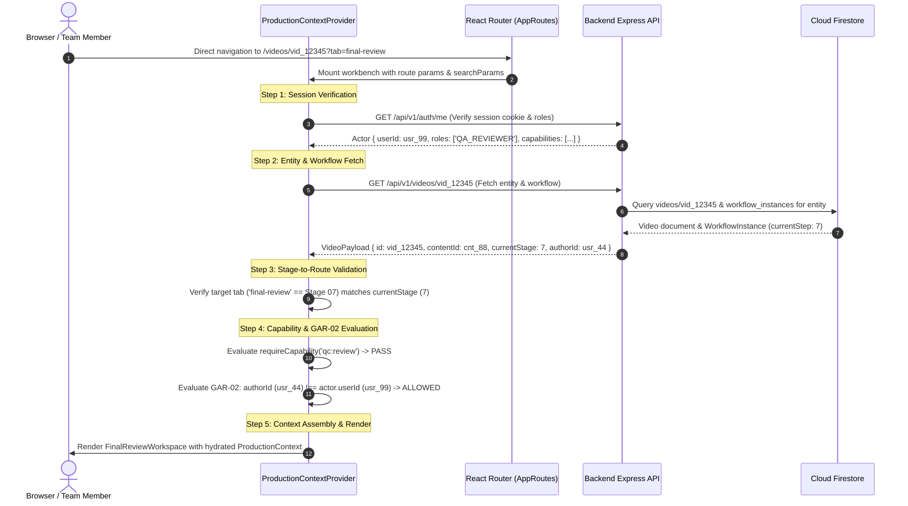

# S8-T05 — Shared Production Context Contract Specification
## Burra Pariksha Content Management System (BP-CMS)
### Sprint 08 — Dynamic Production Foundation / Phase B Architecture Specification

```text
================================================================================
Document ID:       BP-S8-T05-PRODUCTION-CONTEXT-CONTRACT
Version:           1.0.0
Date:              2026-10-14
Status:            APPROVED CONTRACT SPECIFICATION
Gate Status:       GATE A APPROVED / PHASE B DELIVERABLE
Inspected Commit:  62b23b4 (main)
Scope:             Shared Production Context Interface, URL Grounding Contract,
                   Lifecycle Hydration, State Transitions, Persistence Alignment,
                   and Implementation Impact Matrix across 15 Canonical Stages
Upstream Inputs:   docs/sprints/sprint-08/S8-T01-QUESTION-GENERATION-AUDIT.md
                   docs/sprints/sprint-08/S8-T02-PRODUCTION-PAGE-WORKFLOW-INVENTORY.md
                   docs/sprints/sprint-08/S8-T03-CONTENT-MODE-REQUIREMENTS.md
                   docs/sprints/sprint-08/S8-T04-DYNAMIC-PAGE-ROLE-REQUIREMENTS.md
                   docs/architecture/DECISION-LOG.md (ADR-008, 009, 010, 011)
                   docs/architecture/07-CANONICAL-15-STEP-WORKFLOW.md
                   docs/architecture/09-RBAC-CAPABILITY-MODEL.md
                   docs/architecture/11-PAGE-ROUTE-CONTRACT.md
                   docs/architecture/12-DATABASE-ARCHITECTURE.md
                   docs/architecture/14-MEDIA-ARCHITECTURE.md
                   docs/architecture/15-API-CONTRACT.md
                   docs/architecture/25-TWO-TIER-TAXONOMY-ARCHITECTURE.md
                   docs/architecture/26-COLLISION-RESISTANT-UUID-CANONICAL-ID-ARCHITECTURE.md
                   shared/lib/id.service.ts
                   shared/constants/roles.ts
                   shared/types/taxonomy.ts
                   shared/contracts/workflow.ts
                   shared/contracts/planning.ts
                   frontend/contexts/ProductionJourneyContext.tsx
                   frontend/features/question-generation/hooks/useQuestionGeneration.ts
Downstream Impact: S8-T06 (Context Provider Implementation), S8-T07 (Studio Reopening)
================================================================================
```

---

## 1. Executive Summary & Architectural Governance

### 1.1 Purpose
This specification establishes the authoritative **Shared Production Context Contract** (`ProductionContext`) for BP-CMS. Following the closure of Gate A, which validated the forensic audits (S8-T01, S8-T02) and finalized the Phase A requirements (S8-T03, S8-T04) alongside Architecture Decision Records ADR-008 through ADR-011, this document bridges conceptual requirements into concrete TypeScript contracts, data flow sequences, and URL parameter bindings without modifying runtime application code.

### 1.2 Core Architectural Invariants (Non-Negotiable)
In strict accordance with [AGENTS.md](../../../AGENTS.md), this contract enforces:
1. **Cloud Firestore Sole Transactional Datastore**: All state persisted and rehydrated via Cloud Firestore collections (`question_drafts`, `questions`, `videos`, `scripts`, `thumbnails`, `social_reviews`, `publishing_records`, `content_masters`, `workflow_instances`, `assignments`, `topics`, `subtopics`, `users`). Google Sheets is permanently prohibited from runtime state.
2. **Canonical 15-Stage Workflow Continuity**: Every production asset traverses Stages 01 through 15 sequentially ([07-CANONICAL-15-STEP-WORKFLOW.md](../../architecture/07-CANONICAL-15-STEP-WORKFLOW.md)). No stage may be skipped, bypassed, or merged.
3. **Canonical Two-Tier Taxonomy**: Strictly autonomous **Topic** (`top_<uuid>` or legacy `TOP-*`) $\longrightarrow$ child **Subtopic** (`sub_<uuid>` or legacy `SUB-*`) ([25-TWO-TIER-TAXONOMY-ARCHITECTURE.md](../../architecture/25-TWO-TIER-TAXONOMY-ARCHITECTURE.md)). Legacy `Category` is permanently obsolete.
4. **Collision-Resistant UUID Canonical IDs**: All entities utilize RFC 4122 v4 distributed identifiers generated statelessly by [`shared/lib/id.service.ts`](../../../shared/lib/id.service.ts). Database-backed sequence counters are prohibited.
5. **Absolute Anti-Self-Approval (`GAR-02`)**: No author may approve their own submission at Stage 02 (Question Verification), Stage 07 (Final QC), or Stage 09 (Social Review). Enforced server-side with zero administrative or role-based bypass across all 11 canonical roles.
6. **Save Draft $\neq$ Submit for Verification**: Saving a draft persists minimal data to `question_drafts` and remains in Stage 01. Submitting for verification requires a saved draft, validates full educational rules, and triggers the formal transition to Stage 02.
7. **Three Content Production Modes**: Accommodates Mode 1 (`QUESTION_CHALLENGE_SHORT`), Mode 2 (`TOPIC_INTRODUCTION`), and Mode 3 (`EXPLAINED_QUESTIONS_VIDEO`) per ADR-010.

---

## 2. Production Context Type Definition & Canonical Schema

The Shared Production Context unifies curriculum taxonomy, content mode, entity references, workflow lifecycle, task assignment, and actor authorization into a single typed contract.

### 2.1 TypeScript Interface Definition

```typescript
/**
 * Shared Production Context Contract
 * Location: shared/types/production-context.ts
 */

import { CanonicalRbacRole } from '../constants/roles';
import { DifficultyLevel, QuestionLanguage, QuestionStyle } from '../constants/enums';
import { WorkflowStepNumber, WorkflowStageStatus } from '../constants/workflow';

export type ContentProductionMode =
  | 'QUESTION_CHALLENGE_SHORT'  // Mode 1: Single-question vertical short (<= 58s)
  | 'TOPIC_INTRODUCTION'        // Mode 2: Conceptual syllabus overview (0 questions, 60-180s)
  | 'EXPLAINED_QUESTIONS_VIDEO';// Mode 3: Masterclass (1 intro + N practice questions, 16:9)

export interface ProductionContextTaxonomy {
  topicId: string;                     // Canonical: top_<uuid> (legacy: TOP-###)
  topicName: string;                   // Human-readable topic title
  topicSlug: string;                   // URL-safe slug
  subtopicId: string;                  // Canonical: sub_<uuid> (legacy: SUB-###)
  subtopicName: string;                // Human-readable subtopic title
  subtopicSlug: string;                // URL-safe slug
}

export interface ProductionContextModeConfig {
  productionMode: ContentProductionMode;
  questionCount: number;               // Mode 1: 1 (or batch series {5,10,15,20}); Mode 2: 0; Mode 3: 5, 10, 15, 20
  aspectRatio: '9:16' | '16:9';        // Mode 1: '9:16'; Mode 2: '9:16' | '16:9'; Mode 3: '16:9'
  language: QuestionLanguage;          // TELUGU | ENGLISH | TELUGU_ENGLISH
  difficulty?: DifficultyLevel;        // EASY | MEDIUM | HARD | PROGRESSIVE (Mode 3)
  questionStyle?: QuestionStyle;       // STORY_BASED | SPEED_MATH | EXAM_DRILL | CONCEPT_FIRST
  targetDurationSeconds?: number;      // Mode 1: <= 58s; Mode 2: 60-180s; Mode 3: 720-3120s
}

export interface ProductionContextEntityIds {
  contentMasterId?: string;            // Root aggregate: cnt_<uuid>
  draftId?: string;                    // Transient draft: dft_<uuid> (Stage 01)
  questionId?: string;                 // Approved question: qst_<uuid> (Stage 02+)
  questionIds?: string[];              // Mode 3 practice questions array: qst_<uuid>[]
  conceptBriefId?: string;             // Mode 2 conceptual overview ID: cbr_<uuid>
  scriptId?: string;                   // Teleprompter script: scr_<uuid> (Stage 03)
  videoId?: string;                    // Video production entity: vid_<uuid> (Stage 04-12)
  thumbnailId?: string;                // Master thumbnail: thm_<uuid> (Stage 08)
  reviewId?: string;                   // QC/Social review: rev_<uuid> (Stage 07 & 09)
  publishingId?: string;               // Publishing record: pub_<uuid> (Stage 10-12)
  analyticsId?: string;                // Performance snapshot: anl_<uuid> (Stage 13-14)
  workflowInstanceId?: string;         // State machine tracking: wfl_<uuid>
}

export interface ProductionContextWorkflow {
  currentStage: WorkflowStepNumber;    // Canonical integer: 1 to 15
  stageStatus: WorkflowStageStatus;    // DRAFT | IN_PROGRESS | PENDING_REVIEW | CHANGES_REQUESTED | APPROVED | etc.
  isTerminal: boolean;                 // True if PUBLISHED or ARCHIVED
  lastTransitionAt: string;            // ISO 8601 UTC timestamp
  lastTransitionBy: string;            // usr_<uuid>
  rejectionNotes?: string;             // Feedback from Stage 02, 07, or 09 rejection
  allowedActions: string[];            // Permitted transitions for active actor
}

export interface ProductionContextAssignment {
  ownerId: string;                     // Content creator / initiator (usr_<uuid>)
  assignedAuthorId?: string;           // Stage 01 Author (usr_<uuid>)
  assignedReviewerId?: string;         // Stage 02 Question QA (usr_<uuid>)
  assignedScriptwriterId?: string;     // Stage 03 Scriptwriter (usr_<uuid>)
  assignedPresenterId?: string;        // Stage 04 Presenter / Talent (usr_<uuid>)
  assignedEditorId?: string;           // Stage 06 Video Editor (usr_<uuid>)
  assignedQcLeadId?: string;           // Stage 07 Final QC Lead (usr_<uuid>)
  assignedDesignerId?: string;         // Stage 08 Graphic Artist (usr_<uuid>)
  assignedPublisherId?: string;        // Stage 09-12 Publishing Lead (usr_<uuid>)
}

export interface ProductionContextActor {
  userId: string;                      // Authenticated User: usr_<uuid>
  name: string;                        // Full name
  roles: CanonicalRbacRole[];          // Canonical 11 roles from shared/constants/roles.ts
  capabilities: string[];              // Expanded atomic tokens ('content:create', 'review:approve', etc.)
  isAiAgent: boolean;                  // True for automated orchestrators, false for humans
}

export interface ProductionContext {
  taxonomy: ProductionContextTaxonomy;
  modeConfig: ProductionContextModeConfig;
  entityIds: ProductionContextEntityIds;
  workflow: ProductionContextWorkflow;
  assignment: ProductionContextAssignment;
  actor: ProductionContextActor;
  isDirty: boolean;                    // Unsaved changes in active workbench
  isLoading: boolean;                  // Context hydration in progress
  error?: string | null;               // Hydration or validation failure
}
```

---

## 3. Attribute Creation, Propagation, Retrieval & Validation

The table below governs how each foundational context attribute is instantiated, transferred between routes, loaded from Firestore, and validated at runtime:

| Attribute | 1. Creation Pattern | 2. Page-to-Page Transfer Contract | 3. Persisted Retrieval Source | 4. Runtime Validation Invariant |
| :--- | :--- | :--- | :--- | :--- |
| **`topicId` & `subtopicId`** | Selected by user in `/studio` dropdowns or seeded by Content Plan (`/planning`). | Propagated via URL search params: `?topicId=top_...&subtopicId=sub_...` | Read from `topics` and `subtopics` collections; stored in `question_drafts` and `content_masters`. | Must exist in Firestore; `subtopic.topicId === topic.id`. Permanent Two-Tier hierarchy; zero Category leaks. |
| **`productionMode`** | Selected via Stage 01 Mode Modal on `/studio` entry (ADR-011 / DD-02). | Propagated via URL query param: `?mode=QUESTION_CHALLENGE_SHORT` (or M2, M3). | Read from `question_drafts.productionMode` or `content_masters.productionMode`. | Restricted to `QUESTION_CHALLENGE_SHORT`, `TOPIC_INTRODUCTION`, `EXPLAINED_QUESTIONS_VIDEO`. Immutable after Stage 02. |
| **`questionCount`** | Configured in Stage 01 Studio Panel based on mode rules. | Propagated via URL query param: `?count=1` (Mode 1) or `?count=10` (Mode 3). | Read from `question_drafts.targetQuestionCount` or `content_masters.questionCount`. | Mode 1: strictly 1 (or batch 5,10,15,20 per ADR-010); Mode 2: strictly 0; Mode 3: strictly 5, 10, 15, or 20. |
| **`draftId`** | Generated statelessly via `idService.generateDraftId()` (`dft_<uuid>`) on initial "Save Draft". | Propagated via URL query param: `?draftId=dft_<uuid>` on `/studio` and `/questions/:id/verify`. | Persisted to and retrieved from `question_drafts` collection in Cloud Firestore. | Prefix must be `dft_` followed by RFC 4122 v4 UUID. Distinct from permanent `qst_<uuid>`. |
| **`contentId` / `entityId`** | Generated on Stage 02 approval (`qst_<uuid>`, `vid_<uuid>`, `cnt_<uuid>`). | Route path parameter (`/videos/:videoId`) or query param (`?contentId=cnt_<uuid>`). | Persisted in `content_masters`, `questions`, and `videos` collections. | Strict prefix validation (`cnt_`, `qst_`, `vid_`). Aligns with ADR-011 typed parameter schema. |
| **`workflowStage`** | Initialized to `1` on draft creation; advanced monotonically by workflow engine. | Expressed in UI route (`/studio`=1, `/verify`=2, `/videos/:id?tab=script`=3, etc.). | Persisted in `workflow_instances` collection (`currentStep: WorkflowStepNumber`). | Strictly $1 \le \text{step} \le 15$. Step skipping prohibited. Route must match `workflowStage` or display warning. |
| **`stageStatus`** | Set to `DRAFT` in Stage 01; transitions to `PENDING_REVIEW`, `APPROVED`, etc. | Carried inside `ProductionContext.workflow.stageStatus` and API envelopes. | Read from `workflow_instances` collection (`contentStatus`, `mediaStatus`, etc.). | State transitions governed by `CANONICAL_TRANSITION_RULES` in `transition-matrix.ts`. |
| **`assignment`** | Initialized with `ownerId = actor.userId`; task assignments created in Stage 01–03. | Propagated via API payload; hydrated from server on workbench load. | Persisted in `assignments` collection (`asn_<uuid>`) linked by `entityId`. | Only authorized roles may assign. Assignee must hold role capability for assigned stage. |

---

## 4. Deep-Link Hydration & Direct Navigation Sequence

When a user navigates directly to any production URL (e.g., bookmark, shared Slack link, or notification click), the frontend executes a deterministic **5-Step Hydration Sequence**:



### 4.1 Error & Discrepancy Handling in Deep Linking
1. **Unauthenticated Session**: If Step 1 fails, redirect to `/login?returnUrl=${encodeURIComponent(currentPath)}`.
2. **Entity Not Found**: If Step 2 returns 404, render standard `NotFoundPage` (`P-18`) with explicit "Content record does not exist in Firestore" message.
3. **Stage Mismatch (Out-of-Sequence Navigation)**: If a user attempts to access `/videos/vid_12345?tab=final-review` (Stage 07) but the asset is currently at Stage 04 (Filming):
   - Render the page in **Read-Only Inspection Mode**.
   - Display a prominent amber warning banner: *"This video is currently in Stage 04 (Filming). Stage 07 (Final QC) cannot be executed out of sequence."*
   - Provide an immediate action button: *"Jump to Current Stage (Stage 04)"*.
4. **GAR-02 Anti-Self-Approval Conflict**: If the authenticated user is the original author (`authorId === actor.userId`):
   - Render the review workspace in **Auditor Read-Only Mode**.
   - Disable all approval/sign-off buttons (`disabled={true}`).
   - Display explicit badge: *"GAR-02 Invariant: You are the author of this content and cannot approve your own submission."*

---

## 5. Concrete Operational Scenarios & Lifecycle Examples

### 5.1 Example 1: Creating a New Item (Stage 01 Creation)

```text
 ┌────────────────────────────────────────────────────────────────────────────────────────┐
 │                      SCENARIO 1: CREATING A NEW ITEM IN STAGE 01                       │
 └────────────────────────────────────────────────────────────────────────────────────────┘
```

1. **User Action**: Creator navigates to `/studio`.
2. **Mode Modal Trigger (DD-02 / ADR-011)**:
   - Application renders `ProductionModeModal`.
   - Creator selects **Mode 3: Explained Questions Video** with question count **10**.
3. **Context Initialization**:
   - `ProductionContextProvider` generates initial in-memory context:
     ```json
     {
       "taxonomy": { "topicId": "top_math_01", "subtopicId": "sub_speed_calc_02" },
       "modeConfig": {
         "productionMode": "EXPLAINED_QUESTIONS_VIDEO",
         "questionCount": 10,
         "aspectRatio": "16:9",
         "language": "TELUGU_ENGLISH"
       },
       "workflow": { "currentStage": 1, "stageStatus": "DRAFT" }
     }
     ```
   - URL updates client-side without reload: `/studio?mode=EXPLAINED_QUESTIONS_VIDEO&count=10`.
4. **Draft Persistence (Save Draft Contract)**:
   - Creator inputs Introductory Concept and drafts Question 1.
   - Creator clicks **"Save Draft"** (`ActionBar.tsx`).
   - Hook invokes `questionsApi.saveDraft(payload)`.
   - Backend persists payload to `question_drafts` collection with ID `dft_a1b2c3d4-e5f6-4a7b-8c9d-0e1f2a3b4c5d`.
   - In-place toast displays: *"Draft saved successfully at 22:45 UTC"*.
   - Browser URL updates to: `/studio?draftId=dft_a1b2c3d4-e5f6-4a7b-8c9d-0e1f2a3b4c5d`.
   - **Crucial Rule**: The page does **NOT** navigate away, does **NOT** advance workflow, and does **NOT** execute Stage 02 verification.

---

### 5.2 Example 2: Reopening a Saved Draft (Stage 01 Resumption)

```text
 ┌────────────────────────────────────────────────────────────────────────────────────────┐
 │                   SCENARIO 2: REOPENING A SAVED DRAFT (STAGE 01 RESUMPTION)            │
 └────────────────────────────────────────────────────────────────────────────────────────┘
```

1. **User Action**: Creator returns after lunch, opens browser history or clicks link in dashboard:
   `https://cms.burrapariksha.com/studio?draftId=dft_a1b2c3d4-e5f6-4a7b-8c9d-0e1f2a3b4c5d`
2. **Hydration Sequence**:
   - `useQuestionGeneration` hook mounts and inspects `searchParams.get('draftId')`.
   - Hook detects valid `draftId`. Sets `isLoading = true`.
   - Dispatches `questionsApi.getDraft('dft_a1b2c3d4-e5f6-4a7b-8c9d-0e1f2a3b4c5d')`.
   - Server retrieves document from `question_drafts/dft_a1b2c3d4-e5f6-4a7b-8c9d-0e1f2a3b4c5d`.
3. **Workspace Restoration**:
   - Hook populates form state: `selectedTopic`, `selectedSubtopic`, `productionMode`, `introductoryConcept`, and candidate questions.
   - Clears `isDirty` flag; sets `savedDraftId = 'dft_a1b2c3d4-e5f6-4a7b-8c9d-0e1f2a3b4c5d'`.
   - Sets `isLoading = false`.
   - Workspace displays restored draft exactly as saved.
4. **Submission for Verification**:
   - Creator finishes editing all 10 questions.
   - Creator explicitly clicks **"Submit for Verification"**.
   - Hook validates 100% field presence and executes `questionsApi.submitForVerification(draftId)`.
   - Server creates `WorkflowInstance` (`wfl_...`), advances `currentStep` to `2` (`PENDING_REVIEW`).
   - Browser navigates to: `/questions/qst_new123/verify?draftId=dft_a1b2c3d4-e5f6-4a7b-8c9d-0e1f2a3b4c5d`.

---

### 5.3 Example 3: Resuming Production Mid-Journey (Stage 07 Final QC)

```text
 ┌────────────────────────────────────────────────────────────────────────────────────────┐
 │               SCENARIO 3: RESUMING PRODUCTION MID-JOURNEY (STAGE 07 FINAL QC)          │
 └────────────────────────────────────────────────────────────────────────────────────────┘
```

1. **User Action**: QC Reviewer receives an assignment notification and clicks:
   `/videos/vid_98765432-1a2b-4c3d-9e0f-1a2b3c4d5e6f?tab=final-review`
2. **Context Resolution**:
   - `ProductionContextProvider` resolves `videoId = vid_98765432-1a2b-4c3d-9e0f-1a2b3c4d5e6f`.
   - Queries `GET /api/v1/videos/vid_...` and linked `WorkflowInstance`.
   - Hydrates `ProductionContext`:
     - `taxonomy`: `{ topicId: "top_history", subtopicId: "sub_modern_india" }`
     - `modeConfig`: `{ productionMode: "QUESTION_CHALLENGE_SHORT", aspectRatio: "9:16" }`
     - `entityIds`: `{ contentMasterId: "cnt_11", videoId: "vid_9876...", scriptId: "scr_33" }`
     - `workflow`: `{ currentStage: 7, stageStatus: "IN_PROGRESS" }`
     - `assignment`: `{ ownerId: "usr_author1", assignedQcLeadId: "usr_qclead2" }`
3. **GAR-02 Verification**:
   - Reviewer ID is `usr_qclead2`.
   - Invariant check: `assignment.ownerId (usr_author1) !== actor.userId (usr_qclead2)`. **PASS**.
4. **Execution**:
   - `FinalReviewWorkspace.tsx` mounts under Tab 4.
   - Reviewer audits 6-point checklist (Audio sync, subtitle timing, 9:16 resolution, Telugu orthography, hook retention, trick accuracy).
   - Reviewer clicks **"Approve Final QC"**.
   - Server records QC audit log, advances workflow from Stage 07 to Stage 08 (Thumbnail Generation).
   - Navigation automatically updates active tab to `?tab=thumbnail`.

---

## 6. Existing Repository Files & Minimum Proposed Changes Matrix

The following matrix identifies the exact files across frontend, shared contracts, and backend services, outlining the minimal non-breaking modifications required during upcoming Sprint 8 implementation tasks:

| Existing File Path | Current Role in Baseline | Minimal Proposed Implementation Scope (S8-T06+) | Invariant Preserved |
| :--- | :--- | :--- | :--- |
| [`frontend/contexts/ProductionJourneyContext.tsx`](../../../frontend/contexts/ProductionJourneyContext.tsx) | Manages 15-stage stepper and entity IDs (`contentMasterId`, `videoId`). | Expand `ProductionJourneyContextType` to implement `ProductionContext` (Section 2.1). Add `productionMode`, `topicId`, `subtopicId`, `draftId`, and `assignment`. | Preserves existing `useProductionJourney()` consumers via backward-compatible getters. |
| [`frontend/features/question-generation/hooks/useQuestionGeneration.ts`](../../../frontend/features/question-generation/hooks/useQuestionGeneration.ts) | Stage 01 state management hook. Lacks draft reopening logic. | In `useEffect`, inspect `searchParams.get('draftId')`. If present, invoke `questionsApi.getDraft(draftId)` and populate form state. Add `beforeunload` warning when `isDirty`. | Enforces Save Draft $\neq$ Submit for Verification contract. |
| [`frontend/features/question-generation/pages/QuestionStudioPage.tsx`](../../../frontend/features/question-generation/pages/QuestionStudioPage.tsx) | Stage 01 UI entry point. Lacks Mode Selection dialog. | Mount `ProductionModeModal` when URL lacks `mode` query param. Pass active mode to config panel and `ActionBar`. | Conforms to ADR-011 / DD-02 modal entry flow. |
| [`frontend/components/production/ProductionJourneyBar.tsx`](../../../frontend/components/production/ProductionJourneyBar.tsx) | Visual 15-stage production journey stepper. | Wire stage clicks to use `ProductionContext.modeConfig` to calculate appropriate target route/tab. Display stage lock icons for future stages. | Enforces sequential 15-stage workflow presentation. |
| [`frontend/pages/VideoDetailPage.tsx`](../../../frontend/pages/VideoDetailPage.tsx) | Master production workbench hosting Stages 03–08 across 5 tabs. | Connect tab router to `ProductionContext`. Ensure Tab 4 (`final-review`) evaluates `GAR-02` against `context.assignment.ownerId`. | Preserves ADR-011 / DD-01 QC route consolidation. |
| [`frontend/pages/QuestionVerifyApprovePage.tsx`](../../../frontend/pages/QuestionVerifyApprovePage.tsx) | Stage 02 Question Verification workspace. | Adapt verification UI: render 10-point proof checklist for Modes 1 & 3; render 5-point concept accuracy checklist for Mode 2. | Enforces ADR-009 / OD-03 polymorphic verification gate. |
| [`frontend/app/App.tsx`](../../../frontend/app/App.tsx) | Top-level routing and context provider nesting. | Ensure `ProductionJourneyProvider` wraps `AppRoutes`. No route path deletions or modifications required. | Preserves all 24 mounted canonical application routes. |
| [`shared/contracts/workflow.ts`](../../../shared/contracts/workflow.ts) | Shared DTOs for workflow state transitions and instances. | Export `ProductionContext` and `ContentProductionMode` types from `shared/types/production-context.ts`. | Maintains pure TypeScript shared contract boundary. |
| [`backend/server/validation/request-schemas.ts`](../../../backend/server/validation/request-schemas.ts) | Zod request validation schemas. | Update `QueueVideoInputSchema` to permit `questionId: z.string().optional()` and `questionIds: z.array(z.string()).optional()`. | Implements ADR-010 / OD-05 aggregate root relaxation. |
| [`backend/server/routers/routes.ts`](../../../backend/server/routers/routes.ts) | Express route dispatcher. | Ensure `GET /api/questions/draft/:id` and `POST /api/questions/draft` return full mode configuration and taxonomy linkage. | Enforces zero business logic in Express routes. |

---

## 7. Compliance & Invariant Verification Matrix

| Architectural Invariant | Verification Criteria & Evidence | Compliance Status |
| :--- | :--- | :---: |
| **Firestore Transactional Authority** | All context attributes map to Firestore collections (`question_drafts`, `content_masters`, etc.). Zero Sheets persistence. | **COMPLIANT** |
| **Canonical 15-Step Workflow** | All 15 stages explicitly mapped in `ProductionContextWorkflow`. Sequential transitions strictly preserved without skips. | **COMPLIANT** |
| **Two-Tier Taxonomy Integrity** | Strict `topicId` $\to$ `subtopicId` mapping in `ProductionContextTaxonomy`. Zero Category references. | **COMPLIANT** |
| **UUID Canonical IDs** | Formats strictly defined as `dft_<uuid>`, `cnt_<uuid>`, `qst_<uuid>`, `vid_<uuid>`, etc. Aligned with `id.service.ts`. | **COMPLIANT** |
| **GAR-02 Anti-Self-Approval** | Explicitly enforced in Section 4 (Deep-Link Step 4) and Section 5.3. Author ID strictly checked against Reviewer ID. | **COMPLIANT** |
| **Save Draft $\neq$ Submit for Verification** | Formally defined in Section 5.1 and 5.2. Save persists minimal draft; Submit requires validation and triggers Stage 02. | **COMPLIANT** |
| **Zero Runtime Implementation** | S8-T05 is strictly an architecture specification document. Zero runtime code, database, or folder alterations made. | **COMPLIANT** |

---

## 8. Downstream Implementation Dependencies (Sprint 8 Phase B)

With the completion and approval of this contract specification (S8-T05), the technical blueprint is established for the subsequent implementation tasks:
- **S8-T06**: Implement `ProductionContext` provider and hook in `frontend/contexts/ProductionJourneyContext.tsx`.
- **S8-T07**: Wire `useQuestionGeneration.ts` draft reopening, deep-link parameter parsing, and mode modal selection in `/studio`.
- **S8-T08**: Implement Mode 2 and Mode 3 studio workspaces and polymorphic Stage 02 verification controls.
