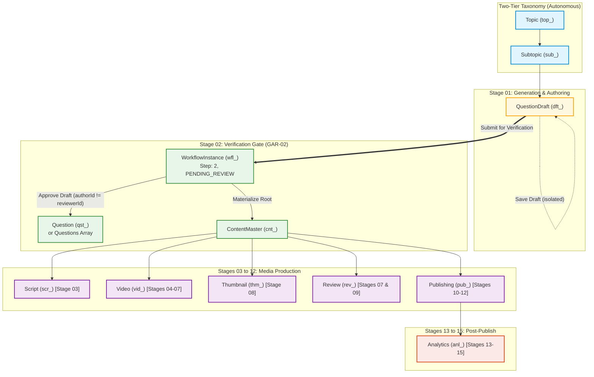
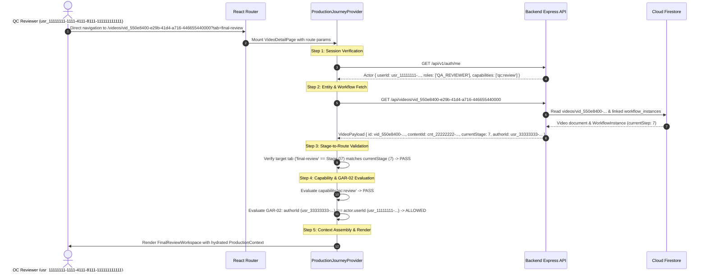

# S8-T05 — Shared Production Context Contract Specification
## Burra Pariksha Content Management System (BP-CMS)
### Sprint 08 — Dynamic Production Foundation / Phase B Architecture Specification

```text
================================================================================
Document ID:       BP-S8-T05-PRODUCTION-CONTEXT-CONTRACT
Version:           1.1.0-RECONCILED
Date:              2026-10-15
Status:            APPROVED BY PROJECT OWNER (ACCEPTED / CLOSED)
Gate Status:       GATE A SATISFIED / PHASE B CONTRACT SPECIFICATION
Inspected Commit:  a749d84 (origin/main)
Scope:             Shared Production Context Interface, URL Grounding Contract,
                   Lifecycle Hydration (New Content, Existing Draft, Reopened Item),
                   Persistence Boundaries, GAR-02 Rule, and Multi-Mode Alignment
Upstream Inputs:   docs/sprints/sprint-08/S8-T01-QUESTION-GENERATION-AUDIT.md
                   docs/sprints/sprint-08/S8-T02-PRODUCTION-PAGE-WORKFLOW-INVENTORY.md
                   docs/sprints/sprint-08/S8-T03-CONTENT-MODE-REQUIREMENTS.md
                   docs/sprints/sprint-08/S8-T04-DYNAMIC-PAGE-ROLE-REQUIREMENTS.md
                   docs/architecture/DECISION-LOG.md (ADR-008, 009, 010, 011)
                   docs/architecture/07-CANONICAL-15-STEP-WORKFLOW.md
                   docs/architecture/09-RBAC-CAPABILITY-MODEL.md
                   docs/architecture/11-PAGE-ROUTE-CONTRACT.md
                   docs/architecture/12-DATABASE-ARCHITECTURE.md
                   docs/architecture/14-MEDIA-ARCHITECTURE.md
                   docs/architecture/15-API-CONTRACT.md
                   docs/architecture/25-TWO-TIER-TAXONOMY-ARCHITECTURE.md
                   docs/architecture/26-COLLISION-RESISTANT-UUID-CANONICAL-ID-ARCHITECTURE.md
                   shared/lib/id.service.ts
                   shared/types/production-context.ts
                   shared/types/taxonomy.ts
                   shared/contracts/workflow.ts
                   shared/constants/roles.ts
                   frontend/contexts/ProductionJourneyContext.tsx
                   frontend/features/question-generation/hooks/useQuestionGeneration.ts
Downstream Impact: S8-T06 (Context Provider Implementation), S8-T07 (Studio Reopening),
                   S8-T08 (Workspaces & Polymorphic Verification), Downstream Stages
Approval State:    ACCEPTED / CLOSED — FORMALLY APPROVED BY PROJECT OWNER (2026-10-15)
================================================================================
```

---

## 1. Executive Summary & Architectural Governance

### 1.1 Purpose
This specification establishes the authoritative **Shared Production Context Contract** (`ProductionContext`) for BP-CMS. Following the formal closure of **Gate A** on 2026-10-15 (which validated the forensic audits S8-T01 and S8-T02, approved the content-mode requirements S8-T03, and accepted the dynamic-page and role requirements S8-T04 alongside Architecture Decision Records ADR-008 through ADR-011), this document defines the concrete TypeScript contracts, lifecycle data flows, URL parameter bindings, and persistence boundaries without introducing competing abstractions or altering runtime code.

### 1.2 Core Architectural Invariants (Non-Negotiable)
In strict accordance with [AGENTS.md](../../../AGENTS.md), this contract enforces:
1. **Cloud Firestore Sole Transactional Datastore**: All state persists to and rehydrates from Cloud Firestore collections (`question_drafts`, `questions`, `videos`, `scripts`, `thumbnails`, `social_reviews`, `publishing_records`, `content_masters`, `workflow_instances`, `assignments`, `topics`, `subtopics`, `users`). Google Sheets is permanently prohibited from runtime state.
2. **Canonical 15-Stage Workflow Continuity**: Every production asset traverses Stages 01 through 15 sequentially ([07-CANONICAL-15-STEP-WORKFLOW.md](../../architecture/07-CANONICAL-15-STEP-WORKFLOW.md)). No stage may be skipped, bypassed, or merged.
3. **Canonical Two-Tier Taxonomy**: Strictly autonomous **Topic** (`top_<uuid>` or legacy `TOP-*`) $\longrightarrow$ child **Subtopic** (`sub_<uuid>` or legacy `SUB-*`) ([25-TWO-TIER-TAXONOMY-ARCHITECTURE.md](../../architecture/25-TWO-TIER-TAXONOMY-ARCHITECTURE.md)). Legacy `Category` is permanently obsolete across all UI, APIs, and schemas.
4. **Collision-Resistant UUID Canonical IDs**: All entities utilize RFC 4122 v4 distributed identifiers generated statelessly by [`shared/lib/id.service.ts`](../../../shared/lib/id.service.ts). Database-backed sequence counters are prohibited.
5. **Absolute Anti-Self-Approval (`GAR-02`)**: No author may approve their own submission at Stage 02 (Question Verification), Stage 07 (Final QC), or Stage 09 (Social Review). Enforced server-side with zero administrative or role-based bypass across all 11 canonical roles:
   $$\text{\texttt{authorId}} \neq \text{\texttt{approverId}}$$
6. **Save Draft $\neq$ Submit for Verification**: Saving a draft persists minimal data to `question_drafts` and remains in Stage 01. Submitting for verification requires a saved draft, validates educational rules, and triggers the formal transition to Stage 02.
7. **Three Approved Content Production Modes**:
   - **Mode 1 — `QUESTION_CHALLENGE_SHORT`**: Single-question vertical short ($\le 58\text{ seconds}$, 9:16 aspect ratio). The approved production contract specifies exactly **one question per published video by default** ($N=1$). Proposed batch runner generation remains an unapproved open decision (ADR-010 / OD-02) and is not approved runtime functionality.
   - **Mode 2 — `TOPIC_INTRODUCTION`**: Conceptual syllabus overview (60–180 seconds, 9:16 or 16:9 aspect ratio). Strictly **zero questions** ($N=0$); no question count input required.
   - **Mode 3 — `EXPLAINED_QUESTIONS_VIDEO`**: Masterclass video (1 intro roadmap + $N$ sequential practice questions, fixed 16:9 landscape aspect ratio). Configurable question counts: strictly **5, 10, 15, or 20 questions** ($N \in \{5, 10, 15, 20\}$).

---

## 2. Production Context Type Definition & Canonical Schema

The Shared Production Context unifies curriculum taxonomy, content mode, entity references, workflow lifecycle, task assignment, and actor authorization into a single typed contract.

### 2.1 Authoritative TypeScript Interface Definition

```typescript
/**
 * Shared Production Context Contract
 * Location: shared/types/production-context.ts
 */

import { CanonicalRbacRole } from '../constants/roles';
import { DifficultyLevel, QuestionLanguage, QuestionStyle } from '../constants/enums';
import { WorkflowStepNumber, WorkflowStageStatus } from '../constants/workflow';

/**
 * Three approved content production modes (ADR-010)
 */
export type ContentProductionMode =
  | 'QUESTION_CHALLENGE_SHORT'  // Mode 1: Single-question vertical short (<= 58s, 9:16, N=1 default)
  | 'TOPIC_INTRODUCTION'        // Mode 2: Conceptual syllabus overview (60-180s, 9:16 or 16:9, N=0)
  | 'EXPLAINED_QUESTIONS_VIDEO';// Mode 3: Masterclass (1 intro + N practice questions, 16:9, N in {5,10,15,20})

export interface ProductionContextTaxonomy {
  topicId: string;                     // Canonical: top_<uuid> (legacy: TOP-###)
  topicName: string;                   // Human-readable topic title
  topicSlug: string;                   // URL-safe slug
  subtopicId: string;                  // Canonical: sub_<uuid> (legacy: SUB-###)
  subtopicName: string;                // Human-readable subtopic title
  subtopicSlug: string;                // URL-safe slug
}

export interface ProductionContextModeConfig {
  productionMode: ContentProductionMode;
  questionCount: number;               // Mode 1: 1 (canonical default); Mode 2: 0; Mode 3: 5, 10, 15, 20
  aspectRatio: '9:16' | '16:9';        // Mode 1: '9:16'; Mode 2: '9:16' | '16:9'; Mode 3: '16:9'
  language: QuestionLanguage;          // TELUGU | ENGLISH | TELUGU_ENGLISH
  difficulty?: DifficultyLevel;        // EASY | MEDIUM | HARD
  questionStyle?: QuestionStyle;       // STORY_BASED | SPEED_MATH | EXAM_DRILL | CONCEPT_FIRST
  targetDurationSeconds?: number;      // Mode 1: <= 58s; Mode 2: 60-180s; Mode 3: 720-3120s
}

export interface ProductionContextEntityIds {
  contentMasterId?: string;            // Root aggregate: cnt_<uuid>
  draftId?: string;                    // Transient draft: dft_<uuid> (Stage 01)
  questionId?: string;                 // Approved question: qst_<uuid> (Stage 02+)
  questionIds?: string[];              // Mode 3 practice questions array: qst_<uuid>[]
  conceptBriefId?: string;             // Mode 2 conceptual overview ID: cbr_<uuid>
  scriptId?: string;                   // Teleprompter script: scr_<uuid> (Stage 03)
  videoId?: string;                    // Video production entity: vid_<uuid> (Stage 04-12)
  thumbnailId?: string;                // Master thumbnail: thm_<uuid> (Stage 08)
  reviewId?: string;                   // QC/Social review: rev_<uuid> (Stage 07 & 09)
  publishingId?: string;               // Publishing record: pub_<uuid> (Stage 10-12)
  analyticsId?: string;                // Performance snapshot: anl_<uuid> (Stage 13-14)
  workflowInstanceId?: string;         // State machine tracking: wfl_<uuid>
}

export interface ProductionContextWorkflow {
  currentStage: WorkflowStepNumber;    // Canonical integer: 1 to 15
  stageStatus: WorkflowStageStatus;    // DRAFT | IN_PROGRESS | PENDING_REVIEW | CHANGES_REQUESTED | APPROVED | etc.
  isTerminal: boolean;                 // True if PUBLISHED or ARCHIVED
  lastTransitionAt: string;            // ISO 8601 UTC timestamp
  lastTransitionBy: string;            // usr_<uuid>
  rejectionNotes?: string;             // Feedback from Stage 02, 07, or 09 rejection
  allowedActions: string[];            // Permitted transitions for active actor
}

export interface ProductionContextAssignment {
  ownerId: string;                     // Content creator / initiator (usr_<uuid>)
  assignedAuthorId?: string;           // Stage 01 Author (usr_<uuid>)
  assignedReviewerId?: string;         // Stage 02 Question QA (usr_<uuid>)
  assignedScriptwriterId?: string;     // Stage 03 Scriptwriter (usr_<uuid>)
  assignedPresenterId?: string;        // Stage 04 Presenter / Talent (usr_<uuid>)
  assignedEditorId?: string;           // Stage 06 Video Editor (usr_<uuid>)
  assignedQcLeadId?: string;           // Stage 07 Final QC Lead (usr_<uuid>)
  assignedDesignerId?: string;         // Stage 08 Graphic Artist (usr_<uuid>)
  assignedPublisherId?: string;        // Stage 09-12 Publishing Lead (usr_<uuid>)
}

export interface ProductionContextActor {
  userId: string;                      // Authenticated User: usr_<uuid>
  name: string;                        // Full name
  roles: CanonicalRbacRole[];          // Canonical 11 roles from shared/constants/roles.ts
  capabilities: string[];              // Expanded atomic tokens ('QUESTION:CREATE', 'QUESTION:APPROVE', etc.)
  isAiAgent: boolean;                  // True for automated orchestrators, false for humans
}

export interface ProductionContext {
  taxonomy: ProductionContextTaxonomy;
  modeConfig: ProductionContextModeConfig;
  entityIds: ProductionContextEntityIds;
  workflow: ProductionContextWorkflow;
  assignment: ProductionContextAssignment;
  actor: ProductionContextActor;
  isDirty: boolean;                    // Unsaved changes in active workbench
  isLoading: boolean;                  // Context hydration in progress
  error?: string | null;               // Hydration or validation failure
}
```

### 2.2 Canonical Entity Relationships & Lifecycle Correlators

The production context correlates entities across the 15-stage lifecycle. Each entity maintains strict parent-child or stage progression relationships:



---

## 3. Attribute Creation, Propagation, Retrieval & Validation

The table below governs how each foundational context attribute is instantiated, transferred between routes, loaded from Firestore, and validated at runtime:

| Attribute | 1. Creation Pattern | 2. Page-to-Page Transfer Contract | 3. Persisted Retrieval Source | 4. Runtime Validation Invariant |
| :--- | :--- | :--- | :--- | :--- |
| **`topicId` & `subtopicId`** | Selected by user in `/studio` dropdowns or seeded by Content Plan (`/planning`). | Propagated via URL search params: `?topicId=top_<uuid>&subtopicId=sub_<uuid>` | Read from `topics` and `subtopics` collections; stored in `question_drafts` and `content_masters`. | Must exist in Firestore; `subtopic.topicId === topic.id`. Permanent Two-Tier hierarchy; zero Category leaks. Validated by `validateTaxonomyLink()`. |
| **`productionMode`** | Selected via Stage 01 Mode Modal on `/studio` entry (ADR-011 / DD-02). | Propagated via URL query param: `?mode=QUESTION_CHALLENGE_SHORT` (or M2, M3). | Read from `question_drafts.productionMode` or `content_masters.productionMode`. | Restricted to `QUESTION_CHALLENGE_SHORT`, `TOPIC_INTRODUCTION`, `EXPLAINED_QUESTIONS_VIDEO`. Validated by `validateProductionModeConfig()`. Immutable after Stage 02. |
| **`questionCount`** | Configured in Stage 01 Studio Panel based on mode rules. | Propagated via URL query param: `?count=1` (Mode 1) or `?count=10` (Mode 3). | Read from `question_drafts.targetQuestionCount` or `content_masters.questionCount`. | Mode 1: strictly 1 by default; Mode 2: strictly 0 (no count input); Mode 3: strictly 5, 10, 15, or 20. |
| **`draftId`** | Generated statelessly via `idService.generateDraftId()` (`dft_<uuid>`) on initial "Save Draft". | Propagated via URL query param: `?draftId=dft_<uuid>` on `/studio` and `/questions/:id/verify`. | Persisted to and retrieved from `question_drafts` collection in Cloud Firestore. | Prefix must be `dft_` followed by RFC 4122 v4 UUID (`UUID_V4_PATTERN`). Distinct from permanent `qst_<uuid>`. |
| **`contentMasterId` / `entityId`** | Generated on Stage 02 approval (`cnt_<uuid>`, `qst_<uuid>`, `vid_<uuid>`). | Route path parameter (`/videos/:videoId`) or query param (`?contentId=cnt_<uuid>`). | Persisted in `content_masters`, `questions`, and `videos` collections. | Strict prefix validation (`cnt_`, `qst_`, `vid_`). Aligns with ADR-011 typed parameter schema. |
| **`currentStage`** | Initialized to `1` on draft creation; advanced monotonically by backend workflow engine. | Expressed in UI route (`/studio`=1, `/verify`=2, `/videos/:id?tab=script`=3, etc.). | Persisted in `workflow_instances` collection (`currentStep: WorkflowStepNumber`). | Strictly $1 \le \text{step} \le 15$. Step skipping prohibited. Route must match `currentStage` or trigger read-only warning. |
| **`stageStatus`** | Set to `DRAFT` in Stage 01; transitions to `PENDING_REVIEW`, `APPROVED`, etc. | Carried inside `ProductionContext.workflow.stageStatus` and API envelopes. | Read from `workflow_instances` collection (`contentStatus`, `mediaStatus`, etc.). | State transitions governed by `CANONICAL_TRANSITION_RULES` in `transition-matrix.ts`. |
| **`assignment`** | Initialized with `ownerId = actor.userId`; task assignments created in Stage 01–03. | Propagated via API payload; hydrated from server on workbench load. | Persisted in `assignments` collection (`asn_<uuid>`) linked by `entityId`. | Only authorized roles may assign. Assignee must hold role capability for assigned stage. |
| **`actor`** | Derived from authenticated session (`GET /api/v1/auth/me`). | Client-side React context for presentation; bearer cookie sent on all HTTP calls. | Server-side user session store (`users` collection). | Advisory in UI; server middleware (`requireCapability`) enforces authoritative RBAC and GAR-02. |

---

## 4. Context Lifecycle & Hydration Sequences

The context lifecycle operates across three primary flows. Every flow relies strictly on Cloud Firestore via typed API endpoints, enforces server-side authorization, and handles edge cases deterministically.

### 4.1 Flow A: New Content Lifecycle (Stage 01 Creation)

```text
 ┌────────────────────────────────────────────────────────────────────────────────────────┐
 │                         FLOW A: NEW CONTENT CREATION LIFECYCLE                         │
 └────────────────────────────────────────────────────────────────────────────────────────┘
```

1. **Taxonomy Selection**:
   - Creator navigates to `/studio`.
   - Client calls `GET /api/taxonomy` (or `taxonomyApi.getTaxonomyTree()`), returning `PureTaxonomyTreeItem[]`.
   - Creator selects an active Topic (`top_a1b2c3d4-e5f6-4a7b-8c9d-0e1f2a3b4c5d`) and child Subtopic (`sub_b2c3d4e5-f6a7-4b8c-9d0e-1f2a3b4c5d6e`).
   - `validateTaxonomyLink` confirms `subtopic.topicId === topic.id`.
2. **Production Mode Selection & Configuration**:
   - `ProductionModeModal` mounts if no `mode` query parameter is present.
   - Creator selects approved mode:
     - `QUESTION_CHALLENGE_SHORT`: default question count = 1, aspect ratio = `9:16`.
     - `TOPIC_INTRODUCTION`: question count = 0 (no count input), aspect ratio = `9:16` or `16:9`.
     - `EXPLAINED_QUESTIONS_VIDEO`: question count $\in \{5, 10, 15, 20\}$, aspect ratio = `16:9`.
   - `validateProductionModeConfig` verifies the parameters before proceeding.
3. **Transient Context Initialization**:
   - `ProductionJourneyProvider` initializes in-memory state:
     - `taxonomy`: `{ topicId: "top_a1b2c3d4-e5f6-4a7b-8c9d-0e1f2a3b4c5d", subtopicId: "sub_b2c3d4e5-f6a7-4b8c-9d0e-1f2a3b4c5d6e" }`
     - `modeConfig`: `{ productionMode: "EXPLAINED_QUESTIONS_VIDEO", questionCount: 10, aspectRatio: "16:9", language: "TELUGU" }`
     - `workflow`: `{ currentStage: 1, stageStatus: "DRAFT", isTerminal: false }`
     - `assignment`: `{ ownerId: "usr_11111111-1111-4111-8111-111111111111" }`
   - URL updates client-side without page reload: `/studio?mode=EXPLAINED_QUESTIONS_VIDEO&count=10`.
4. **Draft Persistence via Backend API (Save Draft Contract)**:
   - Creator inputs content (concept overview and practice questions).
   - Creator clicks **"Save Draft"** (`ActionBar.tsx`).
   - Client invokes `POST /api/questions/draft` (or `/api/v1/questions/draft`) with payload:
     ```json
     {
       "topicId": "top_a1b2c3d4-e5f6-4a7b-8c9d-0e1f2a3b4c5d",
       "subtopicId": "sub_b2c3d4e5-f6a7-4b8c-9d0e-1f2a3b4c5d6e",
       "productionMode": "EXPLAINED_QUESTIONS_VIDEO",
       "targetQuestionCount": 10,
       "aspectRatio": "16:9",
       "language": "TELUGU",
       "introductoryConcept": "Speed Math shortcuts for quadratic roots...",
       "questions": [
         { "statement": "Find roots of 2x^2 + 5x - 12 = 0", "options": { "a": "1.5, -4", "b": "2, -3", "c": "-1.5, 4", "d": "3, -2" }, "correctOption": "a", "explanation": "Factoring gives (2x - 3)(x + 4) = 0" }
       ]
     }
     ```
   - Server endpoint checks `requireCapability('QUESTION:CREATE')`, generates canonical draft ID `dft_c3d4e5f6-a7b8-4c9d-8e0f-2a3b4c5d6e7f` via `idService.generateDraftId()`, and persists document to `question_drafts` Firestore collection.
5. **Canonical ID Retention & URL Update**:
   - Server responds with HTTP 201:
     ```json
     {
       "id": "dft_c3d4e5f6-a7b8-4c9d-8e0f-2a3b4c5d6e7f",
       "status": "DRAFT",
       "version": 1,
       "authorId": "usr_11111111-1111-4111-8111-111111111111",
       "createdAt": "2026-10-15T02:00:00.000Z"
     }
     ```
   - Browser URL updates to `/studio?draftId=dft_c3d4e5f6-a7b8-4c9d-8e0f-2a3b4c5d6e7f`.
   - `isDirty` flag cleared. Toast confirms *"Draft saved successfully"*.
   - **Critical Boundary**: Application remains in Stage 01 on `/studio`. It does **NOT** navigate to verification and does **NOT** trigger Stage 02 evaluation.
6. **Workflow & Assignment Hydration**:
   - `entityIds.draftId` set to `dft_c3d4e5f6-a7b8-4c9d-8e0f-2a3b4c5d6e7f`.
   - Workflow state remains `currentStage = 1`, `stageStatus = 'DRAFT'`.

---

### 4.2 Flow B: Existing Draft Lifecycle (Stage 01 Resumption & Stage 02 Submission)

```text
 ┌────────────────────────────────────────────────────────────────────────────────────────┐
 │                    FLOW B: EXISTING DRAFT RESUMPTION & SUBMISSION                      │
 └────────────────────────────────────────────────────────────────────────────────────────┘
```

1. **Draft ID Resolution**:
   - User navigates directly to `/studio?draftId=dft_c3d4e5f6-a7b8-4c9d-8e0f-2a3b4c5d6e7f` or clicks draft in Question Library.
   - `useQuestionGeneration` hook reads `searchParams.get('draftId')`.
2. **Draft Retrieval from Authoritative API**:
   - Hook sets `isLoadingDraft = true`.
   - Calls `GET /api/questions/draft/dft_c3d4e5f6-a7b8-4c9d-8e0f-2a3b4c5d6e7f` via `questionsApi.getDraft()`.
   - Backend service `questionDraftService.getDraftById()` reads from Firestore `question_drafts/dft_c3d4e5f6-a7b8-4c9d-8e0f-2a3b4c5d6e7f`.
   - If not found, API returns HTTP 404; hook renders error banner with option to return to library.
3. **Workspace Restoration**:
   - Restores taxonomy: `selectedTopic = draft.topicId`, `selectedSubtopic = draft.subtopicId`.
   - Restores mode: `productionMode = draft.productionMode`, `targetQuestionCount = draft.targetQuestionCount`, `aspectRatio = draft.aspectRatio`.
   - Restores content payload: restores multi-question array `draft.questions` or single candidate and concept notes.
   - Sets `savedDraftId = draft.id`, clears `isDirty = false`, sets `isLoadingDraft = false`.
4. **Ownership & Access Validation**:
   - Client checks that authenticated user has access. Server enforces author authorization on updates.
5. **Distinct Submission for Verification (Stage 01 $\to$ Stage 02)**:
   - Creator completes editing and clicks **"Submit for Verification"**.
   - Client validates completeness (all questions filled, options non-empty, correct answer declared).
   - Calls `POST /api/questions/draft/dft_c3d4e5f6-a7b8-4c9d-8e0f-2a3b4c5d6e7f/submit` via `questionsApi.submitForVerification()`.
   - Server validates educational invariants, initializes `WorkflowInstance` (`wfl_e5f6a7b8-c9d0-4e1f-8a2b-4c5d6e7f8a9b`) at `currentStep = 2`, `status = 'PENDING_REVIEW'`, and records audit log.
   - Server returns:
     ```json
     {
       "success": true,
       "draftId": "dft_c3d4e5f6-a7b8-4c9d-8e0f-2a3b4c5d6e7f",
       "workflowInstanceId": "wfl_e5f6a7b8-c9d0-4e1f-8a2b-4c5d6e7f8a9b",
       "currentStep": 2,
       "status": "PENDING_REVIEW"
     }
     ```
   - Client navigates to Stage 02: `/questions/qst_d4e5f6a7-b8c9-4d0e-8f1a-3b4c5d6e7f8a/verify?draftId=dft_c3d4e5f6-a7b8-4c9d-8e0f-2a3b4c5d6e7f`.

---

### 4.3 Flow C: Reopened Production Item Lifecycle (Mid-Journey Stages 03–15)

```text
 ┌────────────────────────────────────────────────────────────────────────────────────────┐
 │                    FLOW C: REOPENED PRODUCTION ITEM (STAGES 03–15)                     │
 └────────────────────────────────────────────────────────────────────────────────────────┘
```

1. **Identifier Resolution from Route**:
   - Team member clicks notification or direct link:
     `https://cms.burrapariksha.com/videos/vid_550e8400-e29b-41d4-a716-446655440000?tab=final-review`
   - React Router resolves route parameter `videoId = "vid_550e8400-e29b-41d4-a716-446655440000"` and query parameter `tab = "final-review"`.
2. **Entity & Workflow State Retrieval**:
   - `ProductionJourneyProvider` initiates deterministic hydration:
     - Calls `GET /api/v1/auth/me` to obtain session identity and role tokens.
     - Calls `GET /api/videos/vid_550e8400-e29b-41d4-a716-446655440000`.
     - Server verifies `canAccessVideo(actor, video)` and queries Firestore `videos` and `workflow_instances` collections.
   - Server responds with HTTP 200:
     ```json
     {
       "id": "vid_550e8400-e29b-41d4-a716-446655440000",
       "contentId": "cnt_22222222-2222-4222-8222-222222222222",
       "workflowInstanceId": "wfl_e5f6a7b8-c9d0-4e1f-8a2b-4c5d6e7f8a9b",
       "currentStage": 7,
       "productionStatus": "IN_PROGRESS",
       "topicId": "top_a1b2c3d4-e5f6-4a7b-8c9d-0e1f2a3b4c5d",
       "subtopicId": "sub_b2c3d4e5-f6a7-4b8c-9d0e-1f2a3b4c5d6e",
       "productionMode": "QUESTION_CHALLENGE_SHORT",
       "aspectRatio": "9:16",
       "authorId": "usr_33333333-3333-4333-8333-333333333333",
       "scriptId": "scr_44444444-4444-4444-8444-444444444444"
     }
     ```
3. **Context Reconstruction from Authoritative Data**:
   - Provider constructs `ProductionContext`:
     - `taxonomy`: `{ topicId: "top_a1b2c3d4-...", subtopicId: "sub_b2c3d4e5-..." }`
     - `modeConfig`: `{ productionMode: "QUESTION_CHALLENGE_SHORT", questionCount: 1, aspectRatio: "9:16" }`
     - `entityIds`: `{ videoId: "vid_550e8400-...", contentMasterId: "cnt_22222222-...", scriptId: "scr_44444444-...", workflowInstanceId: "wfl_e5f6a7b8-..." }`
     - `workflow`: `{ currentStage: 7, stageStatus: "IN_PROGRESS", isTerminal: false }`
     - `assignment`: `{ ownerId: "usr_33333333-3333-4333-8333-333333333333", assignedQcLeadId: "usr_11111111-1111-4111-8111-111111111111" }`
4. **Stage-to-Route Validation**:
   - Provider compares target tab (`final-review`, which corresponds to Stage 07 Final QC) against `video.currentStage` (7).
   - If `targetStage === currentStage`: workbench renders active review controls.
   - If `targetStage !== currentStage` (e.g., video is still at Stage 04 Filming, but user opened `tab=final-review`):
     - Renders page in **Read-Only Inspection Mode**.
     - Displays amber warning banner: *"This video is currently in Stage 04 (Filming). Stage 07 (Final QC) cannot be executed out of sequence."*
     - Provides button: *"Jump to Current Stage (Stage 04)"*.
5. **GAR-02 Anti-Self-Approval Enforcement**:
   - Evaluator checks: `video.authorId === actor.userId`.
   - If Reviewer is the Author (`usr_33333333-3333-4333-8333-333333333333 === usr_33333333-3333-4333-8333-333333333333`):
     - Workbench forces **Auditor Read-Only Mode**.
     - All approval/sign-off buttons disabled (`disabled={true}`).
     - Displays badge: *"GAR-02 Invariant: You are the author of this content and cannot approve your own submission."*
   - If Reviewer is distinct (`usr_33333333-... !== usr_11111111-...`):
     - Reviewer checks 6-point QC audit criteria and approves.
     - Advance to Stage 08 (Thumbnail Generation).



---

## 5. Concrete Operational Scenarios & Lifecycle Examples

Every illustrative identifier below strictly matches the RFC 4122 v4 canonical specification from [`shared/lib/id.service.ts`](../../../shared/lib/id.service.ts) and satisfies `UUID_V4_PATTERN`:

### 5.1 Example 1: Creating a New Item (Stage 01 Creation — Mode 3 Masterclass)

1. **User Action**: Creator (`usr_11111111-1111-4111-8111-111111111111`) navigates to `/studio`.
2. **Mode Modal Trigger**:
   - `ProductionModeModal` renders.
   - Creator selects **Mode 3: Explained Questions Video** with question count **10** and landscape **16:9** aspect ratio.
3. **Context Initialization**:
   - `ProductionJourneyProvider` generates initial context:
     ```json
     {
       "taxonomy": {
         "topicId": "top_a1b2c3d4-e5f6-4a7b-8c9d-0e1f2a3b4c5d",
         "topicName": "Quantitative Aptitude",
         "topicSlug": "quantitative-aptitude",
         "subtopicId": "sub_b2c3d4e5-f6a7-4b8c-9d0e-1f2a3b4c5d6e",
         "subtopicName": "Quadratic Equations",
         "subtopicSlug": "quadratic-equations"
       },
       "modeConfig": {
         "productionMode": "EXPLAINED_QUESTIONS_VIDEO",
         "questionCount": 10,
         "aspectRatio": "16:9",
         "language": "TELUGU"
       },
       "workflow": {
         "currentStage": 1,
         "stageStatus": "DRAFT",
         "isTerminal": false,
         "lastTransitionAt": "2026-10-15T02:00:00.000Z",
         "lastTransitionBy": "usr_11111111-1111-4111-8111-111111111111",
         "allowedActions": ["SAVE_DRAFT", "SUBMIT_VERIFICATION"]
       },
       "assignment": {
         "ownerId": "usr_11111111-1111-4111-8111-111111111111"
       }
     }
     ```
   - URL updates client-side: `/studio?mode=EXPLAINED_QUESTIONS_VIDEO&count=10`.
4. **Draft Persistence (Save Draft Contract)**:
   - Creator inputs introductory concept roadmap and drafts Question 1.
   - Creator clicks **"Save Draft"** (`ActionBar.tsx`).
   - Hook invokes `questionsApi.saveDraft(payload)`.
   - Backend persists payload to `question_drafts` collection with ID `dft_c3d4e5f6-a7b8-4c9d-8e0f-2a3b4c5d6e7f`.
   - In-place toast displays: *"Draft saved successfully at 02:00 UTC"*.
   - Browser URL updates to: `/studio?draftId=dft_c3d4e5f6-a7b8-4c9d-8e0f-2a3b4c5d6e7f`.
   - **Crucial Rule**: The page does **NOT** navigate away, does **NOT** advance workflow, and does **NOT** execute Stage 02 verification.

---

### 5.2 Example 2: Reopening a Saved Draft (Stage 01 Resumption & Stage 02 Submission)

1. **User Action**: Creator opens saved draft link from browser bookmarks or Question Library:
   `https://cms.burrapariksha.com/studio?draftId=dft_c3d4e5f6-a7b8-4c9d-8e0f-2a3b4c5d6e7f`
2. **Hydration Sequence**:
   - `useQuestionGeneration` hook detects `searchParams.get('draftId') === 'dft_c3d4e5f6-a7b8-4c9d-8e0f-2a3b4c5d6e7f'`.
   - Sets `isLoadingDraft = true`.
   - Dispatches `questionsApi.getDraft('dft_c3d4e5f6-a7b8-4c9d-8e0f-2a3b4c5d6e7f')`.
   - Server retrieves document from `question_drafts/dft_c3d4e5f6-a7b8-4c9d-8e0f-2a3b4c5d6e7f`.
3. **Workspace Restoration**:
   - Hook populates form state: `selectedTopic`, `selectedSubtopic`, `productionMode`, `introductoryConcept`, and candidate questions.
   - Clears `isDirty = false`; sets `savedDraftId = 'dft_c3d4e5f6-a7b8-4c9d-8e0f-2a3b4c5d6e7f'`.
   - Sets `isLoadingDraft = false`.
   - Workspace displays restored draft exactly as saved.
4. **Submission for Verification**:
   - Creator finishes editing all 10 questions.
   - Creator explicitly clicks **"Submit for Verification"**.
   - Hook validates 100% field presence and executes `questionsApi.submitForVerification({ draftId: 'dft_c3d4e5f6-a7b8-4c9d-8e0f-2a3b4c5d6e7f' })`.
   - Server creates `WorkflowInstance` (`wfl_e5f6a7b8-c9d0-4e1f-8a2b-4c5d6e7f8a9b`), advances `currentStep` to `2` (`PENDING_REVIEW`).
   - Browser navigates to: `/questions/qst_d4e5f6a7-b8c9-4d0e-8f1a-3b4c5d6e7f8a/verify?draftId=dft_c3d4e5f6-a7b8-4c9d-8e0f-2a3b4c5d6e7f`.

---

### 5.3 Example 3: Resuming Production Mid-Journey (Stage 07 Final QC — Mode 1 Short)

1. **User Action**: QC Reviewer (`usr_11111111-1111-4111-8111-111111111111`) receives an assignment notification and clicks:
   `https://cms.burrapariksha.com/videos/vid_550e8400-e29b-41d4-a716-446655440000?tab=final-review`
2. **Context Resolution**:
   - `ProductionJourneyProvider` resolves `videoId = 'vid_550e8400-e29b-41d4-a716-446655440000'`.
   - Queries `GET /api/videos/vid_550e8400-e29b-41d4-a716-446655440000` and linked `WorkflowInstance`.
   - Hydrates `ProductionContext`:
     - `taxonomy`: `{ topicId: "top_a1b2c3d4-e5f6-4a7b-8c9d-0e1f2a3b4c5d", subtopicId: "sub_b2c3d4e5-f6a7-4b8c-9d0e-1f2a3b4c5d6e" }`
     - `modeConfig`: `{ productionMode: "QUESTION_CHALLENGE_SHORT", questionCount: 1, aspectRatio: "9:16" }`
     - `entityIds`: `{ contentMasterId: "cnt_22222222-2222-4222-8222-222222222222", videoId: "vid_550e8400-e29b-41d4-a716-446655440000", scriptId: "scr_44444444-4444-4444-8444-444444444444" }`
     - `workflow`: `{ currentStage: 7, stageStatus: "IN_PROGRESS" }`
     - `assignment`: `{ ownerId: "usr_33333333-3333-4333-8333-333333333333", assignedQcLeadId: "usr_11111111-1111-4111-8111-111111111111" }`
3. **GAR-02 Verification**:
   - Author ID: `usr_33333333-3333-4333-8333-333333333333`.
   - Reviewer ID: `usr_11111111-1111-4111-8111-111111111111`.
   - Invariant check: `authorId !== actor.userId`. **PASS**.
4. **Execution**:
   - `FinalReviewWorkspace.tsx` mounts under Tab 4 of `VideoDetailPage.tsx`.
   - Reviewer audits 6-point checklist (Audio sync, subtitle timing, 9:16 resolution, Telugu orthography, hook retention, trick accuracy).
   - Reviewer clicks **"Approve Final QC"**.
   - Server records QC audit log, advances workflow from Stage 07 to Stage 08 (Thumbnail Generation).
   - Navigation automatically updates active tab to `?tab=thumbnail`.

---

## 6. Source-of-Truth Boundaries & Persistence Isolation

To ensure system integrity and eliminate architectural ambiguity, the following source-of-truth boundaries are non-negotiable:

1. **Cloud Firestore Sole Transactional Datastore**:
   - All runtime entities (`questions`, `question_drafts`, `scripts`, `videos`, `thumbnails`, `social_reviews`, `publishing`, `content_masters`, `workflow_instances`, `assignments`, `topics`, `subtopics`, `users`) persist exclusively to Cloud Firestore.
   - Google Sheets is permanently prohibited from runtime state and transactional persistence.
2. **Frontend Context is Presentation & Navigation Only**:
   - `ProductionContext` and `ProductionJourneyContext` manage transient in-memory UI state, form field caching, and route synchronization.
   - React state is **never** an authoritative source of truth. If the browser tab is refreshed, state must rehydrate strictly from the authoritative backend API.
3. **URL Search and Path Parameters are Navigation Hints**:
   - URLs carry resource identifiers (`videoId`, `draftId`) and navigation hints (`?tab=final-review`, `?mode=...`).
   - URLs **never** establish authoritative workflow status, role permissions, or transition validity.
   - Even if a URL contains `?currentStage=7`, the backend workflow engine and Firestore document strictly dictate whether Stage 07 is unlocked.
4. **Unidirectional Dependency Flow**:
   $$\text{\textbf{Frontend UI}} \longrightarrow \text{\textbf{Typed API Client}} \longrightarrow \text{\textbf{Express Route Dispatcher}} \longrightarrow \text{\textbf{Backend Domain Service}} \longrightarrow \text{\textbf{Firestore Repository}}$$
   - Frontend components never import Firestore SDKs or execute direct queries.
   - Express routes never contain inline persistence or business logic; they validate inputs via Zod and delegate to domain services.
5. **Server-Side Security & State Machine Authority**:
   - Server middleware (`requireCapability`, `requireRole`) strictly enforces authentication, role verification, and the GAR-02 rule on every HTTP request.
   - Workflow state machine transitions are validated and executed solely by `workflow-engine.service.ts` on the backend.
6. **Zero Runtime Implementation**:
   - S8-T05 is strictly an architectural contract and governance document. No runtime application code, database schema, or repository packages are modified.

---

## 7. Implementation Alignment & Repository Verification Matrix

| Existing File Path | Current Role in Baseline | Implementation Alignment | Invariant Preserved |
| :--- | :--- | :--- | :--- |
| [`shared/types/production-context.ts`](../../../shared/types/production-context.ts) | Authoritative TypeScript interface definitions. | Exports `ProductionContext`, `ContentProductionMode`, `validateProductionModeConfig`, `validateTaxonomyLink`. | Type-safety boundary across frontend and backend. |
| [`shared/lib/id.service.ts`](../../../shared/lib/id.service.ts) | Canonical distributed UUID generator. | Defines canonical prefixes (`dft_`, `cnt_`, `qst_`, `vid_`, `scr_`, `thm_`, `top_`, `sub_`, `usr_`) and `UUID_V4_PATTERN`. | Collision-resistant UUID canonical IDs. |
| [`frontend/contexts/ProductionJourneyContext.tsx`](../../../frontend/contexts/ProductionJourneyContext.tsx) | Master production journey provider and hook. | Implements `ProductionContextValue` integrating taxonomy, mode config, entity IDs, workflow state, and assignment. | Preserves 15-stage sequential journey orchestration. |
| [`frontend/features/question-generation/hooks/useQuestionGeneration.ts`](../../../frontend/features/question-generation/hooks/useQuestionGeneration.ts) | Stage 01 state management hook. | Reads `draftId` query param, hydrates draft via `questionsApi.getDraft()`, manages mode config, enforces Save Draft $\neq$ Submit. | Decoupled draft persistence and resumption. |
| [`frontend/pages/VideoDetailPage.tsx`](../../../frontend/pages/VideoDetailPage.tsx) | Master production workbench hosting Stages 03–08. | Hydrates `ProductionContext` from `videoId`, mounts tabs based on workflow stage, evaluates GAR-02 on Tab 4 (`final-review`). | Tab-level consolidation under single workbench. |
| [`backend/server/routers/routes.ts`](../../../backend/server/routers/routes.ts) | Express route dispatcher. | Mounts `POST /api/questions/draft`, `GET /api/questions/draft/:id`, `POST /api/questions/draft/:id/submit`, `GET /api/videos/:id`. | Thin HTTP dispatchers with zero inline business logic. |
| [`backend/domain/question-generation/question-generation.service.ts`](../../../backend/domain/question-generation/question-generation.service.ts) | Question generation domain service. | Implements `saveDraft`, `getDraftById`, `submitForVerification`, and `approveDraft`. Enforces `validateProductionModeConfig`. | Server-authoritative validation and state transitions. |

---

## 8. Acceptance Criteria & Traceability Matrix

| ID | Acceptance Criterion | Supporting Section | Implementation & Evidence Reference | Verification Status |
| :--- | :--- | :--- | :--- | :---: |
| **AC-01** | **Taxonomy Parent-Child Invariant**: `topicId` and `subtopicId` strictly defined with mandatory parent link; zero Category taxonomy references. | Section 2.1, Section 3 | `shared/types/taxonomy.ts`, `validateTaxonomyLink()` in `shared/types/production-context.ts` | **SATISFIED** |
| **AC-02** | **Three Approved Production Modes**: Accommodates Mode 1 ($N=1$ default), Mode 2 ($N=0$), Mode 3 ($N \in \{5,10,15,20\}$). Mode 1 batch runner explicitly documented as unapproved proposal. | Section 1.2, Section 2.1, Section 3 | `validateProductionModeConfig()` in `shared/types/production-context.ts`, ADR-010 | **SATISFIED** |
| **AC-03** | **UUID v4 Canonical Identifier Format**: All illustrative and documented entity IDs conform to RFC 4122 v4 and match `UUID_V4_PATTERN`. Zero legacy sequences. | Section 2.1, Section 4, Section 5 | `shared/lib/id.service.ts` (`CANONICAL_PREFIXES`, `UUID_V4_PATTERN`) | **SATISFIED** |
| **AC-04** | **15-Stage Workflow Continuity**: Full mapping of `currentStage` ($1 \le \text{step} \le 15$), stage statuses, and state transitions without stage skipping or bypassing. | Section 1.2, Section 2.1, Section 3 | `shared/contracts/workflow.ts`, `07-CANONICAL-15-STEP-WORKFLOW.md` | **SATISFIED** |
| **AC-05** | **GAR-02 Anti-Self-Approval**: Enforces `authorId !== approverId` at Stage 02, Stage 07, and Stage 09. Zero role-based bypass across all 11 canonical roles. | Section 1.2, Section 4.3, Section 5.3 | `objectAuthService`, `requireCapability` in `backend/server/routers/routes.ts` | **SATISFIED** |
| **AC-06** | **Save Draft $\neq$ Submit for Verification**: Strict separation. Save Draft persists minimal draft and stays in Stage 01. Submit for Verification validates rules and advances to Stage 02. | Section 1.2, Section 4.1, Section 4.2 | `questionsApi.saveDraft()` vs. `questionsApi.submitForVerification()`, `routes.ts` | **SATISFIED** |
| **AC-07** | **Deterministic Context Lifecycles**: Unambiguously specifies Flow A (New Content), Flow B (Existing Draft Resumption), and Flow C (Reopened Mid-Journey Item) with verified API endpoints. | Section 4.1, Section 4.2, Section 4.3 | `useQuestionGeneration.ts`, `ProductionJourneyContext.tsx`, `routes.ts` | **SATISFIED** |
| **AC-08** | **Source-of-Truth Boundaries**: Firestore is sole transactional datastore; URLs/context are presentation/navigation only; zero runtime code modified. | Section 1.2, Section 6 | `12-DATABASE-ARCHITECTURE.md`, `AGENTS.md` | **SATISFIED** |

---

## 9. Deliverable Status & Project Owner Approval Register

```text
================================================================================
FINAL DELIVERABLE STATUS:  ACCEPTED / CLOSED
Document Version:          1.1.0-RECONCILED
Approval Authority:        Project Owner Executive Sign-Off
Approval Date:             2026-10-15
Approval Status:           APPROVED BY PROJECT OWNER

Decision & Scope Accepted:
- The reconciled Production Context Contract, version 1.1.0-RECONCILED, is accepted.
- Accepted scope encompasses:
  1. Collision-Resistant UUID Canonical Identifiers (RFC 4122 v4; UUID_V4_PATTERN).
  2. Canonical Two-Tier Taxonomy (Topic -> Subtopic, zero Category).
  3. Three Approved Production Modes:
     - Mode 1: QUESTION_CHALLENGE_SHORT (N=1 default; batch runner unapproved).
     - Mode 2: TOPIC_INTRODUCTION (N=0; no question count required).
     - Mode 3: EXPLAINED_QUESTIONS_VIDEO (N in {5, 10, 15, 20}, 16:9).
  4. 15-Stage Workflow Continuity (monotonically progressive, zero skips).
  5. Uncompromised Anti-Self-Approval Rule (GAR-02: authorId !== approverId).
  6. Strict Save Draft != Submit for Verification separation.
  7. Deterministic Context Lifecycles:
     - Flow A: New Content Lifecycle (Stage 01 Creation).
     - Flow B: Existing Draft Lifecycle (Stage 01 Resumption & Stage 02 Submit).
     - Flow C: Reopened Production Item Lifecycle (Stages 03-15 Mid-Journey).
  8. Source-of-Truth Boundaries (Firestore sole transactional datastore;
     client context and URL params are navigation/presentation only).

Approval Basis:
- Explicit approval provided by Project Owner on 2026-10-15.
- S8-T05 is formally CLOSED.
================================================================================
```
