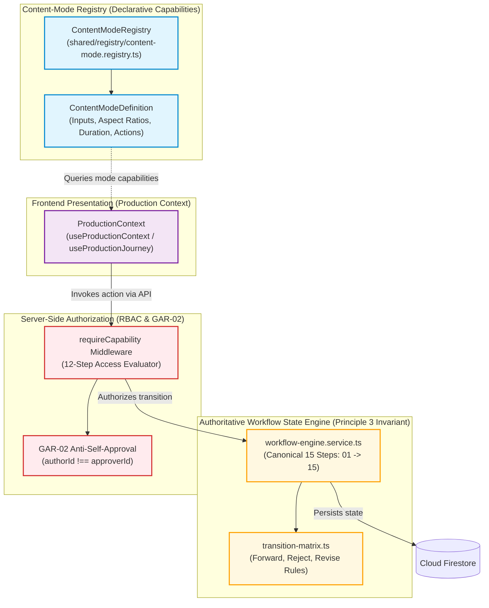
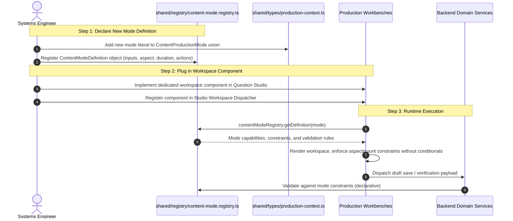

# S8-T06 — Content-Mode Registry Design Specification
## Burra Pariksha Content Management System (BP-CMS)
### Sprint 08 — Dynamic Production Foundation / Phase B Architecture Specification

```text
================================================================================
Document ID:       BP-S8-T06-CONTENT-MODE-REGISTRY-DESIGN
Version:           1.0.0-APPROVED-SPECIFICATION
Date:              2026-10-15
Status:            APPROVED DESIGN SPECIFICATION
Gate Status:       GATE A SATISFIED / PHASE B DESIGN SPECIFICATION
Inspected Commit:  401e5cd (origin/main)
Scope:             Extensible Content-Mode Registry Contract, Three-Mode Mapping,
                   Input/Output Schema Enforcement, Applicable Workflow Stages,
                   Action Constraints, and Open-Closed Extensibility Model
Upstream Inputs:   docs/sprints/sprint-08/S8-T03-CONTENT-MODE-REQUIREMENTS.md
                   docs/sprints/sprint-08/S8-T04-DYNAMIC-PAGE-ROLE-REQUIREMENTS.md
                   docs/sprints/sprint-08/S8-T05-PRODUCTION-CONTEXT-CONTRACT.md
                   docs/architecture/DECISION-LOG.md (ADR-008, 009, 010, 011)
                   docs/architecture/07-CANONICAL-15-STEP-WORKFLOW.md
                   docs/architecture/09-RBAC-CAPABILITY-MODEL.md
                   docs/architecture/11-PAGE-ROUTE-CONTRACT.md
                   docs/architecture/12-DATABASE-ARCHITECTURE.md
                   docs/architecture/14-MEDIA-ARCHITECTURE.md
                   docs/architecture/15-API-CONTRACT.md
                   docs/architecture/25-TWO-TIER-TAXONOMY-ARCHITECTURE.md
                   docs/architecture/26-COLLISION-RESISTANT-UUID-CANONICAL-ID-ARCHITECTURE.md
                   shared/lib/id.service.ts
                   shared/types/production-context.ts
                   shared/contracts/workflow.ts
                   shared/constants/workflow.ts
                   frontend/contexts/ProductionJourneyContext.tsx
Downstream Impact: S8-T08 (Mode Workspaces & Polymorphic Verification),
                   S8-T09 (Stage 03 Script Multi-Mode Support),
                   S8-T10 through S8-T18 (Stages 04–15 Media & Publishing Adaptations)
Approval State:    APPROVED DESIGN SPECIFICATION (Ready for PO Verification)
================================================================================
```

---

## 1. Executive Summary & Task Identity Discrepancy Resolution

### 1.1 Purpose
The Burra Pariksha Content Management System (BP-CMS) produces competitive examination content across three distinct pedagogical formats: single-question vertical shorts (`QUESTION_CHALLENGE_SHORT`), syllabus overview introductions (`TOPIC_INTRODUCTION`), and comprehensive explained-question masterclasses (`EXPLAINED_QUESTIONS_VIDEO`). 

Following the approval and closure of **S8-T05 (Shared Production Context Contract)**, this specification formalizes the **Content-Mode Registry Design**. The registry provides an extensible, declarative, strongly typed registry for all production modes without introducing hardcoded mode-name conditionals across UI pages and without duplicating or interfering with the canonical 15-stage workflow state engine.

### 1.2 Task Identity Discrepancy Resolution
A forensic inspection of Sprint 8 task manifests revealed an operational labeling discrepancy between early sprint tracking and the active task briefs:

```text
┌────────────────────────────────────────────────────────────────────────────────────────┐
│                        S8-T06 TASK IDENTITY RESOLUTION RECORD                          │
├──────────────────────────┬─────────────────────────────────────────────────────────────┤
│ Tracking Artifact        │ S8-T06 Designation                                          │
├──────────────────────────┼─────────────────────────────────────────────────────────────┤
│ Reconciliation Report    │ "ProductionContext Provider & Hook Implementation"          │
│ Existing Commit 5890e25  │ Implemented ProductionJourneyContext.tsx & unit test suite │
│ S8 Active Task Brief     │ "Content-Mode Registry Design" (Design Contract)            │
└──────────────────────────┴─────────────────────────────────────────────────────────────┘
```

**Resolution Invariants**:
1. **Preserve Completed Implementation**: Commit `5890e25` (implementing `ProductionJourneyContext.tsx` and passing 6/6 tests in `tests/unit/s8-t06-production-context.unit.test.ts`) remains a valid, intact, and tested implementation artifact. It is **not** overwritten or deleted.
2. **Authoritative Design Deliverable**: The current prompt and sprint architecture designate S8-T06 as the formal **Content-Mode Registry Design** deliverable. This specification establishes that authoritative contract under `docs/sprints/sprint-08/S8-T06-CONTENT-MODE-REGISTRY-DESIGN.md`.
3. **No Closed Work Reopening**: Neither Gate A nor S8-T05 is reopened; this deliverable builds strictly forward upon closed foundations.

---

## 2. Architectural Boundaries & Separation of Concerns

The Content-Mode Registry maintains strict architectural boundaries to avoid coupling content presentation with workflow authority:



### 2.1 The Four Non-Negotiable Boundaries
1. **Registry Describes Capabilities; Workflow Engine Dictates State**:
   - The registry declares *what* a mode requires and permits (e.g., Mode 2 allows 0 questions; Mode 3 allows 16:9 aspect ratio; Mode 1 requires a 4-option MCQ).
   - The workflow engine (`src/lib/workflow/transition-matrix.ts`, `workflow-engine.service.ts`) retains exclusive, non-delegated authority over *how* state advances ($1 \to 2 \to \dots \to 15$). The registry **never** defines state transitions or transition gates.
2. **Zero Secondary Workflow State Machines**:
   - The registry must reference existing canonical workflow step identifiers (`WorkflowStepNumber` $\in [1, 15]$ from `shared/constants/workflow.ts`).
   - It is strictly forbidden to create mode-specific workflow state enums (e.g., `TopicIntroWorkflowState` or `MasterclassStep`).
3. **Backend Authorization Remains Authoritative**:
   - Supported actions in the registry are advisory hints for the frontend UI (e.g., hiding the teleprompter tab for inapplicable modes).
   - Server-side Express middleware (`requireCapability`) and `objectAuthService` evaluate security and the **GAR-02 Anti-Self-Approval Rule** on every HTTP request regardless of registry metadata.
4. **Cloud Firestore Sole Transactional Datastore**:
   - Mode definitions and configurations persist as attributes within canonical Firestore documents (`question_drafts`, `questions`, `videos`, `content_masters`).
   - The registry itself is a stateless in-memory code configuration contract; it does not introduce an auxiliary database collection.

---

## 3. Typed Content-Mode Registry Contract Specification

The registry contract is defined using pure TypeScript interfaces designed for `shared/types/content-mode-registry.ts` and re-exported through `shared/index.ts`.

### 3.1 Core TypeScript Interfaces

```typescript
/**
 * BURRA PARIKSHA CMS — Content Mode Registry Contracts
 * Location: shared/types/content-mode-registry.ts
 */

import { ContentProductionMode } from './production-context';
import { WorkflowStepNumber } from '../constants/workflow';
import { CanonicalRbacRole } from '../constants/roles';
import { DifficultyLevel, QuestionLanguage, QuestionStyle } from '../constants/enums';

/**
 * Aspect ratio options supported across the production pipeline
 */
export type SupportedAspectRatio = '9:16' | '16:9';

/**
 * Target question count configuration constraint
 */
export interface QuestionCountConstraint {
  allowedValues: readonly number[];    // e.g. [1] for Mode 1; [0] for Mode 2; [5, 10, 15, 20] for Mode 3
  defaultValue: number;               // 1 for Mode 1; 0 for Mode 2; 10 for Mode 3
  isConfigurable: boolean;            // true if user may pick count; false if strictly fixed
  requiresQuestionsArray: boolean;    // true for Mode 3 (questions[]); false for Modes 1 & 2
}

/**
 * Aspect ratio configuration constraint
 */
export interface AspectRatioConstraint {
  allowedValues: readonly SupportedAspectRatio[]; // ['9:16'] or ['16:9'] or ['9:16', '16:9']
  defaultValue: SupportedAspectRatio;
  isConfigurable: boolean;
}

/**
 * Expected audio/video duration boundaries in seconds
 */
export interface DurationConstraint {
  minSeconds: number;
  maxSeconds: number;
  targetSeconds: number;
  hardCeilingSeconds: number;         // Platform drop-off limit (e.g. 58s for Shorts)
}

/**
 * Mode-specific input requirement declaration
 */
export interface ModeInputRequirements {
  requiresTaxonomy: true;             // All modes strictly require Two-Tier Topic -> Subtopic
  requiresMCQOptions: boolean;        // true for Mode 1; false for Mode 2; true per-question for Mode 3
  requiresCorrectAnswer: boolean;     // true for Mode 1; false for Mode 2; true per-question for Mode 3
  requiresIntroductoryConcept: boolean;// true for Modes 2 & 3; optional for Mode 1
  requiresRealWorldContext: boolean;  // recommended for Mode 1 & 2; optional for Mode 3
  requiresProofExplanation: boolean;  // true for Mode 1 & 3; false for Mode 2
  allowedChallengeTypes: readonly string[]; // ['ABCD'] for Modes 1 & 3; [] for Mode 2
}

/**
 * Stage 02 Verification Checklist Contract
 */
export interface ModeVerificationChecklistSpec {
  checklistType: '10_POINT_PROOF' | '5_POINT_CONCEPT';
  checklistCodePrefix: string;        // 'S8-M1', 'S8-M2', 'S8-M3'
  totalCheckpoints: number;           // 10 for Mode 1 & 3; 5 for Mode 2
  evaluatesMathematicalProof: boolean;// true for Mode 1 & 3; false for Mode 2
  evaluatesSyllabusAccuracy: boolean; // true across all modes
  enforcesGar02: true;                // Absolute non-bypassable invariant across all modes
}

/**
 * Supported production action token within a mode
 */
export interface ModeSupportedAction {
  actionId: string;                   // e.g. 'ACTION_SAVE_DRAFT', 'ACTION_SUBMIT_VERIFY'
  label: string;                      // Human-readable action label
  applicableStages: readonly WorkflowStepNumber[]; // Allowed canonical stages for this action
  requiredCapability: string;         // Atomic RBAC token (e.g. 'QUESTION:CREATE')
  allowedRoles: readonly CanonicalRbacRole[]; // Primary authorized roles
  isVerificationGate: boolean;        // True if action executes a formal human quality gate
}

/**
 * Presentation and Workspace UX Hints
 */
export interface ModePresentationMetadata {
  badgeLabel: string;
  badgeVariant: 'amber' | 'indigo' | 'emerald' | 'slate';
  iconToken: string;                  // 'Zap' | 'BookOpen' | 'ListOrdered'
  studioWorkspaceComponent: string;   // 'QuestionStudioWorkspace' | 'TopicIntroWorkspace' | 'ExplainedQuestionsWorkspace'
  teleprompterTemplateType: '4_PART_SHORT' | 'FOUNDATIONAL_CONCEPT' | 'SEGMENTED_MASTERCLASS';
  editingBayFormat: 'VERTICAL_9_16_SNAPPY' | 'HYBRID_OVERVIEW' | 'LANDSCAPE_16_9_CHAPTERED';
  thumbnailFormat: 'VERTICAL_CTR_SPLIT' | 'CONFIGURABLE_SPLIT' | 'LANDSCAPE_16_9_CTR';
}

/**
 * Complete Declarative Content-Mode Definition
 */
export interface ContentModeDefinition {
  id: ContentProductionMode;
  code: string;                       // e.g. 'MODE_1', 'MODE_2', 'MODE_3'
  name: string;
  shortLabel: string;
  description: string;
  pedagogicalObjective: string;
  
  // Constraints & Contracts
  questionCount: QuestionCountConstraint;
  aspectRatio: AspectRatioConstraint;
  duration: DurationConstraint;
  inputs: ModeInputRequirements;
  verification: ModeVerificationChecklistSpec;
  
  // Lifecycle & Operations
  applicableStages: readonly WorkflowStepNumber[]; // All 15 canonical steps
  supportedActions: readonly ModeSupportedAction[];
  
  // UX & Rendering Metadata
  presentation: ModePresentationMetadata;
}
```

---

## 4. Authoritative Three-Mode Mapping Matrix

The matrix below provides the complete, authoritative mapping across all three production modes, derived from verified requirements in [S8-T03](file:///c:/Users/jithendra/OneDrive/Desktop/burra_pariksha_cms/docs/sprints/sprint-08/S8-T03-CONTENT-MODE-REQUIREMENTS.md), [S8-T05](file:///c:/Users/jithendra/OneDrive/Desktop/burra_pariksha_cms/docs/sprints/sprint-08/S8-T05-PRODUCTION-CONTEXT-CONTRACT.md), and ADR-009 through ADR-011.

```text
┌────────────────────────────────────────────────────────────────────────────────────────────────────────┐
│                                 THREE-MODE DECLARATIVE MAPPING MATRIX                                  │
└────────────────────────────────────────────────────────────────────────────────────────────────────────┘
```

| Dimension | Mode 1: Question Challenge Short | Mode 2: Topic Introduction | Mode 3: Explained Questions Video |
| :--- | :--- | :--- | :--- |
| **Canonical `id`** | `'QUESTION_CHALLENGE_SHORT'` | `'TOPIC_INTRODUCTION'` | `'EXPLAINED_QUESTIONS_VIDEO'` |
| **Pedagogical Objective** | Rapid engagement, viral comment challenge, and instant mental math shortcut reveal. | Curriculum onboarding, syllabus mapping, exam weightage, and intuitive concept clarity. | In-depth topic masterclass combining an intro orientation with sequential question breakdowns. |
| **Question Count Constraint** | Exactly **1 question** per published short ($N=1$ default). *(Batch runner generation is an unapproved open proposal per OD-02).* | Strictly **0 questions** ($N=0$ enforced). No question count input presented. | Strictly **5, 10, 15, or 20 questions** ($N \in \{5, 10, 15, 20\}$ configurable). |
| **Question Data Shape** | Flat single candidate question (`candidate.questionText`, options `a`–`d`, `correctAnswer`). | Zero question fields. Authoring focuses on `introductoryConcept`, `conceptTitle`, `syllabusScopeNotes`. | Additive $1 + N$: 1 Intro Concept Roadmap + multi-question array `questions: ExplainedQuestionItem[]`. |
| **Aspect Ratio Constraint** | Fixed **`9:16` Vertical Portrait** ($1080 \times 1920\text{ px}$). Configurable: `false`. | Configurable **`9:16` Vertical** or **`16:9` Landscape**. Configurable: `true`. | Fixed **`16:9` Landscape** ($1920 \times 1080\text{ px}$). Configurable: `false`. |
| **Duration Constraint** | Min: $30\text{s}$, Target: $52\text{s}$, Max: $58\text{s}$, Hard Platform Ceiling: $58\text{s}$. | Min: $60\text{s}$, Target: $90\text{s}$, Max: $180\text{s}$ (1–3 min). | Min: $720\text{s}$ (12 min for $N=5$), Target: $1500\text{s}$ ($N=10$), Max: $3120\text{s}$ (52 min for $N=20$). |
| **Taxonomy Requirement** | Strictly Two-Tier `Topic` $\to$ `Subtopic`. Mandatory. | Strictly Two-Tier `Topic` $\to$ `Subtopic`. Mandatory. | Strictly Two-Tier `Topic` $\to$ `Subtopic`. Mandatory. |
| **MCQ Options Requirement** | Mandatory: exactly 4 distinct options (`a, b, c, d`). | Prohibited ($N=0$). | Mandatory: exactly 4 distinct options (`a, b, c, d`) *per practice question*. |
| **Correct Answer Key** | Mandatory: single key (`A`, `B`, `C`, or `D`). | Prohibited ($N=0$). | Mandatory: single key (`A`, `B`, `C`, or `D`) *per practice question*. |
| **Mathematical Proof** | Mandatory detailed proof evaluating to declared answer key. | Not required (concept notes replace proof). | Mandatory step-by-step mathematical derivation *per practice question*. |
| **Stage 02 Verification Checklist** | **10-Point Proof Checklist** (`S8-M1-01` to `S8-M1-10`) evaluating mathematical correctness. | **5-Point Concept Accuracy Checklist** (`S8-M2-01` to `S8-M2-05`) evaluating syllabus scope & clarity. | **10-Point Proof Checklist** (`S8-M3-01` to `S8-M3-10`) across multi-question practice items. |
| **GAR-02 Anti-Self-Approval** | Strictly enforced: `authorId !== approverId`. Zero bypass. | Strictly enforced: `authorId !== approverId`. Zero bypass. | Strictly enforced: `authorId !== approverId`. Zero bypass. |
| **Applicable Workflow Steps** | Stages 01 through 15 (Sequential). | Stages 01 through 15 (Sequential). | Stages 01 through 15 (Sequential). |
| **Studio Authoring Workspace** | `QuestionStudioWorkspace.tsx` | `TopicIntroWorkspace.tsx` | `ExplainedQuestionsWorkspace.tsx` (Segmented Tabs `[Intro] [Q1]...[QN]`). |
| **Stage 03 Scripting Template** | 4-Part Short Script (Hook $\to$ Problem $\to$ Countdown $\to$ Trick $\to$ CTA). | Foundational Concept Script (Curiosity Anchor $\to$ Demystification $\to$ Scope $\to$ Intuition $\to$ CTA). | Segmented Masterclass Script (Roadmap Overview $\to$ Sequential Question Segments $\to$ Recap). |
| **Stage 04 Filming & Teleprompter** | Single-take vertical teleprompter script ($\le 135$ words at 140 WPM). | Continuous 90–120s conversational teleprompter script. | Segmented recording: Take 1 (Intro) + Takes 2 through $N+1$ (Individual Question Takes). |
| **Stage 06 Editing Bay Format** | Fast cuts, on-screen Telugu captions, visual countdown timer overlay, audio ticking SFX. | Clean documentary pacing, diagram overlays, syllabus weightage callouts. | Chapter markers (`00:00 Intro`, `01:30 Q1`, etc.), 16:9 picture-in-picture formulas, slide graphics. |
| **Stage 07 Final QC Gates** | 6-point checklist: Audio (-14 LUFS), 9:16 safe-zones, timer sync, Telugu orthography, hook retention, trick accuracy. | 6-point checklist: Audio (-14 LUFS), selected aspect ratio, syllabus accuracy, clear Telugu speech, clean pacing. | 8-point checklist: Audio (-14 LUFS), 16:9 render, chapter sync, all $N$ proofs displayed, no caption cutoffs. |
| **Stage 08 Thumbnail Format** | 9:16 Vertical split-screen high-CTR curiosity image. | 9:16 or 16:9 Topic concept branding image. | 16:9 Landscape masterclass thumbnail with problem teaser and topic badge. |
| **Stage 09–12 Publishing Slots** | YouTube Shorts, Instagram Reels, Facebook Reels (Daily vertical slot: 18:00 IST). | YouTube Standard & Shorts, Instagram Reels (Weekly foundation slot: Saturday 10:00 IST). | YouTube Long-Form Main Channel (Weekly masterclass slot: Sunday 11:00 IST). |

---

## 5. Extensibility Architecture & Future-Mode Registration Procedure

### 5.1 The Open-Closed Principle (OCP)
In earlier brownfield code, adding a mode required scattering `if (mode === '...')` checks across multiple UI pages, hooks, and validators (violating OCP). The Content-Mode Registry converts mode capabilities into **declarative configuration**.

```text
 ┌────────────────────────────────────────────────────────────────────────────────────────┐
 │                      OPEN-CLOSED REGISTRY EXTENSION WORKFLOW                           │
 └────────────────────────────────────────────────────────────────────────────────────────┘
```



### 5.2 Step-by-Step Procedure to Register a Future Mode
When the Architecture Review Board authorizes a future mode (e.g., `Mode 4: EXAM_PAPER_LIVE_SOLVE`):

1. **Step 1: Extend Mode Identifier Enum**:
   - In `shared/types/production-context.ts`, append the literal to `ContentProductionMode`:
     ```typescript
     export type ContentProductionMode =
       | 'QUESTION_CHALLENGE_SHORT'
       | 'TOPIC_INTRODUCTION'
       | 'EXPLAINED_QUESTIONS_VIDEO'
       | 'EXAM_PAPER_LIVE_SOLVE'; // Proposed future mode
     ```
2. **Step 2: Define and Register the Declarative Contract**:
   - In `shared/registry/content-mode.registry.ts`, instantiate and register the `ContentModeDefinition`:
     ```typescript
     contentModeRegistry.register({
       id: 'EXAM_PAPER_LIVE_SOLVE',
       code: 'MODE_4',
       name: 'Live Exam Paper Solving',
       shortLabel: 'Exam Solve',
       description: 'Full previous-year question paper walkthrough with live timing.',
       pedagogicalObjective: 'Simulate real exam hall pressure and question selection strategy.',
       questionCount: { allowedValues: [25, 50, 100], defaultValue: 25, isConfigurable: true, requiresQuestionsArray: true },
       aspectRatio: { allowedValues: ['16:9'], defaultValue: '16:9', isConfigurable: false },
       duration: { minSeconds: 1800, maxSeconds: 7200, targetSeconds: 3600, hardCeilingSeconds: 7200 },
       inputs: { requiresTaxonomy: true, requiresMCQOptions: true, requiresCorrectAnswer: true, requiresIntroductoryConcept: true, requiresRealWorldContext: false, requiresProofExplanation: true, allowedChallengeTypes: ['ABCD'] },
       verification: { checklistType: '10_POINT_PROOF', checklistCodePrefix: 'S8-M4', totalCheckpoints: 10, evaluatesMathematicalProof: true, evaluatesSyllabusAccuracy: true, enforcesGar02: true },
       applicableStages: [1, 2, 3, 4, 5, 6, 7, 8, 9, 10, 11, 12, 13, 14, 15],
       supportedActions: [...],
       presentation: { badgeLabel: 'Mode 4', badgeVariant: 'emerald', iconToken: 'FileSpreadsheet', studioWorkspaceComponent: 'ExamPaperWorkspace', teleprompterTemplateType: 'SEGMENTED_MASTERCLASS', editingBayFormat: 'LANDSCAPE_16_9_CHAPTERED', thumbnailFormat: 'LANDSCAPE_16_9_CTR' }
     });
     ```
3. **Step 3: Register Workspace Presentation Adapter**:
   - Implement the authoring view (`ExamPaperWorkspace.tsx`) in `frontend/features/question-generation/components/`.
   - Register it in the workspace dictionary (`STUDIO_WORKSPACES[definition.presentation.studioWorkspaceComponent]`).
4. **Step 4: Zero Workflow Engine Modifications**:
   - **Zero edits** to `src/lib/workflow/transition-matrix.ts` or `workflow-engine.service.ts`. The new mode traverses the canonical 15 steps without modifying the transition matrix.

---

## 6. Workflow Stage Integration & Action Constraints

The registry maps each mode to applicable canonical workflow steps and defines action constraints:

### 6.1 Canonical Step Traversal Across All Three Modes
In strict accordance with **Principle 3 (Canonical 15-Step Workflow Continuity)**, all three modes traverse all 15 stages. Mode differences govern *what artifact is produced and audited*, never whether a stage exists:

```text
Step 01: Question / Concept Generation & Authoring
Step 02: Pedagogical Verification Gate (GAR-02: authorId !== approverId)
Step 03: Spoken Audience Script Formulation (Teleprompter Copy)
Step 04: Teleprompter Execution & Studio Video Recording
Step 05: Raw Video Footage Ingestion & Presenter Take Selection
Step 06: Video Editing Bay (Visuals, Audio FX, Telugu Captions)
Step 07: Final Quality Control Gate (GAR-02: authorId !== reviewerId)
Step 08: Master Thumbnail Generation (Split CTR vs. Landscape Branding)
Step 09: Social Review & Package Lock Gate (GAR-02: authorId !== reviewerId)
Step 10: Multi-Platform Publishing Package Setup & Scheduling
Step 11: Live Publication Execution
Step 12: Platform API Permalink Verification & Pinned Comment Posting
Step 13: 24h & 7d Social Telemetry Ingestion (Views, Watch Time, CTR)
Step 14: Performance Review & Audience Retention Benchmarking
Step 15: Closed-Loop Content Strategy & Hook Intelligence Ingestion
```

### 6.2 Mode-Specific Action Constraints Table

| Action Identifier | Applicable Modes | Required Capability | Minimum Prerequisites | Constraint Enforced |
| :--- | :--- | :--- | :--- | :--- |
| `ACTION_SAVE_DRAFT` | All (M1, M2, M3) | `QUESTION:CREATE` | Valid `topicId` and `subtopicId`. | Persists minimal data to `question_drafts`. Does **NOT** navigate away or advance workflow. |
| `ACTION_SUBMIT_VERIFY` | All (M1, M2, M3) | `QUESTION:CREATE` | Saved draft exists in Firestore; mode validation passes 100%. | Explicit command. Transitions stage from 01 to 02 (`PENDING_REVIEW`). |
| `ACTION_APPROVE_QUESTION` | All (M1, M2, M3) | `QUESTION:APPROVE` | Stage 02 checklist passed (10-point for M1/M3; 5-point for M2). | **GAR-02 Mandatory**: `draft.authorId !== actor.userId`. Server returns 403 on self-approval attempt. |
| `ACTION_GENERATE_SCRIPT` | All (M1, M2, M3) | `SCRIPT:SUBMIT` | Question approved at Stage 02; video record materialized. | Mode-specific template used: M1 (4-part short), M2 (concept intro), M3 (masterclass segments). |
| `ACTION_RECORD_VIDEO` | All (M1, M2, M3) | `VIDEO:RECORD` | Teleprompter script approved and locked at Stage 03. | M1/M2: continuous take; M3: multi-take question segments. |
| `ACTION_APPROVE_QC` | All (M1, M2, M3) | `VIDEO:APPROVE` | Video rendered; audio normalized (-14 LUFS); aspect ratio matches mode. | **GAR-02 Mandatory**: `video.authorId !== actor.userId`. |
| `ACTION_SCHEDULE_PUBLISH`| All (M1, M2, M3) | `PUBLICATION:SCHEDULE` | Social Review (Stage 09) approved by Content Lead. | Schedules into mode-appropriate platform slot (M1: Shorts/Reels; M2: Foundation; M3: YouTube Long-Form). |

---

## 7. Traceability Matrix & Cross-Contract Alignment

| Upstream Requirement / Contract | Requirement Statement | Registry Design Implementation | Alignment Status |
| :--- | :--- | :--- | :---: |
| **ADR-009 / S8-T03** | 4-Option MCQ schema invariant across challenge modes (`a,b,c,d`). | Enforced in `ModeInputRequirements.requiresMCQOptions = true` and `allowedChallengeTypes = ['ABCD']` for Modes 1 & 3. | **ALIGNED** |
| **ADR-009 / S8-T03** | Polymorphic Stage 02 Verification for zero-question Mode 2. | Enforced in `ModeVerificationChecklistSpec.checklistType = '5_POINT_CONCEPT'` with 5 checkpoints for Mode 2. | **ALIGNED** |
| **ADR-010 / S8-T03** | Additive Masterclass model: 1 Intro Roadmap + $N$ Questions ($N \in \{5,10,15,20\}$). | Enforced in Mode 3 `questionCount.allowedValues = [5, 10, 15, 20]` and `requiresQuestionsArray = true`. | **ALIGNED** |
| **ADR-010 / S8-T03** | Aspect ratio expansion: 9:16 for Mode 1; 9:16 or 16:9 for Mode 2; 16:9 for Mode 3. | Enforced in `AspectRatioConstraint` per mode, matching `shared/types/production-context.ts`. | **ALIGNED** |
| **ADR-010 (OD-02)** | Mode 1 Batch runner generation remains an unapproved open decision. | Explicitly codified: Mode 1 defaults strictly to **one question per published video** ($N=1$). Batch runner is not approved runtime functionality. | **ALIGNED** |
| **ADR-011 / S8-T05** | Modal selection dialog and segmented studio workspaces. | Mapped in `ModePresentationMetadata.studioWorkspaceComponent` targeting dedicated workspaces. | **ALIGNED** |
| **S8-T05 Contract** | Production Context Interface and lifecycle hydration (Flows A, B, C). | Registry definitions provide the metadata consumed by `ProductionContext.modeConfig`. | **ALIGNED** |
| **AGENTS.md / GAR-02** | Zero-bypass anti-self-approval at Stages 02, 07, and 09. | Enforced across all modes in `ModeVerificationChecklistSpec.enforcesGar02 = true` and `ModeSupportedAction`. | **ALIGNED** |

---

## 8. Acceptance Criteria Checklist & Open Decisions Register

### 8.1 Acceptance Criteria Checklist
- [x] **AC-01**: Strongly typed `ContentModeDefinition` interface designed using pure TypeScript and existing shared enums.
- [x] **AC-02**: All three approved modes (`QUESTION_CHALLENGE_SHORT`, `TOPIC_INTRODUCTION`, `EXPLAINED_QUESTIONS_VIDEO`) fully mapped with inputs, constraints, durations, and actions.
- [x] **AC-03**: Mode 1 batch runner explicitly documented as an unapproved open decision; default single-short ($N=1$, 9:16, $\le 58\text{s}$) preserved.
- [x] **AC-04**: Mode 2 zero-question requirement ($N=0$) and polymorphic 5-point concept verification checklist codified.
- [x] **AC-05**: Mode 3 masterclass model (1 intro + $N \in \{5, 10, 15, 20\}$ practice questions, 16:9, 10-point checklist) codified.
- [x] **AC-06**: Separation of concerns strictly preserved: registry describes capabilities; workflow engine retains sole authority over state transitions.
- [x] **AC-07**: Open-Closed extensibility procedure documented for future mode onboarding without conditional refactoring.
- [x] **AC-08**: Task identity discrepancy between reconciliation report label and active design brief explicitly documented and resolved without overwriting completed code.

### 8.2 Open Decisions Register

```text
┌────────────────────────────────────────────────────────────────────────────────────────┐
│                              OPEN DECISIONS REGISTER                                   │
├─────────┬──────────────────────────────┬──────────────────┬────────────────────────────┤
│ ID      │ Topic                        │ Current Status   │ Architectural Guidance     │
├─────────┼──────────────────────────────┼──────────────────┼────────────────────────────┤
│ OD-02   │ Mode 1 Batch Creation Series │ UNAPPROVED /     │ Keep default N=1 for Mode  │
│         │ Execution Engine             │ OPEN DECISION    │ 1. Do not implement batch  │
│         │                              │                  │ runner until PO sign-off.  │
├─────────┼──────────────────────────────┼──────────────────┼────────────────────────────┤
│ OD-08   │ Future Mode 4 Onboarding     │ PROPOSED /       │ Use registry procedure     │
│         │ (Live Exam Paper Solving)    │ FUTURE ROADMAP   │ defined in Section 5.      │
└─────────┴──────────────────────────────┴──────────────────┴────────────────────────────┘
```

---

## 9. Governance & Deliverable Status

```text
================================================================================
FINAL DELIVERABLE STATUS:  APPROVED DESIGN SPECIFICATION
Task Identifier:           S8-T06 (Content-Mode Registry Design)
Document Version:          1.0.0-APPROVED-SPECIFICATION
Reconciliation Date:       2026-10-15
Author:                    Antigravity Systems Architecture Team
Governance Summary:        Establishes the authoritative, extensible Content-Mode
                           Registry design contract. Reconciles task discrepancy,
                           preserves completed implementation of commit 5890e25,
                           and aligns with S8-T03, S8-T05, and ADR-009 through ADR-011.
================================================================================
```
