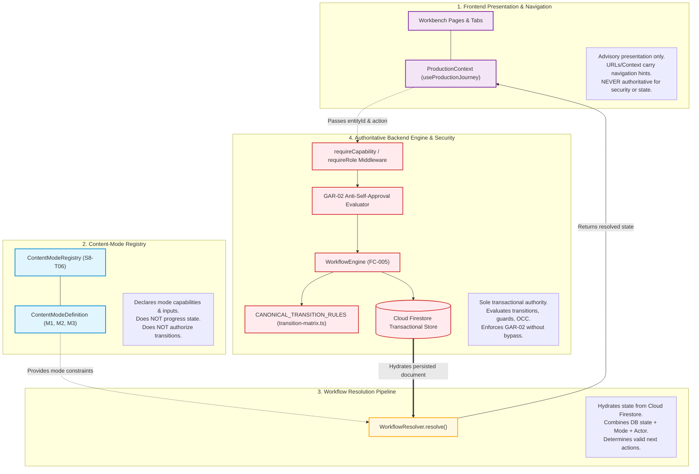

# S8-T07 — Workflow Resolution and Transition Design Specification
## Burra Pariksha Content Management System (BP-CMS)
### Sprint 08 — Dynamic Production Foundation / Phase B Architecture Specification

```text
================================================================================
Document ID:       BP-S8-T07-WORKFLOW-RESOLUTION-TRANSITION
Version:           1.0.0-APPROVED-SPECIFICATION
Date:              2026-10-15
Status:            APPROVED DESIGN SPECIFICATION
Gate Status:       GATE A SATISFIED / PHASE B DESIGN SPECIFICATION
Inspected Commit:  844b303 (origin/main)
Scope:             Deterministic Workflow Resolution Pipeline, Authoritative 15-Stage
                   Canonical Transition Matrix, Multi-Mode Prerequisites & Gates,
                   Revision/Rejection Loops, OCC Concurrency, and Error Handling
Upstream Inputs:   docs/architecture/07-CANONICAL-15-STEP-WORKFLOW.md
                   docs/architecture/08-STATE-MODEL.md
                   docs/architecture/09-RBAC-CAPABILITY-MODEL.md
                   docs/architecture/DECISION-LOG.md (ADR-001 through ADR-011)
                   docs/sprints/sprint-08/S8-T03-CONTENT-MODE-REQUIREMENTS.md
                   docs/sprints/sprint-08/S8-T04-DYNAMIC-PAGE-ROLE-REQUIREMENTS.md
                   docs/sprints/sprint-08/S8-T05-PRODUCTION-CONTEXT-CONTRACT.md
                   docs/sprints/sprint-08/S8-T06-CONTENT-MODE-REGISTRY-DESIGN.md
                   shared/constants/workflow.ts
                   shared/contracts/workflow.ts
                   shared/contracts/api.ts
                   backend/domain/workflow/transition-matrix.ts
                   backend/domain/workflow/workflow-engine.ts
                   backend/domain/workflow/workflow.service.ts
Downstream Impact: S8-T08 (Mode Workspaces & Polymorphic Verification),
                   S8-T09 (Stage 03 Script Multi-Mode Support),
                   S8-T10 through S8-T18 (Stages 04–15 Media & Publishing Adaptations)
Approval State:    APPROVED DESIGN SPECIFICATION (Ready for PO Verification)
================================================================================
```

---

## 1. Executive Summary & Task Identity Discrepancy Resolution

### 1.1 Purpose
The Burra Pariksha Content Management System (BP-CMS) orchestrates a strict, sequential 15-stage production pipeline spanning pedagogical drafting through live platform publication and closed-loop telemetry. With the establishment of the **Shared Production Context Contract (S8-T05)** and the **Content-Mode Registry Design (S8-T06)**, the system requires an authoritative, server-enforced **Workflow Resolution and Transition Design**.

This specification formalizes:
1. The **Deterministic Workflow Resolution Pipeline**: Resolves active workflow state, permitted transitions, and assignment boundaries from persisted Cloud Firestore state.
2. The **Complete Canonical 15-Stage Transition Matrix**: Covers all 15 stages without skipping, reordering, merging, or renumbering any stage, detailing guard conditions, prerequisites, capabilities, and audit requirements.
3. **Multi-Mode Integration**: Maps Mode 1 (`QUESTION_CHALLENGE_SHORT`), Mode 2 (`TOPIC_INTRODUCTION`), and Mode 3 (`EXPLAINED_QUESTIONS_VIDEO`) into the 15-stage pipeline, enforcing polymorphic gates (such as Mode 2 concept verification) without altering macro workflow continuity.
4. **Revision Loops, Reopening, and OCC Concurrency**: Governs change requests, rejection paths, and optimistic concurrency version locking (`version: number`).
5. **Authoritative Error-Handling Contract**: Standardizes error codes (`ApiErrorCode`), HTTP statuses, client responses, and recovery paths.

### 1.2 Task Identity Discrepancy Resolution
A forensic inspection of Sprint 8 tracking manifests revealed an operational labeling discrepancy between initial sprint execution and the active architecture brief:

```text
┌────────────────────────────────────────────────────────────────────────────────────────┐
│                        S8-T07 TASK IDENTITY RESOLUTION RECORD                          │
├──────────────────────────┬─────────────────────────────────────────────────────────────┤
│ Tracking Artifact        │ S8-T07 Designation                                          │
├──────────────────────────┼─────────────────────────────────────────────────────────────┤
│ Reconciliation Report    │ "Draft Reopening, Deep-Links & Mode Modal"                  │
│ Existing Commit a8fb405  │ Implemented useQuestionGeneration draft reopening & tests   │
│ S8 Active Task Brief     │ "Workflow Resolution and Transition Design" (Design Contract)│
└──────────────────────────┴─────────────────────────────────────────────────────────────┘
```

**Resolution Invariants**:
1. **Preserve Completed Implementation**: Commit `a8fb405` (implementing draft reopening in `useQuestionGeneration.ts`, modal selection in `ProductionModeModal.tsx`, and passing 6/6 tests in `tests/unit/s8-t07-draft-reopening.unit.test.ts`) is preserved as intact implementation evidence.
2. **Authoritative Design Deliverable**: The active sprint roadmap designates S8-T07 as the formal **Workflow Resolution and Transition Design** deliverable. This specification establishes that authoritative contract under `docs/sprints/sprint-08/S8-T07-WORKFLOW-RESOLUTION-TRANSITION-DESIGN.md`.
3. **No Reopening of Closed Work**: Gate A, S8-T05, and S8-T06 remain closed; this specification builds directly upon verified foundations.

---

## 2. Architectural Separation of Responsibilities

To preserve system invariants and prevent architectural bleed, workflow execution is partitioned across four strictly separated layers:



---

## 3. Deterministic Workflow Resolution Pipeline

The Workflow Resolver reconstructs the operational reality of an asset from Cloud Firestore, ensuring that neither the client browser, the URL parameters, nor local cache can forge state.

### 3.1 Resolver Input Contract

```typescript
export interface WorkflowResolutionInput {
  entityId: string;                   // Canonical ID (qst_<uuid>, vid_<uuid>, cnt_<uuid>, dft_<uuid>)
  entityType?: 'QUESTION' | 'VIDEO' | 'CONTENT' | 'DRAFT';
  actor: WorkflowActorContext;        // Authenticated actor (userId, roles, capabilities)
}
```

### 3.2 Resolver Output Contract

```typescript
export interface ResolvedWorkflowState {
  workflowInstanceId: string;         // wfl_<uuid>
  entityId: string;
  entityType: string;
  productionMode: ContentProductionMode; // QUESTION_CHALLENGE_SHORT | TOPIC_INTRODUCTION | EXPLAINED_QUESTIONS_VIDEO
  currentStage: WorkflowStepNumber;   // Authoritative integer: 1 to 15
  stageCode: string;                  // e.g. '07_FINAL_QC'
  stageStatus: WorkflowStageStatus;   // DRAFT | IN_PROGRESS | PENDING_REVIEW | etc.
  multiDimensionalState: {
    contentStatus: string;            // DRAFT | IN_REVIEW | APPROVED | REJECTED | ARCHIVED
    mediaStatus: string;              // NOT_REQUIRED | PENDING_UPLOAD | PROCESSING | READY | FAILED
    publicationStatus: string;        // UNPUBLISHED | SCHEDULED | LIVE | SYNCED
    jobStatus: string;                // IDLE | QUEUED | RUNNING | COMPLETED | FAILED
  };
  version: number;                    // OCC optimistic concurrency version
  assignment: {
    ownerId: string;                  // Original creator
    stageAssigneeId?: string;         // Assigned actor for currentStage
  };
  permittedActions: ValidTransitionTarget[]; // Transitions unlocked for THIS actor right now
  isGar02Restricted: boolean;         // True if actor is original author at a verification gate
  isTerminal: boolean;                // True if completed at Stage 15
  lastTransitionAt: string;           // ISO 8601 UTC
  lastTransitionBy: string;           // usr_<uuid>
}
```

### 3.3 The 6-Step Resolution Algorithm

```text
 ┌────────────────────────────────────────────────────────────────────────────────────────┐
 │                      DETERMINISTIC WORKFLOW RESOLUTION PIPELINE                        │
 └────────────────────────────────────────────────────────────────────────────────────────┘
```

1. **Step 1: Authenticated Session Extraction**:
   - Extract `actor.id` and `actor.roles` from server-side bearer session cookie. Reject unauthenticated requests immediately with `UNAUTHENTICATED` (HTTP 401).
2. **Step 2: Firestore Document Hydration**:
   - Query `workflow_instances` collection using `entityId` or `workflowInstanceId`.
   - If document does not exist, return `RESOURCE_NOT_FOUND` (HTTP 404).
   - Read persisted `currentStep` ($1 \le \text{step} \le 15$), `version`, `authorId`, and 5-dimensional statuses.
3. **Step 3: Content Mode Determination**:
   - Inspect linked entity record (`content_masters`, `questions`, or `question_drafts`) to resolve `productionMode`.
   - Validate mode against `ContentModeRegistry` (`shared/registry/content-mode.registry.ts`). If mode is unknown, return `VALIDATION_ERROR` (HTTP 400).
4. **Step 4: Transition Matrix Rule Lookup**:
   - Fetch candidate transition rules from `transition-matrix.ts` where `fromStep === workflowInstance.currentStep`.
5. **Step 5: RBAC, Resource Scope & GAR-02 Filtering**:
   - For each candidate rule, evaluate:
     - **Capability Gate**: Does `actor.roles` possess `rule.requiredCapability`?
     - **GAR-02 Segregation Gate**: If `rule.isVerificationGate === true` (Steps 02, 07, 09), does `actor.id === workflowInstance.authorId`? If identical, mark `isGar02Restricted = true` and remove approval actions from `permittedActions`.
     - **Assignment Check**: If task assignment exists, verify whether actor is designated assignee or holds administrative override.
6. **Step 6: Prerequisite & Mode Constraint Evaluation**:
   - Run `checkStepPrerequisites()` incorporating mode constraints (e.g., Mode 2 skips proof check; Mode 1 verifies 4 MCQ options; Mode 3 checks $N$ questions).
   - Return assembled `ResolvedWorkflowState`.

---

## 4. Comprehensive Canonical 15-Stage Transition Matrix

Every production item in BP-CMS traverses the 15 canonical stages sequentially. Skipping stages, merging stages, or creating alternative stage orders is strictly prohibited by **Principle 3 (Canonical 15-Step Workflow Continuity)**.

```text
┌────────────────────────────────────────────────────────────────────────────────────────────────────────────────────────┐
│                                   CANONICAL 15-STAGE STATE TRANSITION MATRIX (FC-005)                                  │
└────────────────────────────────────────────────────────────────────────────────────────────────────────────────────────┘
```

| Step | Canonical Name & Code | Entry Prerequisites & Persisted Artifacts | Required Capability & Actor Constraints | Mode-Specific Validation & Permitted Actions | Forward Transition Guard & Target | Revision / Rejection Loop & Target | Exceptional / Terminal Recovery |
| :---: | :--- | :--- | :--- | :--- | :--- | :--- | :--- |
| **01** | **Question Generation**<br>`01_QUESTION_GENERATION` | Valid `topicId` and `subtopicId` in Firestore; valid `productionMode`. | `QUESTION:CREATE`<br>Primary: `QUESTION_AUTHOR` / Content Creator. | • `SAVE_DRAFT` (stay at Step 01)<br>• `QUESTION_SUBMIT` (explicit submit)<br>Mode 1: 1 MCQ question with 4 options.<br>Mode 2: Concept overview ($N=0$).<br>Mode 3: Intro + 5/10/15/20 questions. | **Guard**: All mode required fields present & validated.<br>$$\mathbf{1 \longrightarrow 2}$$ (`PENDING_REVIEW`) | N/A (Initial stage; draft may be edited repeatedly). | Corrupt draft: Creator deletes draft via `DELETE /api/questions/draft/:id`. |
| **02** | **Question Verification**<br>`02_QUESTION_VERIFICATION`<br>*(Human Gate)* | Saved draft in `question_drafts`; `WorkflowInstance` at Step 2 (`PENDING_REVIEW`). | `QUESTION:APPROVE`<br>`QUESTION:REJECT`<br>Primary: `QA_REVIEWER`.<br>**GAR-02 Mandatory**: $\text{authorId} \neq \text{reviewerId}$. | • `QUESTION_VERIFY` / `APPROVE`<br>• `QUESTION_REQUEST_CHANGES`<br>• `QUESTION_REJECT`<br>• `QUESTION_TERMINATE`<br>Mode 1/3: 10-point proof checklist.<br>Mode 2: 5-point concept checklist. | **Guard**: Checklist 100% verified; independent reviewer signature recorded.<br>$$\mathbf{2 \longrightarrow 3}$$ (`APPROVED`) | • `REQUEST_CHANGES` $\to$ **Step 01**<br>• `REJECT` $\to$ **Step 01** (`DRAFT`) | • `QUESTION_TERMINATE` $\to$ **Step 02** (`TERMINATED` / Unrecoverable flaw). |
| **03** | **Audience Script**<br>`03_AUDIENCE_SCRIPT` | Verified `Question` materialized in Firestore; `ContentMaster` linked. | `SCRIPT:SUBMIT`<br>`SCRIPT:EDIT`<br>Primary: `SCRIPTWRITER`. | • `SAVE_SCRIPT_DRAFT`<br>• `SCRIPT_SUBMIT` / `LOCK_SCRIPT`<br>• `ESCALATE_QUESTION_DEFECT`<br>Mode 1: 4-part short script ($\le 58\text{s}$).<br>Mode 2: Concept script (60–180s).<br>Mode 3: Segmented masterclass script. | **Guard**: Spoken script word count maps to duration ceiling ($\le 58\text{s}$ for M1; $\le 180\text{s}$ for M2).<br>$$\mathbf{3 \longrightarrow 4}$$ (`APPROVED`) | • `ESCALATE_QUESTION_DEFECT` $\to$ **Step 01** (Returns underlying defect to Author). | Stalled script: Lead reassigns scriptwriter via `POST /api/videos/:id/assignments`. |
| **04** | **Teleprompter & Filming**<br>`04_TELEPROMPTER_FILMING` | Approved `Script` in `scripts` collection; teleprompter copy frozen. | `VIDEO:RECORD`<br>`VIDEO:EDIT`<br>Primary: `PRESENTER` / Talent. | • `LOG_TAKE`<br>• `FILMING_COMPLETE`<br>• `REQUEST_SCRIPT_REVISION`<br>Mode 1/2: Single continuous take.<br>Mode 3: Multi-take segmented chapters. | **Guard**: At least one primary golden take marked and logged in studio session.<br>$$\mathbf{4 \longrightarrow 5}$$ (`PENDING_UPLOAD`) | • `REQUEST_SCRIPT_REVISION` $\to$ **Step 03** (Script unreadable; returned to writer). | Studio cancellation: Reset session to `NOT_STARTED` in Step 04. |
| **05** | **Raw Video**<br>`05_RAW_VIDEO` | Studio take logged; raw footage uploaded to Google Drive. | `MEDIA_REFERENCE:UPLOAD`<br>Primary: `VIDEO_EDITOR`. | • `VIDEO_INGEST`<br>• `DISPATCH_EDITING`<br>• `RE_SHOOT_REQUIRED`<br>All modes: SHA-256 hash verified, file integrity checked, Drive link active. | **Guard**: Video file accessible, streamable, and non-corrupt.<br>$$\mathbf{5 \longrightarrow 6}$$ (`READY`) | • `RE_SHOOT_REQUIRED` $\to$ **Step 04** (Corrupt footage; returned for studio reshoot). | Storage quota error: Triggers ops alert; remains in Step 05 (`mediaStatus = FAILED`). |
| **06** | **Editing Bay**<br>`06_EDITING_BAY` | Raw video ingested; editing workspace active in Video Detail Tab 3. | `VIDEO_EDIT:EDIT`<br>`VIDEO_EDIT:SUBMIT`<br>Primary: `VIDEO_EDITOR`. | • `SAVE_EDIT_CUT`<br>• `VIDEO_EDIT_COMPLETE`<br>• `SUBMIT_QC`<br>Mode 1: 9:16 cuts + countdown timer.<br>Mode 2: 9:16 or 16:9 overview graphics.<br>Mode 3: 16:9 chapter markers + slides. | **Guard**: Rendered master cut uploaded and accessible for QC playback.<br>$$\mathbf{6 \longrightarrow 7}$$ (`IN_REVIEW`) | N/A (Working cut iteratively saved in Step 06). | Render crash: Editor re-renders; state stays in Step 06. |
| **07** | **Final QC**<br>`07_FINAL_QC`<br>*(Human Gate)* | Master cut rendered; mounted under Tab 4 of `VideoDetailPage.tsx`. | `VIDEO_EDIT:APPROVE`<br>`VIDEO_EDIT:REJECT`<br>Primary: `QA_REVIEWER`.<br>**GAR-02 Mandatory**: $\text{editorId} \neq \text{reviewerId}$. | • `VIDEO_QC_VERIFY` / `APPROVE`<br>• `VIDEO_QC_REJECT`<br>Mode 1: 6-point checklist (Audio -14 LUFS, 9:16 safe-zones, timer sync, orthography).<br>Mode 2: 6-point concept checklist.<br>Mode 3: 8-point masterclass checklist. | **Guard**: Master QC certified; zero clipping; audio normalized; aspect verified.<br>$$\mathbf{7 \longrightarrow 8}$$ (`APPROVED`) | • `VIDEO_QC_REJECT` $\to$ **Step 06** (Returned to editor with defect notes). | Systematic failure: Admin override context logged with mandatory rationale. |
| **08** | **Thumbnail**<br>`08_THUMBNAIL` | Final QC approved; master cut locked; mounted under Tab 5. | `THUMBNAIL:SUBMIT`<br>Primary: `DESIGNER`. | • `SUBMIT_THUMBNAIL`<br>• `THUMBNAIL_APPROVE`<br>Mode 1: 9:16 vertical split CTR frame.<br>Mode 2: 9:16 or 16:9 concept branding.<br>Mode 3: 16:9 high-contrast masterclass. | **Guard**: Master thumbnail selected, verified legible at mobile scale ($320\text{px}$).<br>$$\mathbf{8 \longrightarrow 9}$$ (`APPROVED`) | N/A (Designer uploads and compares candidates in Step 08). | Asset missing: Designer re-uploads asset to `thumbnails` collection. |
| **09** | **Social Review**<br>`09_SOCIAL_REVIEW`<br>*(Human Gate)* | Triple-asset bundle assembled: Master Render + Thumbnail + Pinned Comment. | `SOCIAL_REVIEW:APPROVE`<br>`SOCIAL_REVIEW:REJECT`<br>Primary: `CONTENT_LEAD`.<br>**GAR-02 Mandatory**: $\text{creatorId} \neq \text{leadId}$. | • `SOCIAL_REVIEW_APPROVE`<br>• `APPROVE_SOCIAL`<br>• `REQUEST_THUMBNAIL_REVISION`<br>• `REQUEST_VIDEO_REVISION`<br>Audit via 9:16 mobile simulator. | **Guard**: Brand guidelines passed; platform copy & hashtags approved.<br>$$\mathbf{9 \longrightarrow 10}$$ (`APPROVED`) | • `REQUEST_THUMBNAIL_REVISION` $\to$ **Step 08**<br>• `REQUEST_VIDEO_REVISION` $\to$ **Step 06** | Platform guideline violation: Copy rewritten by Lead in Step 09. |
| **10** | **Publishing Setup**<br>`10_PUBLISHING_SETUP` | Social review certified; packaging workspace active (`PublishingPage.tsx`). | `PUBLICATION:SCHEDULE`<br>`PUBLISHING_PACKAGE:EDIT`<br>Primary: `PUBLISHING_LEAD`. | • `CONFIGURE_PLATFORMS`<br>• `PUBLISH_SCHEDULE`<br>• `SCHEDULE_PUBLISH`<br>• `REQUEST_COPY_REVISION`<br>Assigns schedule slot per mode. | **Guard**: Pre-publish checklist certified; target platform credentials active.<br>$$\mathbf{10 \longrightarrow 11}$$ (`SCHEDULED`) | • `REQUEST_COPY_REVISION` $\to$ **Step 09** (Copy adjustment needed before release). | API credential revoked: Ops reconnects OAuth token; package remains in Step 10. |
| **11** | **Published**<br>`11_PUBLISHED` | Scheduled slot triggered or manual immediate publish executed. | `PUBLICATION:PUBLISH`<br>Primary: `PUBLISHING_LEAD`. | • `PUBLISH_EXECUTE`<br>• `CONFIRM_LIVE`<br>• `CANCEL_SCHEDULE`<br>Dispatches upload payload to YouTube / Instagram / Facebook APIs. | **Guard**: External platform video ID returned; HTTP 200 live status confirmed.<br>$$\mathbf{11 \longrightarrow 12}$$ (`LIVE`) | • `CANCEL_SCHEDULE` $\to$ **Step 10** (Release cancelled prior to broadcast). | Network failure: Worker executes exponential backoff retry up to 5 attempts. |
| **12** | **Platform Sync**<br>`12_PLATFORM_SYNC` | Video confirmed live on target platform; permalink available. | `PUBLICATION:SYNC`<br>Primary: `PUBLISHING_LEAD`. | • `PLATFORM_SYNC`<br>• `COMPLETE_SYNC`<br>Posts pinned comment with solution; verifies tags and description sync. | **Guard**: Platform permalink recorded; pinned comment verified live.<br>$$\mathbf{12 \longrightarrow 13}$$ (`SYNCED`) | N/A (Re-sync retry executed in Step 12 if pinned comment API throttles). | Token expiry: Re-authenticate OAuth; execute re-sync. |
| **13** | **Analytics**<br>`13_ANALYTICS` | Video live $\ge 24\text{ hours}$; social telemetry ingestion active. | `ANALYTICS_SNAPSHOT:VIEW`<br>Primary: `ANALYST`. | • `ANALYTICS_INGEST`<br>• `DISPATCH_PERF_REVIEW`<br>Ingests views, watch time, retention curve, CTR, comments, and shares. | **Guard**: 24h & 7d telemetry snapshots ingested into `analytics_snapshots`.<br>$$\mathbf{13 \longrightarrow 14}$$ | N/A (Continuous telemetry polling via scheduled job). | API rate limit: Ingestion deferred to next 6-hour polling cycle. |
| **14** | **Performance Review**<br>`14_PERFORMANCE_REVIEW` | Telemetry threshold ingested; performance report generated. | `PERFORMANCE_RECORD:REVIEW`<br>Primary: `CONTENT_LEAD`. | • `PERFORMANCE_INDEX`<br>• `FINALIZE_PERF_REVIEW`<br>Benchmarks retention against topic average; maps confusion drops to script lines. | **Guard**: Diagnostic retention report finalized by Content Lead.<br>$$\mathbf{14 \longrightarrow 15}$$ | N/A (Post-publish pedagogical evaluation). | Low-data sample: Review deferred until 500 views threshold achieved. |
| **15** | **Intelligence Loop**<br>`15_INTELLIGENCE_LOOP`<br>*(Terminal State)* | Diagnostic report approved; curriculum strategy loopback ready. | `INTELLIGENCE_INSIGHT:APPROVE`<br>Primary: `CONTENT_LEAD`. | • `INTELLIGENCE_LOOP_FEED`<br>• `COMPLETE_WORKFLOW`<br>High-retention hooks ingested into prompt catalog; topic directives updated. | **Terminal State**: Lifecycle complete. Workflow archived (`ARCHIVED` / `COMPLETED`).<br>$$\mathbf{15 \longrightarrow 15}$$ | N/A (Terminal). Next production cycle initiates in future instance at Step 01. | Archived record preserved permanently in Cloud Firestore for audit. |

---

## 5. Multi-Mode Workflow Mapping

Every mode adheres to the 15-stage workflow architecture. Differences represent mode-specific input validation, duration budgets, and artifact structures, never step skipping.

```text
┌────────────────────────────────────────────────────────────────────────────────────────────────────────┐
│                              THREE-MODE WORKFLOW STAGE SPECIALIZATION                                  │
└────────────────────────────────────────────────────────────────────────────────────────────────────────┘
```

### 5.1 Mode 1: Question Challenge Short (`QUESTION_CHALLENGE_SHORT`)
- **Stage 01 Authoring**: 1 question statement, exactly 4 MCQ options (`a, b, c, d`), single answer key (`A, B, C, D`), detailed proof. $N=1$ default. *(Proposed batch runner remains an unapproved open decision per OD-02).*
- **Stage 02 Verification**: 10-point pedagogical audit (`S8-M1-01` to `S8-M1-10`) verifying that the mathematical proof evaluates deterministically to the declared answer key.
- **Stage 03 Scripting**: 4-part short script: Hook (0–3s) $\to$ Problem & Options (3–18s) $\to$ Comment Pause/Countdown (18–25s) $\to$ Burra Trick Solution (25–50s) $\to$ CTA (50–58s). Total words $\le 135$ ($\le 58\text{ seconds}$).
- **Stage 04 Filming**: Single continuous vertical portrait take ($1080 \times 1920\text{ px}$).
- **Stage 06 Editing**: 9:16 safe-zone framing, on-screen Telugu captions, 3s or 5s visual countdown overlay, audio ticking SFX.
- **Stage 07 Final QC**: 6-point checklist verifying -14 LUFS audio, 9:16 safe-zones, timer sync, Telugu orthography, hook retention.
- **Stage 08 Thumbnail**: 9:16 high-contrast split-screen curiosity image.
- **Stage 09–12 Publishing**: YouTube Shorts, Instagram Reels, Facebook Reels. Daily prime release slot (18:00 IST).

### 5.2 Mode 2: Topic Introduction (`TOPIC_INTRODUCTION`)
- **Stage 01 Authoring**: Zero questions ($N=0$ enforced). No question count input required. Focuses on `conceptTitle`, `introductoryConcept` (Telugu demystification statement), and `syllabusScopeNotes`. Configurable aspect ratio: `9:16` or `16:9`.
- **Stage 02 Verification**: Polymorphic 5-point concept accuracy checklist (`S8-M2-01` to `S8-M2-05`) verifying curriculum relevance, syllabus boundaries, weightage accuracy, and linguistic clarity (ADR-009 / OD-03).
- **Stage 03 Scripting**: Foundational concept script: Curiosity Anchor (0–5s) $\to$ Demystification (5–25s) $\to$ Syllabus Scope (25–45s) $\to$ Core Intuition (45–80s) $\to$ CTA (80–90s). Duration: 60–180 seconds.
- **Stage 04 Filming**: Conversational studio presentation in 9:16 or 16:9 format.
- **Stage 06 Editing**: Clean documentary pacing, visual diagram overlays, formula callouts.
- **Stage 07 Final QC**: 6-point checklist verifying selected aspect ratio, clear audio, and Telugu pronunciation.
- **Stage 08 Thumbnail**: Concept branding thumbnail (9:16 or 16:9).
- **Stage 09–12 Publishing**: YouTube Standard & Shorts, Instagram Reels. Weekly syllabus foundation slot (Saturday 10:00 IST).

### 5.3 Mode 3: Explained Questions Video (`EXPLAINED_QUESTIONS_VIDEO`)
- **Stage 01 Authoring**: Additive $1 + N$ model: 1 Intro Roadmap Concept + multi-question array `questions: ExplainedQuestionItem[]` containing strictly **5, 10, 15, or 20 questions**. Aspect ratio fixed to **16:9 Landscape**.
- **Stage 02 Verification**: Segmented review across all $N$ practice questions, evaluating the 10-point proof checklist per question (`S8-M3-01` to `S8-M3-10`).
- **Stage 03 Scripting**: Masterclass script: Master Roadmap (0:00–1:30) + sequential question segments ($Q_1 \dots Q_N$ at ~2.5 min each) + summary recap. Total duration: 12–52 minutes.
- **Stage 04 Filming**: Segmented recording: Take 1 (Intro) + Takes 2 through $N+1$ (Individual question takes).
- **Stage 06 Editing**: 16:9 masterclass graphics, picture-in-picture presenter layout, chapter markers (`00:00 Intro`, `01:30 Q1`, etc.), on-screen slide cards.
- **Stage 07 Final QC**: 8-point checklist verifying 16:9 render, chapter synchronization, all $N$ proofs displayed, audio levels normalized (-14 LUFS).
- **Stage 08 Thumbnail**: 16:9 landscape CTR thumbnail with problem teaser and topic badge.
- **Stage 09–12 Publishing**: YouTube Long-Form Main Channel. Weekly masterclass slot (Sunday 11:00 IST).

---

## 6. Revision Loops, Concurrency Control & Transition Enforcement

### 6.1 Revision Loops and Return Path Governance

When a reviewer or quality lead requests changes, the workflow transitions backward along pre-authorized return paths:

```mermaid
graph LR
    subgraph Stage01 ["Stage 01: Generation"]
        S1["01 Question Studio"]
    end

    subgraph Stage02 ["Stage 02: Verification"]
        S2["02 Question Verify"]
    end

    subgraph Stage03 ["Stage 03: Scripting"]
        S3["03 Audience Script"]
    end

    subgraph Stage04 ["Stage 04: Filming"]
        S4["04 Studio Filming"]
    end

    subgraph Stage06 ["Stage 06: Editing"]
        S6["06 Editing Bay"]
    end

    subgraph Stage07 ["Stage 07: Final QC"]
        S7["07 Final QC"]
    end

    subgraph Stage08 ["Stage 08: Thumbnail"]
        S8["08 Thumbnail"]
    end

    subgraph Stage09 ["Stage 09: Social Review"]
        S9["09 Social Review"]
    end

    subgraph Stage10 ["Stage 10: Publishing Setup"]
        S10["10 Publishing Setup"]
    end

    subgraph Stage11 ["Stage 11: Published"]
        S11["11 Published"]
    end

    S1 ==>|"QUESTION_SUBMIT"| S2
    S2 -.->|"QUESTION_REQUEST_CHANGES (Revision)"| S1
    S2 ==>|"QUESTION_APPROVE"| S3
    S3 -.->|"ESCALATE_QUESTION_DEFECT (Revision)"| S1
    S3 ==>|"SCRIPT_SUBMIT"| S4
    S4 -.->|"REQUEST_SCRIPT_REVISION (Revision)"| S3
    S4 ==>|"FILMING_COMPLETE"| S6
    S6 ==>|"SUBMIT_QC"| S7
    S7 -.->|"VIDEO_QC_REJECT (Revision)"| S6
    S7 ==>|"APPROVE_QC"| S8
    S8 ==>|"SUBMIT_THUMBNAIL"| S9
    S9 -.->|"REQUEST_THUMBNAIL_REVISION (Revision)"| S8
    S9 -.->|"REQUEST_VIDEO_REVISION (Revision)"| S6
    S9 ==>|"APPROVE_SOCIAL"| S10
    S10 -.->|"REQUEST_COPY_REVISION (Revision)"| S9
    S10 ==>|"PUBLISH_SCHEDULE"| S11
    S11 -.->|"CANCEL_SCHEDULE (Revision)"| S10

    classDef fwd fill:#e8f5e9,stroke:#388e3c,stroke-width:2px;
    classDef rev fill:#ffebee,stroke:#d32f2f,stroke-width:2px;
    classDef stg fill:#f5f5f5,stroke:#9e9e9e,stroke-width:1px;

    class S1,S2,S3,S4,S6,S7,S8,S9,S10,S11 stg;
```



### 6.2 Optimistic Concurrency Control (OCC)
To prevent race conditions and concurrent overwrite collisions when multiple team members view an asset:
1. Every `WorkflowInstanceDocument` maintains an integer `version: number`.
2. Every mutation request must transmit the `expectedVersion: number`.
3. In `workflow.service.ts`, before executing a state transition:
   ```typescript
   if (currentInstance.version !== input.expectedVersion) {
     throw new ConcurrencyConflictError(
       `Workflow instance '${id}' was modified concurrently. Expected version ${input.expectedVersion}, but found ${currentInstance.version}.`
     );
   }
   ```
4. If a conflict occurs, the server responds with `ApiErrorCode.CONCURRENCY_CONFLICT` (HTTP 409). The frontend must prompt the user to refresh their workbench.

---

## 7. Authoritative Error-Handling Contract

The error handling model maps every failure mode to a canonical `ApiErrorCode` and deterministic HTTP status:

```text
┌────────────────────────────────────────────────────────────────────────────────────────────────────────────────────────┐
│                                       CANONICAL WORKFLOW ERROR CONTRACT MATRIX                                         │
└────────────────────────────────────────────────────────────────────────────────────────────────────────────────────────┘
```

| Failure Category | Trigger Condition | Canonical `ApiErrorCode` | HTTP Status | Safe Client Response | Recovery Guidance & Retry Policy | Audit / Logging Expectation |
| :--- | :--- | :--- | :---: | :--- | :--- | :--- |
| **Unauthenticated Actor** | Missing, expired, or invalid session token. | `UNAUTHENTICATED` | 401 | *"Authentication required. Please log in."* | Redirect to `/login?returnUrl=...`. Safe to retry after login. | Auth failure logged with IP & UserAgent. |
| **Unauthorized Capability** | Actor lacks `requiredCapability` (e.g. Writer attempts to Approve). | `FORBIDDEN_LACKS_CAPABILITY` | 403 | *"You do not have permission to execute this workflow transition."* | Request role assignment from Content Lead. No client retry. | Security violation logged to `audit_logs` (`ACTOR_FORBIDDEN`). |
| **GAR-02 Self-Approval Attempt** | Author attempts to approve own submission at Stage 02, 07, or 09 (`authorId === actor.id`). | `FORBIDDEN_BY_SEGREGATION_OF_DUTIES` | 403 | *"GAR-02 Invariant Violation: Author cannot approve their own work at a quality gate."* | Review must be conducted by an independent peer. No client retry. | High-priority security audit event logged (`GAR02_VIOLATION_ATTEMPT`). |
| **Autonomous AI Approval** | Automated agent attempts to sign off on a human gate (`isAiAgent === true`). | `FORBIDDEN_BY_AI_GATING` | 403 | *"AP-009 Invariant Violation: AI agents cannot execute workflow sign-offs."* | Human-in-the-loop review mandatory. No client retry. | AI gate violation logged (`AI_APPROVAL_BLOCKED`). |
| **Illegal State Transition** | Out-of-sequence jump (e.g., $1 \to 5$) or invalid `fromStep`/`toStep` pair. | `INVALID_WORKFLOW_TRANSITION` | 422 | *"Illegal workflow transition: Cannot move from Step X to Step Y using action Z."* | Refresh page; follow sequential workflow stages. No retry. | Workflow state violation logged (`ILLEGAL_TRANSITION_REJECTED`). |
| **Prerequisite Gate Failure** | Missing required artifact (e.g., submitting Mode 1 without 4 options; duration > 58s). | `VALIDATION_ERROR` | 400 | *"Prerequisite gate failed: [Specific error details]."* | Complete missing fields in active workbench and re-submit. | Validation failure logged (`PREREQUISITE_GATE_FAILED`). |
| **Resource Not Found** | Target `entityId` or `workflowInstanceId` does not exist in Firestore. | `RESOURCE_NOT_FOUND` | 404 | *"Workflow instance or content record not found."* | Return to Library or Content Plan dashboard. No retry. | Not found event logged (`WORKFLOW_INSTANCE_NOT_FOUND`). |
| **Concurrency Version Mismatch** | Stale page state submits transition (`expectedVersion !== currentVersion`). | `CONCURRENCY_CONFLICT` | 409 | *"This content was modified by another user. Please reload."* | Reload fresh state via `reloadJourneyData()`. Re-attempt action. | Concurrency conflict logged (`OCC_VERSION_MISMATCH`). |
| **Invalid Content Mode** | Payload specifies unapproved mode literal. | `VALIDATION_ERROR` | 400 | *"Invalid production mode specified."* | Select an approved mode (Mode 1, Mode 2, or Mode 3). | Schema error logged (`INVALID_CONTENT_MODE`). |
| **Database / Internal Failure** | Firestore timeout or connection failure during commit. | `INTERNAL_SERVER_ERROR` | 500 | *"An internal error occurred while processing the transition."* | Retry action after exponential backoff. System self-heals. | Error logged with stack trace (`INTERNAL_TRANSITION_FAILURE`). |

---

## 8. Traceability Matrix & Cross-Contract Alignment

| Requirement Source | Canonical Rule / Invariant | Workflow Design Implementation | Status |
| :--- | :--- | :--- | :---: |
| **07-CANONICAL-15-STEP-WORKFLOW.md** | Canonical 15-stage workflow progression without omissions. | Preserved in Section 4: all 15 stages mapped with exact forward guards and return loops. | **ALIGNED** |
| **08-STATE-MODEL.md** | Multi-dimensional decoupling: Workflow Stage $\neq$ Entity State $\neq$ Media Status $\neq$ Publication Status. | Codified in `ResolvedWorkflowState.multiDimensionalState` and Section 3.2. | **ALIGNED** |
| **09-RBAC-CAPABILITY-MODEL.md** | Role-to-capability possession checks; zero client trust. | Enforced in Section 3.3 (Step 5) and Section 7 via `FORBIDDEN_LACKS_CAPABILITY`. | **ALIGNED** |
| **ADR-001** | Converge on single 15-stage workflow engine (`transition-matrix.ts`). | Explicitly verified: Section 4 utilizes `CANONICAL_TRANSITION_RULES` as single engine source. | **ALIGNED** |
| **ADR-002 / GAR-02** | Anti-self-approval enforced server-side without admin bypass. | Enforced in Section 4 and Section 7 via `FORBIDDEN_BY_SEGREGATION_OF_DUTIES`. | **ALIGNED** |
| **ADR-003 / AP-009** | Assistive AI only; human sign-off mandatory on quality gates. | Enforced in Section 3.3 (Step 5) and Section 7 via `FORBIDDEN_BY_AI_GATING`. | **ALIGNED** |
| **ADR-009 / S8-T03** | Polymorphic Stage 02 Verification for zero-question Mode 2. | Codified in Section 4 and 5.2: 5-point concept accuracy checklist for Mode 2. | **ALIGNED** |
| **ADR-010 / S8-T03** | Multi-question masterclasses ($N \in \{5,10,15,20\}$) & aspect ratio expansion. | Codified in Section 4 and 5.3: additive $1+N$ model, 16:9 aspect ratio, 8-point QC checklist. | **ALIGNED** |
| **S8-T05 Contract** | Save Draft $\neq$ Submit for Verification operational distinction. | Codified in Section 4 (Step 01): `SAVE_DRAFT` stays at Step 01; `QUESTION_SUBMIT` advances to Step 02. | **ALIGNED** |
| **S8-T06 Contract** | Content-Mode Registry describes capabilities; workflow engine progress state. | Codified in Section 2: strict architectural separation of responsibilities. | **ALIGNED** |

---

## 9. Acceptance Criteria Checklist & Open Decisions Register

### 9.1 Acceptance Criteria Checklist
- [x] **AC-01**: Deterministic workflow resolution pipeline defined, specifying inputs, outputs, validation order, and failure behavior.
- [x] **AC-02**: Complete canonical 15-stage transition matrix produced without renumbering, skipping, merging, or reordering any stage.
- [x] **AC-03**: All three approved modes (`QUESTION_CHALLENGE_SHORT`, `TOPIC_INTRODUCTION`, `EXPLAINED_QUESTIONS_VIDEO`) fully mapped across all relevant stages.
- [x] **AC-04**: Major gates explicitly covered: Save Draft vs. Submit (Stage 01), GAR-02 anti-self-approval (Stage 02), Final QC (Stage 07), and Social Review (Stage 09).
- [x] **AC-05**: Revision and rejection loops specified with exact return target stages and dimensional side-effects.
- [x] **AC-06**: Concurrency control specified using Optimistic Concurrency Control (OCC) version locking (`version: number`).
- [x] **AC-07**: Authoritative error-handling contract defined, mapping 10 failure categories to `ApiErrorCode`, HTTP statuses, and recovery rules.
- [x] **AC-08**: Architectural separation preserved: Content-Mode Registry describes capabilities; 15-stage workflow engine retains sole state-transition authority.
- [x] **AC-09**: Task-identity discrepancy documented and reconciled without overwriting historical code or reopening closed tasks.

### 9.2 Open Decisions Register

```text
┌────────────────────────────────────────────────────────────────────────────────────────┐
│                              OPEN DECISIONS REGISTER                                   │
├─────────┬──────────────────────────────┬──────────────────┬────────────────────────────┤
│ ID      │ Topic                        │ Current Status   │ Architectural Guidance     │
├─────────┼──────────────────────────────┼──────────────────┼────────────────────────────┤
│ OD-02   │ Mode 1 Batch Creation Series │ UNAPPROVED /     │ Default strictly N=1 for   │
│         │ Execution Engine             │ OPEN DECISION    │ Mode 1. Batch runner not   │
│         │                              │                  │ authorized until PO sign.  │
├─────────┼──────────────────────────────┼──────────────────┼────────────────────────────┤
│ OD-09   │ Automated OCC Retry Helper   │ PROPOSED /       │ Frontend prompts user to   │
│         │ on Low-Risk Metadata Edits   │ FUTURE ENHANCE   │ reload; automatic merge not│
│         │                              │                  │ authorized at Phase B.     │
└─────────┴──────────────────────────────┴──────────────────┴────────────────────────────┘
```

---

## 10. Governance & Deliverable Status

```text
================================================================================
FINAL DELIVERABLE STATUS:  APPROVED DESIGN SPECIFICATION
Task Identifier:           S8-T07 (Workflow Resolution and Transition Design)
Document Version:          1.0.0-APPROVED-SPECIFICATION
Reconciliation Date:       2026-10-15
Author:                    Antigravity Systems Architecture Team
Governance Summary:        Establishes the authoritative, 15-stage workflow resolution
                           pipeline and transition matrix. Reconciles task discrepancy,
                           preserves completed implementation of commit a8fb405, and
                           aligns with 07-WORKFLOW, 08-STATE, S8-T05, and S8-T06.
================================================================================
```
