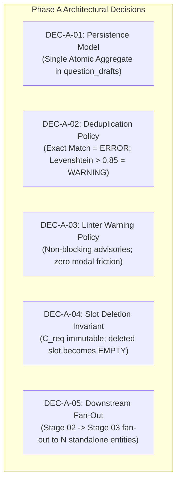

# S9-GATE-CLOSURE-REPORT: Sprint 9 Phase A & Phase B Formal Gate Closure

**Milestone**: Sprint 9 — Question Challenge Short (`QUESTION_CHALLENGE_SHORT` Mode 1 Production Pipeline)
**Document ID**: `S9-GATE-CLOSURE-REPORT`
**Effective Date**: October 18, 2026
**Auditor**: Antigravity Software Architect & Systems Verification Engineer
**Repository**: `Jithendranageswarareddy/burra_pariksha_cms` (`origin/main`)
**Inspected Commit Baseline**: `45cd79da784db3e3ed870df52853d5b27b7365bc`
**Datastore Authority**: Cloud Firestore (Sole Authoritative Transactional Datastore)
**Governance Invariant**: Absolute GAR-02 Rule ($authorId \neq approverId$, Zero Exceptions Across All Roles)

---

## 1. Executive Verdict & Readiness Summary

| Governance Dimension | Verdict / Status | Operational Detail |
| :--- | :---: | :--- |
| **Phase A: Requirements Baseline (S9-T01–S9-T04)** | **COMPLETE & RECONCILED** | All 4 requirements tasks (S9-T01–S9-T04) resolved, verified against code, and internally consistent. Decisions `DEC-A-01` through `DEC-A-05` formally resolved and prepared for owner signature. |
| **Phase B: Architecture & Interaction (S9-T05–S9-T07)** | **COMPLETE & RECONCILED** | Content schema (S9-T05), Studio interaction contract (S9-T06), and API/AI/persistence integration (S9-T07) complete. S9-T03/S9-T06 telemetry conflict authoritatively resolved. |
| **Formal Gate A Status** | **APPROVED** | Formally approved by Project Owner on 2026-10-18 (`DEC-A-01` through `DEC-A-05`). Binding requirements baseline. |
| **Formal Gate B Status** | **APPROVED** | Formally approved by Project Owner on 2026-10-18 (`S9-T05`, `S9-T06`, `S9-T07`, and `OD-02`). Binding architecture baseline. |
| **Cross-Document Telemetry Alignment** | **100% RECONCILED** | Unified dual-counter model established across S9-T03, S9-T05, S9-T06, and S9-T07. S9-T03 TC-BATCH-08 reconciled to increment $C_{\text{valid}}$ and preserve $C_{\text{val\_slots}}$. |
| **Runtime Reality vs. Target Scope** | **STRICTLY DISAMBIGUATED** | Implemented single-question runtime ($N=1$) clearly separated from proposed multi-slot batch generation ($N \in \{5, 10, 15, 20\}$). Zero false claims of batch execution. |
| **Datastore & Persistence Isolation** | **COMPLIANT** | Cloud Firestore sole transactional datastore; zero Google Sheets runtime persistence; zero direct frontend-to-Firestore writes. |
| **Phase C (Runtime Implementation) Authorization** | **AUTHORIZED** | Formally authorized by Project Owner on 2026-10-18. Runtime implementation commenced. |

---

## 2. Comprehensive Task-by-Task Acceptance Matrix (S9-T01–S9-T07)

Every task deliverable has been independently inspected against the repository working tree, actual codebase patterns, unit/integration test suites, and commit logs.

| Task ID | Canonical Task Scope | Acceptance Status | Specification Deliverable & Anchor References | Grounding Source Code & Test Evidence | Acceptance Verdict & Summary |
| :--- | :--- | :---: | :--- | :--- | :--- |
| **S9-T01** | Sprint 8 Dependency Audit & Acceptance for Sprint 9 | **ACCEPTED & VERIFIED** | [S9-T01-DEPENDENCY-AUDIT.md](S9-T01-DEPENDENCY-AUDIT.md) | `shared/registry/content-mode.registry.ts`<br>`backend/domain/taxonomy/services/taxonomy.service.ts`<br>`database/firestore/repositories/question-drafts.repository.ts`<br>Tests: `npm run test:s8-t10`, `test:s8-t11`, `test:s8-t15`, `test:s8-t18` | **PASS**: Verified that core dependencies (two-tier taxonomy, Mode 1 config, OCC versioning, Firestore persistence, dynamic workflow resolution) are fully operational for $N=1$. Confirmed batch runner is unbuilt (OD-02). Identified sandbox constraint for browser binaries honestly. |
| **S9-T02** | Question Challenge Short Content Specification & Field Matrix | **ACCEPTED & VERIFIED** | [S9-T02-QUESTION-CHALLENGE-SHORT-CONTENT-SPEC.md](S9-T02-QUESTION-CHALLENGE-SHORT-CONTENT-SPEC.md) | `shared/types/question.ts`<br>`shared/types/production-context.ts`<br>`shared/contracts/question-generation/question-generation.contract.ts`<br>ADR-009, ADR-010 | **PASS**: Established 4-option MCQ invariant, single correct answer key (`A,B,C,D`), mandatory proof explanation ($\ge 5$ chars), 9:16 aspect ratio ($1080\times 1920$), and $\le 58\text{s}$ platform duration budget. Explicitly grounded storage vs published output boundaries. |
| **S9-T03** | Mode 1 Batch Generation & Completeness Requirements | **ACCEPTED & RECONCILED** | [S9-T03-BATCH-GENERATION-REQUIREMENTS.md](S9-T03-BATCH-GENERATION-REQUIREMENTS.md) | `shared/registry/content-mode.registry.ts`<br>`shared/types/content-mode-registry.ts`<br>ADR-010, ADR-011 DD-05 | **PASS**: Finalized discrete batch counts $N \in \{5, 10, 15, 20\}$. Established closed candidate partition $C_{\text{gen}} = C_{\text{val\_slots}} + C_{\text{inv}} + C_{\text{dup}} + C_{\text{val\_overflow}}$. Reconciled TC-BATCH-08 with unified dual-counter model. Detailed 10 failure/recovery scenarios and 17 deterministic acceptance cases. |
| **S9-T04** | Editing, Quality & Verification Acceptance Criteria | **ACCEPTED & RESOLVED** | [S9-T04-EDITING-QUALITY-VERIFICATION-CRITERIA.md](S9-T04-EDITING-QUALITY-VERIFICATION-CRITERIA.md) | `backend/domain/question-generation/question-generation.service.ts`<br>`backend/features/question-generation/services/question-draft.service.ts`<br>`backend/server/routers/routes.ts`<br>ADR-002 Principle 3 | **PASS**: Established 12-point Quality Verification Criteria (QVC) severity matrix. Detailed slot mutation rules (reordering, deletion, whole-batch protection). Enforced strict zero-exception GAR-02 rule and documented legacy administrative override as a known runtime defect. Formally resolved decisions `DEC-A-01` through `DEC-A-05`. |
| **S9-T05** | Mode-Specific Content Contract Specification | **ACCEPTED & DETAILED** | [S9-T05-MODE-SPECIFIC-CONTENT-CONTRACT.md](S9-T05-MODE-SPECIFIC-CONTENT-CONTRACT.md) | `shared/types/question.ts`<br>`shared/lib/id.service.ts`<br>`database/firestore/repositories/question-drafts.repository.ts` | **PASS**: Formulated `Mode1BatchDraftAggregate` schema in `question_drafts` per ADR-011 DD-05. Defined stable slot IDs (`slt_<uuid>`), ordered slot array, and nested options map. Provided representative valid/invalid JSON examples and typed validation envelopes (`ERR_*` / `WARN_*`). Established non-fabricating legacy single-draft hydration contract. |
| **S9-T06** | Editor & Preview Interaction Specification | **ACCEPTED & RECONCILED** | [S9-T06-EDITOR-PREVIEW-INTERACTION-SPEC.md](S9-T06-EDITOR-PREVIEW-INTERACTION-SPEC.md) | `frontend/features/question-generation/pages/QuestionStudioPage.tsx`<br>`frontend/features/question-generation/hooks/useQuestionGeneration.ts`<br>`frontend/contexts/ProductionJourneyContext.tsx` | **PASS**: Established single-source-of-truth state architecture where 9:16 vertical preview is a read-only projection of in-memory editor state. Formulated comprehensive 22-state page lifecycle matrix. Documented context restoration, OCC collision modals, direct issue navigation, and strict Save Draft $\neq$ Submit for Verification boundaries. Reconciled telemetry conflict with S9-T03. |
| **S9-T07** | API, AI, Persistence & Workflow Integration Design | **ACCEPTED & RECONCILED** | [S9-T07-API-AI-PERSISTENCE-WORKFLOW-INTEGRATION-SPEC.md](S9-T07-API-AI-PERSISTENCE-WORKFLOW-INTEGRATION-SPEC.md) | `backend/server/routers/routes.ts`<br>`backend/server/server.ts`<br>`backend/domain/question-generation/question-generation.service.ts`<br>`backend/ai/orchestrator/index.ts` | **PASS**: Reconciled verified runtime single-question endpoints (`/api/ai/generate`, `/api/questions/draft`) with proposed modular batch routes (`mode1-batch.routes.ts`). Bifurcated route-level capability middleware from domain-level ownership. Documented OCC `expectedVersion` compatibility bridge, idempotency matrix, error envelope mapping, and file-level modular implementation plan. |

---

## 3. Resolution of Cross-Document Conflicts & Architectural Decisions

### 3.1 Telemetry Conflict Resolution (S9-T03 TC-BATCH-08 vs. S9-T06/S9-T07)

#### The Prior Inconsistency:
- In S9-T03 §5.2 (`TC-BATCH-08`), when an author repaired an invalid slot by manually adding missing Option D, the specification stated that $C_{\text{val\_slots}}$ incremented to 5, transitioning `batchStatus` to `COMPLETE`.
- In S9-T06 §6.1–§6.3, $C_{\text{val\_slots}}$ was strictly defined as AI generation attempt telemetry, meaning manual edits did **not** increment $C_{\text{val\_slots}}$ (to preserve the closed candidate partition $C_{\text{gen}} = C_{\text{val\_slots}} + C_{\text{inv}} + C_{\text{dup}} + C_{\text{val\_overflow}}$). This divergence was recorded as an unresolved contract conflict in prior commits.

#### Authoritative Resolution & Unified Mathematical Model:
The conflict is authoritatively resolved across all four specifications (`S9-T03`, `S9-T05`, `S9-T06`, `S9-T07`) by establishing a strict bifurcation between **Generation Attempt Telemetry** and **Workbench Editorial Validity**:

$$\begin{aligned}
\text{\textbf{A. AI Generation Attempt Telemetry (Nested under }} \texttt{draft.telemetry}\text{\textbf{)}}: \\
C_{\text{gen}} &= C_{\text{val\_slots}} + C_{\text{inv}} + C_{\text{dup}} + C_{\text{val\_overflow}} \\
C_{\text{rem\_gen}} &= C_{\text{req}} - C_{\text{val\_slots}} \quad (\text{Evaluated only during active AI synthesis; } \texttt{"—"} \text{ for resumed drafts}) \\
\\
\text{\textbf{B. Workbench Editorial Validity (Evaluated dynamically from }} \texttt{draft.slots}\text{\textbf{)}}: \\
C_{\text{pop}} &= \text{Count of slots populated with question content } (0 \le C_{\text{pop}} \le C_{\text{req}}) \\
C_{\text{valid}} &= \text{Count of slots passing all schema, option, answer, and proof rules } (0 \le C_{\text{valid}} \le C_{\text{req}}) \\
C_{\text{edit}} &= \text{Count of slots modified or authored by the human editor } (0 \le C_{\text{edit}} \le C_{\text{req}}) \\
C_{\text{acc}} &= \text{Count of slots explicitly signed off by the human editor } (\texttt{status = 'ACCEPTED'}) \\
C_{\text{rem\_accept}} &= C_{\text{req}} - C_{\text{acc}}
\end{aligned}$$

#### Operational Walkthrough of Reconciled TC-BATCH-08:
1. AI returns 4 valid questions and 1 invalid question ($C_{\text{req}}=5, C_{\text{gen}}=5, C_{\text{val\_slots}}=4, C_{\text{inv}}=1, C_{\text{rem\_gen}}=1$).
2. Human author opens Slot 3, inputs missing Option D, and clicks Save.
3. Slot 3 transitions from `INVALID` to `MANUALLY_EDITED`.
4. $C_{\text{edit}}$ increments to 1.
5. Live workbench validity counter $C_{\text{valid}}$ reaches 5 ($C_{\text{valid}} == C_{\text{req}}$).
6. Generation telemetry $C_{\text{val\_slots}}$ remains 4, preserving the exact historical record of AI generation without fabricating synthetic AI candidates.
7. Author reviews and clicks `"Accept Question"` on all 5 slots $\implies C_{\text{acc}} = 5, C_{\text{rem\_accept}} = 0$.
8. **Milestone 3 (Submit for Verification)** evaluates $C_{\text{valid}} == C_{\text{req}}$ and $C_{\text{acc}} == C_{\text{req}}$, enabling seamless Stage 02 submission.

---

### 3.2 Gate A Decision Resolutions (DEC-A-01 through DEC-A-05)

The five architectural decisions recorded in S9-T04 have been resolved at the technical specification level and prepared for formal Project Owner sign-off:



| Decision ID | Area & Question | Chosen Technical Recommendation | Rationale & Architectural Invariants | Consequences & Trade-Offs | Approval Status |
| :---: | :--- | :--- | :--- | :--- | :---: |
| **DEC-A-01** | **Mode 1 Batch Dispatcher & Persistence Model** | **Option A: Atomic Aggregate Document Model** (`Mode1BatchDraftAggregate` in `question_drafts`). | Aligns with ADR-011 DD-05 and Mode 3. Single network round-trip for batch saves; atomic document-level versioning for OCC; prevents partial writes or orphan child documents. | Bounded document size ($N \le 20$, $\approx 15-25\text{ KB}$, well within 1 MB Firestore limit). Updating any slot increments aggregate `version`. | **APPROVED (2026-10-18)** |
| **DEC-A-02** | **Semantic Deduplication Strategy & Threshold** | **Option B: Exact Match = ERROR; Levenshtein $> 0.85$ = Advisory WARNING** (`WARN_Q_06B_SIMILARITY`). | Exact duplicate questions in a batch are unacceptable and block submission. Pedagogically similar questions (different numbers/phrasing) are alerted as warnings without restricting author agency. | Pure TypeScript evaluation without external vector database or latency-heavy LLM calls during typing. | **APPROVED (2026-10-18)** |
| **DEC-A-03** | **Linter Warning Policy & Submission Gating** | **Option B: Non-Blocking Visual Advisories**. Warnings display badges and amber banners but do not block `Submit for Verification`. | Maximizes author workflow velocity. Quality verification in Stage 02 provides human reviewer oversight before rendering. | Only blocking errors (`ERR_*`) disable submission button. Warnings are recorded in audit logs and visible in Stage 02. | **APPROVED (2026-10-18)** |
| **DEC-A-04** | **Slot Deletion Invariant & Count Stability** | **Option B: Discrete Count Immutability** ($N \in \{5, 10, 15, 20\}$). Deleting a slot clears content, sets status to `EMPTY`, and increments $C_{\text{rem\_gen}}$. | Preserves ADR-010 and `ContentModeRegistry` count constraints. Arbitrary batch counts (e.g. 9 or 14) violate YouTube Shorts playlist series structuring. | Author must refill the slot (regenerate, pick from overflow tray, or manually draft) before the batch can advance to Stage 02. | **APPROVED (2026-10-18)** |
| **DEC-A-05** | **Downstream Fan-Out from Batch Draft** | **Option B: Stage 02 $\to$ Stage 03 Fan-Out**. Approved aggregate generates $N$ independent `Question` and `Script` entities linked by `batchId`. | Downstream Remotion rendering, audio synthesis, and social scheduling are inherently per-video workflows ($\le 58\text{s}$). Preserves downstream contracts (FC-003, FC-004, FC-012) unchanged. | Aggregate authoring cohesion in Stages 01–02 transitions to parallel video pipelines in Stages 03–15 without monolithic downstream refactoring. | **APPROVED (2026-10-18)** |

---

### 3.3 Batch-Runner Open Decision 2 (OD-02) Formal Request

- **Current Runtime Reality (`main`)**: The production backend operates strictly on single-question authoring ($N=1$) via `POST /api/ai/generate` and flat `question_drafts` documents.
- **Proposed Target Architecture (Gate B)**: The batch execution runner orchestrates multi-slot prompt synthesis, rate-limiting retry boundaries (max 1 automated retry for generation shortfall; max 2 automated retries for slot invalidity), overflow candidate buffering, and aggregate Firestore persistence.
- **Owner Decision (2026-10-18)**: **AUTHORIZED**. The Project Owner formally approved `OD-02`, authorizing implementation of the Mode 1 Batch Dispatch Runner, candidate buffer, bounded retries, and associated recovery behavior in Phase C.

---

### 3.4 Concurrency, Version Compatibility & Idempotency Bridge

The specification reconciles the existing runtime draft-save implementation with the standardized Gate B contract:

1. **Version Compatibility Bridge**:
   - *Current Runtime Behavior*: `QuestionGenerationService.saveDraft` accepts `input.version?: number` and evaluates `expectedVersion: input.version ?? existing.version`. If `version` is omitted, the service silently defaults to the existing database version, bypassing strict client-driven OCC conflict detection.
   - *Proposed Gate B Contract*: Standardizes on mandatory `expectedVersion: number (>= 1)` across all update endpoints (`PUT /api/v1/questions/draft/:id`, `PATCH .../slots/:slotId`, `POST .../submit`).
   - *Compatibility Plan*: For Phase C, the domain service will support both `input.expectedVersion` and legacy `input.version`, logging a deprecation notice when missing, before enforcing mandatory `expectedVersion` across all clients.
2. **Draft Create Idempotency**:
   - Reusing an existing `draftId` on `POST /api/questions/draft` routes internally into `questionDraftService.saveDraft`, which executes an update and increments the version counter. To achieve true idempotent replay without version increments, clients must pass an `Idempotency-Key` header cached in Redis/memory with an in-flight lock.

---

### 3.5 Authorization Tiering & GAR-02 Defect Documentation

1. **Authorization Tiering**:
   - *Route-Level Capability Middleware*: Asserts coarse-grained operational permissions (`QUESTION:CREATE`, `QUESTION:VIEW`, `QUESTION:SUBMIT`) using session JWT tokens before invoking domain code.
   - *Domain-Level Ownership Enforcement*: Validates fine-grained business logic (`authorId === actor.id` or `ADMIN`/`CONTENT_LEAD`).
2. **Defect Documentation**:
   - *Legacy Missing-`authorId` Gap*: Verified that legacy draft records lacking `authorId` bypass domain ownership checks in current runtime code. The Gate B contract mandates non-empty `authorId` on all draft creations.
   - *Brownfield Administrative Override Defect*: `QuestionDraftService.approveDraft` currently permits an `ADMIN` self-approval override if an `overrideContext` with a 10-character reason is supplied. Consistent with S9-T04 §4.3 and S9-T07 §2.1, this override is formally classified as an **active implementation defect**. The authoritative target architecture enforces zero self-approval exceptions under GAR-02 without bypass.

---

## 4. Formal Gate Status Declarations

In accordance with project governance standards and AGENTS.md §1:

### 4.1 Gate A (Requirements Baseline) Status
$\mathbf{Gate\ A\ Status}:\ \mathbf{APPROVED\ BY\ PROJECT\ OWNER\ (2026\text{-}10\text{-}18)}$
- Tasks `S9-T01`, `S9-T02`, `S9-T03`, and `S9-T04` have satisfied all technical acceptance criteria.
- Decisions `DEC-A-01` through `DEC-A-05` are formally approved by the Project Owner as of 2026-10-18.
- **Binding requirements baseline established for Phase C runtime implementation.**

### 4.2 Gate B (Architecture & Interaction Design) Status
$\mathbf{Gate\ B\ Status}:\ \mathbf{APPROVED\ BY\ PROJECT\ OWNER\ (2026\text{-}10\text{-}18)}$
- Tasks `S9-T05`, `S9-T06`, and `S9-T07` have satisfied all technical design and integration criteria.
- Telemetry invariants and workbench validity are 100% reconciled across all contracts.
- **`OD-02` batch runner architecture formally authorized by Project Owner as of 2026-10-18.**

> [!NOTE]
> **Formal Governance Record**: Gate A and Gate B were formally approved by the Project Owner on 2026-10-18, with Phase C runtime implementation authorized. All decisions are binding as recorded.

---

## 5. Conditions Precedent for Phase C (Runtime Implementation)

Phase C runtime implementation is authorized to begin once the following conditions are satisfied:

1. [X] **Formal Owner Sign-Off on Gate A**: Confirmed on 2026-10-18. Project Owner approved `DEC-A-01` through `DEC-A-05`.
2. [X] **Formal Owner Sign-Off on Gate B & OD-02**: Confirmed on 2026-10-18. Project Owner approved `S9-T05`, `S9-T06`, `S9-T07`, and authorized `OD-02` batch runner.
3. [X] **Phase C Task Allocation**: Implementation sub-tasks authorized following vertical feature-slice boundaries:
   - `S9-T08`: Mode 1 Batch Schema & Aggregate Persistence Types (`Mode1BatchDraftAggregate`).
   - `S9-T09`: Modular Route & Controller Infrastructure (`mode1-batch.routes.ts`, `Mode1BatchController`).
   - `S9-T10`: Mode 1 Pure Server Validator (QVC 12-point engine).
   - `S9-T11`: AI Batch Dispatch Runner & Retry Orchestrator.
   - `S9-T12`: Multi-Slot Studio Workspace UI & Reorder Sidebar.
   - `S9-T13`: Synchronized 9:16 Short Preview Component.
   - `S9-T14`: OCC Version Compatibility Bridge & Submission Gate.
   - `S9-T15`: End-to-End Regression & Architecture Integration Verification.
4. [ ] **Target Datastore Safety**: Enforce Firestore emulator execution for all Phase C tests; zero mutation of production collections.

---

## 6. Verification Protocol & Execution Evidence

### 6.1 Verification Tier & Mandatory Pre-Test Decision
Under [AGENTS.md §15.1 and §15.2](../../../AGENTS.md#15-risk-based-engineering-execution-cycle--verification-policy):
- **Verification Tier**: **Tier 1: Documentation-Only**.
- **Pre-Test Decision**:
  1. *Changed Scope Classification*: Documentation deliverable and specification reconciliation across `docs/sprints/sprint-09/`. Zero changes to executable TypeScript runtime code, dependencies, or test fixtures.
  2. *Selected Verification Command*: `git diff --check` to confirm zero trailing whitespace, zero merge conflict markers, and clean file formatting.
  3. *Safely Bypassed Commands*:
     - `npm run test:architecture`: Bypassed because zero manifest files, test files, or tracked file counts were modified.
     - `npm run lint` (`tsc --noEmit`): Bypassed because zero TypeScript code was edited.
     - `npm run build`: Bypassed because zero bundler/package configuration or executable source code was touched.
     - Runtime regression suites: Bypassed because no runtime code was modified.

---

## 7. Document Revision & Sign-Off Block

| Revision | Date | Author / Role | Changes & Milestones | Status |
| :---: | :---: | :--- | :--- | :---: |
| `1.0.0` | 2026-10-18 | Antigravity Software Architect & Systems Verification Engineer | Initial comprehensive Phase A & Phase B formal gate closure report. | Prepared for Owner Sign-Off |
| `1.1.0` | 2026-10-18 | Project Owner & Antigravity Lead | Formal Project Owner decision approving Gate A, Gate B, OD-02, and authorizing Phase C implementation. | Formally Approved & Authorized |

### 7.2 Formal Project Owner Decision Ledger & Approval Checklist

This checklist provides the exact decision ledger for the Authorized Project Owner to formally approve, reject, or amend each Phase A requirement and Phase B architectural contract.

#### 7.2.1 Gate A — Requirements Decisions (DEC-A-01 through DEC-A-05)

| Decision ID | Topic & Current Recommendation | Rationale & Architectural Invariants | Consequences & Trade-Offs | Exact Scope of Approval | Owner Decision Action |
| :---: | :--- | :--- | :--- | :--- | :---: |
| **DEC-A-01** | **Atomic Batch Aggregate Persistence Model**<br>*Recommendation*: **Option A**. Persist all $N$ slots as a single atomic document (`Mode1BatchDraftAggregate`) in `question_drafts` per ADR-011 DD-05. | Single round-trip batch save; atomic OCC document versioning; zero orphan child records; consistent with Mode 3 aggregate pattern. | Batch document size bounded ($N \le 20$, $\approx 15-25\text{ KB}$, well within 1 MB Firestore limit). Updating any slot increments aggregate `version`. | Authorizes Firestore repository layer to implement atomic aggregate document schema and transactions in Phase C. | `[X] APPROVED (2026-10-18)` |
| **DEC-A-02** | **Semantic Deduplication Policy**<br>*Recommendation*: **Option B**. Exact-string duplicate is blocking `ERROR` (`ERR_DUPLICATE_QUESTION`); Levenshtein distance $> 0.85$ is advisory `WARNING` (`WARN_Q_06B_SIMILARITY`). | Exact collisions within a batch are unacceptable and block submission. Pedagogically similar questions (variants with different numbers) alert the author without restricting author agency. | Pure TypeScript evaluator execution without external vector database or latency-heavy LLM calls during Studio typing. | Authorizes deduplication logic in Mode 1 server validator (`VAL-Q-06` and `VAL-Q-06B`). | `[X] APPROVED (2026-10-18)` |
| **DEC-A-03** | **Linter Warning Policy & Submission Gating**<br>*Recommendation*: **Option B**. Warnings display badges and amber banners in Studio and QA matrices, but do not block `Submit for Verification`. | Maximizes author workflow velocity. Quality verification in Stage 02 provides human reviewer oversight before video rendering. | Only blocking errors (`ERR_*`) disable `Submit for Verification` button. Warnings are recorded in audit logs and remain visible in Stage 02. | Authorizes submission gate validation rules and warning presentation in Studio UI. | `[X] APPROVED (2026-10-18)` |
| **DEC-A-04** | **Slot Deletion Invariant & Count Stability**<br>*Recommendation*: **Option B**. Discrete Count Immutability ($N \in \{5, 10, 15, 20\}$). Deleting a slot clears content, sets status to `EMPTY`, and increments $C_{\text{rem\_gen}}$; $C_{\text{req}}$ does not shrink. | Preserves ADR-010 and `ContentModeRegistry` count constraints. Arbitrary batch counts (e.g. 9 or 14) violate YouTube Shorts playlist series structuring. | Author must refill the slot (regenerate, pick from overflow tray, or manually draft) before the batch can advance to Stage 02. | Authorizes slot deletion behavior in Studio state coordinator and backend slot endpoints. | `[X] APPROVED (2026-10-18)` |
| **DEC-A-05** | **Downstream Fan-Out from Batch Draft**<br>*Recommendation*: **Option B**. Stage 02 $\to$ Stage 03 Fan-Out. Approved aggregate decomposes at Stage 03 into $N$ standalone `Question` and `Script` entities linked by `batchId`. | Downstream Remotion rendering, audio synthesis, and social scheduling are inherently per-video workflows ($\le 58\text{s}$). Preserves downstream contracts (FC-003, FC-004, FC-012) unchanged. | Aggregate authoring cohesion in Stages 01–02 transitions to parallel video pipelines in Stages 03–15 without monolithic downstream refactoring. | Authorizes Stage 02 $\to$ Stage 03 workflow transition handler to spawn $N$ child production entities. | `[X] APPROVED (2026-10-18)` |

---

#### 7.2.2 Gate B — Architecture Specifications & OD-02 Batch Runner

| Deliverable / Decision | Current Technical Recommendation | Rationale & Architectural Invariants | Consequences & Trade-Offs | Exact Scope of Approval | Owner Decision Action |
| :---: | :--- | :--- | :--- | :--- | :---: |
| **S9-T05 Contract** | **Mode-Specific Content Contract**<br>Approve `Mode1BatchDraftAggregate` schema, stable slot IDs (`slt_<uuid>`), ordered slot array, typed validation envelopes (`ERR_*` / `WARN_*`), and non-fabricating legacy hydration contract. | Reuses canonical types (`options` map, 4-option MCQ, declared answer key, $\ge 5$ char proof). Prevents synthetic attribute fabrication on legacy draft resumption. | Explicit diagnostic findings surface for missing legacy attributes, requiring authenticated human review. | Authorizes TypeScript interfaces, DTOs, and validation schemas in `shared/` and `backend/` as binding for Phase C. | `[X] APPROVED (2026-10-18)` |
| **S9-T06 Design** | **Editor & Preview Interaction Design**<br>Approve Question Studio page interaction contract, 22-state machine, single-source-of-truth 9:16 vertical preview projection, direct issue navigation, and OCC conflict resolution modal. | Eliminates dual editable models. Synchronizes preview directly from in-memory canonical state. Strictly maintains Save Draft $\neq$ Submit for Verification. | Ensures non-destructive editing: local unsaved edits are never lost on network disconnects or OCC collisions. | Authorizes React component architecture, local hooks, and design system layout in `frontend/features/question-generation/` for Phase C. | `[X] APPROVED (2026-10-18)` |
| **S9-T07 Design** | **API, AI, Persistence & Workflow Integration Design**<br>Approve modular router structure (`mode1-batch.routes.ts`), `Mode1BatchController`, OCC `expectedVersion` compatibility bridge, idempotency caching, route capability vs. domain ownership attribution, and zero-exception GAR-02 rule. | Prevents route monolith expansion. Grounded in actual route middleware and service implementations. Identifies legacy override as a known runtime defect. | Mandates strict `expectedVersion` for OCC; establishes idempotency key replay cache for network retries. | Authorizes backend routing, controller delegation, and service boundaries for Phase C runtime build. | `[X] APPROVED (2026-10-18)` |
| **OD-02 Runner** | **Mode 1 Batch Dispatcher & Runner Orchestration**<br>Approve automated multi-prompt batch generation runner with candidate buffering (`overflowBuffer`) and bounded retries (max 1 shortfall retry; max 2 slot invalidity retries). | Automates candidate synthesis for counts $N \in \{5, 10, 15, 20\}$ while guarding against runaway LLM costs and rate limits. | Strictly distinguishes target batch runner architecture from existing verified single-short ($N=1$) runtime code. | Authorizes creation of batch dispatch runner service, retry bounds, and candidate buffer manager in Phase C. | `[X] APPROVED (2026-10-18)` |

---

#### 7.2.3 Formal Gate Governance Status & Signatures

| Governance Gate | Status | Prerequisite Criteria Satisfied | Remaining Approval Requirement |
| :--- | :---: | :--- | :--- |
| **GATE A (Requirements Baseline)** | **APPROVED (2026-10-18)** | Tasks S9-T01 through S9-T04 complete; acceptance evidence verified; DEC-A-01..05 formally approved by Project Owner on 2026-10-18. | Formally approved. |
| **GATE B (Architecture & Design)** | **APPROVED (2026-10-18)** | Tasks S9-T05 through S9-T07 complete; telemetry reconciled; S9-T05..T07 and OD-02 formally approved by Project Owner on 2026-10-18. | Formally approved. |
| **PHASE C (Runtime Implementation)** | **AUTHORIZED (2026-10-18)** | All specifications, contracts, and interaction models finalized. Implementation authorized by Project Owner on 2026-10-18. | Formally authorized; implementation in progress. |

```text
================================================================================
SPRINT 9 FORMAL GATE SIGN-OFF LEDGER (PROJECT OWNER EXECUTION BLOCK)
================================================================================
Project: Burra Pariksha Content Management System (BP-CMS)
Mode: Mode 1 (QUESTION_CHALLENGE_SHORT) Production Pipeline

Phase A Decisions:
[X] DEC-A-01: Adopt Atomic Aggregate Document Model in question_drafts (APPROVED 2026-10-18)
[X] DEC-A-02: Adopt Exact Match = ERROR, Levenshtein > 0.85 = WARNING (APPROVED 2026-10-18)
[X] DEC-A-03: Adopt Non-Blocking Linter Visual Advisories (APPROVED 2026-10-18)
[X] DEC-A-04: Adopt Discrete Count Immutability N in {5,10,15,20} on Deletion (APPROVED 2026-10-18)
[X] DEC-A-05: Adopt Stage 02 -> Stage 03 Fan-Out to Standalone Entities (APPROVED 2026-10-18)

Phase B Architecture & Execution Decisions:
[X] S9-T05: Approve Mode 1 Content Schema & Validation Envelope (APPROVED 2026-10-18)
[X] S9-T06: Approve Studio Editor Lifecycle & 9:16 Preview Projection (APPROVED 2026-10-18)
[X] S9-T07: Approve Modular Router, Idempotency & OCC Integration Design (APPROVED 2026-10-18)
[X] OD-02: Authorize Mode 1 Batch Generation Runner & Retry Orchestration (APPROVED 2026-10-18)

Gate Formal Closure Actions:
GATE A (Requirements Baseline):      [X] APPROVED    [ ] PENDING OWNER REVIEW
GATE B (Architecture & Design):      [X] APPROVED    [ ] PENDING OWNER REVIEW
PHASE C (Runtime Implementation):    [X] AUTHORIZED  [ ] PENDING GATE SIGN-OFF

Authorized Project Owner: Project Owner (Burra Pariksha CMS)
Decision Record:          Explicit Project Owner Approval Directive
Date of Execution:        2026-10-18
================================================================================
```
