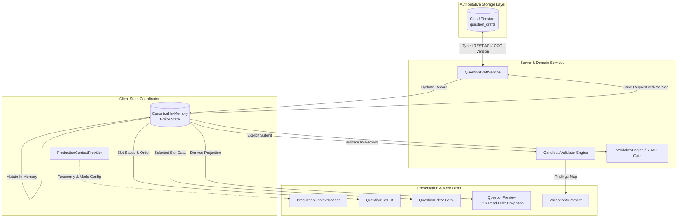
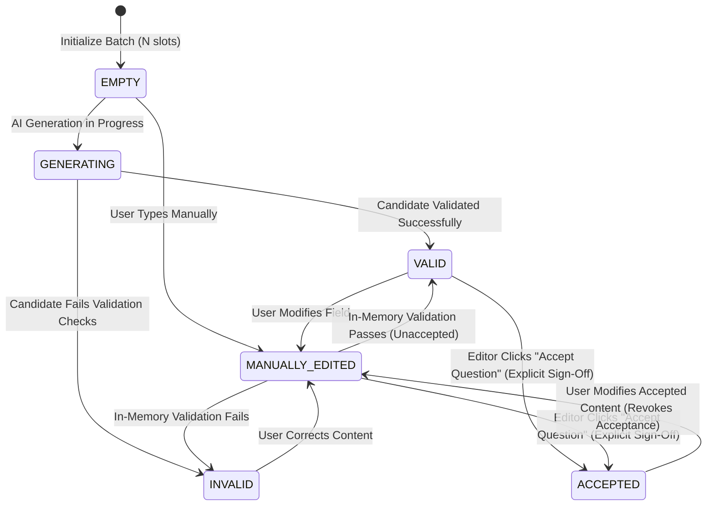
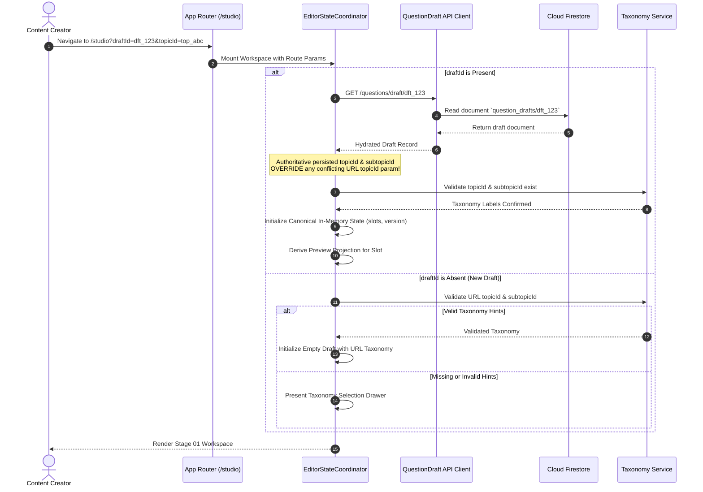
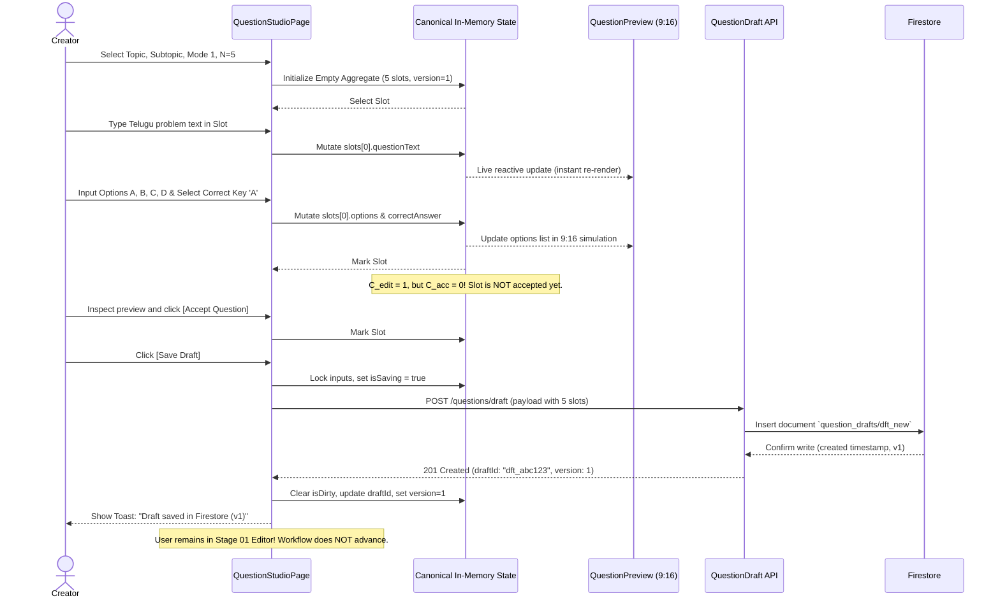

# S9-T06: Editor and Preview Interaction Specification

**Milestone**: Sprint 9 — Question Challenge Short (Mode 1 Production Pipeline)<br>
**Task ID**: `S9-T06`<br>
**Effective Date**: October 18, 2026<br>
**Author**: Antigravity Software Architect & Systems Verification Engineer<br>
**Target Mode**: `QUESTION_CHALLENGE_SHORT` (Mode 1 Single Question $N=1$ and Batch Series $N \in \{5, 10, 15, 20\}$)<br>
**Inspected Baseline Commit**: `fee1a25e28756fcbd013dc2a8068d1e9119b65d5`<br>
**Status**: Authoritative Interaction Contract & Specification (Gate B Design Baseline — Batch Metrics & Acceptance Reconciliation)

---

## 1. Document Identity, Scope, Inspected Commit & Specification Status

### 1.1 Document Purpose
This specification establishes the authoritative interaction design, responsive page architecture, component responsibilities, state transition model, and single-source-of-truth synchronization rules for the Stage 01 Question Studio workspace in the Burra Pariksha Content Management System (BP-CMS).

It provides the complete, reconciled design contract for:
1. Production context restoration and header visibility.
2. Generation settings and modification guardrails.
3. Batch generation lifecycle and status counters strictly reconciled with [S9-T03 §2.3](S9-T03-BATCH-GENERATION-REQUIREMENTS.md#23-batch-generation-metrics--counter-model) and [S9-T05 §6.1](S9-T05-MODE-SPECIFIC-CONTENT-CONTRACT.md#61-typed-validation-envelope-interfaces):
   - **Generation Telemetry Counters**: $C_{\text{req}}, C_{\text{gen}}, C_{\text{val\_slots}}, C_{\text{inv}}, C_{\text{dup}}, C_{\text{val\_overflow}}, C_{\text{rem\_gen}}$.
   - **Workbench Editorial Counters**: $C_{\text{pop}}, C_{\text{valid}}, C_{\text{edit}}, C_{\text{acc}}, C_{\text{rem\_accept}}$.
   - Strict invariant: `MANUALLY_EDITED` is **not** treated as accepted; slots require explicit editorial acceptance (`status = 'ACCEPTED'`).
4. Ordered slot management, stable slot identity (`slt_<uuid>`) versus display order, and reordering interactions.
5. In-place question editing and dirty state tracking across slots.
6. A derived, read-only 9:16 vertical short preview panel synchronized directly from in-memory editor state.
7. Multi-level validation feedback (field, slot, batch) using authoritative stable error codes (`ERR_*` / `WARN_*`) with direct-focus issue navigation.
8. A comprehensive 22-state page lifecycle matrix covering loading, empty, partial, failed, concurrency, legacy, and read-only conditions.
9. Non-fabricating legacy single-question draft compatibility fully aligned with [S9-T05 §8.2](S9-T05-MODE-SPECIFIC-CONTENT-CONTRACT.md#82-safe-compatibility--legacy-hydration-contract-proposed-gate-b-design).
10. Strict persistence boundaries enforcing **Save Draft $\neq$ Submit for Verification** and preserving the GAR-02 anti-self-approval invariant.

### 1.2 Inspected Baseline & Commit Forensic Evidence
In compliance with [AGENTS.md §0 and §1](../../../AGENTS.md#1-source-of-truth-authority-hierarchy), this specification was revised after inspecting the active repository working tree at commit:
$$\mathbf{Commit\ SHA}:\ \texttt{fee1a25e28756fcbd013dc2a8068d1e9119b65d5}$$

#### Forensic Runtime Audit Findings:
1. **Current Production Route for Stage 01**:
   - The Stage 01 workspace is hosted at `/studio` ([`frontend/features/question-generation/pages/QuestionStudioPage.tsx`](../../../frontend/features/question-generation/pages/QuestionStudioPage.tsx)).
   - Route parameters and deep-linking support route hints: `/studio?topicId=...&subtopicId=...` and `/studio?draftId=...`.
2. **Current Persistence Reality**:
   - Cloud Firestore is the sole authoritative datastore ([AGENTS.md §3](../../../AGENTS.md#3-cloud-firestore-authority)).
   - Runtime `QuestionDraftService` ([`backend/features/question-generation/services/question-draft.service.ts`](../../../backend/features/question-generation/services/question-draft.service.ts)) persists single-question drafts ($N=1$) into the `question_drafts` Firestore collection using flat option properties (`optionA`, `optionB`, `optionC`, `optionD`) alongside the canonical `options` map.
   - Optimistic Concurrency Control (OCC) is enforced via document `version` counter increments.
3. **Current UI State Management**:
   - `useQuestionGeneration` hook ([`frontend/features/question-generation/hooks/useQuestionGeneration.ts`](../../../frontend/features/question-generation/hooks/useQuestionGeneration.ts)) manages a single active candidate (`StudioCandidate`), tracking transient field edits and local `isDirty` state.
   - Mode 3 (`EXPLAINED_QUESTIONS_VIDEO`) has an aggregate workspace ([`ExplainedQuestionsWorkspace.tsx`](../../../frontend/features/question-generation/components/ExplainedQuestionsWorkspace.tsx)) editing `questions?: ExplainedQuestionItem[]`.
   - **Mode 1 Batch Series ($N \in \{5, 10, 15, 20\}$)** is registered in [`shared/registry/content-mode.registry.ts`](../../../shared/registry/content-mode.registry.ts), but the multi-slot editor UI, vertical 9:16 preview panel, batch dispatch runner (Open Decision **OD-02**), and atomic aggregate persistence (Architecture Decision **ADR-011 DD-05**) remain **unimplemented future runtime dependencies** per the S9-T01 audit.
4. **Specification Status**:
   - This document defines the authoritative design contract for subsequent implementation tasks.
   - Proposed behaviors and data structures are explicitly distinguished from verified runtime behavior throughout this specification.

---

## 2. Executive Summary & Acceptance Criteria Traceability

### 2.1 Executive Summary
Mode 1 (`QUESTION_CHALLENGE_SHORT`) produces high-yield, vertical 9:16 video shorts ($\le 58\text{ seconds}$) for competitive exam preparation. Creators draft either a single stand-alone question ($N=1$) or a cohesive batch series of questions ($N \in \{5, 10, 15, 20\}$) sharing syllabus grounding.

The primary architectural challenge addressed by S9-T06 is maintaining absolute consistency between the **Question Editor** and the **Preview Panel** without maintaining dual editable models, diverging state copies, or desynchronized persistence paths. Under this specification, the preview is strictly a **derived, read-only projection** of the canonical in-memory editor state. Furthermore, stable slot identities (`slt_<uuid>`) guarantee that question ordering, slot selection, and validation issues remain stable even when questions are moved, filtered, or refreshed.

Critically, this revised specification enforces two core architectural invariants:
1. **Safe, Non-Fabricating Legacy Compatibility ([S9-T05 §8.2](S9-T05-MODE-SPECIFIC-CONTENT-CONTRACT.md#82-safe-compatibility--legacy-hydration-contract-proposed-gate-b-design))**: When reading legacy records, the editor does not invent answer keys, synthetic slot IDs, validation timestamps, or false completion states; missing or inconsistent attributes surface as explicit diagnostic findings requiring authenticated human review.
2. **Disambiguated Batch Accounting & Editorial Acceptance ([S9-T03 §2.3](S9-T03-BATCH-GENERATION-REQUIREMENTS.md#23-batch-generation-metrics--counter-model))**: Generation telemetry ($C_{\text{val\_slots}}$) is strictly separated from live workbench validity ($C_{\text{valid}}$), and manual edits (`MANUALLY_EDITED`) are strictly distinguished from editorial acceptance (`ACCEPTED`).

### 2.2 Acceptance Criteria Matrix

| Criterion ID | Contract Requirement | S9-T06 Specification Section | Verification Mechanism |
| :--- | :--- | :--- | :--- |
| **AC-01** | Active Topic, Subtopic, Mode, Configured Count ($N$), and Completion Status are immediately visible. | [§4.2, §5.1, §5.2, §6.2](#5-generation-settings--production-context-header) | Header & workbench summary inspectable in all page states. |
| **AC-02** | Editor and Preview consume the exact same underlying canonical content record; zero dual models or competing sources of truth. | [§3.1, §9.1, §9.2, §15.1](#9-preview-projection--synchronization-rules) | In-memory unidirection flow: $DraftAggregate \to In-Memory\ State \to Preview\ Projection$. |
| **AC-03** | Batch generation lifecycle cleanly distinguishes generation telemetry ($C_{\text{val\_slots}}$) from editor validity ($C_{\text{valid}}$), and manual edits from explicit editorial acceptance ($C_{\text{acc}}$). | [§6.1, §6.2, §6.3](#6-batch-status-model--completion-indicators) | Formal metrics strictly separated. Populated $\neq$ Valid, and `MANUALLY_EDITED` is strictly not accepted without explicit sign-off. |
| **AC-04** | Stable slot identity (`slt_<uuid>`) is strictly separated from display position (`slotNumber`). Reordering preserves slot content and active selection. | [§7.1, §7.2, §7.3, §14.3](#7-question-list-selection-ordering--slot-lifecycle) | Stable ID preserved across array re-indexing; selection tracked by `selectedSlotId`. |
| **AC-05** | Save Draft persists in-place to Firestore without advancing the 15-stage workflow; Submit for Verification requires deliberate action, 100% valid slots ($C_{\text{valid}} = C_{\text{req}}$), and 100% accepted slots ($C_{\text{acc}} = C_{\text{req}}$). | [§3.3, §14.1, §14.10, §15.2](#15-persistence-concurrency-authorization--workflow-boundaries) | Enforces AGENTS.md §11 and GAR-02 ($authorId \neq approverId$). |
| **AC-06** | Deterministic context restoration handles new drafts, existing drafts, deep links, route conflicts, legacy records, and OCC collisions without semantic fabrication. | [§11.1, §12.1, §12.2, §14.7, §14.8](#12-production-context-restoration--route-entry-behavior) | Authoritative record overrides URL hints; legacy drafts emit diagnostic findings per S9-T05. |
| **AC-07** | Comprehensive 22-state page lifecycle matrix covers loading, empty, partial, failed, read-only, legacy, and error states. | [§11.1, §11.2](#11-complete-page-state-matrix) | Full matrix with triggers, indicators, allowed/prohibited actions, and recovery. |
| **AC-08** | Unimplemented batch engine (OD-02) and aggregate persistence (ADR-011 DD-05) are labeled honestly as future dependencies. | [§1.2, §18.1](#18-runtime-dependencies-open-decisions--explicit-non-goals) | No false claims of runtime execution. |

---

## 3. Source-of-Truth Hierarchy & Architectural Constraints

### 3.1 Unidirectional State and Authority Flow
BP-CMS enforces strict unidirectional data flow and persistence isolation per [AGENTS.md §7](../../../AGENTS.md#7-frontend--backend-boundary):



### 3.2 Invariant Architectural Rules
1. **Firestore Is Sole Transactional Datastore ([AGENTS.md §3](../../../AGENTS.md#3-cloud-firestore-authority))**:
   - All draft persistence, slot content, and revision histories reside in Cloud Firestore.
   - Google Sheets is completely decommissioned for transactional runtime state ([AGENTS.md §4](../../../AGENTS.md#4-google-sheets-decommissioning-rule)).
2. **Canonical Two-Tier Taxonomy ([AGENTS.md §5](../../../AGENTS.md#5-canonical-two-tier-taxonomy-architecture))**:
   - Taxonomy consists strictly of $\text{Topic} \to \text{Subtopic}$.
   - Category is permanently obsolete and must never appear in route parameters, state interfaces, or UI labels.
3. **Collision-Resistant Distributed UUIDs ([AGENTS.md §6](../../../AGENTS.md#6-entity-id-architecture-uuid-based))**:
   - Entities use stateless UUID formats: Draft `dft_<uuid>`, Slot `slt_<uuid>`, Candidate `cnd_<uuid>`, Question `qst_<uuid>`, Topic `top_<uuid>`, Subtopic `sub_<uuid>`, User `usr_<uuid>`.
4. **Canonical 4-Option MCQ Contract ([ADR-009](../../architecture/DECISION-LOG.md#L13))**:
   - Mode 1 requires exactly 4 mutually exclusive options indexed as `options.a`, `options.b`, `options.c`, `options.d`.
   - The correct answer key must be strictly one of `'A' | 'B' | 'C' | 'D'`.
   - Flat compatibility aliases (`optionA`, `optionB`, etc.) are read-only egress shims and must never serve as an independent editable model.
5. **Anti-Self-Approval Invariant GAR-02 ([ADR-002](../../architecture/DECISION-LOG.md#L6))**:
   - The user who authored/saved the draft cannot approve their own work:
     $$\text{authorId} \neq \text{approverId}$$
   - Verified server-side during the Stage 01 $\to$ Stage 02 workflow transition.

---

## 4. Page Information Architecture & Responsive Layout

### 4.1 Global Workspace Zones
The Stage 01 Question Studio workspace is organized into five functional regions:

```
+---------------------------------------------------------------------------------------------------+
| ZONE 1: BREADCRUMB & PRODUCTION CONTEXT HEADER                                                    |
| Topic > Subtopic | Mode 1: Question Challenge Short | N=5 | Status: DRAFT | Save: Saved (v3)      |
+---------------------------------------------------------------------------------------------------+
| ZONE 2: WORKSPACE TOOLBAR & BATCH STATUS SUMMARY                                                  |
| Config: Telugu | Medium | Target: 52s | Progress: 3/5 Populated | C_valid: 2 | C_acc: 1 | Ready: NO |
+------------------------------------+--------------------------------+-----------------------------+
| ZONE 3: ORDERED SLOT LIST          | ZONE 4: QUESTION EDITOR        | ZONE 5: 9:16 PREVIEW PANEL  |
| (Width: 260px - 320px)             | (Flexible Center: 480px+)      | (Width: 340px - 380px)      |
|                                    |                                |                             |
| [#1] slt_01 (ACCEPTED) - Selected  | Problem Statement (questionText) | +-------------------------+ |
|      "భారత రాజ్యాంగ పితామహుడు..."  | [============================] | | 9:16 Vertical Short Sim | |
| [#2] slt_02 (MANUALLY_EDITED)      | Canonical Options:             | | [TELUGU / ENGLISH]      | |
|      "సింధు నాగరికతలో అతి పెద్ద..." | (A) డా. బి.ఆర్. అంబేద్కర్       | |                         | |
| [#3] slt_03 (INVALID - Error 1)    | (B) మహాత్మా గాంధీ              | | Q: భారత రాజ్యాంగ...     | |
|      "ఆంధ్రప్రదేశ్ పునర్వ్యవస్థీ..."| (C) జవహర్‌లాల్ నెహ్రూ          | |                         | |
| [#4] slt_04 (EMPTY)                | (D) సర్దార్ పటేల్              | | [A] డా. బి.ఆర్. అంబేడ్క | |
|      [Unresolved Slot]             | Correct Key: [A] (Radio group) | | [B] మహాత్మా గాంధీ       | |
| [#5] slt_05 (EMPTY)                | Explanation / Trick:           | | [C] జవహర్‌లాల్ నెహ్రూ   | |
|      [Unresolved Slot]             | [============================] | | [D] సర్దార్ పటేల్       | |
|                                    | Validation Message Box:        | |                         | |
| [+ Add Slot] [Reorder Up/Down]     | (i) Explanatory trick verified | | [Reveal Answer: Toggle] | |
+------------------------------------+--------------------------------+-----------------------------+
| ZONE 6: BOTTOM ACTION & PERSISTENCE DOCK                                                          |
| [Reset Studio]    [Discard Changes]                  [Save Draft (In-Place)]  [Submit for Review] |
+---------------------------------------------------------------------------------------------------+
```

### 4.2 Single-Question ($N=1$) Adaptive Presentation
When configured count $N=1$, the interface automatically adapts to eliminate unnecessary batch clutter:
- **Zone 3 (Slot List)** is hidden entirely. The canvas expands into a two-column layout: Center Editor (60%) and Right Preview (40%).
- **Zone 2 (Batch Status)** collapses into a compact single-item status badge: `"Single Question Short | Status: Draft | Valid: Yes"`.
- Batch counter metrics ($C_{\text{val\_overflow}}, C_{\text{dup}}$, etc.) are hidden.

### 4.3 Responsive Viewport Breakpoints
The layout reflows dynamically across three responsive viewports:

| Breakpoint Tier | Viewport Width | Zone Organization | Interaction Adjustments |
| :--- | :--- | :--- | :--- |
| **Desktop Ultra/Wide** | $\ge 1440\text{px}$ | 3-Column Split (List 22%, Editor 48%, Preview 30%). | All three zones simultaneously visible and scrollable independently. |
| **Desktop Standard / Laptop** | $1024\text{px} - 1439\text{px}$ | 3-Column Split (List 20%, Editor 50%, Preview 30%) with collapsible Slot List drawer. | Slot List can be toggled via hotkey (`Ctrl+B`) or sidebar icon. |
| **Tablet Landscape / Portrait** | $768\text{px} - 1023\text{px}$ | 2-Column Split (Editor 60%, Preview 40%). Slot list moves to a modal/drawer overlay. | Floating "Slots ($k/N$)" button opens slide-out drawer. |
| **Mobile / Small Screen** | $< 768\text{px}$ | Single Column with Segmented Tab Switcher: `[ Slots (N) | Edit | Preview (9:16) ]`. | Tabbed navigation. Editor and Preview never render side-by-side. Bottom persistence bar remains sticky. |

---

## 5. Generation Settings & Production-Context Header

### 5.1 Production-Context Header (`ProductionContextHeader`)
The header provides continuous situational awareness. It is anchored to the top of the viewport and renders authoritative context tokens:

```
[Icon] General Studies > Modern Indian History  |  Mode: Question Challenge Short (Mode 1)  |  Series: 5 Questions (9:16)
Draft ID: dft_9a4f2c81-3b7e-41d0-b2f5-8d9e2a104c83  |  Status: In-Progress Draft  |  Unsaved Changes [Dot]  |  v3
```

#### Field Display Matrix:
1. **Taxonomy Path**: Displays `"Topic Name > Subtopic Name"`. If names are unresolved during deep-link hydration, renders fallback `"Loading taxonomy..."` or canonical IDs (`top_... > sub_...`).
2. **Production Mode**: Displays `"Question Challenge Short (Mode 1)"` with mode-specific badge.
3. **Aspect Ratio Indicator**: Displays `"9:16 Vertical Short"`. Immutable for Mode 1 per [S8-T05](../../sprints/sprint-08/S8-T05-PRODUCTION-CONTEXT-CONTRACT.md).
4. **Configured Count ($N$)**: Displays `"Series: N Questions"` (or `"Single Question"` for $N=1$).
5. **Draft Identity**: Displays canonical `id` (`dft_<uuid>`). Renders `"New Unpersisted Draft"` if no document exists yet in Firestore.
6. **Save & Dirty Status Indicator**:
   - *Clean / Saved*: Green check icon `"All changes saved in Firestore (v{version})"`.
   - *Dirty / Unsaved*: Amber pulsating dot `"Unsaved local changes in Slot {k}"`.
   - *Saving*: Spinning loader `"Committing draft to Firestore..."`.
   - *Save Failed*: Red warning icon `"Save failed — local edits preserved [Retry]"`.
7. **Read-Only / Workflow Lock Badge**:
   - If draft has advanced to Stage 02 (`PENDING_REVIEW` or `APPROVED`), renders prominent lock badge: `"Locked — In Stage 02 Question Verification (Read-Only)"`. All mutation inputs disable automatically.

### 5.2 Generation Settings Panel (`GenerationSettingsPanel`)
Controls syllabus parameters and generation constraints:

| Setting Field | Control Type | Allowed Values (Mode 1) | Mutation Boundary & Guardrails |
| :--- | :--- | :--- | :--- |
| **Topic** | Searchable Select | Active topics from taxonomy repository | Blocked if questions are already generated/drafted, unless user explicitly confirms destructive reset. |
| **Subtopic** | Dependent Select | Active subtopics childed to selected Topic | Same as Topic. Parent-child relationship validated strictly. |
| **Production Mode** | Mode Badge / Modal | `QUESTION_CHALLENGE_SHORT` | Fixed in this workspace. Changing mode launches modal warning and redirects to appropriate mode canvas. |
| **Configured Count ($N$)** | Segmented Button Group | `1, 5, 10, 15, 20` | Editable before generation. If content exists, changing $N$ prompts confirmation ([§5.3](#53-guardrails-for-changing-generation-settings)). |
| **Language** | Radio / Toggle | `TELUGU`, `ENGLISH`, `TELUGU_ENGLISH` (`QuestionLanguage`) | Sets primary language for candidate generation and bilingual options display. |
| **Difficulty Level** | Dropdown / Segmented | `EASY`, `MEDIUM`, `HARD` (`DifficultyLevel`) | Guides AI generation prompt and sets slot metadata. Aligned with `shared/constants/enums.ts`. |
| **Question Style** | Select / Tag input | Values from `QuestionStyle` enum (e.g. `SPEED_MATH_TRICK`, `STORY_BASED`, `TRICK_QUESTION`, `LOGICAL_PUZZLE`, `EXAM_STYLE`) | Advisory prompt tuning tag. |
| **Target Duration** | Read-Only Display | `52s` (hard ceiling $\le 58\text{s}$) | Mode 1 vertical short duration constraint per S9-T02. Non-editable. |

### 5.3 Guardrails for Changing Generation Settings
1. **Locking Active Settings**: Once a draft contains populated slots, generation settings (Topic, Subtopic, Mode, Count) are locked in the panel. A padlock icon and `"Settings locked by active content"` notice appear.
2. **Explicit Unlock / Reset Modal**: If the creator clicks `"Change Settings"`, a non-dismissible confirmation modal appears:
   > **Warning: Changing Syllabus or Configuration**
   > Modifying Topic, Subtopic, or Configured Question Count will clear in-memory unpersisted edits.
   > - Current draft `dft_...` has 3 populated slots.
   > - Action options: `[Cancel]` or `[Reset & Change Settings]`.
3. **Preserving Identity on Count Adjustments**: If the creator adjusts $N$ from 5 to 10 on an existing draft, existing populated slots $1 \dots 5$ are strictly preserved; five new empty slots ($6 \dots 10$) are appended to the aggregate. Decreasing $N$ (e.g., from 10 to 5) is rejected if slots $> 5$ contain content, requiring manual slot deletion first.

---

## 6. Batch Status Model & Completion Indicators

### 6.1 Formal Metrics & Disambiguated Accounting Model
In strict adherence to [S9-T03 §2.3](S9-T03-BATCH-GENERATION-REQUIREMENTS.md#23-batch-generation-metrics--counter-model) and [S9-T05 §6.1](S9-T05-MODE-SPECIFIC-CONTENT-CONTRACT.md#61-typed-validation-envelope-interfaces), batch tracking strictly separates **Generation Telemetry** from **Editor Workbench State**.

#### 6.1.1 Generation Telemetry Counters (S9-T03 §2.3.1)
Captures candidate disposition during an active AI generation attempt:

| Counter Symbol | Name | Formal Definition | Operational Rule & Classification |
| :---: | :--- | :--- | :--- |
| $\mathbf{C_{\text{req}}}$ | **Configured Target Count** | Target batch size ($N \in \{1, 5, 10, 15, 20\}$). | Immutable for attempt. `undefined` if draft is malformed. |
| $\mathbf{C_{\text{gen}}}$ | **Raw Generated Candidates** | Total candidate objects produced by AI provider in attempt. | $C_{\text{gen}} \ge 0$. |
| $\mathbf{C_{\text{val\_slots}}}$ | **Valid Generated In-Range Slots** | Number of distinct valid candidates successfully assigned to in-range slots $1 \dots N$ during generation. | $0 \le C_{\text{val\_slots}} \le C_{\text{req}}$. Recorded as unavailable (`"—"`) when resuming draft without telemetry. |
| $\mathbf{C_{\text{inv}}}$ | **Invalid Candidates** | Number of generated candidate objects that fail schema, option, answer, or proof validation. | $C_{\text{inv}} \ge 0$. Unavailable (`"—"`) on resumed drafts. |
| $\mathbf{C_{\text{dup}}}$ | **Duplicate Candidates** | Number of generated candidates rejected due to semantic or textual collision. | $C_{\text{dup}} \ge 0$. Unavailable (`"—"`) on resumed drafts. |
| $\mathbf{C_{\text{val\_overflow}}}$ | **Valid Overflow Candidates** | Valid distinct candidates produced after all $C_{\text{req}}$ in-range slots are filled, quarantined in `overflowBuffer`. | $C_{\text{val\_overflow}} \ge 0$. Unavailable (`"—"`) on resumed drafts. |
| $\mathbf{C_{\text{rem\_gen}}}$ | **Remaining Generation Count** | Number of distinct valid slots still required to reach generation completeness ($C_{\text{rem\_gen}} = \max(0, C_{\text{req}} - C_{\text{val\_slots}})$). | $0 \le C_{\text{rem\_gen}} \le C_{\text{req}}$. |

$$\mathbf{Candidate\ Partition\ Invariant}:\quad C_{\text{gen}} = C_{\text{val\_slots}} + C_{\text{inv}} + C_{\text{dup}} + C_{\text{val\_overflow}}$$

#### 6.1.2 Editor Workbench Evaluation Counters
Evaluates the live in-memory content state currently loaded in the studio:

| Counter Symbol | Name | Formal Definition | Operational Rule & Invariant |
| :---: | :--- | :--- | :--- |
| $\mathbf{C_{\text{pop}}}$ | **Populated In-Range Slots** | Slots $1 \dots C_{\text{req}}$ containing non-empty question text. | $\sum_{k=1}^{C_{\text{req}}} \mathbf{1}(\text{slot}[k].\text{questionText.trim().length} > 0)$. |
| $\mathbf{C_{\text{valid}}}$ | **Currently Valid Slots** | Slots $1 \dots C_{\text{req}}$ whose current content passes all schema and validation rules with zero blocking errors. | $\sum_{k=1}^{C_{\text{req}}} \mathbf{1}(\text{slot}[k].\text{status} \in \{\text{'VALID'}, \text{'MANUALLY\_EDITED'}, \text{'ACCEPTED'}\} \land \text{blockingErrors}[k] == 0)$. |
| $\mathbf{C_{\text{edit}}}$ | **Manually Edited Slots** | Slots $1 \dots C_{\text{req}}$ whose content has been authored or modified by the human editor. | $\sum_{k=1}^{C_{\text{req}}} \mathbf{1}(\text{slot}[k].\text{status} == \text{'MANUALLY\_EDITED'} \lor \text{slot}[k].\text{isManuallyEdited} == \text{true})$. |
| $\mathbf{C_{\text{acc}}}$ | **Accepted Slots** | Slots $1 \dots C_{\text{req}}$ explicitly reviewed and approved by the editor. | $\sum_{k=1}^{C_{\text{req}}} \mathbf{1}(\text{slot}[k].\text{status} == \text{'ACCEPTED'})$. |
| $\mathbf{C_{\text{rem\_accept}}}$ | **Remaining Acceptance Count** | Slots still awaiting explicit editorial approval ($C_{\text{rem\_accept}} = C_{\text{req}} - C_{\text{acc}}$). | $0 \le C_{\text{rem\_accept}} \le C_{\text{req}}$. |

> [!CRITICAL]
> **Cardinal Accounting Invariants**:
> 1. **Populated $\neq$ Valid**: An in-range slot containing question text that fails validation (e.g. `status = 'INVALID'`) is populated ($C_{\text{pop}}$), but does **NOT** increment $C_{\text{valid}}$ and does **NOT** satisfy $C_{\text{rem\_gen}}$.
> 2. **`MANUALLY_EDITED` Is Strictly NOT Accepted**: Modifying an accepted question or drafting a question manually sets `status = 'MANUALLY_EDITED'`. It does **NOT** contribute to $C_{\text{acc}}$. A manually edited slot requires deliberate human review and clicking `"Accept Question"` before it increments $C_{\text{acc}}$ and decrements $C_{\text{rem\_accept}}$.
> 3. **$C_{\text{val\_slots}}$ Is Not Overloaded**: Generation telemetry ($C_{\text{val\_slots}}$) is never conflated with live workbench validity ($C_{\text{valid}}$). When historical telemetry is missing, $C_{\text{val\_slots}}$ displays `"—"`, while $C_{\text{valid}}$ evaluates the current live slots.

### 6.2 Status Panel Presentation (`BatchStatusSummary`)
The status panel renders these metrics clearly, distinguishing generation telemetry from workbench review status:

```
+---------------------------------------------------------------------------------------------------+
| BATCH STATUS: PARTIAL (3 of 5 Slots Populated, 2 Valid, 1 Accepted)                               |
| [======================================-------------] 40% Valid Slots | 20% Editorial Acceptance  |
|                                                                                                   |
| Generation Telemetry:            Workbench Editorial Status:       Candidate Buffer:              |
| - Target Count (C_req): 5        - Currently Valid (C_valid): 2    - Overflow Candidates: 1       |
| - Valid In-Range (C_val_slots): 2- Manually Edited (C_edit): 1     - Rejected Duplicates: —       |
| - Populated Slots (C_pop): 3     - Accepted Slots (C_acc): 1       - Validation Invalids: —       |
| - Generation Rem (C_rem_gen): 3  - Remaining Accept: 4             - Unresolved Slots: 2          |
+---------------------------------------------------------------------------------------------------+
```

### 6.3 Metric Separation & Milestone Progression
In accordance with S9-T03 §2.4, batch production enforces three sequential milestones:

```text
┌───────────────────────────────┬──────────────────────────────────┬───────────────────────────────┐
| 1. Generation Completeness     | 2. Editorial Acceptance          | 3. Submit for Verification     |
| (C_rem_gen == 0)              | (C_rem_accept == 0)              | (Stage 01 -> Stage 02 Hand-off)|
├───────────────────────────────┼──────────────────────────────────┼───────────────────────────────┤
| • Exactly N in-range slots    | • Human reviews every slot       | • BATCH IS 100% COMPLETE      |
| • All N slots C_valid == C_req| • All N slots status='ACCEPTED'  | • C_valid == C_req            |
| • Zero EMPTY or INVALID slots | • C_acc == C_req                 | • C_acc == C_req              |
| • batchStatus = 'COMPLETE'    | • batchStatus = 'ACCEPTED'       | • In-place Save committed     |
| • DOES NOT allow auto-submit  | • Ready for formal submit check  | • AuthorId != ApproverId      |
└───────────────────────────────┴──────────────────────────────────┴───────────────────────────────┘
```

1. **Zero Is Distinct From Unavailable**:
   - If candidate generation metrics ($C_{\text{val\_slots}}, C_{\text{inv}}, C_{\text{dup}}, C_{\text{val\_overflow}}$) were not captured during the active authoring session (e.g., when resuming an existing draft hydrated from Firestore), the UI displays `"—"` (Unavailable) rather than a deceptive `"0"`.
2. **Verification Ineligibility Guard**:
   - The button `"Submit for Verification"` is disabled with an explanatory tooltip whenever:
     $$C_{\text{valid}} < C_{\text{req}} \quad \lor \quad C_{\text{acc}} < C_{\text{req}} \quad \lor \quad C_{\text{rem\_accept}} > 0 \quad \lor \quad \text{hasBlockingErrors} = \text{true}$$

---

## 7. Question List, Selection, Ordering & Slot Lifecycle

### 7.1 Slot Data Model & Stable Identity
Every question slot in the batch aggregate possesses a canonical identifier generated statelessly via `shared/lib/id.service.ts`:
$$\text{slotId} = \texttt{"slt\_"} + \text{uuid\_v4()}$$

> [!IMPORTANT]
> **Ephemeral Display Representation vs. Canonical Identity**:
> When a legacy draft lacks a persisted `slotId`, the hydration layer preserves `slotId` as `undefined` (surfacing `WARN_MISSING_SLOT_ID` per S9-T05).
> The client UI may assign a transient, display-only key (e.g. `"slot-item-1"`) solely for React list reconciliation. This ephemeral key is **never** treated as a canonical ID, is never saved to Firestore, and never implies that the record is in a canonical aggregate format.

The slot display model maintains a strict distinction between **identity** and **display order**:

```typescript
export interface Mode1SlotDisplayModel {
  slotId?: string; // Canonical: "slt_3a1e94c2-..." (undefined if legacy draft lacks slotId)
  displayKey: string; // Transient React render key: slotId ?? `slot-item-${slotNumber}`
  slotNumber: number; // Sequential 1-based display position: 1 <= slotNumber <= N
  status: 'EMPTY' | 'GENERATING' | 'VALID' | 'INVALID' | 'MANUALLY_EDITED' | 'ACCEPTED';
  questionExcerpt: string; // First 60 chars of question text or "[Empty Slot]"
  isDirty: boolean; // Has unpersisted local edits in memory
  hasErrors: boolean; // Has failing validation rules
  errorCount: number; // Number of blocking errors
  warningCount: number; // Number of non-blocking warnings
  isSelected: boolean; // Active slot in Question Editor and Preview
}
```

### 7.2 Slot Lifecycle State Machine
Aligned with [S9-T05 §3.1](S9-T05-MODE-SPECIFIC-CONTENT-CONTRACT.md#31-slot-data-model-mode1questionslot):



### 7.3 Ordered Question Slot List (`QuestionSlotList`)
The left sidebar renders an ordered list of cards (`QuestionSlotItem`).

#### Slot Item Visual Elements:
- **Index Badge**: Prominent display of `slotNumber` (e.g., `"#01"`, `"#02"`).
- **Excerpt Snippet**: Two-line preview of question text.
- **Status Tag**:
  - `EMPTY`: Gray dashed border, `"Empty Slot — Click to draft or generate"`.
  - `GENERATING`: Blue pulsating border, `"Generating..."`.
  - `MANUALLY_EDITED`: Amber border, `"Manually Edited (Awaiting Acceptance)"`.
  - `VALID`: Emerald border, `"Valid (Unreviewed)"`.
  - `INVALID`: Rose red border with badge `"1 Error"`.
  - `ACCEPTED`: Solid green badge `"Accepted"`.
- **Diagnostic Tag**: Amber warning tag `"Legacy Record (Missing Slot ID)"` when `slotId` is absent.
- **Dirty Indicator**: Orange pulsating dot if slot has unpersisted in-memory edits.
- **Reorder Controls**: Up ($\uparrow$) and Down ($\downarrow$) buttons, plus accessible keyboard shortcuts.

### 7.4 Reordering Rules & Concurrency Safety
1. **Stable ID Invariant**: Reordering shifts array positions and updates `slotNumber` (1-indexed display position), but **never alters existing `slotId`s or regenerates content**.
2. **Selection Persistence**: If Slot `slt_abc` (currently at `#2`) is moved to `#3`, the active selection pointer follows `slt_abc`. The user remains focused on the same question.
3. **Keyboard Accessibility**: Users can reorder slots using standard keyboard combinations:
   - Focus slot item $\to$ Press `Alt + ArrowUp` to move up.
   - Focus slot item $\to$ Press `Alt + ArrowDown` to move down.
   - Screen reader announcement: `"Question moved to position 1 of 5"`.
4. **Reorder Lockout**: Reordering controls are disabled during active server persistence (`isSaving = true`), when slots are in `GENERATING` state, and in read-only mode.

---

## 8. Question Editor & Field-Level Interaction

### 8.1 Editor Canvas Layout (`QuestionEditor`)
The center zone hosts the primary editing form, operating directly on the currently selected slot:

```
+---------------------------------------------------------------------------------------------------+
| QUESTION EDITOR — SLOT #01 (ID: slt_9a4f2c81)                   [Status: Valid] [Unsaved Changes] |
+---------------------------------------------------------------------------------------------------+
| 1. PROBLEM STATEMENT (questionText)                                                               |
| +-----------------------------------------------------------------------------------------------+ |
| | భారత రాజ్యాంగ పితామహుడు అని ఎవరిని పిలుస్తారు?                                               | |
| +-----------------------------------------------------------------------------------------------+ |
|                                                                                                   |
| 2. FOUR MUTUALLY EXCLUSIVE OPTIONS (Single Correct Answer)                                       |
| [o] (A) డా. బి.ఆర్. అంబేద్కర్                                            [Correct Key: A] (Radio) |
| [ ] (B) మహాత్మా గాంధీ                                                                            |
| [ ] (C) జవహర్‌లాల్ నెహ్రూ                                                                        |
| [ ] (D) సర్దార్ వల్లభభాయ్ పటేల్                                                                  |
|                                                                                                   |
| 3. STEP-BY-STEP EXPLANATION & BURRA SPEED TRICK                                                  |
| Explanation (explanation):                                                                        |
| +-----------------------------------------------------------------------------------------------+ |
| | డా. బి.ఆర్. అంబేద్కర్ రాజ్యాంగ ముసాయిదా కమిటీ చైర్మన్‌గా వ్యవహరించారు...                      | |
| +-----------------------------------------------------------------------------------------------+ |
| Speed Trick / Common Pitfall (trickOrPitfall - Optional):                                         |
| +-----------------------------------------------------------------------------------------------+ |
| | ముసాయిదా (Drafting) = డాక్టర్ బాబా సాహెబ్ అంబేద్కర్.                                          | |
| +-----------------------------------------------------------------------------------------------+ |
|                                                                                                   |
| 4. METADATA & TAGS                                                                                |
| Difficulty: [ Medium v ]         | Question Style: [ Speed Math Trick v ]  | Real-Life Context: [ ]|
+---------------------------------------------------------------------------------------------------+
```

### 8.2 Field Specifications & Interaction Constraints
All field definitions strictly reconcile with `shared/types/question.ts` and `shared/constants/enums.ts`:

| Field Name | Data Binding Path | Input Control Type | Canonical Validation Contract (S9-T05) | Status |
| :--- | :--- | :--- | :--- | :--- |
| **Question Statement** | `slot.questionText` | Multi-line auto-expanding textarea | Non-empty trimmed string, $\text{length} \ge 5$ (`ERR_EMPTY_PROMPT`). Advisory warning if $> 180$ chars (`WARN_LENGTH_PACING`). | **Approved Contract** (`QuestionDraft.questionText`) |
| **Option A** | `slot.options.a` | Text input with 'A' badge | Required non-empty string (`ERR_OPTION_MISSING`). Must be distinct from B, C, D (`ERR_OPTION_DUPLICATE`). | **Approved Contract** (ADR-009) |
| **Option B** | `slot.options.b` | Text input with 'B' badge | Required non-empty string (`ERR_OPTION_MISSING`). Distinct from A, C, D (`ERR_OPTION_DUPLICATE`). | **Approved Contract** (ADR-009) |
| **Option C** | `slot.options.c` | Text input with 'C' badge | Required non-empty string (`ERR_OPTION_MISSING`). Distinct from A, B, D (`ERR_OPTION_DUPLICATE`). | **Approved Contract** (ADR-009) |
| **Option D** | `slot.options.d` | Text input with 'D' badge | Required non-empty string (`ERR_OPTION_MISSING`). Distinct from A, B, C (`ERR_OPTION_DUPLICATE`). | **Approved Contract** (ADR-009) |
| **Correct Answer Key** | `slot.correctAnswer` | Radio button group (`A, B, C, D`) | Required strictly one of `'A' \| 'B' \| 'C' \| 'D'` (`ERR_INVALID_ANSWER_KEY`, `ERR_MISSING_ANSWER_KEY`). | **Approved Contract** (ADR-009) |
| **Explanation** | `slot.explanation` | Multi-line textarea | Non-empty trimmed string, $\text{length} \ge 5$ (`ERR_MISSING_EXPLANATION`). | **Approved Contract** (`QuestionDraft.explanation`) |
| **Speed Trick / Pitfall** | `slot.trickOrPitfall` | Single/Multi-line input (optional) | Optional speed trick or common mistake helper. | **Approved Schema** (`ExplainedQuestionItem.trickOrPitfall`) |
| **Real-Life Context** | `slot.realWorldContext` | Single-line input (optional) | Optional scenario hook. | **Approved Schema** (`QuestionDraft.realWorldContext`) |
| **Difficulty Level** | `draft.difficulty` / `slot.difficulty` | Dropdown (`EASY`, `MEDIUM`, `HARD`) | Values strictly from `DifficultyLevel` enum in `shared/constants/enums.ts`. | **Approved Contract** (`DifficultyLevel`) |

> [!NOTE]
> **Minimal Draft Save vs. Verification Readiness**:
> - **Draft Save**: Requires only basic structural presence (valid draft ID, topic/subtopic IDs). An in-progress draft with partially filled options or unassigned answer key can be saved safely to Firestore without triggering blocking HTTP 422 errors.
> - **Verification Readiness**: Evaluates all blocking schema and quality criteria. A batch cannot be submitted for verification while any `ERR_*` code remains unresolved, or while any slot remains in `MANUALLY_EDITED` / unaccepted status.

### 8.3 In-Memory Dirty Tracking & Revocation of Acceptance
1. **Granular Dirty State**:
   - Edits update the canonical in-memory state immediately on keystroke (`onChange`).
   - The edited slot's `status` transitions to `'MANUALLY_EDITED'`.
   - **Revocation of Prior Acceptance**: If the slot was previously `'ACCEPTED'`, modifying any field **immediately revokes acceptance**, transitioning the slot to `'MANUALLY_EDITED'`, decrementing $C_{\text{acc}}$, and incrementing $C_{\text{rem\_accept}}$.
   - The slot's `isDirty` flag becomes `true`.
   - The global `ProductionContext.isDirty` becomes `true`.
2. **Switching Slots With Unsaved Edits**:
   - When a creator clicks another slot in `QuestionSlotList`, **all in-memory edits are preserved**.
   - No confirmation modal is required for switching slots because all slots belong to the same in-memory aggregate.
   - The editor form rebinds to the newly selected slot, while the previously edited slot displays its amber dirty indicator until the entire draft is saved to Firestore.

---

## 9. Preview Projection & Synchronization Rules

### 9.1 Single Source-of-Truth Projection
The Preview Panel (`QuestionPreview`) is an absolute, read-only projection of the active slot in the canonical in-memory editor state:

$$\text{PreviewProps} = \mathcal{P}(\text{canonicalEditorState}.\text{slots}[\text{selectedSlotIndex}])$$

```mermaid
flowchart LR
    subgraph Editor [Question Editor Form]
        INP[User Keystrokes in Field]
    end

    subgraph State [Canonical In-Memory State]
        CAN[canonicalEditorState.slots[k]]
    end

    subgraph Preview [9:16 Vertical Short Simulation]
        PRV[QuestionPreview View Model]
    end

    INP -->|Instant Mutate| CAN
    CAN -->|Direct Reactive Read| PRV
```

### 9.2 Preview Simulation Characteristics
1. **Aspect Ratio Enforcement**: The preview container maintains a strict `9:16` vertical aspect ratio (e.g., $340\text{px} \times 604\text{px}$ or $360\text{px} \times 640\text{px}$).
2. **Visual Hierarchy (Vertical Short Simulation)**:
   - **Header Bar**: Displays Channel branding (`"బుర్ర పరీక్ష"`), syllabus topic tag, and duration countdown timer badge (`"0:52"`).
   - **Question Box**: Centered high-contrast card rendering Telugu question text in bold, accessible typography (`Noto Sans Telugu` or equivalent).
   - **Interactive Option Stack**: Vertical stack of four rounded option pills ($A, B, C, D$).
   - **Interactive Reveal Toggle**:
     - *Default Mode*: Options appear unrevealed (neutral border/background), simulating what the viewer sees during the first 15 seconds of the video.
     - *Reveal Mode (Toggleable by Editor)*: Correct option lights up in vibrant green (`#10b981`), while incorrect options dim.
   - **Bottom Explanation Drawer**: Simulates on-screen graphic overlay revealing the solution proof and "Burra Speed Trick" during the final 10 seconds of the short.
3. **Live Zero-Latency Sync**: As the user types in any editor field, the preview updates synchronously on the next animation frame.
4. **Visual Approximation Disclosure**: The preview displays a subtle footer caption:
   `"Interactive Video Simulation — Final typography and audio render occurs in Stage 06 Video Assembly"`.

### 9.3 Preview Error & Edge Case Handling
- **Empty / Incomplete Slot**: If question text is empty, preview displays a clean wireframe placeholder: `"Drafting question statement in progress..."`.
- **Text Overflow**: If question text exceeds 180 characters, the preview text container applies an amber warning outline: `"Text length exceeds recommended pacing for 58s vertical short"`.
- **Preview Failure Isolation**: If a syntax error or rendering exception occurs in the preview component, a local React Error Boundary catches it, displaying: `"Preview rendering temporarily unavailable [Reload Preview]"`. **The Question Editor remains fully functional and no user data is lost.**

---

## 10. Validation Feedback & Issue Navigation

### 10.1 Multi-Tier Validation Model
Validation operates at three distinct levels, adhering strictly to the stable validation error codes established in [S9-T05 §6.2](S9-T05-MODE-SPECIFIC-CONTENT-CONTRACT.md#62-stable-error--warning-codes-inventory):

| Validation Level | Scope & Trigger | Target Element | Blocking Status | Stable Code Examples (S9-T05) |
| :--- | :--- | :--- | :--- | :--- |
| **Tier 1: Field-Level** | In-memory, on blur & on keystroke debounce (300ms) | Individual input (e.g. Option B) | Non-blocking during draft; blocking for submit | `ERR_OPTION_MISSING`, `ERR_OPTION_INVALID_TYPE`, `ERR_EMPTY_PROMPT` |
| **Tier 2: Slot-Level** | In-memory, evaluated on slot switch or demand | Specific slot aggregate | Non-blocking for draft save; blocking for slot acceptance | `ERR_OPTION_DUPLICATE`, `ERR_INVALID_ANSWER_KEY`, `ERR_MISSING_EXPLANATION` |
| **Tier 3: Batch-Level** | Evaluated on demand or pre-submit verification | Root aggregate ($N$ slots) | Blocking for Stage 02 submission | `ERR_SLOT_COUNT_MISMATCH`, `ERR_INCOMPLETE_BATCH_SLOTS`, `ERR_INCOMPLETE_LEGACY_BATCH` |

### 10.2 Issue Presentation & Deep-Focus Navigation
1. **Validation Summary Box (`ValidationSummary`)**:
   - Positioned in Zone 2 or atop Zone 4.
   - Summarizes active findings: `"2 blocking errors, 1 warning across batch"`.
2. **Deep-Focus Click Navigation**:
   - Each error item in the validation summary is clickable.
   - Example: Clicking `"[Slot #3] ERR_OPTION_DUPLICATE: Option C is identical to Option A"` performs an atomic navigation:
     1. Switches active slot selection to Slot `#3`.
     2. Scrolls the editor form to Option C.
     3. Applies a temporary highlight pulse (`ring-2 ring-rose-500`) and places cursor focus directly in the Option C text input.
3. **Stale Finding Invalidation**:
   - When a user edits a field associated with a validation finding, the finding is immediately dimmed with an `"Evaluating..."` badge, preventing stale error displays while the user is typing the correction.

---

## 11. Complete Page-State Matrix

The following comprehensive matrix specifies deterministic behavior across all 22 distinct operational and edge states:

| State ID | State Name | Trigger Condition | Visible Indicator / Message | Allowed Actions | Prohibited Actions | Content Preservation Rule | Exit / Recovery Transition |
| :--- | :--- | :--- | :--- | :--- | :--- | :--- | :--- |
| **ST-01** | **Initial Loading** | Route entry, mounting context & draft data | Centered skeleton loaders for header, slot list, and editor; disabled buttons. | Window resize, cancel navigation | Form edits, slot switching, save, submit | N/A (data fetching in progress) | Transition to ST-03 (New), ST-05 (Single), ST-06 (Partial), or ST-02 (Error). |
| **ST-02** | **Context Loading Failure** | Network failure or 404/500 loading taxonomy or draft | Red banner: `"Failed to load production context. [Retry Connection]"` | Click `[Retry]`, navigate back to Dashboard | All editor mutations | No local content created | Successful retry transitions to ST-01 $\to$ ST-03/05/06. |
| **ST-03** | **Empty / New Draft ($N=1$)** | Workspace opened without `draftId`; $N=1$ selected | Header shows Topic/Subtopic; Editor shows blank canvas with `"Generate AI Candidate"` or `"Draft Manually"`. | Configure settings, generate AI, type question | Submit for verification, reorder | Clean initial state | User types content $\to$ ST-07 (Editing); AI generates $\to$ ST-08 (Valid). |
| **ST-04** | **Empty Configured Batch ($N > 1$)** | New batch configured with $N \in \{5,10,15,20\}$ | Slot list shows $N$ empty slots with dashed borders; status says `"0 of N Populated"`. | Batch Generate, manual draft slot 1, change settings | Submit for verification, accept slot | In-memory slots initialized with unique `slotId`s | Batch generation $\to$ ST-06 (Partial) or ST-08 (Complete). |
| **ST-05** | **Existing Single Draft ($N=1$)** | Hydrated existing draft from Firestore ($N=1$) | Complete single question loaded in editor and preview; version badge `"v{version}"`. | Edit fields, save draft, submit for verification | Batch controls, reordering | Server content hydrated into canonical state | User edits field $\to$ ST-07 (Editing, Dirty). |
| **ST-06** | **Partial Batch** | Hydrated or generated batch with $k < N$ populated slots | Slot list shows populated cards and $N-k$ empty dashed cards; Batch status `"Partial (k/N populated, C_acc < C_req)"`. | Edit populated slots, generate remaining slots, save draft | Submit for verification | All populated slots preserved in-memory and on save | Populating all slots and accepting $\to$ ST-09. |
| **ST-07** | **Editing / Dirty State** | User modifies any field in selected slot | Amber dot `"Unsaved local changes in Slot {k}"`; Slot status becomes `'MANUALLY_EDITED'`. Any prior acceptance is revoked ($C_{\text{acc}}$ decrements, $C_{\text{rem\_accept}}$ increments). | Edit fields, switch slots, reorder slots, click `Save Draft`, click `[Accept Question]` | Submit for verification (until saved and accepted) | All keystrokes retained in canonical in-memory state | Click `Save Draft` $\to$ ST-10 (Saving); Click `[Accept Question]` $\to$ status becomes `'ACCEPTED'`. |
| **ST-08** | **Complete Unreviewed Batch** | All $N$ slots populated and schema-valid ($C_{\text{valid}} == C_{\text{req}}$), but unreviewed ($C_{\text{acc}} < C_{\text{req}}$) | Amber badge: `"All N slots populated — Editorial review required (C_rem_accept = {rem})"`. Slots in `VALID` or `MANUALLY_EDITED` await acceptance. | Inspect slots, edit content, click `[Accept Question]` on slots | Submit for verification (until $C_{\text{acc}} == C_{\text{req}}$) | Preserved | Editor accepts all slots $\to$ ST-09 (Accepted & Ready). |
| **ST-09** | **Accepted & Verification Ready** | All $N$ slots valid ($C_{\text{valid}} == C_{\text{req}}$) and explicitly marked `ACCEPTED` ($C_{\text{acc}} == C_{\text{req}}$, $C_{\text{rem\_accept}} == 0$); draft saved in Firestore | Green badge: `"Batch Complete & Accepted (N/N) — Ready for Verification"`. | Click `[Submit for Verification]`, edit fields (reverts to ST-07) | None | Preserved in Firestore | Click `[Submit for Verification]` $\to$ Stage 02 transition. |
| **ST-10** | **Save In Progress** | User clicked `Save Draft`; network request active | Button shows spinning loader `"Saving to Firestore..."`; inputs read-only. | Cancel (if timeout exceeded) | Duplicate save clicks, slot reordering, page unload | Local state locked against concurrent mutation | Server 200 $\to$ ST-11 (Save Success); Server Error $\to$ ST-12 (Save Failure). |
| **ST-11** | **Save Success** | Firestore write succeeded with new version counter | Toast: `"Draft saved successfully (v{version})"`; dirty flags cleared. | Continue editing, switch slots, submit if eligible | None | Server and in-memory state synchronized | Next user edit transitions to ST-07. |
| **ST-12** | **Save Failure** | Network disconnect or server 500 during save | Banner: `"Save failed: [reason]. Local edits preserved. [Retry Save]"`. | Click `[Retry Save]`, inspect error | Overwrite from server, navigate away without warning | **Local edits strictly preserved in memory** | Successful retry $\to$ ST-11. |
| **ST-13** | **OCC Version Conflict** | Save rejected with 409 Conflict (`ERR_OCC_VERSION_MISMATCH`) | Modal: `"Version Conflict: Draft was updated elsewhere. [Review Diff | Overwrite | Cancel]"`. | Compare differences, merge changes | Silent automatic overwrite | Dirty local state kept isolated from incoming remote state | User resolves diff and commits new version. |
| **ST-14** | **Validation Failure** | In-memory or server validator detects errors | Red badges on failing slots; Validation Summary lists specific error codes. | Click error to navigate, correct field text, save draft | Submit for verification | Form contents intact | User fixes errors $\to$ errors clear dynamically. |
| **ST-15** | **Generation Failure** | AI provider error or timeout during generation | Warning banner: `"Generation failed: [reason]. [Retry Generation]"`. | Retry generation, switch to manual drafting | Silent data wipe | Pre-existing populated slots strictly preserved | Successful retry populates slots. |
| **ST-16** | **Network Disruption** | Browser detects offline status | Banner: `"Offline — Changes stored in browser memory only"`. | Continue drafting locally | Save Draft to server, Submit for Verification | In-memory state preserved | Connection restored $\to$ banner clears, save re-enabled. |
| **ST-17** | **Read-Only Record (Stage Lock)** | Draft has advanced to Stage 02+ (`PENDING_REVIEW`, `APPROVED`) | Lock banner: `"Locked — In Stage 02 Verification. Viewing read-only copy."` | Browse slots, toggle preview, export | Modify fields, reorder, save, delete | Server record displayed immutably | Workflow rejection from Stage 02 returns draft to ST-07. |
| **ST-18** | **Unauthorized Access** | User lacks required RBAC role (`QUESTION_CREATOR` or `CONTENT_ADMIN`) | Red shield: `"Access Denied — Insufficient permissions to view or edit this draft."` | Navigate to Dashboard | All workspace access | No data exposed | User requests permissions. |
| **ST-19** | **Terminal / Published Record** | Artifact is in Stage 10-15 (`PUBLISHED`, `ARCHIVED`) | Banner: `"Published Content — Permanent archive record."` | View content, inspect performance metrics | Any editing or deletion | Permanent immutable display | N/A |
| **ST-20** | **Legacy Single Draft Resumed** | Loading older draft missing new Mode 1 metadata or `slots` array | Diagnostic notice: `"Legacy draft loaded in compatibility mode. Human review required."` Warning badge: `WARN_MISSING_SLOT_ID`. | Review fields, assign missing answer key if absent, edit content, save draft | Submit for verification without review; fabricate answer keys or slot IDs; claim batch completion | Root question fields projected into Slot 1 without mutating Firestore; missing fields left `undefined` | User explicitly edits and saves draft $\to$ generates canonical `slotId` and updates to ST-07/11. |
| **ST-21** | **Malformed Record Detected** | Record in Firestore violates required schema (corrupt JSON or missing key) | Error banner: `"Draft record is malformed: [ERR_MISSING_ANSWER_KEY | ERR_MALFORMED_SLOTS]. [Open in Diagnostic Mode]"`. | Open in diagnostic mode, assign missing answer key | Submit for verification, automated mutation | Raw content preserved for diagnostic audit | Administrator or creator assigns valid answer key $\to$ ST-07. |
| **ST-22** | **Preview Failure** | Error boundary catches preview rendering crash | Card: `"Preview rendering error. [Reload Preview]"`. | Reload preview, continue editing question text | None | Editor state completely unaffected | Reloading restores preview. |

---

## 12. Production-Context Restoration & Route-Entry Behavior

### 12.1 Route Entry Precedence Hierarchy
When a user navigates to the Stage 01 workspace (`/studio`), context is resolved following a strict deterministic authority hierarchy:

$$\mathbf{Authoritative\ Persisted\ Record} \succ \mathbf{Validated\ URL\ Route\ Hints} \succ \mathbf{Default\ System\ Context}$$



### 12.2 Deep-Link Reconciliation & Compatibility Scenarios
1. **Scenario 1: Opening With `draftId`**:
   - The system retrieves the draft from Firestore via `GET /questions/draft/:id`.
   - The persisted `topicId`, `subtopicId`, `productionMode`, and `configuredQuestionCount` in the document are **strictly authoritative**.
   - If the URL contained `?topicId=top_DIFFERENT`, the application logs a reconciliation notice and displays the persisted document's true topic. The URL is sanitized via `window.history.replaceState`.
2. **Scenario 2: Opening With Taxonomy Hints Only (`?topicId=top_X&subtopicId=sub_Y`)**:
   - The system verifies that `sub_Y` is an active child of `top_X` in the taxonomy service.
   - If valid, sets `ProductionContext.taxonomy` and renders an empty draft ready for generation.
   - If `sub_Y` does not belong to `top_X`, the subtopic is cleared, and the creator is prompted to select a valid subtopic.
3. **Scenario 3: Resuming a Legacy Single-Question Draft (Strict S9-T05 Invariants)**:
   - In strict compliance with [S9-T05 §8.2](S9-T05-MODE-SPECIFIC-CONTENT-CONTRACT.md#82-safe-compatibility--legacy-hydration-contract-proposed-gate-b-design):
     - If the hydrated document contains root-level question fields and lacks a `slots` array, root fields are projected into Slot 1 (`slotNumber = 1`).
     - **No Slot ID Fabrication**: If `slotId` is absent in the legacy record, it remains `undefined` on hydration, emitting `WARN_MISSING_SLOT_ID`. A canonical distributed UUID (`slt_<uuid_v4>`) is generated via `canonicalIdService.generateSlotId()` **only when the draft is explicitly edited and persisted**.
     - **No Answer Key Fabrication**: If `correctAnswer` is missing or invalid in the legacy record, it is preserved as `undefined` (or raw invalid value) and surfaced as a blocking validation error (`ERR_MISSING_ANSWER_KEY`), requiring authenticated human editorial assignment before submission.
     - **No Inferred Validation / Acceptance**: The slot status is **not** inferred as `VALID` or `ACCEPTED` merely because root fields exist. If `slotStatus` was not persisted, it is evaluated by the validator or left in `NEEDS_REVIEW`.
     - **No Inferred Batch Count**: `configuredQuestionCount` is **not** inferred from present slots; it reads persisted `configuredQuestionCount` or `targetQuestionCount`. If `targetQuestionCount > 1` but only 1 root question is present, the aggregate emits `ERR_INCOMPLETE_LEGACY_BATCH` (`PARTIAL` status).
     - **No Semantic Metadata Invention**: Validation timestamps (`lastValidatedAt`), revision counters (`revisionNumber`), or manual edit flags are **never** invented.
     - **Read-Only Hydration**: Hydration is completely read-only; it does **not** execute an automated database write or mutate the legacy record in Firestore.

---

## 13. Component Responsibility Matrix

| Component Name | File Placement | Primary Responsibility | Input Props / Data | Output Events / Actions | Owned Local State | Prohibited Responsibilities |
| :--- | :--- | :--- | :--- | :--- | :--- | :--- |
| **`EditorStateCoordinator`** | `frontend/features/question-generation/pages/QuestionStudioPage.tsx` | Root state coordinator. Owns canonical in-memory draft aggregate, OCC version, and selected slot pointer. | Route params (`draftId`, `topicId`), User auth session | Dispatches API saves, transitions workflow | Canonical `draftAggregate`, `selectedSlotId`, `isSaving`, `saveError` | Direct Firestore SDK queries; Presentation rendering |
| **`ProductionContextHeader`** | `frontend/features/question-generation/components/ProductionContextHeader.tsx` | Renders taxonomy breadcrumb, mode label, draft ID, version badge, and lock indicators. | `taxonomy`, `modeConfig`, `draftId`, `version`, `isDirty`, `workflowStatus` | `onOpenModeModal()`, `onOpenTaxonomySelector()` | None (pure presentation) | Mutating context directly |
| **`GenerationSettingsPanel`** | `frontend/features/question-generation/components/GenerationSettingsPanel.tsx` | Provides inputs for Language, Difficulty, Question Style, and Count ($N$). | `modeConfig`, `isLocked`, `disabled` | `onUpdateConfig(partialConfig)` | Local drawer open/close | Altering persisted data without user confirmation |
| **`BatchStatusSummary`** | `frontend/features/question-generation/components/BatchStatusSummary.tsx` | Visualizes batch metrics ($C_{\text{req}}, C_{\text{val\_slots}}, C_{\text{valid}}, C_{\text{acc}}$, completion bar, verification readiness). | `slots[]`, `configuredCount`, `overflowBuffer` | `onFilterSlots(statusFilter)` | Metric tooltip open/close | Fabricating missing metrics as 0 |
| **`QuestionSlotList`** | `frontend/features/question-generation/components/QuestionSlotList.tsx` | Renders scrollable vertical list of slot items; handles selection and reordering triggers. | `slots[]`, `selectedSlotId`, `disabled` | `onSelectSlot(slotId)`, `onReorderSlot(fromIdx, toIdx)`, `onAddSlot()` | Scroll position | Direct array mutation without coordinator callback |
| **`QuestionSlotItem`** | `frontend/features/question-generation/components/QuestionSlotItem.tsx` | Individual slot card displaying excerpt, status badge, dirty dot, and move up/down buttons. | `slot: Mode1SlotDisplayModel`, `isSelected`, `isFirst`, `isLast` | `onClick()`, `onMoveUp()`, `onMoveDown()`, `onDelete()` | Hover & focus state | Evaluating cross-slot batch rules |
| **`QuestionEditor`** | `frontend/features/question-generation/components/QuestionEditor.tsx` | Form editing problem statement, 4 canonical options, radio answer key, and explanation for active slot. | `slot: Mode1QuestionSlot`, `validationErrors[]`, `isReadOnly` | `onUpdateField(fieldPath, value)`, `onMarkAccepted(slotId)` | Active field focus | Independent persistence; dual content copies |
| **`QuestionPreview`** | `frontend/features/question-generation/components/QuestionPreview.tsx` | Read-only vertical 9:16 simulation of active slot. Provides interactive reveal toggle. | `slot: Mode1QuestionSlot`, `topicName`, `aspectRatio` | None | `isRevealActive: boolean`, `activeTab` | Maintaining editable state; persisting data |
| **`ValidationSummary`** | `frontend/features/question-generation/components/ValidationSummary.tsx` | Banner displaying grouped blocking errors and warnings with deep-focus links. | `findings: ValidationFinding[]` | `onNavigateToFinding(slotId, fieldPath)` | Collapsed / expanded state | Suppressing server validation errors |
| **`ActionBar`** | `frontend/features/question-generation/components/ActionBar.tsx` | Bottom sticky dock hosting Reset, Save Draft, and Submit for Verification controls. | `isDirty`, `isSaving`, `canSubmit`, `isReadOnly` | `onSaveDraft()`, `onSubmitForVerification()`, `onReset()` | Confirmation dialog open state | Bypassing backend workflow validation gates |

---

## 14. Interaction Flows & State Transitions

### 14.1 Flow A: New Draft Creation & In-Place Persistence
**Objective**: Creator configures Mode 1 ($N=5$), inputs question content, previews the result, explicitly accepts the question, and commits an in-place draft save to Firestore.



### 14.2 Flow B: Edit and Switch Slots
1. **Precondition**: Draft contains 5 slots. User is viewing Slot `#1` (status: `ACCEPTED`).
2. **Action**: User modifies Slot `#1` explanation text.
3. **State Transition**:
   - `slots[0].status` transitions from `ACCEPTED` to `MANUALLY_EDITED`.
   - Prior acceptance is revoked: $C_{\text{acc}}$ decrements from 1 to 0; $C_{\text{rem\_accept}}$ increments from 4 to 5.
   - `slots[0].isDirty` becomes `true`.
4. **Action**: User clicks Slot `#2` in `QuestionSlotList`.
5. **State Transition**:
   - `selectedSlotId` shifts to `slots[1].slotId`.
   - `QuestionEditor` unmounts Slot `#1` bindings and binds to Slot `#2`.
   - `QuestionPreview` immediately projects Slot `#2` content.
   - Slot `#1` card in `QuestionSlotList` displays `"Manually Edited (Awaiting Acceptance)"` and retains its amber dirty dot indicator.
   - **Zero data loss**: Slot `#1` modifications remain safe in memory.

### 14.3 Flow C: Reorder Questions
1. **Precondition**: Batch has 5 populated slots. Slot `#2` (`slt_beta`) is currently selected.
2. **Action**: User clicks the `Move Up` button ($\uparrow$) on Slot `#2` or presses `Alt + ArrowUp`.
3. **State Transition**:
   - Canonical `slots` array swaps index 0 and index 1.
   - Slot `#2` becomes Slot `#1` (`slotNumber = 1`), and previous Slot `#1` becomes `#2`.
   - `selectedSlotId` remains `"slt_beta"`. The editor and preview stay locked onto the same question.
   - Global `isDirty` becomes `true`.
   - Screen reader announces: `"Question moved to position 1 of 5"`.

### 14.4 Flow D: Validate and Deep-Focus Correction
1. **Precondition**: Slot `#3` has an empty Option D (`ERR_OPTION_MISSING`).
2. **Event**: User clicks `"Validate Batch"` or attempts submission.
3. **Feedback**: `ValidationSummary` displays error: `"[Slot #3] ERR_OPTION_MISSING: Option D is required"`.
4. **Action**: User clicks the error item in the summary.
5. **State Transition**:
   - Workspace navigates to Slot `#3` (`selectedSlotId = slots[2].slotId`).
   - Editor scrolls directly to the Option D input container.
   - Option D input receives focus and displays a pulsing red ring (`ring-2 ring-rose-500`).
   - As soon as the user enters text, `ERR_OPTION_MISSING` is cleared from in-memory findings.

### 14.5 Flow E: Partial Batch Generation & Resilience
1. **Precondition**: AI batch runner generates 3 valid questions out of 5 requested before encountering an API rate-limit error.
2. **Feedback**:
   - Slot 1, 2, 3 display populated question cards with `status = 'VALID'`.
   - Slot 4, 5 display empty dashed placeholders with `status = 'EMPTY'`.
   - Telemetry displays: $C_{\text{req}} = 5, C_{\text{val\_slots}} = 3, C_{\text{rem\_gen}} = 2$.
   - Batch status banner displays: `"Partial Batch (3 of 5 generated, 3 valid, 0 accepted). Generation interrupted: Rate limit exceeded."`
   - Actions available: `[Retry Remaining 2 Slots]` or `[Draft Manually]`.
3. **Integrity Rule**: Existing valid slots (1-3) are **never discarded or overwritten** on retry.

### 14.6 Flow F: Save Failure & Safe Retry
1. **Event**: User clicks `Save Draft`. During the REST dispatch, the network connection drops.
2. **System Behavior**:
   - `QuestionDraftService` throws a network disconnect exception.
   - `isSaving` is reset to `false`.
   - **In-memory state and all local edits are strictly preserved**.
   - An alert banner displays: `"Network error: Could not reach Firestore. Your local edits are safe. [Retry Save]"`.
   - The user can click `[Retry Save]` once connectivity resumes without losing a single keystroke.

### 14.7 Flow G: Optimistic Concurrency Control (OCC) Collision
1. **Precondition**: Client has hydrated draft `dft_123` at `version = 2`.
2. **Event**: Another session or background process updates the draft to `version = 3`.
3. **Action**: Client attempts to save local edits, sending payload with `expectedVersion = 2`.
4. **Server Response**: HTTP 409 Conflict: `{"error": "ERR_OCC_VERSION_MISMATCH", "serverVersion": 3}`.
5. **UI Handling**:
   - Local edits are **not discarded**.
   - A non-destructive modal opens: `"Conflict Detected — Draft Updated Elsewhere"`.
   - The user is presented with a field-by-field diff comparison and can choose:
     - `[Keep Local Changes & Overwrite]`: Re-attempts save with `expectedVersion = 3`.
     - `[Discard Local & Load Server Version]`: Re-hydrates from server.

### 14.8 Flow H: Context Restoration From Deep Link
1. **Event**: User opens `/studio?draftId=dft_456&topicId=top_OLD`.
2. **Sequence**:
   - Client executes `GET /questions/draft/dft_456`.
   - Firestore returns document with `topicId: "top_POLITY"`, `subtopicId: "sub_CONST"`, `version: 4`.
   - Client detects discrepancy between URL (`top_OLD`) and authoritative record (`top_POLITY`).
   - Client applies authoritative record: displays `"General Studies > Indian Polity"`.
   - URL is silently cleaned to `/studio?draftId=dft_456`.
   - Slot `#1` is selected and preview rendered.

### 14.9 Flow I: Read-Only Record Inspection (Stage Lock)
1. **Precondition**: Draft `dft_789` was submitted to Stage 02 and is currently in `PENDING_REVIEW`.
2. **UI State**:
   - Top banner renders in steel blue: `"Stage 02 Lock: This question is currently undergoing Question Quality QA. All fields are read-only."`
   - All input textareas, radios, and reorder controls are disabled (`disabled={true}`).
   - `Save Draft` and `Submit for Verification` buttons are replaced with `"Return to Dashboard"` and `"View Verification QA Matrix"`.
   - The 9:16 Preview Panel remains fully interactive for review and testing.

### 14.10 Flow J: Submit for Verification Boundary
1. **Precondition**:
   - All $N$ slots are valid ($C_{\text{valid}} == C_{\text{req}}$).
   - All $N$ slots are explicitly marked `'ACCEPTED'` ($C_{\text{acc}} == C_{\text{req}}$, $C_{\text{rem\_accept}} == 0$).
   - Zero slots remain in `'MANUALLY_EDITED'`, `'VALID'` (unaccepted), or `'EMPTY'`.
   - Global `isDirty = false` (draft committed to Firestore).
2. **Action**: User clicks `[Submit for Verification]`.
3. **Execution**:
   - Client displays confirmation dialog:
     > **Submit Batch for Verification (Stage 02)**
     > This will submit all 5 questions to Question QA. You will not be able to edit this draft while it is under review.
     > Confirm submission? `[Cancel]` `[Confirm & Submit]`
   - Upon confirmation, client invokes `POST /questions/draft/:id/submit`.
   - Backend `WorkflowEngine` verifies:
     1. All $N$ slots pass schema validation ($C_{\text{valid}} == C_{\text{req}}$).
     2. All $N$ slots are explicitly accepted ($C_{\text{acc}} == C_{\text{req}}$).
     3. Authenticated user has `QUESTION:SUBMIT` capability.
     4. Anti-self-approval invariant GAR-02 is registered (`authorId = user.id`).
   - Backend transitions draft to `stage: 2, status: 'PENDING_REVIEW'`.
   - UI displays success screen and navigates to the verification workspace after a 1.2s delay.

---

## 15. Persistence, Concurrency, Authorization & Workflow Boundaries

### 15.1 Single Canonical Content Record
To eliminate the risk of conflicting copies, the Question Studio operates on **one and only one** in-memory root record during the session:

```typescript
export interface CanonicalStudioState {
  draftId: string | null; // dft_<uuid> or null if unpersisted
  productionMode: 'QUESTION_CHALLENGE_SHORT';
  topicId: string;
  subtopicId: string;
  configuredQuestionCount?: 1 | 5 | 10 | 15 | 20; // undefined if legacy record lacks valid count
  slots: Mode1QuestionSlot[]; // Exactly configuredQuestionCount elements
  overflowBuffer: Mode1OverflowCandidate[]; // Extra candidates
  selectedSlotId?: string; // Active slot pointer (undefined if slot lacks slotId)
  selectedSlotIndex: number; // Fallback positional pointer (0-indexed)
  version: number; // OCC version counter
  isDirty: boolean; // Unsaved changes flag
}
```

- The **Question Editor** reads and writes to `slots[selectedSlotIndex]`.
- The **Question Preview** reads read-only props computed from the exact same slot.
- The **Save Action** serializes this exact state into the Firestore request.

### 15.2 Save Draft vs. Submit for Verification Operational Boundary
In strict accordance with [AGENTS.md §11](../../../AGENTS.md#11-save-vs-verify-operational-contract):

$$\mathbf{SAVE\ DRAFT} \quad \neq \quad \mathbf{SUBMIT\ FOR\ VERIFICATION}$$

| Operational Dimension | Save Draft (`handleSaveDraft`) | Submit for Verification (`handleSubmitForVerification`) |
| :--- | :--- | :--- |
| **User Intent** | In-place progress persistence | Formal handover to Stage 02 Question QA |
| **Navigation Effect** | **Remains in the editor** on the current page | Navigates to `/questions/:draftId/verify` |
| **Validation Gate** | Minimal schema check (valid JSON shape, valid IDs) | Comprehensive 10-point Quality Verification Criteria (QVC) |
| **Completeness Check** | Can save partial batches ($k < N$ populated slots, unaccepted slots, or slots in `MANUALLY_EDITED` status) | Strictly requires $100\%$ valid slots ($C_{\text{valid}} = C_{\text{req}}$) AND $100\%$ explicitly accepted slots ($C_{\text{acc}} = C_{\text{req}}, C_{\text{rem\_accept}} = 0$) |
| **Workflow State** | Remains in Stage 01 (`currentStage: 1, status: 'DRAFT'`) | Advances to Stage 02 (`currentStage: 2, status: 'PENDING_REVIEW'`) |
| **Anti-Self-Approval** | N/A (author edits own draft) | Enforces GAR-02 ($authorId \neq approverId$) |
| **Dirty State** | Clears `isDirty` flag, retains draft identity | Clears `isDirty`, locks document against further edits |

---

## 16. Accessibility & Responsive Behavior

### 16.1 WCAG 2.1 AA Compliance Standards
1. **Keyboard Traversal & Focus Trapping**:
   - The entire workspace is traversable via standard keyboard navigation (`Tab`, `Shift+Tab`, `Space`, `Enter`).
   - Modals (Production Mode, Settings Confirmation, OCC Diff) implement strict focus trapping and release focus back to the triggering element upon closure.
2. **ARIA Live Regions**:
   - Save status changes and validation findings are wired to an `aria-live="polite"` container, ensuring screen readers announce:
     - `"Draft saved successfully"`
     - `"Error in Option B: ERR_OPTION_MISSING"`
     - `"Slot 2 moved to position 1"`
3. **Contrast Ratios & Typography**:
   - All text elements satisfy a minimum 4.5:1 contrast ratio against their background.
   - Telugu typography uses optimized line-height multipliers ($1.6\times$) to prevent clipping of complex diacritics and conjuncts (వత్తులు, గుణింతాలు).
4. **Color-Blind Safe Indicators**:
   - Status indicators do not rely on color alone; every status combines distinct colors with unique icons and explicit text tags (e.g., Red circle + exclamation mark icon + `"Invalid"` text).

---

## 17. Representative State & Interaction Scenarios

### Scenario 1: Valid Mode 1 Single-Question Draft ($N=1$)
```json
{
  "id": "dft_8f3a1290-7c2e-4b9a-8a1e-5d4c3b2a1098",
  "productionMode": "QUESTION_CHALLENGE_SHORT",
  "topicId": "top_polity_001",
  "subtopicId": "sub_constitution_002",
  "configuredQuestionCount": 1,
  "aspectRatio": "9:16",
  "language": "TELUGU_ENGLISH",
  "difficulty": "MEDIUM",
  "batchStatus": "COMPLETE",
  "version": 2,
  "slots": [
    {
      "slotId": "slt_4a9f1b2c-3d4e-5f6a-7b8c-9d0e1f2a3b4c",
      "slotNumber": 1,
      "status": "ACCEPTED",
      "questionText": "భారత రాజ్యాంగంలోని ఏ అధికరణం అస్పృశ్యత నివారణను తెలియజేస్తుంది? / Which Article abolishes Untouchability?",
      "options": {
        "a": "ఆర్టికల్ 14 / Article 14",
        "b": "ఆర్టికల్ 17 / Article 17",
        "c": "ఆర్టికల్ 19 / Article 19",
        "d": "ఆర్టికల్ 21 / Article 21"
      },
      "correctAnswer": "B",
      "explanation": "ఆర్టికల్ 17 అస్పృశ్యతను రద్దు చేస్తుంది మరియు దాని ఆచరణను ఏ రూపంలోనైనా నిషేధిస్తుంది.",
      "isManuallyEdited": true,
      "revisionNumber": 2
    }
  ]
}
```

### Scenario 2: Partial Configured Batch ($N=5$ with 2 Populated Slots)
```json
{
  "id": "dft_9c1d2e3f-4a5b-6c7d-8e9f-0a1b2c3d4e5f",
  "productionMode": "QUESTION_CHALLENGE_SHORT",
  "topicId": "top_history_003",
  "subtopicId": "sub_modern_india_004",
  "configuredQuestionCount": 5,
  "batchStatus": "PARTIAL",
  "version": 1,
  "slots": [
    {
      "slotId": "slt_11111111-2222-3333-4444-555555555555",
      "slotNumber": 1,
      "status": "ACCEPTED",
      "questionText": "1857 సిపాయిల తిరుగుబాటు ఎక్కడ ప్రారంభమైంది?",
      "options": { "a": "మీరట్", "b": "ఢిల్లీ", "c": "లక్నో", "d": "కాన్పూర్" },
      "correctAnswer": "A",
      "explanation": "1857 మే 10న మీరట్‌లో తిరుగుబాటు ప్రారంభమైంది."
    },
    {
      "slotId": "slt_22222222-3333-4444-5555-666666666666",
      "slotNumber": 2,
      "status": "MANUALLY_EDITED",
      "questionText": "వందేమాతరం గేయాన్ని రచించినది ఎవరు?",
      "options": { "a": "రవీంద్రనాథ్ ఠాగూర్", "b": "బంకించంద్ర ఛటర్జీ", "c": "శ్రీశ్రీ", "d": "గురజాడ" },
      "correctAnswer": "B",
      "explanation": "బంకించంద్ర ఛటర్జీ ఆనందమఠ్ నవలలో వందేమాతరం రచించారు."
    },
    {
      "slotId": "slt_33333333-4444-5555-6666-777777777777",
      "slotNumber": 3,
      "status": "EMPTY",
      "questionText": "",
      "options": { "a": "", "b": "", "c": "", "d": "" },
      "correctAnswer": "A",
      "explanation": ""
    },
    {
      "slotId": "slt_44444444-5555-6666-7777-888888888888",
      "slotNumber": 4,
      "status": "EMPTY",
      "questionText": "",
      "options": { "a": "", "b": "", "c": "", "d": "" },
      "correctAnswer": "A",
      "explanation": ""
    },
    {
      "slotId": "slt_55555555-6666-7777-8888-999999999999",
      "slotNumber": 5,
      "status": "EMPTY",
      "questionText": "",
      "options": { "a": "", "b": "", "c": "", "d": "" },
      "correctAnswer": "A",
      "explanation": ""
    }
  ]
}
```

#### Disambiguated Evaluation Metrics for Scenario 2:
- **Configured Target**: $C_{\text{req}} = 5$
- **Populated In-Range Slots**: $C_{\text{pop}} = 2$ (Slots 1 and 2)
- **Currently Valid Slots**: $C_{\text{valid}} = 2$ (Both Slot 1 and Slot 2 pass validation)
- **Manually Edited Slots**: $C_{\text{edit}} = 1$ (Slot 2 has manual edits awaiting acceptance)
- **Accepted Slots**: $C_{\text{acc}} = 1$ (Only Slot 1 has status `ACCEPTED`. **Slot 2 with status `MANUALLY_EDITED` is strictly NOT accepted!**)
- **Remaining Acceptance Count**: $C_{\text{rem\_accept}} = C_{\text{req}} - C_{\text{acc}} = 5 - 1 = 4$ (Slots 2, 3, 4, 5 still require acceptance)
- **Remaining Generation Count**: $C_{\text{rem\_gen}} = 3$ (Slots 3, 4, 5 remain empty)
- **Generation Telemetry**: $C_{\text{val\_slots}} = \text{"—"}$, $C_{\text{inv}} = \text{"—"}$, $C_{\text{dup}} = \text{"—"}$ (Unavailable on resumed draft)
- **Verification Eligibility**: **BLOCKED** ($C_{\text{rem\_gen}} > 0 \lor C_{\text{rem\_accept}} > 0$).

### Scenario 3: Validation Error on Option Collision (`ERR_OPTION_DUPLICATE`)
```json
{
  "code": "ERR_OPTION_DUPLICATE",
  "severity": "BLOCKING",
  "path": "slots[1].options.c",
  "slotNumber": 2,
  "message": "Option C has identical text to Option A. MCQ options must be mutually exclusive."
}
```

### Scenario 4: Save Failure With Local State Retention
```json
{
  "lastAttemptedSaveAt": "2026-10-18T02:30:15Z",
  "saveStatus": "FAILED",
  "error": {
    "code": "HTTP_NETWORK_TIMEOUT",
    "httpStatus": 504,
    "message": "Gateway Timeout: Firestore persistence pipeline did not respond within 5000ms."
  },
  "localBufferState": {
    "isDirty": true,
    "draftId": "dft_9c1d2e3f-4a5b-6c7d-8e9f-0a1b2c3d4e5f",
    "unsavedSlotIds": ["slt_22222222-3333-4444-5555-666666666666"],
    "recoveryAction": "RETRY_PERSISTENCE"
  }
}
```

### Scenario 5: Resumed Legacy Single-Question Draft (Strict S9-T05 Compatibility)
```json
{
  "id": "BP-DFT-1042",
  "topicId": "top_polity_001",
  "subtopicId": "sub_constitution_002",
  "questionText": "భారత రాజ్యాంగం ఎప్పుడు అమలులోకి వచ్చింది?",
  "options": {
    "a": "26 జనవరి 1950",
    "b": "15 ఆగస్టు 1947",
    "c": "26 నవంబర్ 1949",
    "d": "30 జనవరి 1948"
  },
  "correctAnswer": "A",
  "explanation": "1950 జనవరి 26న భారత రాజ్యాంగం అధికారికంగా అమలులోకి వచ్చింది.",
  "difficulty": "MEDIUM",
  "language": "TELUGU",
  "version": 1,
  "_hydrationDiagnostic": {
    "slotId": null,
    "slotNumber": 1,
    "findings": [
      {
        "code": "WARN_MISSING_SLOT_ID",
        "severity": "WARNING",
        "message": "Legacy single-question record lacks a slotId; a canonical UUID (slt_<uuid>) will be generated upon save."
      }
    ]
  }
}
```

### Scenario 6: Incomplete Multi-Question Legacy Record (`ERR_INCOMPLETE_LEGACY_BATCH`)
```json
{
  "id": "BP-DFT-2089",
  "topicId": "top_history_003",
  "subtopicId": "sub_modern_india_004",
  "targetQuestionCount": 5,
  "questionText": "సిపాయిల తిరుగుబాటు ఎప్పుడు జరిగింది?",
  "options": { "a": "1857", "b": "1885", "c": "1905", "d": "1942" },
  "correctAnswer": "A",
  "explanation": "1857 మే 10న మీరట్‌లో ప్రారంభమైంది.",
  "_hydrationDiagnostic": {
    "configuredCount": 5,
    "validSlotCount": 1,
    "remainingCount": 4,
    "findings": [
      {
        "code": "ERR_INCOMPLETE_LEGACY_BATCH",
        "severity": "BLOCKING",
        "message": "Legacy record specifies configured question count: 5, but contains only 1 question at root. Remaining 4 slots are empty and must be generated or authored."
      }
    ]
  }
}
```

---

## 18. Runtime Dependencies, Open Decisions & Explicit Non-Goals

### 18.1 Runtime Implementation Dependencies Matrix

| Architectural Item | Contract Reference | Current Working Reality (`main`) | Required S9-T06 Interaction Contract | Future Implementation Task | Operational Consequence If Unimplemented |
| :--- | :--- | :--- | :--- | :--- | :--- |
| **Batch Generation Engine** | S9-T03, Open Decision **OD-02** | Single-question candidate generation only | UI specifies $N \in \{5,10,15,20\}$ batch UI, but generation button displays dependency notice if runner is missing. | S9-T07 / S9-T08 | Creators must draft batch slots manually or generate one slot at a time. |
| **Atomic Multi-Slot Aggregate Persistence** | ADR-011 (DD-05), S9-T05 | `QuestionDraftService` persists root-level flat properties for single questions | UI models single root document with `slots[]` array. | S9-T09 Backend Persistence Refactor | Multi-question drafts cannot persist more than 1 slot without schema support. |
| **OCC Concurrency Enforcement** | AGENTS.md §1, S9-T05 | `version` field incremented on update; 409 handling basic | Full non-destructive OCC conflict modal with field diffing. | Frontend Concurrency Handler | Overwriting concurrent edits requires full manual page refresh. |
| **Interactive 9:16 Video Preview Component** | S9-T06 AC-02 | No vertical 9:16 preview exists in Stage 01 | Zero-copy derived projection component rendering 9:16 simulation. | S9-T10 Component Implementation | Creators review questions in standard form inputs without visual short preview. |

### 18.2 Explicit Non-Goals & Safety Prohibitions
1. **Zero Destructive Database Operations ([AGENTS.md §14](../../../AGENTS.md#14-database-safety-zero-destructive-operations))**:
   - This task does not execute migrations, cleanups, or schema resets against real Cloud Firestore collections.
2. **Zero Google Sheets Access ([AGENTS.md §4](../../../AGENTS.md#4-google-sheets-decommissioning-rule))**:
   - Google Sheets must not be touched, queried, or referenced as a datastore.
3. **No Premature Runtime Code Creep**:
   - This deliverable is strictly the architectural design specification. It does not implement the backend batch dispatcher or alter production route dispatchers.
4. **Preservation of Canonical 15-Step Workflow ([AGENTS.md §10](../../../AGENTS.md#10-workflow-authority-and-gar-02-rule))**:
   - Stage progression remains strictly linear. Stage 01 never jumps directly to Stage 03 Scripting or Stage 06 Video Editing.

---

## 19. Acceptance-Criteria Traceability Matrix

| Section / Capability | AC-01 (Visible Context) | AC-02 (Single Source SOT) | AC-03 (Batch Metrics) | AC-04 (Slot Identity) | AC-05 (Save $\neq$ Verify) | AC-06 (Non-Fabricating Restoration) | AC-07 (State Matrix) | AC-08 (Honest Dep.) |
| :--- | :---: | :---: | :---: | :---: | :---: | :---: | :---: | :---: |
| **§1 Forensics** | | | | | | | | $\checkmark$ |
| **§3 Authority Hierarchy** | | $\checkmark$ | | | $\checkmark$ | | | |
| **§4 Layout Architecture** | $\checkmark$ | $\checkmark$ | | $\checkmark$ | | | | |
| **§5 Header & Settings** | $\checkmark$ | | | | | $\checkmark$ | | |
| **§6 Batch Status Model** | $\checkmark$ | | $\checkmark$ | | | | | |
| **§7 Slot Management** | | $\checkmark$ | | $\checkmark$ | | | | |
| **§8 Question Editor** | | $\checkmark$ | | $\checkmark$ | $\checkmark$ | | | |
| **§9 Preview Projection** | | $\checkmark$ | | | | | | |
| **§10 Validation Model** | | $\checkmark$ | $\checkmark$ | $\checkmark$ | $\checkmark$ | | | |
| **§11 22-State Matrix** | $\checkmark$ | $\checkmark$ | $\checkmark$ | $\checkmark$ | $\checkmark$ | $\checkmark$ | $\checkmark$ | $\checkmark$ |
| **§12 Context Restoration** | $\checkmark$ | | | | | $\checkmark$ | | |
| **§13 Component Matrix** | $\checkmark$ | $\checkmark$ | $\checkmark$ | $\checkmark$ | $\checkmark$ | $\checkmark$ | $\checkmark$ | $\checkmark$ |
| **§14 Interaction Flows** | $\checkmark$ | $\checkmark$ | $\checkmark$ | $\checkmark$ | $\checkmark$ | $\checkmark$ | $\checkmark$ | $\checkmark$ |
| **§15 Persistence Boundary**| | $\checkmark$ | | | $\checkmark$ | | | |
| **§18 Dependencies** | | | | | | | | $\checkmark$ |

---

## 20. Verification Record & Final Scope Verdict

### 20.1 Verification Protocol Execution
Under [AGENTS.md §15.1 and §15.2](../../../AGENTS.md#15-risk-based-engineering-execution-cycle--verification-policy):
- **Verification Tier**: Tier 1 Documentation-Only.
- **Mandatory Pre-Test Decision**:
  1. *Changed Scope*: Updating documentation deliverable `docs/sprints/sprint-09/S9-T06-EDITOR-PREVIEW-INTERACTION-SPEC.md` to resolve batch status telemetry versus workbench validity and editorial acceptance invariants. Zero changes to manifest, test files, or runtime code.
  2. *Selected Verification Commands*:
     - `git diff --check`: Verify zero whitespace errors or merge marker corruptions.
  3. *Safely Bypassed Commands*:
     - `npm run test:architecture`: Bypassed because zero manifest files, test files, or tracked file counts were changed.
     - `npm run build`: Bypassed because zero executable code was modified.

### 20.2 Scope Verdict & Sign-Off
- **Verdict**: **COMPLETE & ACCEPTED (GATE B BASELINE — RECONCILED)**.
- **Summary**: All 8 primary acceptance criteria (AC-01 through AC-08) are fully satisfied. The specification completely reconciles $C_{\text{val\_slots}}$ with S9-T03 generation telemetry, defines $C_{\text{valid}}$ for workbench evaluation, enforces that `MANUALLY_EDITED` is strictly not accepted without explicit editorial sign-off, maintains unavailable metrics as `"—"`, and preserves the historical S7 baseline and architecture test manifest without alteration.
