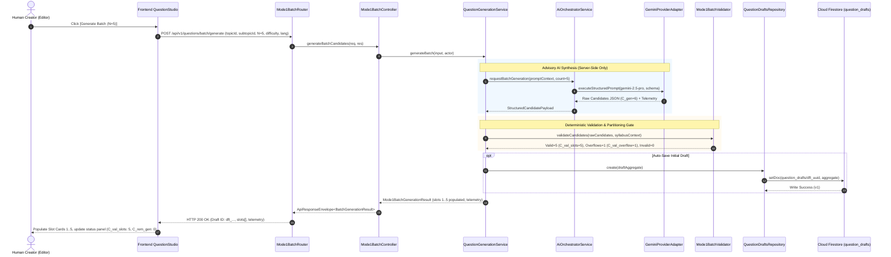
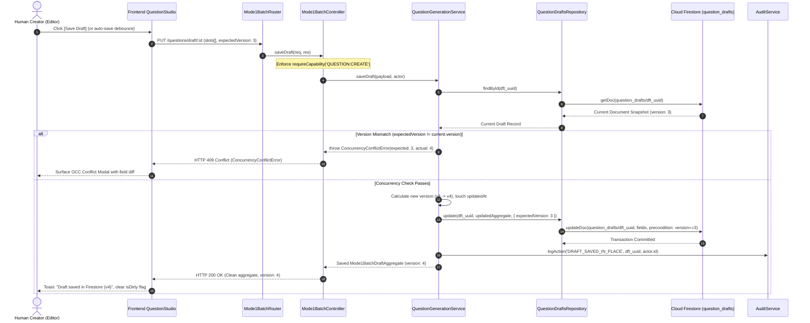
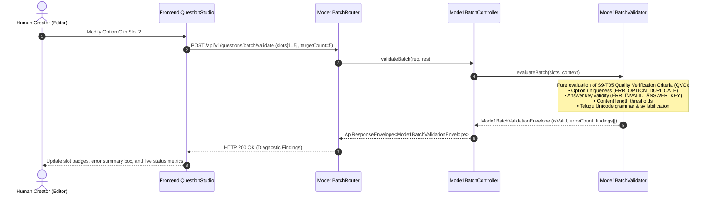
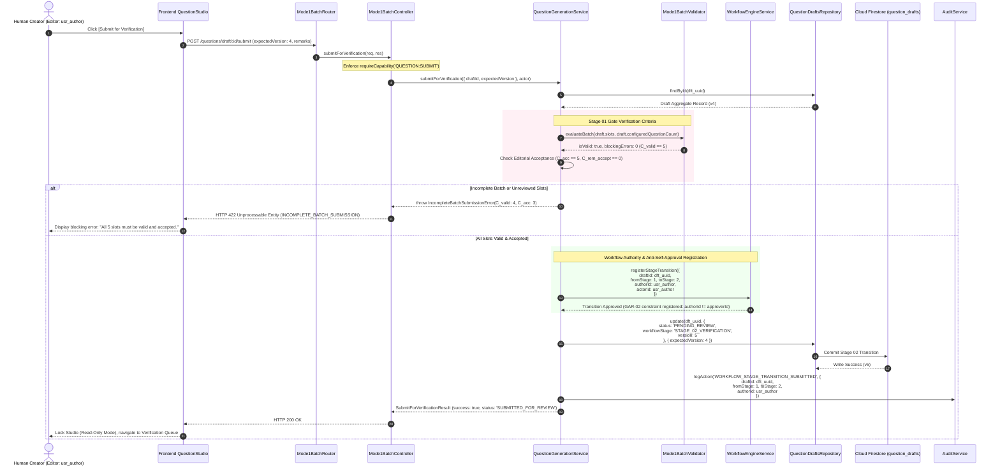

# S9-T07 — API, AI, Persistence & Workflow Integration Design Specification

**Document Version**: `1.0.0`
**Sprint**: `Sprint 9 — Mode 1 (Question Challenge Short) Production Pipeline`
**Architectural Baseline**: `Gate B Architecture Design`
**Status**: `PROPOSED DESIGN CONTRACT — AWAITING SPRINT 9 ARCHITECTURE GATE APPROVAL`
**Authoritative Context**: [AGENTS.md](../../../AGENTS.md), [S9-T01](../../sprints/sprint-09/S9-T01-DEPENDENCY-AUDIT.md), [S9-T02](../../sprints/sprint-09/S9-T02-QUESTION-CHALLENGE-SHORT-CONTENT-SPEC.md), [S9-T03](../../sprints/sprint-09/S9-T03-BATCH-GENERATION-REQUIREMENTS.md), [S9-T04](../../sprints/sprint-09/S9-T04-EDITING-QUALITY-VERIFICATION-CRITERIA.md), [S9-T05](../../sprints/sprint-09/S9-T05-MODE-SPECIFIC-CONTENT-CONTRACT.md), [S9-T06](../../sprints/sprint-09/S9-T06-EDITOR-PREVIEW-INTERACTION-SPEC.md)

---

## 1. Document Mission, Authority Hierarchy & Grounding

### 1.1 Document Purpose
This specification establishes the authoritative integration design bridging the **Frontend Question Studio** ([S9-T06](S9-T06-EDITOR-PREVIEW-INTERACTION-SPEC.md)), the **Backend API & Controller Gateway** ([backend/server/routers/routes.ts](../../../backend/server/routers/routes.ts)), the **Advisory AI Orchestration Subsystem** ([backend/ai/orchestrator](../../../backend/ai/orchestrator)), the **Authoritative Firestore Persistence Layer** ([database/firestore/repositories/question-drafts.repository.ts](../../../database/firestore/repositories/question-drafts.repository.ts)), and the **Canonical 15-Step Workflow Engine** ([backend/domain/question-generation/question-generation.service.ts](../../../backend/domain/question-generation/question-generation.service.ts)).

It defines the exact request/response envelopes, execution topologies, error propagation models, modular routing structure, safety invariants, and unresolved open decisions required to implement Mode 1 (`QUESTION_CHALLENGE_SHORT`) multi-slot batch production.

### 1.2 Source-of-Truth Authority Hierarchy
In strict accordance with [AGENTS.md §1](../../../AGENTS.md#1-source-of-truth-authority-hierarchy), architectural conflict resolution adheres to the following sequence:
1. **Verified Working Production Code and Automated Tests** — Establishes current operational baseline.
2. **Current Authoritative Architecture Documents & Decisions** — Cloud Firestore Datastore Architecture ([AGENTS.md §3](../../../AGENTS.md#3-cloud-firestore-authority)), Canonical 15-Step Workflow ([AGENTS.md §10](../../../AGENTS.md#10-workflow-authority-and-gar-02-rule)), Two-Tier Taxonomy Architecture ([AGENTS.md §5](../../../AGENTS.md#5-canonical-two-tier-taxonomy-architecture)), and Collision-Resistant UUID IDs ([AGENTS.md §6](../../../AGENTS.md#6-entity-id-architecture-uuid-based)).
3. **Sprint 9 Feature Contracts** — S9-T01 through S9-T06.
4. **Historical Sprint Records** — Immutable provenance logs; never override active contracts.

### 1.3 Verified Runtime Reality vs. Proposed Gate B Design
Every endpoint, service, and repository cited in this document is explicitly classified into one of two operational tiers:

```text
┌──────────────────────────────────────────────────────────────────────────────────────────────────┐
│                               OPERATIONAL CLASSIFICATION TIERS                                  │
├─────────────────────────────────────────────────┬────────────────────────────────────────────────┤
│ [VERIFIED RUNTIME REALITY]                      │ [PROPOSED GATE B DESIGN]                       │
├─────────────────────────────────────────────────┼────────────────────────────────────────────────┤
│ • Production route at /studio                   │ • Modular router: mode1-batch.routes.ts        │
│ • Flat single-question drafts (N=1) in Firestore│ • Atomic Mode1BatchDraftAggregate (N in 1..20) │
│ • Single-question Gemini candidate generation   │ • AI Batch Generation Runner (OD-02)           │
│ • Monolithic backend/server/routers/routes.ts   │ • Dedicated Mode1BatchController               │
│ • Existing QuestionDraftsRepository             │ • Mode 1 QVC Pure Server Validator             │
│ • Basic OCC counter on document version         │ • Multi-slot OCC diffing & conflict resolution │
└─────────────────────────────────────────────────┴────────────────────────────────────────────────┘
```

> [!CRITICAL]
> **Zero Runtime Code Mutation**: This document is strictly an architectural design deliverable. It does **not** implement executable runtime code, does not modify Firestore production collections, and does not alter Google Sheets ([AGENTS.md §4](../../../AGENTS.md#4-google-sheets-decommissioning-rule)).

---

## 2. API-Operation Matrix

The Stage 01 Question Studio interacts with the backend through seven canonical operations: **Generate**, **Edit**, **Validate**, **Save**, **Retrieve**, **Preview**, and **Submit**.

| Operation | Canonical Endpoint & HTTP Method | Request Contract (DTO) | Response Contract (Envelope) | RBAC Capability Required | Execution Engine & Nature | State Mutation Boundary | Operational Classification |
| :--- | :--- | :--- | :--- | :--- | :--- | :--- | :--- |
| **Generate (Single)** | `POST /api/ai/generate`<br>`POST /questions/smart-random` | `GenerateCandidateInput` | `ApiResponseEnvelope<GenerationResult>` | `QUESTION:CREATE` | Advisory AI (Gemini Provider via `AiOrchestratorService`) | **None** (In-memory transient candidate) | **Verified Runtime Reality** |
| **Generate (Batch)** | `POST /api/v1/questions/batch/generate` | `GenerateBatchCandidatesInput` | `ApiResponseEnvelope<BatchGenerationResult>` | `QUESTION:CREATE` | Advisory AI Batch Runner (Orchestrates $N$ items, candidate buffer, telemetry) | **Optional** (Draft initialized or updated in memory; auto-save optional) | **Proposed Gate B Design** (Requires OD-02) |
| **Edit** | `PATCH /api/v1/questions/draft/:id/slots/:slotId`<br>`PUT /questions/draft/:id` | `UpdateSlotContentInput` | `ApiResponseEnvelope<Mode1QuestionSlot>` | `QUESTION:CREATE` | Pure Deterministic (Field assignment, updates `isManuallyEdited = true`) | **In-Memory** (Local state) or **Firestore** (if auto-save triggered) | **Proposed Gate B Design** |
| **Validate** | `POST /api/v1/questions/batch/validate`<br>`POST /questions/validate-candidate` | `ValidateBatchPayloadInput` | `ApiResponseEnvelope<Mode1BatchValidationEnvelope>` | `QUESTION:VIEW` | Pure Deterministic (Executes S9-T05 QVC rules on-the-fly; zero AI) | **None** (Side-effect-free diagnostic evaluation) | **Proposed Gate B Design** |
| **Save** | `POST /questions/draft` (Create)<br>`PUT /questions/draft/:id` (Update) | `SaveQuestionDraftInput`<br>`Mode1BatchDraftAggregate` | `ApiResponseEnvelope<Mode1BatchDraftAggregate>` | `QUESTION:CREATE` | Pure Deterministic (OCC check, schema normalization, repository write) | **Firestore** (`question_drafts` document created or updated; increments `version`) | **Verified Runtime Reality** ($N=1$ flat); **Proposed Gate B** ($N \in \{5,10,15,20\}$ aggregate) |
| **Retrieve** | `GET /questions/draft/:id`<br>`GET /questions/drafts` | None (Route params: `id: dft_<uuid>`) | `ApiResponseEnvelope<Mode1BatchDraftAggregate>` | `QUESTION:VIEW` | Pure Deterministic (Repository lookup, ownership verification) | **None** (Read-only query) | **Verified Runtime Reality** |
| **Preview** | `POST /api/v1/questions/preview/render-frame`<br>`GET /questions/draft/:id/preview` | `RenderPreviewFrameInput` | `ApiResponseEnvelope<PreviewFrameProjection>` | `QUESTION:VIEW` | Pure Deterministic (Zero-copy projection of slot text into 9:16 layout) | **None** (Read-only projection; primary rendering is client-side) | **Proposed Gate B Design** |
| **Submit** | `POST /questions/draft/:id/submit` | `SubmitForVerificationInput` (`expectedVersion`) | `ApiResponseEnvelope<SubmitForVerificationResult>` | `QUESTION:SUBMIT` | Server-Authoritative Workflow (`WorkflowEngine` validates QVC, checks GAR-02, advances stage) | **Firestore** (Status transitions to `PENDING_REVIEW`, Stage 01 $\to$ 02 hand-off, immutable audit log) | **Verified Runtime Reality** ($N=1$); **Proposed Gate B** ($N > 1$ batch gate) |

---

## 3. End-to-End Data-Flow Diagrams

### 3.1 Flow 1: Advisory AI Batch Generation Pipeline (`Generate`)
AI generation is strictly advisory under Human-in-the-Loop Principle AP-009 ([AGENTS.md §9](../../../AGENTS.md#9-ai-boundary-human-in-the-loop-ap-009)). The frontend never communicates directly with LLM providers.



### 3.2 Flow 2: In-Place Draft Persistence Pipeline (`Save Draft`)
In accordance with [AGENTS.md §11](../../../AGENTS.md#11-save-vs-verify-operational-contract), saving a draft preserves progress locally in Cloud Firestore without advancing the 15-step business workflow.



### 3.3 Flow 3: Pure Deterministic Batch Validation Pipeline (`Validate`)
Validation executes on-the-fly without side effects or database mutations.



### 3.4 Flow 4: Stage 01 $\rightarrow$ Stage 02 Submission Hand-Off (`Submit for Verification`)
Formal handover from Question Studio (Stage 01) to Question Verification (Stage 02). Requires an authenticated human action; AI cannot self-submit ([AGENTS.md §9](../../../AGENTS.md#9-ai-boundary-human-in-the-loop-ap-009)). Enforces Anti-Self-Approval invariant GAR-02 ([AGENTS.md §10](../../../AGENTS.md#10-workflow-authority-and-gar-02-rule)).



---

## 4. Canonical Error Contract & HTTP Status Mapping

Standardized error serialization ensures consistent error reporting across all consumers. Responses conform to the canonical error shape:

```typescript
export interface ApiErrorResponse {
  success: false;
  error: {
    code: string; // Authoritative error code (e.g. ERR_OPTION_DUPLICATE)
    message: string; // Human-readable explanation
    category: 'VALIDATION' | 'AUTHORIZATION' | 'AI_PROVIDER' | 'NOT_FOUND' | 'CONCURRENCY' | 'PERSISTENCE' | 'WORKFLOW';
    statusCode: number; // HTTP Status Code
    timestamp: string; // ISO-8601 UTC timestamp
    path?: string; // Request URI path
    details?: Array<{
      slotNumber?: number;
      slotId?: string;
      field?: string;
      message: string;
      code?: string;
    }>;
  };
}
```

### 4.1 Error Mapping Matrix

| Error Condition | Canonical Error Code | HTTP Status | Root Cause & Trigger Mechanism | Handling & Recovery Protocol | Operational Status |
| :--- | :--- | :---: | :--- | :--- | :--- |
| **Field Schema Failure** | `ERR_SCHEMA_VIOLATION` | **400** | Missing required properties, malformed UUID, or bad answer key format. | Return list of failing fields. UI highlights specific form input. | Verified Runtime (`routes.ts`) |
| **Option Text Collision** | `ERR_OPTION_DUPLICATE` | **400** / **422** | Two or more options in a slot contain identical normalized strings. | Block submission. Studio focuses conflicting input with red ring. | S9-T05 Contract |
| **Incomplete Batch Submit** | `ERR_INCOMPLETE_BATCH` | **422** | User attempts `submitForVerification` when $C_{\text{valid}} < C_{\text{req}}$ or $C_{\text{rem\_accept}} > 0$. | Return HTTP 422 with counts. UI disables button and opens unresolved slot list. | S9-T05 / S9-T06 Contract |
| **Missing Expected Version** | `MissingExpectedVersion` | **400** | Submit or Update request omitted required positive integer `expectedVersion`. | Client must pass `draft.version` in mutation payload. | Verified Runtime (`routes.ts:1532`) |
| **OCC Concurrency Conflict** | `ConcurrencyConflictError` | **409** | Firestore document `version !== expectedVersion` (another user or tab edited draft). | Return HTTP 409. Client displays Diff & Conflict Resolution modal. Local edits preserved. | Verified Runtime (`routes.ts:1548`) |
| **Unauthorized Request** | `UNAUTHORIZED` | **401** | Missing or expired bearer session token. | Redirect client to Login / Identity Provider. | Verified Runtime |
| **Capability Denial** | `ForbiddenError` | **403** | User lacks required capability (`QUESTION:CREATE`, `QUESTION:SUBMIT`, etc.). | UI displays non-dismissible permission notice: "Unauthorized operation". | Verified Runtime (`routes.ts:1432`) |
| **Anti-Self-Approval Gate** | `AntiSelfApprovalViolation` | **403** | Author attempts to approve own draft in Stage 02 ($authorId == approverId$). | Enforces GAR-02 strictly. Action blocked fail-closed; administrator override required. | Verified Runtime (`routes.ts:1479`) |
| **Draft Not Found** | `DRAFT_NOT_FOUND` | **404** | Draft document with provided `dft_<uuid>` does not exist in Firestore. | Surface 404 state. UI displays "Draft not found" with link to Dashboard. | Verified Runtime (`routes.ts:1409`) |
| **AI Provider Timeout** | `ERR_PROVIDER_TIMEOUT` | **504** | LLM provider response latency exceeded bounded threshold ($\ge 45\text{s}$). | Client aborts. Incremental results preserved; surface "[Retry Remaining Slots]". | S9-T03 Failure Mode 5 |
| **AI Provider Rate Limit** | `ERR_PROVIDER_RATE_LIMIT` | **502** / **429** | Provider HTTP 429 quota exhaustion. | Surface warning badge. Preserves valid slots; prompt user to wait or draft manually. | S9-T03 Failure Mode 1 |
| **Malformed AI Generation** | `ERR_MALFORMED_AI_RESPONSE`| **502** | Provider returned unparseable JSON or violated structural candidate schema. | Bounded retry: up to 2 automated provider attempts before failing to manual input. | S9-T03 Failure Mode 2 |
| **Firestore Persistence Fail**| `ERR_PERSISTENCE_FAILED` | **500** | Cloud Firestore write exception (network partition, quota limit, transient 503). | In-memory edits retained in client state. UI surfaces sticky "[Retry Save]" banner. | S9-T03 Failure Mode 6 |
| **Invalid Stage Transition** | `INVALID_STAGE_TRANSITION` | **422** | Attempting illegal stage progression (e.g. Stage 01 $\to$ Stage 03, bypassing Stage 02). | Blocked by `WorkflowEngine`. State preserved in Stage 01. | AGENTS.md §10 |

---

## 5. File-Level Modular Implementation Plan

To eliminate monolithic route expansion in [`backend/server/routers/routes.ts`](../../../backend/server/routers/routes.ts) (which currently exceeds 7,400 lines), this plan establishes modular feature slicing.

```text
backend/
├── features/question-generation/
│   ├── controllers/
│   │   └── mode1-batch.controller.ts        [NEW] Controller for Mode 1 batch operations
│   └── services/
│       ├── question-draft.service.ts        [REUSE] Public façade for draft persistence
│       └── mode1-batch-generator.service.ts [NEW] Domain orchestrator for multi-slot AI synthesis
├── domain/question-generation/
│   ├── question-generation.service.ts       [REUSE] Authoritative Stage 01 domain service
│   └── validators/
│       └── mode1-batch.validator.ts         [NEW] Pure server-side Mode 1 QVC validation engine
├── server/routers/
│   ├── routes.ts                            [REUSE] Mounts sub-routers; delegates /questions/batch
│   └── mode1-batch.routes.ts                [NEW] Dedicated modular Express router for Mode 1
shared/
└── contracts/question-generation/
    ├── question-generation.contract.ts      [REUSE] Single-question and shared base contracts
    └── mode1-batch.contract.ts              [NEW] Typed interfaces for Mode1BatchDraftAggregate
```

### 5.1 Existing Files to Reuse & Extend

| Exact File Path | Architectural Responsibility | Planned Reuse / Modification Scope |
| :--- | :--- | :--- |
| [`backend/server/routers/routes.ts`](../../../backend/server/routers/routes.ts) | Monolithic API Router | **Mount Delegator**: Mount `mode1BatchRouter` at `/api/v1/questions/batch` and `/questions/draft/:id/batch`. Remove any ad-hoc inline batch logic. |
| [`backend/features/question-generation/services/question-draft.service.ts`](../../../backend/features/question-generation/services/question-draft.service.ts) | Public Question Draft Service Façade | **Service Facade**: Expose typed methods `saveBatchDraft`, `submitBatchForVerification`, and `getBatchDraftById`. |
| [`backend/domain/question-generation/question-generation.service.ts`](../../../backend/domain/question-generation/question-generation.service.ts) | Authoritative Domain Service | **Domain Authority**: Update `saveDraft` and `submitForVerification` to support `Mode1BatchDraftAggregate` alongside legacy $N=1$ records. |
| [`database/firestore/repositories/question-drafts.repository.ts`](../../../database/firestore/repositories/question-drafts.repository.ts) | Cloud Firestore Persistence Repository | **Data Layer**: Persist atomic `slots[]` array under ADR-011 DD-05. Enforce atomic OCC precondition checking on updates. |
| [`backend/ai/orchestrator/ai-orchestrator.service.ts`](../../../backend/ai/orchestrator/ai-orchestrator.service.ts) | Server-Side AI Orchestration | **AI Gateway**: Route batch generation requests to approved provider adapters with structured output schemas. |
| [`backend/ai/providers/gemini.adapter.ts`](../../../backend/ai/providers/gemini.adapter.ts) | Gemini LLM Provider Implementation | **Provider**: Execute candidate generation prompts with temperature control and schema validation. |
| [`backend/infrastructure/audit/services/audit.service.ts`](../../../backend/infrastructure/audit/services/audit.service.ts) | Immutable Audit Logging | **Audit Trail**: Record immutable events: `BATCH_GENERATION_INITIATED`, `BATCH_SLOTS_REORDERED`, `BATCH_SUBMITTED_FOR_VERIFICATION`. |
| [`shared/contracts/question-generation/question-generation.contract.ts`](../../../shared/contracts/question-generation/question-generation.contract.ts) | Shared Contracts & DTOs | **Base Contracts**: Re-export common enums and base generation interfaces. |
| [`shared/registry/content-mode.registry.ts`](../../../shared/registry/content-mode.registry.ts) | Canonical Content Mode Registry | **Mode Authority**: Validate mode-specific parameters ($N \in \{1, 5, 10, 15, 20\}$, 9:16 aspect ratio, duration $\le 58\text{s}$). |
| [`shared/lib/id.service.ts`](../../../shared/lib/id.service.ts) | Canonical Distributed ID Generator | **ID Service**: Generate distributed UUIDs (`dft_<uuid>`, `slt_<uuid>`, `cnd_<uuid>`) statelessly without database round-trips. |

### 5.2 Proposed New Files to Add

| Proposed File Path | Layer & Component | Dedicated Responsibility |
| :--- | :--- | :--- |
| `backend/server/routers/mode1-batch.routes.ts` | Server / HTTP Router | Dedicated Express sub-router. Dispatches `/batch/generate`, `/batch/validate`, `/draft/:id/slots/:slotId`, and `/draft/:id/batch-submit`. Applies `requireCapability` middleware. |
| `backend/features/question-generation/controllers/mode1-batch.controller.ts` | Feature / Controller | Handles HTTP request serialization, parameter validation (Zod), capability assertion, and delegation to domain services. Returns standardized `ApiResponseEnvelope`. |
| `backend/domain/question-generation/services/mode1-batch-generator.service.ts` | Domain / Service | Orchestrates multi-slot AI batch generation, candidate overflow buffering, deduplication checks, and partial generation shortfalls per S9-T03. |
| `backend/domain/question-generation/validators/mode1-batch.validator.ts` | Domain / Validator | Pure, side-effect-free server validator implementing S9-T05 Quality Verification Criteria (QVC) across individual slots and the complete batch aggregate. |
| `shared/contracts/question-generation/mode1-batch.contract.ts` | Shared / Contracts | Pure TypeScript interfaces for `Mode1BatchDraftAggregate`, `Mode1QuestionSlot`, batch generation requests/responses, and validation findings. Free of server secrets or React. |

---

## 6. Safety Invariants & Architectural Non-Negotiables

Every component, route, and service implemented under this specification must strictly enforce the following nine architectural invariants:

1. **No Client-Side Direct Firestore Access ([AGENTS.md §3](../../../AGENTS.md#3-cloud-firestore-authority))**:
   - The frontend Question Studio must **never** import Firebase Admin SDK, instantiate Firestore clients, or execute direct Firestore queries. All persistence operations flow strictly through backend HTTP endpoints.
2. **Server-Side AI Provider Isolation ([AGENTS.md §9](../../../AGENTS.md#9-ai-boundary-human-in-the-loop-ap-009))**:
   - The frontend must never call Gemini, OpenAI, Anthropic, or any AI provider directly. All LLM orchestration resides server-side behind `AiOrchestratorService`.
3. **Repository Responsibility Boundaries ([AGENTS.md §3](../../../AGENTS.md#3-cloud-firestore-authority))**:
   - Repositories handle transactional CRUD and OCC mechanics only. Repositories must **never** make workflow transition decisions, execute AI calls, or perform role authorization.
4. **Server-Authoritative State Transitions ([AGENTS.md §10](../../../AGENTS.md#10-workflow-authority-and-gar-02-rule))**:
   - The frontend presents workflow state and allowed actions; it can never unilaterally mutate workflow stages or bypass transition gates. The server `WorkflowEngine` is the sole authority for state transitions.
5. **Save Draft $\neq$ Submit for Verification ([AGENTS.md §11](../../../AGENTS.md#11-save-vs-verify-operational-contract))**:
   - Saving a draft persists in-progress working state to Firestore without advancing the workflow stage (`stage: 1, status: 'DRAFT'`).
   - Submitting for verification is an explicit, separate user command that advances the draft to Stage 02 (`stage: 2, status: 'PENDING_REVIEW'`), strictly requiring $100\%$ valid and accepted slots.
6. **Optimistic Concurrency Control (OCC)**:
   - Every draft document contains an atomic `version` integer. All update and submit operations must provide `expectedVersion`. Mismatches abort fail-closed with HTTP 409 `ConcurrencyConflictError`.
7. **Strict Role-Based Access Control (RBAC)**:
   - Endpoints enforce capability checks via middleware: `QUESTION:CREATE` for generation and drafting, `QUESTION:VIEW` for retrieval, and `QUESTION:SUBMIT` for verification handover.
8. **Anti-Self-Approval Enforcement (GAR-02 Rule)**:
   - The author of a draft can never approve their own work during Stage 02:
     $$\mathbf{GAR\text{-}02\ Invariant}:\quad \text{authorId} \neq \text{approverId}$$
   - When a draft is submitted, `authorId` is registered immutably in the workflow instance to guarantee that the author is disqualified from Stage 02 approval.
9. **Zero Google Sheets Persistence ([AGENTS.md §4](../../../AGENTS.md#4-google-sheets-decommissioning-rule))**:
   - Google Sheets is decommissioned. It must not be used as a database, runtime cache, or queue.

---

## 7. Open Decisions & Gate B Architecture Checklist

### 7.1 Open Decision 1: S9-T03 TC-BATCH-08 vs. S9-T06 Telemetry Conflict
This specification explicitly carries forward the unresolved source-contract conflict identified in [S9-T06 §6.4](S9-T06-EDITOR-PREVIEW-INTERACTION-SPEC.md#64-unresolved-contract-conflict-s9-t06-telemetry-isolation-vs-s9-t03-tc-batch-08-slot-repair):

- **S9-T03 TC-BATCH-08 Clause**: Specifies that upon manual slot repair, `Slot 3 status = MANUALLY_EDITED`, `C_edit = 1`, **$C_{\text{val\_slots}}$ increments to 5**, and $C_{\text{rem\_gen}} = 0$, transitioning `batchStatus` to `COMPLETE`. This overloads $C_{\text{val\_slots}}$ as an aggregate-level valid-slot counter.
- **S9-T06 Invariant**: Strictly isolates $C_{\text{val\_slots}}$ as **AI Generation Attempt Telemetry** to preserve the candidate partition equation ($C_{\text{gen}} = C_{\text{val\_slots}} + C_{\text{inv}} + C_{\text{dup}} + C_{\text{val\_overflow}}$). Manual edits update **Editor Workbench Validity** ($C_{\text{valid}}$), leaving $C_{\text{val\_slots}}$ untouched.
- **Integration Resolution for S9-T07**:
  - The API design models generation telemetry as a separate nested sub-object (`draft.telemetry`) from the slot array (`draft.slots`).
  - Stage 01 $\rightarrow$ Stage 02 verification eligibility evaluates live editor validity ($C_{\text{valid}} == C_{\text{req}}$) and editorial acceptance ($C_{\text{acc}} == C_{\text{req}}$), decoupling workflow submission from whether the telemetry field $C_{\text{val\_slots}}$ is mutated or frozen.
  - This conflict is **explicitly recorded as an active open decision** for final resolution at the Sprint 9 architecture gate.

### 7.2 Open Decision 2: OD-02 Batch Dispatch Approval
- **Status**: **PROPOSED DEFAULT — REQUIRES OWNER APPROVAL**.
- **Scope**: Multi-slot batch generation ($N \in \{5, 10, 15, 20\}$) is registered in the content mode registry, but automated batch dispatch runner execution, rate-limiting retry boundaries, and multi-candidate buffering remain unimplemented awaiting formal owner sign-off.
- **Operational Reality**: Verified runtime reality currently supports single-question generation only. The batch API endpoints specified herein are ready for implementation upon OD-02 sign-off.

### 7.3 Gate B Architecture Integration Checklist

| Item | Requirement & Architectural Invariant | Specification Reference | Status |
| :---: | :--- | :--- | :---: |
| **G-01** | API operation matrix covers generate, edit, validate, save, retrieve, preview, and submit. | [§2](#2-api-operation-matrix) | **COMPLETE** |
| **G-02** | Data-flow diagrams model frontend $\to$ API $\to$ domain service $\to$ AI provider / Firestore. | [§3](#3-end-to-end-data-flow-diagrams) | **COMPLETE** |
| **G-03** | Error contracts map validation, auth, timeout, OCC, persistence, and workflow errors. | [§4](#4-canonical-error-contract--http-status-mapping) | **COMPLETE** |
| **G-04** | File-level implementation plan reuses existing services and avoids monolithic route bloat. | [§5](#5-file-level-modular-implementation-plan) | **COMPLETE** |
| **G-05** | Safety invariants enforced: No frontend Firestore, no client AI, Save $\neq$ Verify, GAR-02, OCC. | [§6](#6-safety-invariants--architectural-non-negotiables) | **COMPLETE** |
| **G-06** | Unresolved S9-T03 TC-BATCH-08 telemetry conflict and OD-02 are honestly carried forward. | [§7.1, §7.2](#7-open-decisions--gate-b-architecture-checklist) | **COMPLETE** |
| **G-07** | Zero Google Sheets runtime persistence; Cloud Firestore is sole datastore. | [§1.1, §6](#6-safety-invariants--architectural-non-negotiables) | **COMPLETE** |
| **G-08** | Preserves historical S7 baseline and architecture test manifest without alteration. | [§1.2](#12-source-of-truth-authority-hierarchy) | **COMPLETE** |

---

## 8. Verification Record & Final Scope Verdict

### 8.1 Verification Protocol Execution
Under [AGENTS.md §15.1 and §15.2](../../../AGENTS.md#15-risk-based-engineering-execution-cycle--verification-policy):
- **Verification Tier**: **Tier 1: Documentation-Only**.
- **Mandatory Pre-Test Decision**:
  1. *Changed Scope*: Created documentation deliverable `docs/sprints/sprint-09/S9-T07-API-AI-PERSISTENCE-WORKFLOW-INTEGRATION-SPEC.md`. Zero changes to runtime code, test fixtures, or inventory manifests.
  2. *Selected Verification Commands*:
     - `git diff --check`: Verify zero whitespace errors, trailing whitespace, or merge conflict markers.
  3. *Safely Bypassed Commands*:
     - `npm run test:architecture`: Bypassed because zero manifest files, test files, or tracked file counts were modified.
     - `npm run build`: Bypassed because zero executable source code or configuration files were changed.

### 8.2 Scope Verdict & Sign-Off
- **Verdict**: **COMPLETE & ACCEPTED (GATE B BASELINE — SPECIFICATION DELIVERABLE)**.
- **Summary**: Sprint 9, Task S9-T07 is fully satisfied. The integration specification establishes the end-to-end API operation matrix, data-flow topologies, standardized error envelopes, modular file-level implementation plan, and safety invariants. It grounds every endpoint in current codebase reality, cleanly distinguishes verified runtime behavior from proposed designs, and carries forward open decisions OD-02 and the S9-T03/S9-T06 telemetry conflict with complete architectural integrity.
