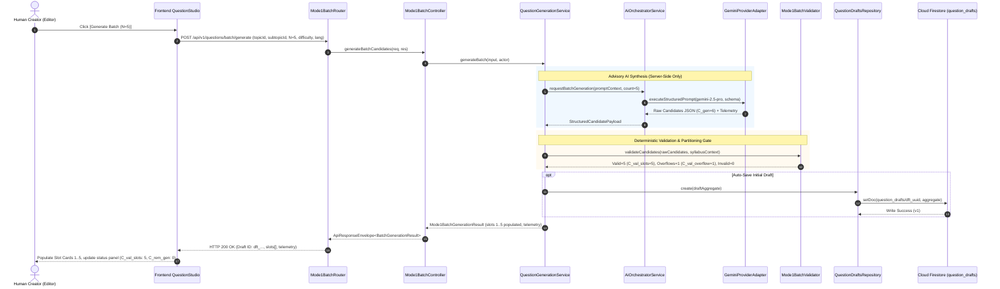
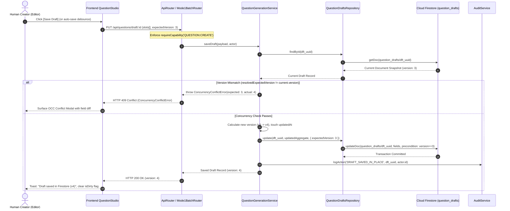
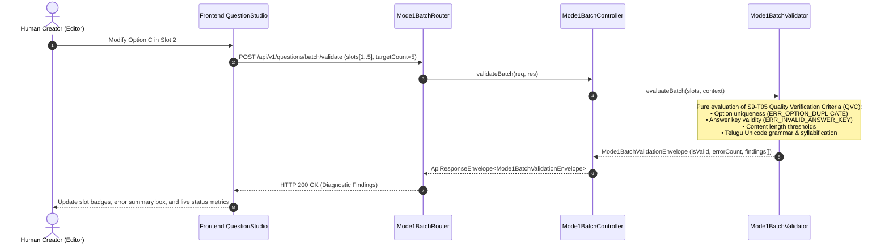
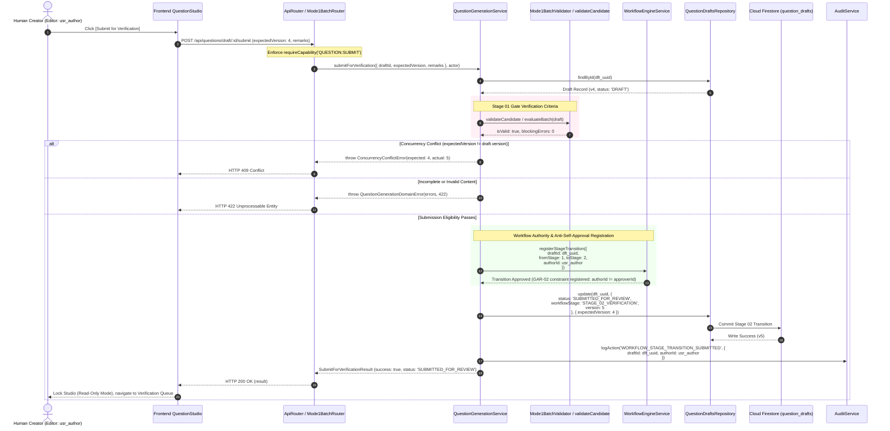

# S9-T07 — API, AI, Persistence & Workflow Integration Design Specification

**Document Version**: `1.3.0`
**Sprint**: `Sprint 9 — Mode 1 (Question Challenge Short) Production Pipeline`
**Architectural Baseline**: `Gate B Architecture Design`
**Status**: `INTEGRATION DESIGN COMPLETE — PREPARED FOR FORMAL SPRINT 9 GATE B OWNER SIGN-OFF (NOT YET APPROVED)`
**Authoritative Context**: [AGENTS.md](../../../AGENTS.md), [S9-T01](../../sprints/sprint-09/S9-T01-DEPENDENCY-AUDIT.md), [S9-T02](../../sprints/sprint-09/S9-T02-QUESTION-CHALLENGE-SHORT-CONTENT-SPEC.md), [S9-T03](../../sprints/sprint-09/S9-T03-BATCH-GENERATION-REQUIREMENTS.md), [S9-T04](../../sprints/sprint-09/S9-T04-EDITING-QUALITY-VERIFICATION-CRITERIA.md), [S9-T05](../../sprints/sprint-09/S9-T05-MODE-SPECIFIC-CONTENT-CONTRACT.md), [S9-T06](../../sprints/sprint-09/S9-T06-EDITOR-PREVIEW-INTERACTION-SPEC.md)

---

## 1. Document Mission, Authority Hierarchy & Grounding

### 1.1 Document Purpose
This specification establishes the authoritative integration design bridging the **Frontend Question Studio** ([S9-T06](S9-T06-EDITOR-PREVIEW-INTERACTION-SPEC.md)), the **Backend API & Controller Gateway** ([backend/server/routers/routes.ts](../../../backend/server/routers/routes.ts)), the **Advisory AI Orchestration Subsystem** ([backend/ai/orchestrator](../../../backend/ai/orchestrator)), the **Authoritative Firestore Persistence Layer** ([database/firestore/repositories/question-drafts.repository.ts](../../../database/firestore/repositories/question-drafts.repository.ts)), and the **Canonical 15-Step Workflow Engine** ([backend/domain/question-generation/question-generation.service.ts](../../../backend/domain/question-generation/question-generation.service.ts)).

It defines the exact request/response envelopes, execution topologies, error propagation models, idempotency guarantees, modular routing structure, safety invariants, and unresolved open decisions required to implement Mode 1 (`QUESTION_CHALLENGE_SHORT`) multi-slot batch production.

> [!IMPORTANT]
> **Pending Architecture Gate B Approval**: Gate B architecture approval has **NOT** occurred. This document remains a proposed design specification pending formal sign-off. It does not claim batch runtime infrastructure exists or has been verified.

### 1.2 Source-of-Truth Authority Hierarchy
In strict accordance with [AGENTS.md §1](../../../AGENTS.md#1-source-of-truth-authority-hierarchy), architectural conflict resolution adheres to the following sequence:
1. **Verified Working Production Code and Automated Tests** — Establishes current operational baseline.
2. **Current Authoritative Architecture Documents & Decisions** — Cloud Firestore Datastore Architecture ([AGENTS.md §3](../../../AGENTS.md#3-cloud-firestore-authority)), Canonical 15-Step Workflow ([AGENTS.md §10](../../../AGENTS.md#10-workflow-authority-and-gar-02-rule)), Two-Tier Taxonomy Architecture ([AGENTS.md §5](../../../AGENTS.md#5-canonical-two-tier-taxonomy-architecture)), and Collision-Resistant UUID IDs ([AGENTS.md §6](../../../AGENTS.md#6-entity-id-architecture-uuid-based)).
3. **Sprint 9 Feature Contracts** — S9-T01 through S9-T06.
4. **Historical Sprint Records** — Immutable provenance logs; never override active contracts.

### 1.3 Verified Runtime Reality vs. Proposed Gate B Design
Every endpoint, service, and repository cited in this document is strictly classified into one of two operational tiers:

```text
┌──────────────────────────────────────────────────────────────────────────────────────────────────┐
│                               OPERATIONAL CLASSIFICATION TIERS                                  │
├─────────────────────────────────────────────────┬────────────────────────────────────────────────┤
│ [VERIFIED RUNTIME REALITY]                      │ [PROPOSED GATE B DESIGN]                       │
├─────────────────────────────────────────────────┼────────────────────────────────────────────────┤
│ • Express API mounted at /api in server.ts      │ • Modular router: mode1-batch.routes.ts        │
│ • Flat single-question drafts (N=1) in Firestore│ • Atomic Mode1BatchDraftAggregate (N in 1..20) │
│ • Single candidate AI: POST /api/ai/generate    │ • Batch generation: POST /api/v1/.../batch/gen │
│ • Parameter resolution: /questions/smart-random │ • AI Batch Generation Runner (OD-02)           │
│ • Draft CRUD: POST/PUT/GET /api/questions/draft │ • Batch validation: /questions/batch/validate  │
│ • Candidate validation: /questions/validate-can │ • Dedicated Mode1BatchController               │
│ • Single submission: /questions/draft/:id/submit│ • Mode 1 QVC Pure Server Validator             │
│ • Monolithic backend/server/routers/routes.ts   │ • Standardized ApiErrorResponse envelope       │
│ • Existing QuestionDraftsRepository             │ • Slot patch: /draft/:id/slots/:slotId         │
│ • OCC checking on expectedVersion integer       │ • Idempotency key caching & replay semantics   │
└─────────────────────────────────────────────────┴────────────────────────────────────────────────┘
```

> [!CRITICAL]
> **Zero Runtime Code Mutation**: This document is strictly an architectural design deliverable. It does **not** implement executable runtime code, does not modify Firestore production collections, and does not alter Google Sheets ([AGENTS.md §4](../../../AGENTS.md#4-google-sheets-decommissioning-rule)).

---

## 2. API-Operation Matrix

The Stage 01 Question Studio interacts with the backend through seven canonical operations: **Generate**, **Edit**, **Validate**, **Save**, **Retrieve**, **Preview**, and **Submit**.

The table below reconciles verified runtime reality against the proposed Gate B design. Implemented endpoints reflect the exact behavior in `backend/server/routers/routes.ts` mounted under `/api` (`backend/server/server.ts:65`).

| Operation | Canonical Endpoint & Method | Request Contract (DTO) | Response Contract (Payload Shape) | Route-Level Capability Middleware | Domain-Level Ownership & State Rule | Execution Nature & Mutation Boundary | Operational Classification |
| :--- | :--- | :--- | :--- | :--- | :--- | :--- | :--- |
| **Generate (Single)** | `POST /api/ai/generate` | `GenerateCandidateInput` (`topicId`, `subtopicId`, `difficulty`, `options`) | Raw `GenerationResult` (unwrapped JSON object) | None (Unauthenticated / IP rate-limited `aiRateLimiter`) | None (Stateless candidate generation) | Advisory AI (`aiOrchestrator.generateQuestionCandidate` via Gemini). **No DB mutation**. | **Verified Runtime Reality** |
| **Generate (Batch)** | `POST /api/v1/questions/batch/generate` | `GenerateBatchCandidatesInput` (`topicId`, `subtopicId`, $N \in \{5,10,15,20\}$, `language`) | `ApiResponseEnvelope<BatchGenerationResult>` | `requireCapability('QUESTION:CREATE')` | None (Stateless or transient buffer) | Advisory AI Batch Runner (Orchestrates $N$ items, candidate buffer, telemetry). **No DB mutation**. | **Proposed Gate B Design** (Requires OD-02) |
| **Parameter Resolve** | `POST /api/questions/smart-random` | `{ topicId?, difficulty? }` | `{ topicId, subtopicId, difficulty, ... }` | None (Public / internal) | None (Read-only taxonomy query) | Deterministic taxonomy resolution (`smartRandomService.resolveParameters`). **No DB mutation**. | **Verified Runtime Reality** |
| **Edit (Single Full Draft)** | `PUT /api/questions/draft/:id`<br>`PUT /api/v1/questions/draft/:id` | `SaveDraftInput` (`version?: number`, `questionText`, `options`, `correctAnswer`) | Raw `QuestionDraft` (unwrapped JSON object, HTTP 200) | `requireCapability('QUESTION:CREATE')` | `authorId === actor.id` or `ADMIN`/`CONTENT_LEAD` (403 `ForbiddenError`); `DRAFT_LOCKED` if not in DRAFT | Pure Deterministic (`questionDraftService.saveDraft`). **Mutates Firestore** (`question_drafts`, version $V \to V+1$). | **Verified Runtime Reality** |
| **Edit (Slot Partial)** | `PATCH /api/v1/questions/draft/:id/slots/:slotId` | `UpdateSlotContentInput` (`slotId`, `questionText`, `options`, `correctAnswer`, `expectedVersion`) | `ApiResponseEnvelope<Mode1QuestionSlot>` | `requireCapability('QUESTION:CREATE')` | `authorId === actor.id` or `ADMIN`/`CONTENT_LEAD`; `DRAFT_LOCKED` check | Pure Deterministic (Sets `isManuallyEdited = true`, recalculates checksum). **Mutates Firestore** (Aggregate slot, increments version). | **Proposed Gate B Design** |
| **Validate (Single Candidate)** | `POST /api/questions/validate-candidate` | `{ question: Partial<StudioCandidate>, skipTaxonomyLookup?, skipDuplicateCheck? }` | `{ success: true, data: QuestionValidationResult }` (HTTP 200) | `requireAuth` + `requireRole([ADMIN, CONTENT_MANAGER, QUESTION_EDITOR, REVIEWER, CONTENT_WRITER])` | None (Diagnostic evaluation) | Pure Deterministic (`questionValidationService.validateCandidate`; taxonomy, duplicate, grammar). **No DB mutation**. | **Verified Runtime Reality** |
| **Validate (Batch Aggregate)** | `POST /api/v1/questions/batch/validate` | `ValidateBatchPayloadInput` (`slots[]`, `targetCount`) | `ApiResponseEnvelope<Mode1BatchValidationEnvelope>` | `requireCapability('QUESTION:VIEW')` | None (Diagnostic evaluation) | Pure Deterministic (Executes S9-T05 QVC rules on-the-fly across slots; zero AI). **No DB mutation**. | **Proposed Gate B Design** |
| **Save (Draft Create)** | `POST /api/questions/draft`<br>`POST /api/v1/questions/draft` | `SaveDraftInput` (`id?: string`, `topicId`, `subtopicId`, `questionText`, `options`, `correctAnswer`) | Raw `QuestionDraft` (unwrapped JSON object, HTTP 201) | `requireCapability('QUESTION:CREATE')` | If `id` exists: ownership check (`authorId === actor.id` or Admin/Lead); `DRAFT_LOCKED` check | Pure Deterministic (`questionDraftService.saveDraft`). **Mutates Firestore** (`question_drafts` created or updated). | **Verified Runtime Reality** ($N=1$ flat) |
| **Save (Batch Draft Aggregate)** | `POST /api/v1/questions/batch/draft`<br>`PUT /api/v1/questions/batch/draft/:id` | `Mode1BatchDraftAggregate` (`slots[]`, `telemetry`, `expectedVersion`) | `ApiResponseEnvelope<Mode1BatchDraftAggregate>` | `requireCapability('QUESTION:CREATE')` | `authorId === actor.id` or `ADMIN`/`CONTENT_LEAD`; `DRAFT_LOCKED` check | Pure Deterministic (OCC check, schema normalization, batch aggregate persistence). **Mutates Firestore**. | **Proposed Gate B Design** ($N \in \{5,10,15,20\}$ aggregate) |
| **Retrieve (Single Draft)** | `GET /api/questions/draft/:id`<br>`GET /api/v1/questions/draft/:id` | None (Route param: `id: dft_<uuid>`) | Raw `QuestionDraft` (unwrapped JSON object, HTTP 200) | `requireCapability('QUESTION:VIEW')` | `authorId === actor.id` or privileged (`ADMIN`, `CONTENT_LEAD`, `QA_REVIEWER`, `QUESTION_EDITOR`; 403 `ForbiddenError`) | Pure Deterministic (`questionDraftService.getDraftById`). **No DB mutation**. | **Verified Runtime Reality** |
| **Retrieve (Draft List)** | `GET /api/questions/drafts`<br>`GET /api/v1/questions/drafts` | None (Optional query filters) | Raw `QuestionDraft[]` (array of drafts, HTTP 200) | `requireCapability('QUESTION:VIEW')` | Privileged sees all; non-privileged filtered to `authorId === actor.id` or `author === actor.name` | Pure Deterministic (`questionDraftService.getAllDrafts`). **No DB mutation**. | **Verified Runtime Reality** |
| **Preview** | `POST /api/v1/questions/preview/render-frame`<br>`GET /questions/draft/:id/preview` | `RenderPreviewFrameInput` (`slotId`, `aspectRatio: '9:16'`) | `ApiResponseEnvelope<PreviewFrameProjection>` | `requireCapability('QUESTION:VIEW')` | None (Read-only projection) | Pure Deterministic (Zero-copy projection into 9:16 layout). **No DB mutation**. Runtime relies on client preview. | **Proposed Gate B Design** (No backend preview route in `routes.ts`) |
| **Submit (Single Draft)** | `POST /api/questions/draft/:id/submit`<br>`POST /api/v1/questions/draft/:id/submit` | `{ remarks?: string, expectedVersion: number }` | Raw `SubmitForVerificationResult` (unwrapped JSON object, HTTP 200) | `requireCapability('QUESTION:SUBMIT')` | **Verified Runtime**: `authorId === actor.id` or `ADMIN`, `CONTENT_LEAD`, `QUESTION_EDITOR` (throws 403 `ForbiddenError` if `draft.authorId` exists and caller is non-author without one of these 3 roles); status must be `DRAFT`; validates candidate completeness | Server-Authoritative Workflow (`questionDraftService.submitForVerification`). **Mutates Firestore** (Status $\to$ `SUBMITTED_FOR_REVIEW`, increments version). | **Verified Runtime Reality** ($N=1$ flat) |
| **Submit (Batch Draft)** | `POST /api/v1/questions/batch/draft/:id/submit` | `SubmitBatchForVerificationInput` (`expectedVersion: number`, `remarks?: string`) | `ApiResponseEnvelope<SubmitBatchForVerificationResult>` | `requireCapability('QUESTION:SUBMIT')` | **Proposed Gate B Policy**: Draft author or authorized editor/lead role (`ADMIN`, `CONTENT_LEAD`, `QUESTION_EDITOR`); mandatory canonical `authorId` validation; full batch QVC check ($C_{\text{valid}} == C_{\text{req}}$, $C_{\text{acc}} == C_{\text{req}}$); registers author for GAR-02 | Server-Authoritative Workflow (`WorkflowEngine` validates full batch, registers GAR-02). **Mutates Firestore**. | **Proposed Gate B Design** (Requires OD-02 & Gate B approval) |

### 2.1 Precise Authorization Attribution & Tiered Enforcement
Authorization is strictly bifurcated into two architectural layers to ensure separation of concerns between HTTP dispatch security and domain business rules:

1. **Route-Level Capability Middleware (`auth.middleware.ts`)**:
   - Executes immediately upon HTTP request dispatch in `backend/server/routers/routes.ts`.
   - Uses `requireCapability(capability)` to assert that the authenticated session token possesses the required coarse-grained operational permission (`QUESTION:CREATE`, `QUESTION:VIEW`, `QUESTION:SUBMIT`).
   - Fails closed with HTTP 401 `UNAUTHORIZED` (if unauthenticated) or HTTP 403 `ForbiddenError` (if the capability is missing), terminating execution before any domain logic or database read is invoked.
2. **Domain-Level Ownership & Lifecycle Guard Enforcement**:
   - Executes inside domain services ([`backend/domain/question-generation/question-generation.service.ts`](../../../backend/domain/question-generation/question-generation.service.ts)) and feature services ([`backend/features/question-generation/services/question-draft.service.ts`](../../../backend/features/question-generation/services/question-draft.service.ts)).
   - Evaluates entity-level data invariants and fine-grained business authorization:
     - **Draft Modification Authorization (`PUT /api/questions/draft/:id`)**:
       - *Route-Level Middleware*: `requireCapability('QUESTION:CREATE')`.
       - *Domain-Level Rule (Verified Runtime)*: Checks `existing.authorId`. If `existing.authorId && existing.authorId !== actor.id`, permitted only if actor holds `ADMIN` or `CONTENT_LEAD` ([`question-generation.service.ts:464-472`](../../../backend/domain/question-generation/question-generation.service.ts#L464-L472)). Otherwise throws HTTP 403 `ForbiddenError`.
     - **Draft Submission Authorization (`POST /api/questions/draft/:id/submit`)**:
       - *Route-Level Middleware*: `requireCapability('QUESTION:SUBMIT')`.
       - *Domain-Level Rule (Verified Runtime Reality)*: Checks `draft.authorId`. If `draft.authorId && draft.authorId !== actor.id`, permitted only if actor holds `ADMIN`, `CONTENT_LEAD`, or `QUESTION_EDITOR` ([`question-generation.service.ts:580-593`](../../../backend/domain/question-generation/question-generation.service.ts#L580-L593)). Otherwise throws HTTP 403 `ForbiddenError`. (Note: if `draft.authorId` is missing/empty on legacy records, this ownership check is bypassed in current runtime code).
       - *Proposed Gate B Submission Policy*: Mandates non-empty `authorId` on all drafts; restricts submission to the verified draft author (`draft.authorId === actor.id`) or designated leads/editors (`ADMIN`, `CONTENT_LEAD`, `QUESTION_EDITOR`), requiring 100% complete and accepted slots before Stage 02 handover.
     - **Lifecycle Mutability Guards**: Checks that draft status is `DRAFT`. If the draft has already progressed to `SUBMITTED_FOR_REVIEW`, `APPROVED`, or `PUBLISHED`, throws HTTP 409 `DRAFT_LOCKED`.
     - **Anti-Self-Approval Enforcement (GAR-02 Absolute Invariant & Runtime Defect Identification)**:
       $$\mathbf{GAR\text{-}02\ Absolute\ Invariant}:\quad \text{authorId} \neq \text{approverId} \quad (\text{Zero Exceptions})$$
       - Under Architecture Principle 3, ADR-002, AGENTS.md §10, and S9-T04 §4.3, author self-approval is **strictly prohibited across all roles without exceptions, including for `ADMIN`**.
       - *Runtime Defect Identification*: The brownfield implementation in `QuestionDraftService.approveDraft` ([`backend/features/question-generation/services/question-draft.service.ts:142-150`](../../../backend/features/question-generation/services/question-draft.service.ts#L142-L150)) and `routes.ts:1466-1474` currently permits an `ADMIN` self-approval override if an `overrideContext` with a 10-character reason is supplied. Consistent with S9-T04 §4.3, this override is an **identified implementation defect and architectural violation**, NOT compliant behavior. In the authoritative Gate B design, all self-approval attempts must fail closed with HTTP 403 `NEG-01 AntiSelfApprovalViolation` unconditionally without exception.

---

## 3. End-to-End Data-Flow Diagrams

### 3.1 Flow 1: Advisory AI Batch Generation Pipeline (`Generate`)
AI generation is strictly advisory under Human-in-the-Loop Principle AP-009 ([AGENTS.md §9](../../../AGENTS.md#9-ai-boundary-human-in-the-loop-ap-009)). The frontend never communicates directly with LLM providers.



### 3.2 Flow 2: In-Place Draft Persistence Pipeline (`Save Draft`)
In accordance with [AGENTS.md §11](../../../AGENTS.md#11-save-vs-verify-operational-contract), saving a draft persists in-progress state to Cloud Firestore without advancing the 15-step business workflow.



### 3.3 Flow 3: Pure Deterministic Batch Validation Pipeline (`Validate`)
Validation executes on-the-fly without side effects or database mutations.



### 3.4 Flow 4: Stage 01 $\rightarrow$ Stage 02 Submission Hand-Off (`Submit for Verification`)
Formal handover from Question Studio (Stage 01) to Question Verification (Stage 02). In current runtime code, this executes via `POST /api/questions/draft/:id/submit`. Enforces Anti-Self-Approval invariant GAR-02 ([AGENTS.md §10](../../../AGENTS.md#10-workflow-authority-and-gar-02-rule)).



---

## 4. Canonical Error Contract & HTTP Status Mapping

Standardized error serialization ensures consistent error reporting across all consumers. Responses conform to the canonical error shape:

```typescript
export interface ApiErrorResponse {
  success: false;
  error: {
    code: string; // Authoritative error code (e.g. ERR_OPTION_DUPLICATE)
    message: string; // Human-readable explanation
    category: 'VALIDATION' | 'AUTHORIZATION' | 'AI_PROVIDER' | 'NOT_FOUND' | 'CONCURRENCY' | 'PERSISTENCE' | 'WORKFLOW';
    statusCode: number; // Exact HTTP Status Code (strictly one per error condition)
    timestamp: string; // ISO-8601 UTC timestamp
    path?: string; // Request URI path
    details?: Array<{
      slotNumber?: number;
      slotId?: string;
      field?: string;
      message: string;
      code?: string;
    }>;
  };
}
```

### 4.1 Error Mapping Matrix (Existing Handler Behavior vs. Proposed Gate B Shape)

To achieve internal consistency, **exactly one HTTP status code** is assigned to each error condition. The table explicitly distinguishes existing runtime handler behavior from the proposed Gate B contract.

| Error Condition | Canonical Error Code | Proposed HTTP Status | Category | Existing Runtime Handler Behavior (`backend/server/routers/routes.ts`) | Proposed Gate B Handling & Recovery Protocol |
| :--- | :--- | :---: | :--- | :--- | :--- |
| **Field Schema Failure** | `ERR_SCHEMA_VIOLATION` | **400** | `VALIDATION` | Returns HTTP 400 with `{ error: 'Draft Save Failed', message: ... }` (unstructured string message). | Returns HTTP 400 `ApiErrorResponse` listing exact failing fields and slot indices. |
| **Missing Expected Version** | `MissingExpectedVersion` | **400** | `CONCURRENCY` | Returns HTTP 400 with `{ error: 'MissingExpectedVersion', message: 'A valid positive integer...' }` (`routes.ts:1531`). | Returns HTTP 400 `ApiErrorResponse`. Client must pass `expectedVersion` in payload. |
| **Invalid Draft ID Format** | `InvalidDraftId` | **400** | `VALIDATION` | Returns HTTP 400 with `{ error: 'InvalidDraftId', message: '...not a valid canonical identifier...' }` (`routes.ts:1341`). | Returns HTTP 400 `ApiErrorResponse`. Enforces `dft_<uuid_v4>` canonical prefix. |
| **Unauthorized Session** | `UNAUTHORIZED` | **401** | `AUTHORIZATION` | Handled by `requireAuth` middleware returning HTTP 401 `{ error: 'Unauthorized', message: '...' }`. | Returns HTTP 401 `ApiErrorResponse`. Client redirects to Login / Identity Provider. |
| **Capability Denial** | `ForbiddenError` | **403** | `AUTHORIZATION` | Returns HTTP 403 `{ error: 'ForbiddenError', message: 'Unauthorized: User cannot access/modify draft...' }` (`routes.ts:1432`). | Returns HTTP 403 `ApiErrorResponse`. UI surfaces non-dismissible capability notice. |
| **Anti-Self-Approval Gate** | `AntiSelfApprovalViolation` | **403** | `AUTHORIZATION` | Returns HTTP 403 `NEG-01` (`routes.ts:1479`), *except* when bypassed via legacy administrative override defect (`isOverrideAllowed`). | Returns HTTP 403 `ApiErrorResponse`. Prohibits author self-approval unconditionally without exception; legacy override is rejected. |
| **Draft Not Found** | `DRAFT_NOT_FOUND` | **404** | `NOT_FOUND` | Returns HTTP 404 with `{ error: 'Question draft with ID "..." not found' }` (`routes.ts:1409`). | Returns HTTP 404 `ApiErrorResponse`. Studio displays "Draft not found" with dashboard link. |
| **OCC Concurrency Conflict** | `ConcurrencyConflictError` | **409** | `CONCURRENCY` | Catches `ConcurrencyConflictError` and returns HTTP 409 `{ error: 'ConcurrencyConflictError', message: ... }` (`routes.ts:1548`). | Returns HTTP 409 `ApiErrorResponse` with server version. Studio opens Diff & Conflict modal. |
| **Draft Locked / Closed** | `DRAFT_LOCKED` | **409** | `WORKFLOW` | Thrown by domain service (`code: DRAFT_LOCKED`, status 409) if draft is already submitted/approved. | Returns HTTP 409 `ApiErrorResponse`. Studio transitions to read-only review view. |
| **Option Text Collision** | `ERR_OPTION_DUPLICATE` | **422** | `VALIDATION` | Evaluated in domain validation; historically surfaced as general 400 error string. | Standardized to **HTTP 422**. Studio focuses duplicate options with inline ring indicators. |
| **Incomplete Batch Submit** | `ERR_INCOMPLETE_BATCH` | **422** | `WORKFLOW` | Single question returns 422 via `validateCandidate`. Multi-slot batch submission is unverified. | Standardized to **HTTP 422**. Returns missing slot counts; disables submit action. |
| **Invalid Stage Transition** | `INVALID_STAGE_TRANSITION` | **422** | `WORKFLOW` | Blocked by `WorkflowEngine` transition guard; returns HTTP 400 or 422. | Standardized to **HTTP 422**. Prevents illegal stage jumps; state preserved in Stage 01. |
| **AI Rate Limit Exceeded** | `ERR_PROVIDER_RATE_LIMIT` | **429** | `AI_PROVIDER` | Caught in `POST /ai/generate` (`routes.ts:3458`): checks `err.code === 'QUOTA_EXHAUSTED' ? 429 : 500`. | Standardized to **HTTP 429**. Retains current candidates; prompts user cooldown delay. |
| **Firestore Persistence Fail**| `ERR_PERSISTENCE_FAILED` | **500** | `PERSISTENCE` | Catches write exception; returns HTTP 500 `{ error: 'Failed to delete/save draft' }`. | Standardized to **HTTP 500**. In-memory working draft preserved; sticky "Retry Save" banner. |
| **Malformed AI Generation** | `ERR_MALFORMED_AI_RESPONSE`| **502** | `AI_PROVIDER` | Catches JSON parse error in AI orchestrator; returns HTTP 500 `{ error: 'AI Generation Failed' }`. | Standardized to **HTTP 502 Bad Gateway**. Automated retry $\le 2$; falls back to manual draft. |
| **AI Provider Timeout** | `ERR_PROVIDER_TIMEOUT` | **504** | `AI_PROVIDER` | In `routes.ts`, hangs until Express timeout or aborts without custom 504 status. | Standardized to **HTTP 504 Gateway Timeout**. Preserves valid slots; prompt retry for rest. |

---

## 5. Idempotency & Concurrency Matrix

To prevent duplicate draft documents, redundant AI token expenditure, and corrupt workflow transitions during network retry storms, this matrix establishes authoritative idempotency rules across all operations.

| Operation & Canonical Endpoint | Request Identity Key | Existing Runtime Duplicate Behavior (`routes.ts` & Domain) | Proposed Gate B Duplicate Behavior | Duplicate Creation / Transition Risk | Architecture Decision Requiring Gate B Approval |
| :--- | :--- | :--- | :--- | :---: | :--- |
| **AI Generation (Single)**<br>`POST /api/ai/generate` | Transient (none in runtime; proposed `x-idempotency-key: <uuid>`) | Uncached. Every retry executes a fresh Gemini LLM call, consuming provider rate limit and tokens. | Returns cached candidate payload if duplicate request with same `x-idempotency-key` arrives within 5-minute TTL. | **Zero DB Risk**<br>*(High Token Drain)* | **[OD-IDEM-01]**: Approval to cache advisory AI payloads in memory/Redis by idempotency key vs. remaining fully stateless. |
| **AI Generation (Batch)**<br>`POST /api/v1/questions/batch/generate` | `x-idempotency-key: <uuid>` or `batchRequestId: req_<uuid>` | Not implemented in runtime. | Returns in-progress promise or cached batch candidate buffer for identical request key within 10-minute window. | **Zero DB Risk**<br>*(High Token Drain)* | **[OD-IDEM-01]**: Caching boundary for multi-slot AI batches. Linked to OD-02 approval. |
| **Draft Create**<br>`POST /api/questions/draft` | Entity ID: `input.id` (`dft_<uuid>`) or `x-idempotency-key` | **Omitting ID**: `questionGenerationService.saveDraft` allocates a new `dft_<uuid>` on every call, creating **duplicate documents** in Firestore.<br>**Reusing ID**: Enters the **update path** (`existing = findById(draftId)`). Merges fields and executes `questionDraftsRepository.update()`, **incrementing the version ($V \to V+1$)**. It does **NOT** perform an idempotent replay. | Pre-allocating `dft_<uuid>` ensures no new documents are created. Proposed replay semantics would compare payload checksum against current draft state, returning HTTP 200/201 without incrementing version. | **HIGH RUNTIME RISK** (Duplicate docs if ID omitted; version bumps if ID reused) | **[OD-IDEM-02]**: Mandatory client-side canonical `dft_<uuid>` pre-allocation for draft creation.<br>**[OD-IDEM-02B]**: Checksum-based idempotent replay on repeat create/update requests. |
| **Draft Update**<br>`PUT /api/questions/draft/:id` | URI parameter `:id` + `expectedVersion` | First request succeeds, increments version ($V \to V+1$). Immediate retry with identical payload and old `expectedVersion: V` fails fail-closed with HTTP 409 `ConcurrencyConflictError`. | Idempotent replay: If repeat payload matches current draft checksum and version is $V+1$, return HTTP 200 with current draft instead of throwing 409. | **Zero Risk**<br>*(OCC blocks duplicate overwrites)* | **[OD-IDEM-03]**: Approval for checksum-based idempotent replay vs. strict fail-closed 409 rejection on repeat requests. |
| **Draft Submission**<br>`POST /api/questions/draft/:id/submit` | URI parameter `:id` + `expectedVersion` | First submit transitions draft from `DRAFT` $\to$ `SUBMITTED_FOR_REVIEW` (`STAGE_02_VERIFICATION`) and sets version to $V+1$. Duplicate retry with old `expectedVersion: V` throws HTTP 409 (`Draft already submitted`). | Idempotent return: If draft is already in `SUBMITTED_FOR_REVIEW` with matching workflow instance and payload checksum, return existing `SubmitForVerificationResult` (HTTP 200). | **Zero Risk**<br>*(Status guard blocks re-transition)* | **[OD-IDEM-04]**: Approval for idempotent submission return vs. strict HTTP 409 conflict. |

### 5.1 Version Attribute Resolution & Compatibility Change
A key operational distinction exists between current runtime version resolution and the proposed standardized contract:

- **Current Runtime Domain Behavior (`QuestionGenerationService.ts:489`)**:
  In the existing domain service, draft update OCC is resolved via:
  ```typescript
  return questionDraftsRepository.update(draftId, updatedDraft, {
    expectedVersion: input.version ?? existing.version,
  });
  ```
  1. The DTO property is named `version`, not `expectedVersion`.
  2. If the client omits `input.version`, the domain service silently falls back to `existing.version` (using the current document version fetched from Firestore). This **silently bypasses optimistic concurrency protection**, allowing blind overwrites if the client does not explicitly submit a version.
  3. In contrast, draft submission (`POST /api/questions/draft/:id/submit`, `routes.ts:1532`) strictly mandates `expectedVersion: number (>= 1)` and rejects missing values with HTTP 400 `MissingExpectedVersion`.
- **Proposed Gate B Standardized Contract**:
  Standardizes on `expectedVersion: number` across all mutation operations (`PUT /api/questions/draft/:id`, `PATCH /slots/:slotId`, and `POST /submit`) to enforce strict, fail-closed concurrency safety.
- **Compatibility Changes Needed**:
  1. Update `SaveQuestionDraftInput` and `SaveDraftInput` interfaces in `shared/contracts/question-generation` to accept `expectedVersion?: number` alongside deprecated `version?: number`.
  2. In `QuestionGenerationService.saveDraft`, resolve:
     ```typescript
     const resolvedExpectedVersion = input.expectedVersion ?? input.version;
     ```
  3. In the update path, mandate `resolvedExpectedVersion` and deprecate the silent fallback to `existing.version`, throwing HTTP 400 `MissingExpectedVersion` if omitted.
  4. Add route-level `expectedVersion` validation in `routes.ts` for `PUT /api/questions/draft/:id`.

---

## 6. File-Level Modular Implementation Plan

To eliminate monolithic route expansion in [`backend/server/routers/routes.ts`](../../../backend/server/routers/routes.ts) (which currently exceeds 7,400 lines), this plan establishes modular feature slicing.

```text
backend/
├── features/question-generation/
│   ├── controllers/
│   │   └── mode1-batch.controller.ts        [NEW] Controller for Mode 1 batch operations
│   └── services/
│       ├── question-draft.service.ts        [REUSE] Public façade for draft persistence
│       └── mode1-batch-generator.service.ts [NEW] Domain orchestrator for multi-slot AI synthesis
├── domain/question-generation/
│   ├── question-generation.service.ts       [REUSE] Authoritative Stage 01 domain service
│   └── validators/
│       └── mode1-batch.validator.ts         [NEW] Pure server-side Mode 1 QVC validation engine
├── server/routers/
│   ├── routes.ts                            [REUSE] Mounts sub-routers; delegates /questions/batch
│   └── mode1-batch.routes.ts                [NEW] Dedicated modular Express router for Mode 1
shared/
└── contracts/question-generation/
    ├── question-generation.contract.ts      [REUSE] Single-question and shared base contracts
    └── mode1-batch.contract.ts              [NEW] Typed interfaces for Mode1BatchDraftAggregate
```

### 6.1 Existing Files to Reuse & Extend

| Exact File Path | Architectural Responsibility | Planned Reuse / Modification Scope |
| :--- | :--- | :--- |
| [`backend/server/routers/routes.ts`](../../../backend/server/routers/routes.ts) | Monolithic API Router | **Mount Delegator**: Mount `mode1BatchRouter` at `/api/v1/questions/batch` and `/questions/draft/:id/batch`. Remove any ad-hoc inline batch logic. |
| [`backend/features/question-generation/services/question-draft.service.ts`](../../../backend/features/question-generation/services/question-draft.service.ts) | Public Question Draft Service Façade | **Service Facade**: Expose typed methods `saveBatchDraft`, `submitBatchForVerification`, and `getBatchDraftById`. |
| [`backend/domain/question-generation/question-generation.service.ts`](../../../backend/domain/question-generation/question-generation.service.ts) | Authoritative Domain Service | **Domain Authority**: Update `saveDraft` and `submitForVerification` to support `Mode1BatchDraftAggregate` alongside legacy $N=1$ records. Implement `expectedVersion` standardization. |
| [`database/firestore/repositories/question-drafts.repository.ts`](../../../database/firestore/repositories/question-drafts.repository.ts) | Cloud Firestore Persistence Repository | **Data Layer**: Persist atomic `slots[]` array under ADR-011 DD-05. Enforce atomic OCC precondition checking on updates. |
| [`backend/ai/orchestrator/ai-orchestrator.service.ts`](../../../backend/ai/orchestrator/ai-orchestrator.service.ts) | Server-Side AI Orchestration | **AI Gateway**: Route batch generation requests to approved provider adapters with structured output schemas. |
| [`backend/ai/providers/gemini.adapter.ts`](../../../backend/ai/providers/gemini.adapter.ts) | Gemini LLM Provider Implementation | **Provider**: Execute candidate generation prompts with temperature control and schema validation. |
| [`backend/infrastructure/audit/services/audit.service.ts`](../../../backend/infrastructure/audit/services/audit.service.ts) | Immutable Audit Logging | **Audit Trail**: Record immutable events: `BATCH_GENERATION_INITIATED`, `BATCH_SLOTS_REORDERED`, `BATCH_SUBMITTED_FOR_VERIFICATION`. |
| [`shared/contracts/question-generation/question-generation.contract.ts`](../../../shared/contracts/question-generation/question-generation.contract.ts) | Shared Contracts & DTOs | **Base Contracts**: Re-export common enums and base generation interfaces; add `expectedVersion` to `SaveDraftInput`. |
| [`shared/registry/content-mode.registry.ts`](../../../shared/registry/content-mode.registry.ts) | Canonical Content Mode Registry | **Mode Authority**: Validate mode-specific parameters ($N \in \{1, 5, 10, 15, 20\}$, 9:16 aspect ratio, duration $\le 58\text{s}$). |
| [`shared/lib/id.service.ts`](../../../shared/lib/id.service.ts) | Canonical Distributed ID Generator | **ID Service**: Generate distributed UUIDs (`dft_<uuid>`, `slt_<uuid>`, `cnd_<uuid>`) statelessly without database round-trips. |

### 6.2 Proposed New Files to Add

| Proposed File Path | Layer & Component | Dedicated Responsibility |
| :--- | :--- | :--- |
| `backend/server/routers/mode1-batch.routes.ts` | Server / HTTP Router | Dedicated Express sub-router. Dispatches `/batch/generate`, `/batch/validate`, `/draft/:id/slots/:slotId`, and `/draft/:id/batch-submit`. Applies `requireCapability` middleware. |
| `backend/features/question-generation/controllers/mode1-batch.controller.ts` | Feature / Controller | Handles HTTP request serialization, parameter validation (Zod), capability assertion, and delegation to domain services. Returns standardized `ApiResponseEnvelope`. |
| `backend/domain/question-generation/services/mode1-batch-generator.service.ts` | Domain / Service | Orchestrates multi-slot AI batch generation, candidate overflow buffering, deduplication checks, and partial generation shortfalls per S9-T03. |
| `backend/domain/question-generation/validators/mode1-batch.validator.ts` | Domain / Validator | Pure, side-effect-free server validator implementing S9-T05 Quality Verification Criteria (QVC) across individual slots and the complete batch aggregate. |
| `shared/contracts/question-generation/mode1-batch.contract.ts` | Shared / Contracts | Pure TypeScript interfaces for `Mode1BatchDraftAggregate`, `Mode1QuestionSlot`, batch generation requests/responses, and validation findings. Free of server secrets or React. |

---

## 7. Safety Invariants & Architectural Non-Negotiables

Every component, route, and service implemented under this specification must strictly enforce the following nine architectural invariants:

1. **No Client-Side Direct Firestore Access ([AGENTS.md §3](../../../AGENTS.md#3-cloud-firestore-authority))**:
   - The frontend Question Studio must **never** import Firebase Admin SDK, instantiate Firestore clients, or execute direct Firestore queries. All persistence operations flow strictly through backend HTTP endpoints.
2. **Server-Side AI Provider Isolation ([AGENTS.md §9](../../../AGENTS.md#9-ai-boundary-human-in-the-loop-ap-009))**:
   - The frontend must never call Gemini, OpenAI, Anthropic, or any AI provider directly. All LLM orchestration resides server-side behind `AiOrchestratorService`.
3. **Repository Responsibility Boundaries ([AGENTS.md §3](../../../AGENTS.md#3-cloud-firestore-authority))**:
   - Repositories handle transactional CRUD and OCC mechanics only. Repositories must **never** make workflow transition decisions, execute AI calls, or perform role authorization.
4. **Server-Authoritative State Transitions ([AGENTS.md §10](../../../AGENTS.md#10-workflow-authority-and-gar-02-rule))**:
   - The frontend presents workflow state and allowed actions; it can never unilaterally mutate workflow stages or bypass transition gates. The server `WorkflowEngine` is the sole authority for state transitions.
5. **Save Draft $\neq$ Submit for Verification ([AGENTS.md §11](../../../AGENTS.md#11-save-vs-verify-operational-contract))**:
   - Saving a draft persists in-progress working state to Firestore without advancing the workflow stage (`stage: 1, status: 'DRAFT'`).
   - Submitting for verification is an explicit, separate user command that advances the draft to Stage 02 (`stage: 2, status: 'PENDING_REVIEW'`), strictly requiring $100\%$ valid and accepted slots.
6. **Optimistic Concurrency Control (OCC)**:
   - Every draft document contains an atomic `version` integer. All update and submit operations must provide `expectedVersion`. Mismatches abort fail-closed with HTTP 409 `ConcurrencyConflictError`.
7. **Strict Role-Based Access Control (RBAC) & Ownership**:
   - Endpoints enforce coarse-grained capability checks via route middleware (`QUESTION:CREATE`, `QUESTION:VIEW`, `QUESTION:SUBMIT`), while domain services enforce entity-level ownership and role privileges (`authorId === actor.id` or `ADMIN`/`CONTENT_LEAD`/`QUESTION_EDITOR`).
8. **Anti-Self-Approval Enforcement (GAR-02 Absolute Invariant & Defect Identification)**:
   - The author of a draft can never approve their own work during Stage 02 across all roles without exception:
     $$\mathbf{GAR\text{-}02\ Absolute\ Invariant}:\quad \text{authorId} \neq \text{approverId}$$
   - When a draft is submitted, `authorId` is registered immutably in the workflow instance to guarantee that the author is disqualified from Stage 02 approval.
   - *Runtime Defect Identification*: The legacy `isOverrideAllowed` administrative bypass in `QuestionDraftService.approveDraft` ([`backend/features/question-generation/services/question-draft.service.ts:142-150`](../../../backend/features/question-generation/services/question-draft.service.ts#L142-L150)) is recognized as an active implementation defect and architectural violation consistent with S9-T04 §4.3. Authoritative Gate B architecture enforces zero self-approval exceptions.
9. **Zero Google Sheets Persistence ([AGENTS.md §4](../../../AGENTS.md#4-google-sheets-decommissioning-rule))**:
   - Google Sheets is decommissioned. It must not be used as a database, runtime cache, or queue.

---

## 8. Open Decisions & Gate B Architecture Checklist

### 8.1 Resolved Decision: Telemetry Invariant & Workbench Validity Reconciliation
The prior divergence between S9-T03 §5.2 (TC-BATCH-08) and S9-T06 (§6.1–§6.4) regarding $C_{\text{val\_slots}}$ has been authoritatively resolved under the unified dual-counter model:

- **Generation Telemetry Counters** ($C_{\text{val\_slots}}, C_{\text{gen}}, C_{\text{inv}}, C_{\text{dup}}, C_{\text{val\_overflow}}, C_{\text{rem\_gen}}$) are strictly preserved as immutable AI generation attempt performance metrics nested under `draft.telemetry`.
- **Workbench Editorial Counters** ($C_{\text{pop}}, C_{\text{valid}}, C_{\text{edit}}, C_{\text{acc}}, C_{\text{rem\_accept}}$) are derived dynamically from active slot states under `draft.slots`.
- Manual edits increment $C_{\text{valid}}$ and $C_{\text{edit}}$, leaving historical generation telemetry $C_{\text{val\_slots}}$ untouched. This preserves the candidate partition invariant $C_{\text{gen}} = C_{\text{val\_slots}} + C_{\text{inv}} + C_{\text{dup}} + C_{\text{val\_overflow}}$ without fabricating synthetic AI candidates.
- Stage 01 $\rightarrow$ Stage 02 verification eligibility evaluates live editor validity ($C_{\text{valid}} == C_{\text{req}}$) and explicit human acceptance ($C_{\text{acc}} == C_{\text{req}}$), decoupling workflow submission from whether telemetry was complete, partial, or unavailable.
- **Contract Status**: **FULLY RESOLVED & CONSISTENT ACROSS S9-T03, S9-T05, S9-T06, AND S9-T07**.

### 8.2 Open Decision 2: OD-02 Batch Dispatch Approval
- **Status**: **PROPOSED DEFAULT — REQUIRES OWNER APPROVAL**.
- **Scope**: Multi-slot batch generation ($N \in \{5, 10, 15, 20\}$) is registered in the content mode registry, but automated batch dispatch runner execution, rate-limiting retry boundaries, and multi-candidate buffering remain unimplemented awaiting formal owner sign-off.
- **Operational Reality**: Verified runtime reality currently supports single-question generation only. The batch API endpoints specified herein are ready for implementation upon OD-02 sign-off.

### 8.3 Gate B Architecture Integration Checklist

| Item | Requirement & Architectural Invariant | Specification Reference | Status |
| :---: | :--- | :--- | :---: |
| **G-01** | API operation matrix covers generate, edit, validate, save, retrieve, preview, and submit. | [§2](#2-api-operation-matrix) | **COMPLETE** |
| **G-02** | Data-flow diagrams model frontend $\to$ API $\to$ domain service $\to$ AI provider / Firestore. | [§3](#3-end-to-end-data-flow-diagrams) | **COMPLETE** |
| **G-03** | Error contracts map validation, auth, timeout, OCC, persistence, and workflow errors consistently with single HTTP status codes. | [§4](#4-canonical-error-contract--http-status-mapping) | **COMPLETE** |
| **G-04** | Idempotency matrix defines request identity, duplicate behaviors, and transition safety. | [§5](#5-idempotency--concurrency-matrix) | **COMPLETE** |
| **G-05** | File-level implementation plan reuses existing services and avoids monolithic route bloat. | [§6](#6-file-level-modular-implementation-plan) | **COMPLETE** |
| **G-06** | Safety invariants enforced: No frontend Firestore, no client AI, Save $\neq$ Verify, GAR-02, OCC. | [§7](#7-safety-invariants--architectural-non-negotiables) | **COMPLETE** |
| **G-07** | S9-T03/S9-T06 telemetry conflict authoritatively resolved; OD-02 batch dispatch decision formally prepared. | [§8.1, §8.2](#8-open-decisions--gate-b-architecture-checklist) | **COMPLETE** |
| **G-08** | Zero Google Sheets runtime persistence; Cloud Firestore is sole datastore. | [§1.1, §7](#7-safety-invariants--architectural-non-negotiables) | **COMPLETE** |
| **G-09** | Gate B approval status accurately declared as pending; unverified batch code marked proposed. | [§1.1, §1.3](#1-document-mission-authority-hierarchy--grounding) | **COMPLETE** |

---

## 9. Verification Record & Final Scope Verdict

### 9.1 Verification Protocol Execution
Under [AGENTS.md §15.1 and §15.2](../../../AGENTS.md#15-risk-based-engineering-execution-cycle--verification-policy):
- **Verification Tier**: **Tier 1: Documentation-Only**.
- **Mandatory Pre-Test Decision**:
  1. *Changed Scope*: Corrected documentation deliverable `docs/sprints/sprint-09/S9-T07-API-AI-PERSISTENCE-WORKFLOW-INTEGRATION-SPEC.md`. Zero changes to runtime code, test fixtures, or inventory manifests.
  2. *Selected Verification Commands*:
     - `git diff --check`: Verify zero whitespace errors, trailing whitespace, or merge conflict markers.
  3. *Safely Bypassed Commands*:
     - `npm run test:architecture`: Bypassed because zero manifest files, test files, or tracked file counts were modified.
     - `npm run build`: Bypassed because zero executable source code or configuration files were changed.

### 9.2 Scope Verdict & Sign-Off
- **Verdict**: **COMPLETE & ACCEPTED (GATE B PROPOSED DESIGN CONTRACT)**.
- **Summary**: Sprint 9, Task S9-T07 is corrected and fully satisfied. The integration specification precisely reconciles submission authorization between route capability middleware and domain ownership rules (separating verified runtime behavior from proposed policies), identifies the legacy administrative self-approval override as a known runtime defect consistent with S9-T04, documents the `input.version ?? existing.version` compatibility bridge for standardized `expectedVersion`, establishes idempotency guarantees, and preserves pending Gate B approval and unresolved open decisions OD-02 and S9-T03/S9-T06 with absolute architectural rigor.
